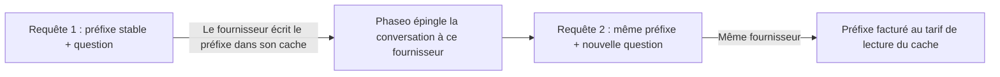

Gardez le début de votre prompt identique d’une requête à l’autre : le fournisseur le lit alors depuis son cache au lieu de le traiter à nouveau. Ces tokens sont facturés au tarif de lecture du cache et le premier token arrive plus tôt. La plupart des fournisseurs mettent eux-mêmes en cache les préfixes répétés. Claude ne met en cache que ce que vous marquez avec `cache_control`.



La mise en cache des prompts exécute toujours l’inférence à chaque requête. Elle ne renvoie pas une réponse antérieure à une requête identique.

## Mettre un prompt en cache

Marquez le dernier bloc de la partie stable. Tout ce qui précède ce bloc, bloc inclus, est mis en cache.

<CodeGroup>
```bash Chat Completions
curl https://api.phaseo.app/v1/chat/completions \
  -H "Authorization: Bearer $PHASEO_API_KEY" \
  -H "Content-Type: application/json" \
  -d '{
    "model": "anthropic/claude-sonnet-5.5",
    "messages": [
      {
        "role": "system",
        "content": [
          {
            "type": "text",
            "text": "You are a support assistant. Follow the company policy exactly.",
            "cache_control": { "type": "ephemeral", "ttl": "1h" }
          }
        ]
      },
      { "role": "user", "content": "Summarise the latest ticket." }
    ]
  }'
```

```bash Responses
curl https://api.phaseo.app/v1/responses \
  -H "Authorization: Bearer $PHASEO_API_KEY" \
  -H "Content-Type: application/json" \
  -d '{
    "model": "anthropic/claude-sonnet-5.5",
    "input": [
      {
        "role": "user",
        "content": [
          {
            "type": "input_text",
            "text": "Reference document: Refunds are available for 30 days when...",
            "cache_control": { "type": "ephemeral", "ttl": "5m" }
          },
          {
            "type": "input_text",
            "text": "Answer this customer: Can I return an item after 20 days?"
          }
        ]
      }
    ]
  }'
```

```bash Anthropic Messages
curl https://api.phaseo.app/v1/messages \
  -H "Authorization: Bearer $PHASEO_API_KEY" \
  -H "Content-Type: application/json" \
  -d '{
    "model": "anthropic/claude-sonnet-5.5",
    "max_tokens": 512,
    "system": [
      {
        "type": "text",
        "text": "You are a careful support assistant. Use the policy below.",
        "cache_control": { "type": "ephemeral", "ttl": "1h" }
      }
    ],
    "messages": [
      {
        "role": "user",
        "content": [
          {
            "type": "text",
            "text": "Policy: refunds are available for 30 days when...",
            "cache_control": { "type": "ephemeral", "ttl": "5m" }
          },
          { "type": "text", "text": "Can this customer return an item after 20 days?" }
        ]
      }
    ],
    "tools": [
      {
        "name": "lookup_order",
        "description": "Look up order status.",
        "input_schema": {
          "type": "object",
          "properties": { "order_id": { "type": "string" } },
          "required": ["order_id"]
        },
        "cache_control": { "type": "ephemeral", "ttl": "5m" }
      }
    ]
  }'
```
</CodeGroup>

Vérifiez ensuite que cela a fonctionné :

1. Envoyez la requête une fois pour écrire le cache.
2. Envoyez-la de nouveau avec le même contenu pouvant être mis en cache.
3. Vérifiez `cached_tokens` et `cache_write_tokens` dans l’utilisation de la réponse (consultez [Champs d’utilisation et de tarification](#usage-and-pricing-fields)), ainsi que les compteurs de cache dans les détails de la requête.
4. Comparez la latence et le coût sur plusieurs appels, pas seulement le premier.

Mettez en cache le contenu qui reste identique d’une requête à l’autre : longues instructions système, documents réutilisés, exemples few-shot, définitions d’outils et volumineux résultats d’outils que le tour suivant renvoie. Ne marquez pas le contenu qui change à chaque requête, les entrées courtes et ponctuelles, ni les données que votre politique n’autorise pas le fournisseur à stocker.

<Note>
Phaseo n’envoie à chaque fournisseur que les contrôles de cache qu’il documente et retire les autres. Les contrôles de cache n’excluent jamais un fournisseur du routage. Chaque page de modèle indique ses prix de lecture et d’écriture du cache.
</Note>

<span id="which-providers-cache-automatically"></span>
## Quels fournisseurs mettent en cache automatiquement

| Fournisseur | Mise en cache | Ce que Phaseo envoie |
| --- | --- | --- |
| [OpenAI](https://developers.openai.com/api/docs/guides/prompt-caching), [Azure OpenAI](https://learn.microsoft.com/en-us/azure/foundry/openai/how-to/prompt-caching) | Automatique pour les prompts de 1 024 tokens ou plus | `prompt_cache_key` ; points d’arrêt et `prompt_cache_options` sur GPT-5.6 et versions ultérieures ; `prompt_cache_retention` sur les modèles antérieurs |
| [Anthropic Claude](https://platform.claude.com/docs/en/build-with-claude/prompt-caching) sur Anthropic, Claude sur AWS, Amazon Bedrock et Google Vertex AI | Sur activation | Points d’arrêt `cache_control`, quatre au maximum par requête |
| [Google Gemini](https://ai.google.dev/gemini-api/docs/caching) sur Google AI Studio et [Vertex AI](https://docs.cloud.google.com/vertex-ai/generative-ai/docs/context-cache/context-cache-overview) | Automatique sur Gemini 2.5 et versions ultérieures | `cached_content` pour un cache explicite que vous avez créé |
| [xAI](https://docs.x.ai/developers/advanced-api-usage/prompt-caching/maximizing-cache-hits) | Automatique | `prompt_cache_key` et l’en-tête `x-grok-conv-id` |
| [DeepSeek](https://api-docs.deepseek.com/guides/kv_cache) | Automatique | Rien de plus |
| [Moonshot AI](https://platform.kimi.ai/docs/guide/context-caching) | Automatique, avec un TTL de 5 minutes ; un TTL d’une heure est disponible sur activation sur Kimi K3 | `prompt_cache_key` et `prompt_cache_options` |
| [Groq](https://console.groq.com/docs/prompt-caching) | Automatique sur les modèles listés par Groq | Rien de plus |
| [Fireworks](https://docs.fireworks.ai/guides/prompt-caching) | Automatique | `prompt_cache_key`, ainsi que l’en-tête `x-session-affinity` et `user` |
| [Cerebras](https://inference-docs.cerebras.ai/capabilities/prompt-caching) | Automatique | `prompt_cache_key` |
| [Cloudflare Workers AI](https://developers.cloudflare.com/workers-ai/features/prompt-caching) | Automatique sur certains modèles | L’en-tête `x-session-affinity` |
| [Together AI](https://docs.together.ai/docs/inference/chat/prompt-caching), [Mistral](https://docs.mistral.ai/studio-api/conversations/advanced/prompt-caching) | Automatique ; `prompt_cache_key` améliore le taux de succès | `prompt_cache_key` |
| [Alibaba Model Studio](https://www.alibabacloud.com/help/en/model-studio/context-cache) | Automatique (implicite) ; les caches explicites sont sur activation | `cache_control` sur les blocs |
| [Venice](https://docs.venice.ai/overview/guides/prompt-caching) | Automatique ; Venice ajoute lui-même les points d’arrêt Claude | `cache_control` sur les blocs |
| [DeepInfra](https://docs.deepinfra.com/chat/prompt-cache-retention) | Automatique ; une fenêtre de conservation est disponible sur activation | `prompt_cache_key`, `prompt_cache_breakpoint` et `prompt_cache_options` |
| [Inference.net](https://inference.net/models/claude-opus-5/) | Automatique ; mise en cache explicite sur les modèles Claude et Gemini 2.5 | `cache_control` sur les blocs pour les modèles Claude et Gemini 2.5, sans `ttl` |
| [Baseten](https://docs.baseten.co/inference/model-apis/pricing-and-limits) | Automatique | `prompt_cache_key` et l’en-tête `x-session-affinity` |
| [Morph](https://docs.morphllm.com/sdk/components/caching) | Automatique | `prompt_cache_key` et l’en-tête `x-session-id` |

Les autres fournisseurs compatibles OpenAI reçoivent `prompt_cache_key` lorsque leur API l’accepte, et aucun autre contrôle de cache. Phaseo envoie toujours un hachage de votre espace de travail et de la clé plutôt que la clé elle-même ; consultez [Affinité de fournisseur](#provider-affinity).

<span id="cache-controls"></span>
## Contrôles de cache

### Laisser Phaseo placer les points d’arrêt Claude

Un `cache_control` de premier niveau sur Chat Completions, Responses ou Anthropic Messages active la mise en cache pour les routes Claude, et Phaseo place les points d’arrêt pour vous. Les autres fournisseurs l’ignorent.

```json
{
  "cache_control": { "type": "ephemeral", "ttl": "5m" }
}
```

Utilisez `ttl: "5m"` (la valeur par défaut) pour un contexte partagé de courte durée, et `ttl: "1h"` lorsque le modèle prend en charge des entrées de cache plus durables. Un `cache_control` de premier niveau maintient aussi la conversation chez un seul fournisseur ; consultez [Affinité de fournisseur](#provider-affinity).

`provider_options.anthropic.cache_control` est le même réglage, et il accepte aussi un `scope`. Lorsqu’une requête envoie les deux, la valeur de `provider_options` l’emporte :

```json
{
  "provider_options": {
    "anthropic": {
      "cache_control": { "type": "ephemeral", "ttl": "5m", "scope": "agent" }
    }
  }
}
```

| `scope` | Où Phaseo place les points d’arrêt |
| --- | --- |
| `all_text` (par défaut) | Le texte système et les trois messages utilisateur les plus récents qui contiennent du texte ou des images. |
| `last_user_message` | Uniquement le dernier message utilisateur. |
| `agent` | Pour les boucles d’outils : la dernière définition d’outil, le texte système, le message final (y compris les résultats d’outils) et le message de l’étape précédente. `conversation` est un alias. |
| `none` | Nulle part. |

Utilisez `agent` pour les boucles d’outils en plusieurs étapes. `all_text` et `last_user_message` ne marquent pas les messages qui ne contiennent que des résultats d’outils : le préfixe en cache cesse donc de grandir. Les valeurs de `scope` non reconnues sont traitées comme `agent`.

Les points d’arrêt que vous placez vous-même sur les blocs l’emportent sur la politique par défaut et comptent dans la limite de quatre par requête d’Anthropic : la politique par défaut cesse d’ajouter des marques à quatre. Si vos propres blocs portent plus de quatre marques, Phaseo conserve la première et les trois plus récentes et retire les autres, afin que la requête ne soit pas refusée.

### Points d’arrêt de cache sur les blocs

Une marque de cache sur un bloc de contenu met en cache tout ce qui précède ce bloc, bloc inclus. Phaseo accepte deux écritures :

- `cache_control` : `{"type": "ephemeral"}`, avec un `ttl` facultatif de `5m` ou `1h`.
- `prompt_cache_breakpoint` : le `{"mode": "explicit"}` d’OpenAI, avec un `ttl` facultatif de `30m` ou `12h` (consultez [Cache de 12 heures sur OpenAI](#12-hour-cache-on-openai)). Lorsqu’un bloc porte les deux, `prompt_cache_breakpoint` l’emporte.

Sur Chat Completions et Responses, les marques sont acceptées sur les parties texte et image, sur les définitions d’outils de fonction, et sur les résultats d’outils dont le contenu est un tableau de parties texte. Anthropic Messages accepte `cache_control` partout où Anthropic l’accepte : blocs de texte `system`, blocs de texte et d’image des messages, blocs de résultats d’outils et définitions d’outils. Lorsqu’une requête comporte plusieurs TTL, Anthropic exige que les points d’arrêt `1h` précèdent les points d’arrêt `5m`.

Chaque fournisseur reçoit la marque sous sa propre forme :

| Fournisseur | `cache_control` sur un bloc | `prompt_cache_breakpoint` |
| --- | --- | --- |
| Claude sur Anthropic, Claude sur AWS, Amazon Bedrock et Google Vertex AI | Envoyé sous la forme `{"type": "ephemeral"}` avec votre `ttl` | Envoyé sous la forme `cache_control: {"type": "ephemeral"}` |
| OpenAI, GPT-5.6 et versions ultérieures | Envoyé sous la forme `prompt_cache_breakpoint: {"mode": "explicit"}` ; le `ttl` est supprimé | Envoyé, avec son `ttl` |
| Azure OpenAI, GPT-5.6 et versions ultérieures | Envoyé sous la forme `prompt_cache_breakpoint: {"mode": "explicit"}` ; le `ttl` est supprimé | Envoyé sans `ttl` |
| OpenAI et Azure OpenAI, modèles antérieurs | Retiré | Retiré |
| DeepInfra | Retiré | Envoyé sans `ttl` |
| Alibaba Model Studio et Venice | Envoyé | Retiré |
| Inference.net, modèles Claude et Gemini 2.5 | Envoyé sans `ttl` | Retiré |
| Autres fournisseurs | Retiré | Retiré |

Les marques sur les définitions d’outils n’atteignent que les routes Claude, Alibaba Model Studio, Venice et les modèles Claude et Gemini 2.5 d’Inference.net ; OpenAI n’accepte pas de points d’arrêt sur les outils. Retirer une marque laisse le reste du prompt inchangé : le préfixe en cache correspond donc à une requête sans marque.

Amazon Bedrock et Google Vertex AI ne mettent en cache Claude 3.7 Sonnet, 3.5 Sonnet et 3 Opus que pendant 5 minutes, et Bedrock peut refuser un `ttl` sur ces modèles. Sur ces routes, Phaseo envoie vos points d’arrêt sans `ttl`, de sorte qu’ils sont mis en cache pendant 5 minutes, et signale un `1h` retiré comme `cache_control.ttl` dans l’en-tête `X-Phaseo-Dropped-Params` et dans `meta.routing.dropped_params`. Inference.net documente des points d’arrêt sans `ttl` : Phaseo y retire et signale donc un `ttl` de la même façon, et les écritures sont facturées comme des écritures de 5 minutes.

<span id="openai-retention-and-options"></span>
### Conservation et options OpenAI

Les contrôles de cache d’OpenAI dépendent de la génération du modèle. Phaseo n’envoie chacun d’eux que là où il est accepté :

| Champ | Valeurs | Envoyé à |
| --- | --- | --- |
| `prompt_cache_options` | `mode` : `implicit` ou `explicit` ; `ttl` : `30m` (par défaut) ou `12h` | OpenAI GPT-5.6 et versions ultérieures |
| `prompt_cache_options` | `mode` : `implicit` ou `explicit` ; `ttl` : `30m` | Azure OpenAI GPT-5.6 et versions ultérieures |
| `prompt_cache_options` | `mode` : `explicit` ; `ttl` : `5m` ou `1h` | DeepInfra |
| `prompt_cache_options` | `mode` : `implicit` ; `ttl` : `5m` (par défaut), ou `1h` sur Kimi K3 | Moonshot AI |
| `prompt_cache_retention` | `in_memory` ou `24h` | Modèles OpenAI et Azure OpenAI antérieurs à GPT-5.6 |

Le mode `explicit` ne met en cache que les points d’arrêt que vous placez. DeepInfra exige aussi `prompt_cache_key` sur chaque requête de la session. Phaseo n’envoie un `1h` Moonshot AI qu’aux routes Kimi K3 qui ont un prix d’écriture d’une heure, de sorte que ces écritures sont facturées à ce prix ; ailleurs, il retire le `ttl` et le signale comme `prompt_cache_options.ttl` dans l’en-tête `X-Phaseo-Dropped-Params`. Les autres fournisseurs ne reçoivent aucun de ces champs.

Envoyez l’un ou l’autre champ au premier niveau ou sous `provider_options.openai`. Lorsque les deux sont présents, la valeur de premier niveau l’emporte :

```json
{
  "prompt_cache_retention": "24h",
  "provider_options": {
    "openai": { "prompt_cache_retention": "in_memory" }
  }
}
```

Ici, la requête utilise `24h`.

<span id="12-hour-cache-on-openai"></span>
### Cache de 12 heures sur OpenAI

Sur GPT-5.6 et versions ultérieures, OpenAI conserve une entrée de cache pendant au moins 12 heures lorsque vous définissez `ttl: "12h"`, soit pour toute la requête dans `prompt_cache_options`, soit pour un point d’arrêt dans `prompt_cache_breakpoint`. Un point d’arrêt sans `ttl` propre utilise celui de la requête. OpenAI facture une écriture de 12 heures à 2,5× le tarif d’entrée et une écriture de 30 minutes à 1,25× ; les lectures du cache coûtent le même prix dans les deux cas.

```json
{
  "model": "openai/gpt-5.6-sol",
  "prompt_cache_options": { "ttl": "30m" },
  "input": [
    {
      "role": "developer",
      "content": [
        {
          "type": "input_text",
          "text": "Shared tool manual...",
          "prompt_cache_breakpoint": { "mode": "explicit", "ttl": "12h" }
        }
      ]
    },
    { "role": "user", "content": "Find the failing test." }
  ]
}
```

- OpenAI ne documente la durée de 12 heures que sur son API Responses. Une requête Chat Completions qui la demande s’exécute sur l’API Responses d’OpenAI, et la réponse conserve le format Chat Completions.
- Les routes qui acceptent un cache de 12 heures sont essayées en premier : l’API d’OpenAI elle-même (`openai` et `openai-eu`), sur un modèle GPT-5.6 ou ultérieur dont la fiche tarifaire comporte un prix d’écriture de 12 heures. Toute autre route, comme Azure OpenAI, un autre fournisseur ou un modèle antérieur à GPT-5.6, reçoit la requête sans ce réglage : la valeur par défaut de 30 minutes s’applique alors. La requête s’exécute quand même, et le champ retiré est signalé comme `prompt_cache_options.ttl` ou `prompt_cache_breakpoint.ttl` dans l’en-tête `X-Phaseo-Dropped-Params` et dans `meta.routing.dropped_params`.

### Utiliser un cache Gemini explicite

Gemini 2.5 et versions ultérieures mettent en cache implicitement, sans rien à envoyer. Pour utiliser un cache explicite que vous avez créé avec l’API de mise en cache de Google, passez son nom dans `provider_options.google.cached_content` :

```json
{
  "provider_options": {
    "google": { "cached_content": "cachedContents/abc123" }
  }
}
```

- Sur Google AI Studio, `cached_content` ne fonctionne qu’avec votre propre clé API Google (BYOK). Avec la clé de Phaseo, la requête renvoie `400`, car le cache appartient au compte qui l’a créé.
- Sur Vertex AI, `cached_content` ne fonctionne qu’avec votre propre identifiant Vertex AI ; avec celui de Phaseo, la requête renvoie `400`. Envoyez le nom complet du cache, `projects/{project}/locations/{location}/cachedContents/{id}`, et Phaseo envoie la requête vers ce projet et cet emplacement. Un nom court tel que `cachedContents/abc123` utilise le `project_id` et la `region` de votre JSON de compte de service, et renvoie `400` si l’un des deux manque.
- Google ne prend pas en charge les caches explicites sur Gemini 4 Argon et versions ultérieures.

`provider_options.google.cache_control` et `provider_options.google.cache_ttl` sont acceptés mais ne sont pas envoyés à Google.

### Responses : envoyer toute la conversation

Phaseo ne stocke pas les réponses. Les requêtes qui définissent `previous_response_id` ou `conversation` renvoient `400` `unsupported_param` : envoyez donc toute la conversation dans `input` à chaque étape. Son ouverture stable est le préfixe mis en cache. Dans les boucles d’outils, renvoyez aussi les éléments de sortie `reasoning` ; consultez [Raisonnement dans les boucles d’outils](../api-reference/endpoint/responses.mdx#reasoning-in-tool-loops).

<span id="change-reasoning-effort-mid-conversation"></span>
### Changer l’effort de raisonnement en cours de conversation

Changez `reasoning_effort` (Chat Completions) ou `reasoning.effort` (Responses) entre deux requêtes : Phaseo conserve le cache de prompts de Claude, car il envoie le changement sous forme de marqueur d’effort à l’intérieur de `messages` au lieu d’un nouvel effort de premier niveau. Cela fonctionne tant que vous renvoyez le raisonnement de Claude inchangé. Sur Anthropic Messages, vous envoyez vous-même le marqueur. Consultez [Changer l’effort de raisonnement en cours de conversation](./reasoning-effort.mdx).

<span id="usage-and-pricing-fields"></span>
## Champs d’utilisation et de tarification

Chaque endpoint texte indique les lectures et écritures du cache. Chat Completions et Responses suivent la sémantique d’OpenAI : le décompte d’entrée inclut les lectures et écritures du cache. Anthropic Messages suit celle d’Anthropic : `input_tokens` les exclut.

| Endpoint | Entrée totale | Lectures du cache | Écritures du cache |
| --- | --- | --- | --- |
| Chat Completions | `prompt_tokens`, lectures et écritures incluses | `prompt_tokens_details.cached_tokens` | `prompt_tokens_details.cache_write_tokens` |
| Responses | `input_tokens`, lectures et écritures incluses | `input_tokens_details.cached_tokens` | `input_tokens_details.cache_write_tokens`, réparti par durée sur OpenAI GPT-5.6 et versions ultérieures dans `input_tokens_details.cache_write_tokens_details.ttl_30m_tokens` et `ttl_12h_tokens` |
| Anthropic Messages | `input_tokens` + `cache_read_input_tokens` + `cache_creation_input_tokens` | `cache_read_input_tokens` | `cache_creation_input_tokens`, réparti par TTL dans `cache_creation.ephemeral_5m_input_tokens` et `cache_creation.ephemeral_1h_input_tokens` |

Sur Chat Completions et Responses, l’entrée non mise en cache correspond à l’entrée totale moins les lectures et moins les écritures du cache. Les réponses Anthropic Messages en streaming portent les champs de cache sur `message_delta`. L’utilisation Chat Completions n’est pas répartie par durée, car OpenAI n’en documente aucune à cet endroit ; les détails de la requête l’enregistrent tout de même.

<Note>
Les réponses antérieures indiquaient les écritures du cache dans `output_tokens_details.cached_tokens` (`completion_tokens_details.cached_tokens` sur Chat Completions), et les routes Claude excluaient les lectures et écritures du cache de `input_tokens` sur Chat Completions et Responses. Ce n’est plus le cas : lisez les écritures dans `cache_write_tokens`. Les réponses Anthropic Messages hors streaming renvoyaient auparavant `cache_creation_input_tokens: null` ; elles renvoient désormais les décomptes réels.
</Note>

Les détails de la requête et les ventilations tarifaires utilisent ces compteurs :

| Compteur | Compte |
| --- | --- |
| `cached_read_text_tokens` | Les lectures du cache. |
| `cached_write_text_tokens` | Les écritures du cache, lorsque le fournisseur a un seul prix d’écriture du cache. |
| `cached_write_text_tokens_5m`, `cached_write_text_tokens_1h` | Les écritures du cache Claude avec un TTL de 5 minutes ou d’une heure, lorsque le fournisseur les indique séparément. |
| `cached_write_text_tokens_30m`, `cached_write_text_tokens_12h` | Les écritures du cache OpenAI d’une durée de 30 minutes ou de 12 heures. |

### Tarification des tokens en cache

Phaseo facture chaque token d’entrée une seule fois, à un seul tarif : l’entrée non mise en cache au tarif d’entrée, les lectures du cache au tarif de lecture du cache, et les écritures du cache au tarif d’écriture du cache, ou aux tarifs de 5 minutes et d’une heure (Claude) ou de 30 minutes et de 12 heures (OpenAI) lorsque le fournisseur les tarifie séparément. Certains fournisseurs comptent les écritures du cache dans le total d’entrée, d’autres les indiquent en plus ; dans tous les cas, un token écrit n’est jamais facturé en plus comme entrée ordinaire.

Par exemple, à des tarifs indicatifs de $5.00 par million de tokens d’entrée, $0.50 pour les lectures du cache, $6.25 pour les écritures du cache de 30 minutes et $30.00 pour la sortie, une requête de 53 100 tokens d’entrée, dont 48 000 lectures du cache et 3 000 écritures du cache, plus 850 tokens de sortie, coûte :

| Tokens | Tarif par million | Coût |
| --- | ---: | ---: |
| 2 100 en entrée non mise en cache | $5.00 | $0.01050 |
| 48 000 lectures du cache | $0.50 | $0.02400 |
| 3 000 écritures du cache | $6.25 | $0.01875 |
| 850 en sortie | $30.00 | $0.02550 |
| Total | | $0.07875 |

Si 2 000 de ces écritures avaient une durée de 12 heures, elles coûteraient $12.50 par million au lieu de $6.25, et la requête coûterait $0.09125.

Certains fournisseurs n’appliquent pas de remise aux tokens en cache sur certains modèles. Leurs pages de modèle affichent alors le même prix pour l’entrée et les lectures du cache.

### Quand une route n’a pas encore de prix de cache

Si un fournisseur indique des tokens en cache sur une route qui n’a pas encore de prix de cache dans le catalogue, la requête n’échoue pas :

- Les lectures du cache sont facturées au tarif d’entrée de la route.
- Les écritures du cache sont facturées au tarif d’entrée multiplié par le multiplicateur d’écriture documenté par le fournisseur.
- La ligne de tarification est marquée `pricing_fallback: "input_rate"`.

| Écritures | Multiplicateur du tarif d’entrée |
| --- | --- |
| Claude, toute plateforme | 1,25× pour les écritures de 5 minutes, 2× pour les écritures d’une heure |
| Écritures OpenAI de 30 minutes, toute route | 1,25× |
| Écritures OpenAI de 12 heures, toute route | 2,5× |
| OpenAI, Azure OpenAI et Alibaba, autres écritures | 1,25× |
| Moonshot AI et Kimi K3 | 1× pour les écritures de 5 minutes, 2× pour les écritures d’une heure |
| Autres fournisseurs | 1× |

Sur une route Claude dont le catalogue a un seul prix d’écriture du cache, ce prix est le tarif de 5 minutes. Les écritures que le fournisseur indique comme écritures d’une heure sont facturées à 2× le tarif d’entrée, sur une ligne `cached_write_text_tokens_1h` marquée `pricing_fallback: "input_rate"`.

Le `message_delta` final d’une réponse Claude en streaming indique le total des écritures du cache sans répartition par TTL. Les écritures au-delà de la répartition sont facturées comme des écritures de 5 minutes, car les écritures des outils serveur peuvent utiliser 5 minutes même lorsque la requête demande une heure.

<span id="provider-affinity"></span>
## Affinité de fournisseur

Un cache de prompt réside chez un seul fournisseur, et souvent dans une seule région ou un seul déploiement de ce fournisseur. Phaseo maintient les requêtes liées chez le fournisseur et sur la route qui les ont servies, afin qu’une boucle d’agent ne paie pas pour reconstruire son cache ailleurs.

Envoyez `prompt_cache_key` ou `session_id`, ou activez la mise en cache avec `cache_control` (au premier niveau, `provider_options.anthropic.cache_control`, ou une marque `cache_control` ou `prompt_cache_breakpoint` sur un bloc de message ou un outil), pour épingler une conversation. Phaseo l’épingle au fournisseur et à la route qui ont servi la première requête réussie, et les requêtes suivantes avec la même clé y vont aussi. Les épinglages sont conservés par espace de travail, endpoint et modèle.

La durée d’un épinglage dépend de la conservation du cache du fournisseur :

| Requête | Durée de l’épinglage |
| --- | --- |
| `session_id` | 24 heures, renouvelées tant que la session est active |
| `cache_control` Anthropic avec `ttl: "1h"` | 90 minutes |
| OpenAI ou Azure OpenAI avec `prompt_cache_retention: "24h"` | 24 heures |
| OpenAI ou Azure OpenAI avec conservation en mémoire (par défaut) | 90 minutes |
| OpenAI avec `ttl: "12h"` dans `prompt_cache_options` ou sur un point d’arrêt, ou une écriture de 12 heures signalée | 18 heures |
| OpenAI ou Azure OpenAI avec `prompt_cache_options.ttl: "30m"` | 45 minutes |
| Tout autre cas | 15 minutes |

Un épinglage ne change que lorsque son fournisseur échoue (disjoncteur ouvert ou taux d’erreur récent élevé), lorsque le quota géré par Phaseo chez ce fournisseur est épuisé, ou lorsque la route active, le préréglage, le garde-fou ou la politique de la requête ne l’autorise plus. La requête bascule alors, et l’épinglage passe au fournisseur qui l’a servie. Les détails de la requête l’enregistrent comme `sticky_routing.demotionReason` dans les diagnostics de routage. Les requêtes épinglées ne servent pas à sonder les fournisseurs en cours de rétablissement.

Sans clé, `session_id` ni marque de cache, Phaseo épingle tout de même le contexte d’ouverture pendant 15 minutes à un fournisseur qui a signalé une lecture ou une écriture de cache pour celui-ci, tant que l’entrée en cache de ce fournisseur coûte moins cher que son entrée standard.

Phaseo envoie aux fournisseurs un hachage de votre espace de travail et de `prompt_cache_key`, jamais la clé brute : la même clé dans deux espaces de travail ne partage donc jamais un cache de fournisseur. Avec seulement un `session_id`, Phaseo dérive ce hachage de la session pour OpenAI, xAI, Fireworks et Cerebras. Fireworks, Cloudflare Workers AI et Baseten le reçoivent aussi dans l’en-tête `x-session-affinity`, Morph dans l’en-tête `x-session-id`, et xAI sous la forme `x-grok-conv-id`, sauf si vous définissez `provider_options.xai.conversation_id`. Les réponses renvoient toujours votre propre `prompt_cache_key`.

Définissez `provider.cache_aware_routing` sur `false` pour désactiver ce comportement pour une requête. Définissez `routing.session_affinity` sur `false` lorsque la requête porte un `session_id` mais ne doit utiliser que le routage normal fondé sur le contexte ; Phaseo cesse alors aussi de dériver une clé de cache de fournisseur à partir de la session. Pour l’articulation de l’affinité avec l’ordre des fournisseurs et les solutions de repli, consultez [Routage et solutions de repli](./routing-and-fallbacks.mdx). Chaque champ de cache figure aussi dans la [référence des paramètres](../api-reference/parameters.mdx).
