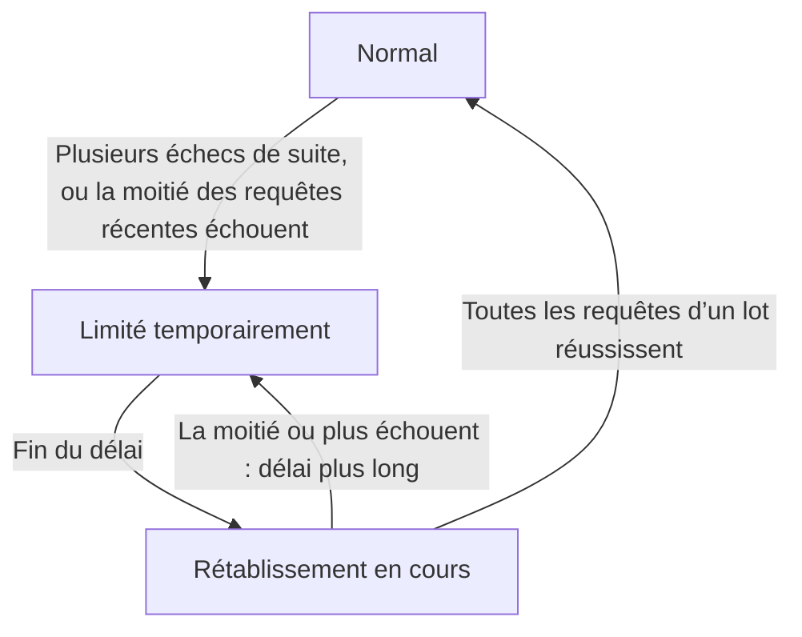

import { ProviderStatusExplorer } from "/snippets/provider-status.jsx";

Sur la page d’un modèle, jusqu’à deux icônes suivent le nom de chaque fournisseur : une **icône d’état**, définie par Phaseo, et une **icône de routage en direct**, qui n’apparaît que lorsque le Gateway détourne le trafic d’un fournisseur en échec.

<ProviderStatusExplorer locale="fr" />

## Icône d’état

Phaseo définit cet état manuellement, et il reste en place jusqu’à ce que Phaseo le modifie. Les pages de modèles affichent les trois niveaux de rétrogradation sous le libellé `Priorité réduite`.

| Icône | État | Routage |
| --- | --- | --- |
| <Icon icon="circle-check" color="#16a34a" /> | `Active` | Routé normalement. |
| <Icon icon="triangle-alert" color="#f59e0b" /> | `Deranked L1` | Routable, juste derrière les autres fournisseurs. |
| <Icon icon="triangle-alert" color="#d97706" /> | `Deranked L2` | Routable, derrière les fournisseurs plus sains. |
| <Icon icon="triangle-alert" color="#ef4444" /> | `Deranked L3` | Routable, loin derrière les autres fournisseurs. |
| <Icon icon="ban" color="#dc2626" /> | `Disabled` | Pas de routage. |

## Routage en direct

Le Gateway le définit automatiquement pour chaque fournisseur, modèle et endpoint, à partir des requêtes qu’il traite en ce moment. Une route limitée ou en rétablissement reste routable, mais les autres fournisseurs sont essayés en premier.

## Disponibilité et intégration

La carte d’état indique aussi si le fournisseur propose le modèle et si Phaseo l’a activé. Une route n’est publique que si les deux le permettent. Par exemple, un fournisseur peut proposer un nouveau modèle (`Available`) pendant que Phaseo développe encore sa prise en charge (`Implementing`).

### Disponibilité chez le fournisseur

| État | Signification |
| --- | --- |
| `Available` | Le fournisseur accepte actuellement les requêtes pour cette offre. |
| `Preview` | Le fournisseur propose l’offre en aperçu. |
| `Limited Access` | L’offre existe, mais son accès dépend du compte, de la région, d’une liste d’autorisation ou de la capacité. |
| `Coming Soon` | Le fournisseur a annoncé ou répertorié l’offre, mais elle n’est pas encore utilisable. |
| `Deprecated` | L’offre reste disponible, mais le fournisseur recommande une migration. |
| `Removed` | Le fournisseur ne propose plus l’offre. |
| `Unknown` | Phaseo n’a pas encore vérifié la disponibilité chez le fournisseur d’origine. |

### Intégration Phaseo

| État | Signification | Routage Phaseo |
| --- | --- | --- |
| `Unsupported` | Phaseo ne dispose pas d’intégration compatible pour cette offre. | Non routable. |
| `Planned` | Le travail d’intégration a été accepté, mais n’a pas commencé. | Non routable. |
| `Implementing` | L’intégration est en cours de développement. | Non routable. |
| `Testing` | L’intégration est en place et fait l’objet de tests de contrat, de préproduction ou canary. | Non routable publiquement. |
| `Enabled` | L’intégration est prise en charge et activée en production. | Routable si les contrôles de routage et l’état de santé le permettent. |
| `Disabled` | Phaseo a volontairement désactivé l’intégration. | Non routable. |
| `Blocked` | Une dépendance externe ou non résolue empêche le déploiement. | Non routable. |

Seules les routes `Enabled` peuvent être publiques. Les routes `Internal` ne servent que le trafic de test de Phaseo.

## Compatibilité

`availability_status`, `routing_status`, `is_active_gateway` et `routable` restent dans l’API pour les intégrations existantes. Les nouvelles intégrations doivent lire les champs distincts du fournisseur et de Phaseo.

## Pages associées

- [Routage et solutions de repli](./routing-and-fallbacks.mdx)
- [Niveaux de service](./service-tiers.mdx)
- [Référence de l’API des modèles](../api-reference/endpoint/models.mdx)
