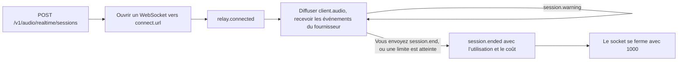

Créez une session depuis votre serveur, connectez votre client au relais Phaseo via un WebSocket et diffusez l’audio du microphone vers le modèle temps réel d’un fournisseur. Le relais transmet sans modification les événements propres au fournisseur, mesure l’appel pendant son déroulement et ajoute trois événements qui lui sont propres : `session.warning` pendant l’appel, `session.end` pour raccrocher et `session.ended` avec la facture finale.

<Note>
La voix en temps réel est en bêta et son accès est contrôlé par espace de travail.
</Note>



## Démarrer une session

Créez la session depuis votre serveur :

```bash
curl https://api.phaseo.app/v1/audio/realtime/sessions \
  -H "Authorization: Bearer $PHASEO_API_KEY" \
  -H "Content-Type: application/json" \
  -d '{"model": "openai/gpt-realtime-2", "voice": "marin"}'
```

La réponse comprend `client_secret`, `connect.url`, `max_duration_seconds` et `idle_timeout_seconds` (toujours `null` pour les sessions API).

Ouvrez un WebSocket vers `connect.url` sur `api.phaseo.app` et proposez deux sous-protocoles : `statsync-realtime` et `rtsec.<client_secret>`. Le relais sélectionne `statsync-realtime`. Si vous ne proposez que `rtsec.<client_secret>`, les navigateurs et la plupart des bibliothèques WebSocket font échouer la négociation, car aucun protocole n’est sélectionné.

Le relais envoie `relay.connected` dès que le fournisseur est prêt. Envoyez ensuite l’audio du microphone sous la forme `{"type": "client.audio", "audio": "<base64 PCM16>"}` à la fréquence d’échantillonnage du fournisseur :

| Fournisseur | Audio d’entrée |
| --- | --- |
| OpenAI, xAI, ElevenLabs, GPT Live | PCM16 à 24 kHz |
| Google, Mistral | PCM16 à 16 kHz |

Phaseo bloque $5 de crédit au démarrage de la session et prolonge ce blocage au fil de l’appel.

Les [SDK TypeScript et Python](/fr/v1/sdk-reference/client/audio-realtime) font tout cela pour vous : `client.realtime.connect()` crée la session et ouvre le socket, et `session.end()` renvoie `session.ended`. Les autres SDK disposent du même petit client ; le README de chaque paquet contient un exemple.

| SDK | Connexion | Bibliothèque WebSocket |
| --- | --- | --- |
| Go | `realtime.Connect(ctx, client, realtime.Options{...})` | `github.com/coder/websocket`, dans le paquet distinct `realtime` |
| Java | `client.realtime.connect(Map.of("model", ...))` | `java.net.http.WebSocket` du JDK |
| C# | `await client.Realtime.ConnectAsync(new RealtimeConnectOptions { ... })` | `System.Net.WebSockets.ClientWebSocket` |
| PHP | `$client->realtime()->connect(["model" => ...])` | `phrity/websocket` (facultatif, `composer require phrity/websocket`) |
| Ruby | `client.realtime.connect(model: ...)` | gem `websocket` (facultative) |
| Rust | `client.realtime().connect(RealtimeOptions::new(...))` | `tungstenite`, derrière la feature `realtime` |

Le SDK C++ n’a pas de client temps réel.

### Connexions Google Live

Continuez à diffuser l’audio du microphone pendant tout l’appel, silences compris. Google ferme une connexion qui ne reçoit aucun audio pendant environ 150 secondes (code de fermeture `1008`), et l’appel se termine alors avec `provider_closed`. Le relais envoie un avertissement `provider_closing` avec `threshold: "input_idle"` après 2 minutes sans audio. Le silence entre les tours ne fait partie d’aucun tour et n’est donc pas facturé.

Google remplace aussi chaque connexion après environ 10 minutes. Le relais transfère l’appel vers une nouvelle connexion grâce à la reprise de session de Google, garde votre socket ouvert et envoie `{"type": "relay.provider_reconnected", "reconnects": 1}` une fois le basculement terminé. L’audio envoyé pendant le basculement (généralement moins d’une seconde) est retenu puis transmis. La connexion reprise retraite la conversation jusque-là, et Google la refacture en tokens d’entrée au tour suivant : un long appel coûte donc un peu plus par tour après chaque basculement. Tout cela est inclus dans `usage` et dans la facture. Le relais n’avertit avec `provider_closing` que s’il ne peut pas reprendre la session, et l’appel se termine alors lorsque Google ferme la connexion.

### Sessions GPT Live

GPT Live (`openai/gpt-live-1`) gère la voix et confie le raisonnement à un modèle backend Responses. Créez la session avec `POST /v1/live/sessions` :

```bash
curl https://api.phaseo.app/v1/live/sessions \
  -H "Authorization: Bearer $PHASEO_API_KEY" \
  -H "Content-Type: application/json" \
  -d '{
    "model": "openai/gpt-live-1",
    "provider": "openai",
    "voice": "marin",
    "backend_model": "openai/gpt-5.6-luna",
    "backend_settings": {
      "tools": [{ "type": "function", "name": "get_time", "description": "Returns the current UTC time.", "parameters": { "type": "object", "properties": {} } }]
    }
  }'
```

`voice` est l’une des valeurs `alloy`, `ash`, `ballad`, `beacon`, `bossa`, `cedar`, `cinder`, `coral`, `delta`, `echo`, `gleam`, `marin`, `meridian`, `quartz`, `ripple`, `sage`, `shimmer`, `stone`, `tempo`, `verse`, `vesper` ou `willow`. `backend_model` vaut `openai/gpt-5.6-luna` (par défaut) ou `openai/gpt-5.6-terra`. Connectez-vous et diffusez l’audio à 24 kHz de la même façon que pour les autres sessions.

Les outils de fonction s’exécutent sur votre client. L’appel du backend arrive sous la forme d’un `response.event` dont `event.item.type` vaut `function_call`. Son nom et ses `arguments` proviennent du modèle, et les propos de l’appelant peuvent les orienter : traitez-les donc comme une entrée non fiable.

1. N’exécutez que les outils que vous avez déclarés, recherchés par `name`, et refusez tout autre nom.
2. Analysez `arguments` en JSON et validez-le par rapport au schéma `parameters` de l’outil avant de l’utiliser.
3. Vérifiez que l’utilisateur connecté a le droit de faire ce que demande l’appel, et obtenez sa confirmation avant toute action qui modifie des données, dépense de l’argent ou contacte quelqu’un.

Exécutez ensuite l’outil, envoyez le résultat et demandez la réponse de suivi. Si un appel échoue à ces vérifications, envoyez un `output` qui en explique la raison au lieu de l’exécuter :

```json
{ "type": "response.item.create", "item": { "type": "function_call_output", "call_id": "call_63hZ...", "output": "{\"utc\":\"2026-10-22T09:42:48Z\"}" } }
{ "type": "response.create" }
```

Le relais n’accepte un `function_call_output` que pour un appel effectué par le backend, une fois par appel et jusqu’à 64 Ko, et n’accepte `response.create` qu’après au moins une sortie. Tout autre envoi reçoit `{"type": "relay.client_event_rejected", "reason": "..."}` et l’appel continue. Phaseo n’exécute jamais lui-même les outils de fonction.

Un appel GPT Live est facturé à la seconde de voix ($0.05 par minute, d’après le `usage.seconds` propre à GPT Live), plus les tokens du modèle backend pour chaque réponse, y compris les réponses qui suivent les résultats d’outils. GPT Live expire une session qui ne reçoit aucun audio pendant environ 30 secondes, ce qui termine l’appel avec `provider_idle_timeout`. Continuez à diffuser l’audio du microphone, silences compris.

### Sessions ElevenLabs Realtime

ElevenLabs Realtime existe en deux modèles : `eleven-labs/eleven-realtime-v1-mini`, le choix par défaut, plus rapide et moins cher, et `eleven-labs/eleven-realtime-v1-max`, qui raisonne avant de répondre et convient aux instructions complexes et à l’utilisation d’outils en plusieurs étapes. Les deux utilisent la même requête de création et le même relais qu’OpenAI, avec de l’audio à 24 kHz. Phaseo se connecte à ElevenLabs avec sa propre clé ; votre client ne voit jamais que le relais.

ElevenLabs facture un appel pour chaque seconde de connexion, plus les tokens de modèle de langage utilisés, et ne communique pas l’utilisation pendant l’appel. Le relais mesure le temps de connexion pendant l’appel, de sorte que les blocages de crédit et le plafond de découvert fonctionnent comme pour les autres fournisseurs. À la fin de l’appel, Phaseo lit la facture d’ElevenLabs pour la conversation et facture le plus élevé des deux montants entre celle-ci et son propre total au prix catalogue. Cela prend généralement quelques secondes. Si c’est plus long, `session.ended` arrive avec `billing_status: "pending"` et une requête `final_bill`, et la facture est réglée dès qu’ElevenLabs la communique, normalement en quelques minutes. Vos blocages restent en place jusque-là. Si ElevenLabs n’a pas communiqué la facture après 24 heures, la session passe en examen de facturation plutôt que d’être facturée sur le seul temps de connexion.

### Transcription en streaming

Les modèles Voxtral Realtime de Mistral transcrivent l’audio en direct à mesure qu’il arrive : `mistral/voxtral-mini-transcribe-realtime-3` et `mistral/voxtral-mini-transcribe-realtime`. Ils ne répondent pas à voix haute : créez donc la session sans `voice` ni `instructions` :

```bash
curl https://api.phaseo.app/v1/audio/realtime/sessions \
  -H "Authorization: Bearer $PHASEO_API_KEY" \
  -H "Content-Type: application/json" \
  -d '{"model": "mistral/voxtral-mini-transcribe-realtime-3"}'
```

Connectez-vous de la même façon et diffusez du PCM16 à 16 kHz sous forme de `client.audio`. Les événements de Mistral sont transmis sans modification : `session.created`, puis `transcription.text.delta` avec chaque nouveau fragment de texte, et `transcription.language` et `transcription.segment` lorsque Mistral les envoie. Pour modifier les réglages de transcription, envoyez `{"type": "session.update", "session": {...}}` avec l’un des champs `language`, `target_streaming_delay_ms` (de 80 à 1 200, ou 2 400), `context_bias`, `diarize` et `turn_detection`. Les autres champs, y compris le format audio, sont refusés avec `relay.client_event_rejected`. Les réglages sont figés dès le début de l’audio : envoyez donc `session.update` avant le premier `client.audio` ; les mises à jour ultérieures sont refusées de la même façon. L’ancien `mistral/voxtral-mini-transcribe-realtime` n’accepte que `target_streaming_delay_ms`.

Lorsque vous envoyez `session.end`, le relais termine le flux audio de Mistral et attend jusqu’à 10 secondes `transcription.done`, qui contient la transcription complète, avant de régler la facture et d’envoyer `session.ended`. L’audio déjà envoyé est utilisé ; rien n’est écarté.

La transcription en streaming est facturée à la minute d’audio envoyé ($0.008 par minute pour Voxtral Mini Transcribe Realtime 3), mesurée par le relais. Le décompte propre de Mistral dans `transcription.done` constitue le minimum facturé. Pour un enregistrement existant, utilisez plutôt les [transcriptions audio](/fr/v1/api-reference/endpoint/audio-transcriptions).

## Terminer une session

Envoyez `session.end` lorsque l’appelant raccroche :

```json
{ "type": "session.end", "reason": "caller hung up" }
```

| Champ | Type | Par défaut | Signification |
| --- | --- | --- | --- |
| `reason` | string | aucun | Votre propre note, jusqu’à 120 caractères imprimables, renvoyée sous la forme `client_reason`. |
| `cancel_response` | boolean | `true` | `true` annule une réponse encore en cours de lecture. `false` la laisse se terminer, pendant 20 secondes au maximum. |

Le relais ensuite :

1. cesse d’accepter l’audio ;
2. écarte l’audio du microphone que le fournisseur n’a pas encore intégré à un tour ;
3. annule la réponse en cours, ou la laisse se terminer, et attend jusqu’à 10 secondes son utilisation ;
4. pour GPT Live, envoie `session.close` au fournisseur et attend `session.closed` ;
5. règle la facture ;
6. envoie `session.ended` ;
7. ferme le socket avec le code `1000`.

Fermer le socket sans `session.end` termine aussi l’appel et le facture de la même façon, mais votre client ne reçoit pas `session.ended`.

## Lire la facture finale : `session.ended`

Le relais envoie `session.ended` à chaque fin d’appel : celle que vous avez demandée, celle déclenchée par le fournisseur et celle déclenchée par le Gateway. Il est envoyé tant que votre socket est encore ouvert, juste avant que le relais ne le ferme.

```json
{
  "type": "session.ended",
  "session_id": "rt_01k8...",
  "reason": "client_requested",
  "initiated_by": "client",
  "client_reason": "caller hung up",
  "duration_seconds": 184.2,
  "usage": { "input_audio_tokens": 1840, "output_audio_tokens": 3120, "input_text_tokens": 412 },
  "cost": {
    "total_usd": 0.231,
    "total_nanos": 231000000,
    "estimated": false,
    "estimate_basis": null,
    "debt_nanos": 0,
    "uncollected_nanos": 0,
    "currency": "USD"
  },
  "billing_status": "settled"
}
```

| Champ | Signification |
| --- | --- |
| `reason` | Un code de motif stable. Consultez les [codes de motif](#reason-codes). |
| `initiated_by` | `client`, `gateway` ou `provider`. |
| `duration_seconds` | Temps écoulé depuis la connexion du relais. |
| `usage` | L'utilisation sur laquelle l'appel est facturé : nombres de jetons par modalité, y compris les lectures et écritures en cache ; `audio_seconds`, la durée audio de l'appel, sur laquelle sont facturés xAI, ElevenLabs, Mistral et la voix de GPT Live (sur les appels facturés aux jetons, elle est affichée à titre indicatif) ; et `native_web_search_requests` pour les recherches web de GPT Live. Quand `billing_status` vaut `pending` ou `unresolved`, il s'agit de l'utilisation connue à ce stade, et `final_bill` renvoie les compteurs définitifs. |
| `cost.estimated` | `true` lorsqu’une partie de l’utilisation a été estimée à partir de l’audio mesuré, parce que l’utilisation communiquée par le fournisseur pour un tour interrompu n’est jamais arrivée. `estimate_basis` en indique la raison. |
| `cost.debt_nanos` | La part du coût facturée en découvert, au-delà de vos blocages et de votre solde libre. |
| `cost.uncollected_nanos` | Le coût au-delà du plafond de découvert, qui n’a pas été facturé. |
| `provider_close_code` | Le code de fermeture WebSocket du fournisseur, lorsque celui-ci a mis fin à l’appel. |
| `billing_status` | `settled`, `pending` ou `unresolved`. |

Si le règlement est encore en cours de nouvelle tentative, `billing_status` vaut `pending` et `cost` affiche l’estimation en cours. Si la session nécessite un examen de facturation, il vaut `unresolved`. Dans les deux cas, `final_bill` fournit la requête permettant de récupérer le coût final une fois réglé :

```json
"final_bill": { "method": "GET", "path": "/v1/generations?id=realtime%3Art_01k8..." }
```

<span id="reason-codes"></span>
### Codes de motif

| `reason` | `initiated_by` | Quand |
| --- | --- | --- |
| `client_requested` | client | Vous avez envoyé `session.end`. |
| `client_disconnected` | client | Votre socket s’est fermé sans `session.end`. |
| `provider_closed` | provider | Le fournisseur a fermé sa connexion, par exemple Google après environ 150 secondes sans audio (code `1008`), ou après un `goAway` dont le relais n’a pas pu reprendre. |
| `provider_idle_timeout` | provider | GPT Live a expiré la session faute d’audio reçu pendant environ 30 secondes. |
| `provider_error` | provider | La connexion au fournisseur a échoué ou a signalé une erreur. |
| `max_duration_reached` | gateway | La limite de session du fournisseur a été atteinte. |
| `insufficient_funds` | gateway | Le plafond de découvert a été atteint. |
| `key_revoked` | gateway | La clé API a été révoquée ou supprimée pendant l’appel. |
| `key_expired` | gateway | La clé API a expiré pendant l’appel. |
| `key_blocked` | gateway | La clé API a été suspendue pendant l’appel. |
| `workspace_disabled` | gateway | L’espace de travail n’existe plus. |
| `policy_blocked` | gateway | Une modification de politique de l’espace de travail a bloqué le modèle, ou retiré le fournisseur de la liste autorisée, et était toujours en place 30 secondes après l’avertissement `policy_blocked`. |
| `input_rejected` | gateway | Le relais a refusé l’audio du client : trop volumineux, plus rapide que le temps réel, ou le fournisseur a pris du retard. |
| `session_reconciled` | gateway | Le relais a perdu son état et la session a été fermée par réconciliation. |
| `gateway_error` | gateway | Phaseo n’a pas pu traiter les événements du fournisseur ou enregistrer l’utilisation. |
| `idle_timeout` | gateway | Playground uniquement : cinq minutes sans audio. |
| `spend_limit_reached` | gateway | Playground uniquement : une limite de dépenses de clé ou un budget d’espace de travail a été atteint. |

De nouveaux codes peuvent être ajoutés : traitez donc un `reason` inconnu comme `gateway_error`.

## Gérer les avertissements : `session.warning`

Les avertissements vous informent de ce qui va arriver sans terminer l’appel. Chaque code est envoyé au plus une fois par seuil.

```json
{ "type": "session.warning", "code": "max_duration_approaching", "message": "...", "seconds_remaining": 120, "expires_at": "2026-10-22T11:00:00.000Z" }
```

| `code` | Champs supplémentaires | Quand |
| --- | --- | --- |
| `max_duration_approaching` | `seconds_remaining`, `expires_at` | 2 minutes avant la limite de session du fournisseur, puis de nouveau 30 secondes avant. |
| `provider_closing` | `seconds_remaining`, et `threshold: "input_idle"` en cas d’inactivité | Google va fermer la connexion : après un `goAway` dont le relais n’a pas pu reprendre, ou (`input_idle`) parce qu’aucun audio n’est arrivé depuis 2 minutes. |
| `funds_low` | `remaining_usd` | Le blocage de crédit n’a pas pu être prolongé. L’appel continue sur votre solde libre. |
| `overdraft_in_use` | `remaining_usd`, `overdraft_used_usd` | Votre solde libre est épuisé et l’appel fonctionne en découvert. Envoyé de nouveau lorsqu’il reste moins de $0.25 sur le plafond. |
| `spend_limit_exceeded` | `limit` (`key` ou `workspace_budget`) | Une limite de dépenses de clé ou un budget d’espace de travail a été atteint. L’appel continue ; les nouvelles requêtes sont refusées. |
| `policy_blocked` | `status`, plus `seconds_remaining` et `ends_at` lorsque `status` vaut `ending` | Une politique de l’espace de travail bloque désormais l’appel, ou son fournisseur a été retiré de la liste autorisée. L’appel se termine après 30 secondes, sauf si la modification est annulée, auquel cas un second avertissement arrive avec `status: "cleared"`. |

`remaining_usd` est ce que l’appel peut encore dépenser avant de se terminer, découvert compris.

## Quand un appel se termine de lui-même

Phaseo ne met jamais fin aux sessions API pour inactivité, et les limites de dépenses ne font qu’avertir. Un appel ne se termine de lui-même que dans l’un de ces cas :

| Limite | Valeur |
| --- | --- |
| OpenAI Realtime | 60 minutes |
| xAI | 120 minutes |
| Google Live | 60 minutes, sur l’ensemble des connexions reprises par le relais. L’appel se termine aussi si votre client cesse d’envoyer de l’audio pendant environ 150 secondes. |
| GPT Live | 25 minutes |
| ElevenLabs Realtime | 30 minutes |
| Transcription en streaming Mistral | 60 minutes |
| Plafond de découvert | $1 au-delà de vos blocages et de votre solde libre |
| Perte d’accès | La clé est révoquée, expirée ou suspendue, ou l’espace de travail est supprimé. Détectée en une minute environ, après quoi l’appel se termine sans délai de grâce. |
| Modification de politique | 30 secondes après un avertissement `policy_blocked`, si la politique bloque toujours l’appel |

Les limites de session courent à partir de la connexion du relais, et non de la création de la session.
