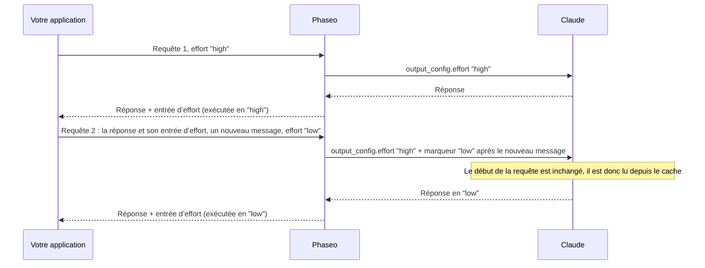

import { EffortCacheExplorer } from "/snippets/effort-cache.jsx";

Envoyez un autre `reasoning_effort` (Chat Completions) ou `reasoning.effort` (Responses) dans n’importe quelle requête : Phaseo change l’effort de Claude sans redémarrer son cache de prompts. Vous n’avez rien d’autre à changer dans votre code, tant que vous renvoyez le raisonnement de Claude inchangé à chaque requête.

<EffortCacheExplorer locale="fr" />

Phaseo continue d’envoyer à Claude l’effort de la première requête de votre conversation et ajoute chaque changement sous forme de marqueur d’effort après votre nouveau message. Tout ce qui précède le marqueur reste identique : Claude le lit donc depuis le cache. Si vous abandonnez le raisonnement, Phaseo change à la place l’effort de premier niveau, et Claude retraite tout à partir de sa première réponse au lieu de le lire depuis le cache.

## Comment Phaseo préserve le cache

Claude ne lit une conversation en cache que si le début de la requête est identique octet pour octet, et l’effort de premier niveau fait partie de ce début. L’[effort par message](https://platform.claude.com/docs/en/build-with-claude/effort-per-message) d’Anthropic change plutôt le niveau à l’intérieur de `messages`, avec un message `system` dont le `content` est vide et qui contient un `output_config.effort`. Phaseo écrit ces marqueurs pour vous :



Phaseo ne stocke rien entre les requêtes. Chaque réponse de Claude se termine par une entrée de raisonnement qui enregistre le niveau auquel elle s’est exécutée, et Phaseo reconstruit chaque marqueur précédent, au même endroit, à partir des entrées que vous renvoyez :

| Requête | Vous envoyez | Phaseo envoie à Claude |
| --- | --- | --- |
| 1 | `"high"` | `output_config.effort: "high"` |
| 2 | `"low"` | `"high"`, plus un marqueur `low` après votre nouveau message |
| 3 | `"low"` | `"high"`, plus le même marqueur au même endroit |
| 4 | `"high"` | `"high"`, le marqueur précédent et un marqueur `high` après votre nouveau message |

Les messages que vous renvoyez ne sont jamais modifiés. Les marqueurs n’existent que dans la requête que Phaseo envoie à Claude.

## Renvoyer le raisonnement inchangé

<Warning>
Renvoyez chaque entrée de raisonnement exactement telle que vous l’avez reçue, à chaque requête : `reasoning_details` de Chat, éléments `reasoning` de Responses et blocs `thinking` d’Anthropic, chiffrés ou non. Ne les abandonnez pas, ne les modifiez pas, ne les réordonnez pas et ne les résumez pas. Sans eux, un changement d’effort redémarre le cache de Claude, et Claude perd son raisonnement entre les étapes de la boucle d’outils.
</Warning>

L’entrée d’effort n’a pas de texte. Sur Chat Completions, c’est la dernière entrée `reasoning.encrypted` de `reasoning_details` :

```json
{
  "role": "assistant",
  "content": "1. Export the data. 2. Create the schema. 3. Import and verify.",
  "reasoning_details": [
    { "type": "reasoning.text", "text": "…", "signature": "phx1.…", "format": "anthropic-claude-v1" },
    { "type": "reasoning.encrypted", "data": "phx1.…", "format": "anthropic-claude-v1" }
  ]
}
```

Sur Responses, c’est le dernier élément `reasoning` de `output`, avec un `id` qui commence par `rs_effort_` :

```json
{ "type": "reasoning", "id": "rs_effort_req_123", "summary": [], "content": [], "encrypted_content": "phx1.…" }
```

La valeur est opaque, et Phaseo la retire avant que la conversation n’atteigne un fournisseur.

## Changer l’effort dans votre code

Ajoutez la réponse complète de Claude à votre conversation, puis définissez l’effort souhaité pour la requête suivante. Le `cache_control` de premier niveau active la mise en cache sur les routes Claude ; consultez [Mise en cache des prompts](./prompt-caching.mdx#which-providers-cache-automatically).

### Chat Completions

<CodeGroup>
```ts TypeScript
import OpenAI from "openai";

const client = new OpenAI({
	apiKey: process.env.PHASEO_API_KEY,
	baseURL: "https://api.phaseo.app/v1",
});

const messages: OpenAI.ChatCompletionMessageParam[] = [
	{ role: "user", content: "Plan a migration from SQLite to PostgreSQL." },
];

async function ask(effort: "low" | "medium" | "high") {
	const response = await client.chat.completions.create({
		model: "anthropic/claude-opus-5.5",
		reasoning_effort: effort,
		messages,
		// @ts-expect-error Champ Phaseo : met la conversation en cache sur les routes Claude
		cache_control: { type: "ephemeral" },
	});
	const message = response.choices[0].message;
	messages.push(message); // le message complet, reasoning_details compris
	return message.content;
}

await ask("high");
messages.push({ role: "user", content: "Summarise the plan in one sentence." });
await ask("low"); // Claude lit la requête 1 depuis le cache
```

```python Python
import os
from openai import OpenAI

client = OpenAI(
    api_key=os.environ["PHASEO_API_KEY"],
    base_url="https://api.phaseo.app/v1",
)

messages = [{"role": "user", "content": "Plan a migration from SQLite to PostgreSQL."}]

def ask(effort: str) -> str | None:
    response = client.chat.completions.create(
        model="anthropic/claude-opus-5.5",
        reasoning_effort=effort,
        messages=messages,
        extra_body={"cache_control": {"type": "ephemeral"}},
    )
    message = response.choices[0].message
    # Le message complet, reasoning_details compris
    messages.append(message.model_dump(exclude_none=True))
    return message.content

ask("high")
messages.append({"role": "user", "content": "Summarise the plan in one sentence."})
ask("low")  # Claude lit la requête 1 depuis le cache
```
</CodeGroup>

### Responses

Phaseo ne stocke pas les réponses : envoyez donc toute la conversation dans `input`, y compris chaque élément de `output`.

<CodeGroup>
```ts TypeScript
import OpenAI from "openai";

const client = new OpenAI({
	apiKey: process.env.PHASEO_API_KEY,
	baseURL: "https://api.phaseo.app/v1",
});

const input: OpenAI.Responses.ResponseInput = [
	{ role: "user", content: "Plan a migration from SQLite to PostgreSQL." },
];

async function ask(effort: "low" | "medium" | "high") {
	const response = await client.responses.create({
		model: "anthropic/claude-opus-5.5",
		reasoning: { effort },
		input,
		// @ts-expect-error Champ Phaseo : met la conversation en cache sur les routes Claude
		cache_control: { type: "ephemeral" },
	});
	input.push(...response.output); // tous les éléments, éléments de raisonnement compris
	return response.output_text;
}

await ask("high");
input.push({ role: "user", content: "Summarise the plan in one sentence." });
await ask("low"); // Claude lit la requête 1 depuis le cache
```

```python Python
import os
from openai import OpenAI

client = OpenAI(
    api_key=os.environ["PHASEO_API_KEY"],
    base_url="https://api.phaseo.app/v1",
)

conversation = [{"role": "user", "content": "Plan a migration from SQLite to PostgreSQL."}]

def ask(effort: str) -> str:
    response = client.responses.create(
        model="anthropic/claude-opus-5.5",
        reasoning={"effort": effort},
        input=conversation,
        extra_body={"cache_control": {"type": "ephemeral"}},
    )
    # Tous les éléments, éléments de raisonnement compris
    conversation.extend(item.model_dump(exclude_none=True) for item in response.output)
    return response.output_text

ask("high")
conversation.append({"role": "user", "content": "Summarise the plan in one sentence."})
ask("low")  # Claude lit la requête 1 depuis le cache
```
</CodeGroup>

### Anthropic Messages

Sur `/v1/messages`, envoyez vous-même le marqueur : un message `system` avec un `content` vide et `output_config.effort`. Gardez le même `output_config.effort` de premier niveau à chaque requête, et laissez chaque marqueur en place dans les requêtes suivantes. Phaseo ajoute l’en-tête bêta `mid-conversation-output-config-2026-07-01` : vous n’avez donc pas à l’envoyer.

```bash cURL
curl https://api.phaseo.app/v1/messages \
  -H "x-api-key: $PHASEO_API_KEY" \
  -H "anthropic-version: 2023-06-01" \
  -H "Content-Type: application/json" \
  -d '{
    "model": "anthropic/claude-opus-5.5",
    "max_tokens": 4096,
    "cache_control": { "type": "ephemeral" },
    "output_config": { "effort": "high" },
    "messages": [
      { "role": "user", "content": "Plan a migration from SQLite to PostgreSQL." },
      { "role": "assistant", "content": "1. Export the data. 2. Create the schema. 3. Import and verify." },
      { "role": "system", "content": [], "output_config": { "effort": "low" } },
      { "role": "user", "content": "Summarise the plan in one sentence." }
    ]
  }'
```

La position du marqueur détermine à quel moment le nouveau niveau commence :

- **Juste après un message utilisateur :** la réponse de Claude à ce message utilise le nouveau niveau.
- **Partout ailleurs**, par exemple entre la réponse de Claude et votre message suivant comme ci-dessus : le nouveau niveau commence à votre message suivant.

Un message utilisateur qui ne contient que des résultats d’outils ne compte pas comme un nouveau message. Sur les routes sans effort par message, Phaseo supprime les marqueurs et envoie le niveau en vigueur comme effort de premier niveau.

## Quand le changement redémarre le cache

Phaseo change l’effort de premier niveau, comme pour les autres fournisseurs, lorsque :

- **Le raisonnement manque.** Votre dernière réponse de Claude n’a pas d’entrée d’effort, parce que votre client a abandonné `reasoning_details` ou les éléments `reasoning`.
- **Le changement arrive entre deux étapes de la boucle d’outils.** Votre dernier message ne contient que des résultats d’outils : un marqueur ne s’appliquerait donc qu’à partir de votre message suivant. Phaseo change l’effort de premier niveau pour que cette étape s’exécute au niveau demandé, et les changements suivants utilisent de nouveau des marqueurs.
- **La requête ne définit aucun effort, ou désactive le raisonnement.** Envoyez `reasoning_effort` ou `reasoning.effort` à chaque requête. `"none"` et `reasoning.enabled: false` désactivent le raisonnement.
- **La route ne le prend pas en charge.** Consultez [Modèles pris en charge](#supported-models).

Un changement de premier niveau conserve dans le cache la partie de la conversation qui précède la première réponse de Claude. Claude retraite tout à partir de cette réponse et le facture comme une nouvelle entrée.

<span id="supported-models"></span>
## Modèles pris en charge

| Route | Modèles |
| --- | --- |
| Anthropic, Google Vertex AI | Claude Fable 5.2 et 5.1, Mythos 5.2 et 5.1, Opus 5.5 et 5, Sonnet 5.5, Haiku 5.5 |
| Claude on AWS | Les mêmes modèles sauf Mythos |
| Amazon Bedrock | Claude Fable 5.1 et Opus 5.5 |

Sur toutes les autres routes, y compris Claude sur Azure, un changement d’effort passe au premier niveau.

## Vérifier que le cache a tenu

Lisez les compteurs de cache de la requête qui suit un changement : `usage.prompt_tokens_details.cached_tokens` sur Chat Completions, `usage.input_tokens_details.cached_tokens` sur Responses et `usage.cache_read_input_tokens` sur Anthropic Messages. [Champs d’utilisation et de tarification](./prompt-caching.mdx#usage-and-pricing-fields) liste tous les champs.

Nous avons mesuré la même conversation Chat Completions de cinq requêtes sur `anthropic/claude-haiku-5.5` le 11 novembre 2026, une fois en renvoyant les entrées d’effort et une fois sans elles. L’effort était `high`, `high`, `low`, `low`, `high`, et un document de 3 400 tokens arrivait dans le deuxième message :

| Requête 3 (effort de `high` à `low`) | Entrées d’effort abandonnées | Entrées d’effort renvoyées |
| --- | --- | --- |
| Tokens lus depuis le cache | 0 | 3 575 |
| Tokens retraités et écrits dans le cache | 3 499 | 75 |
