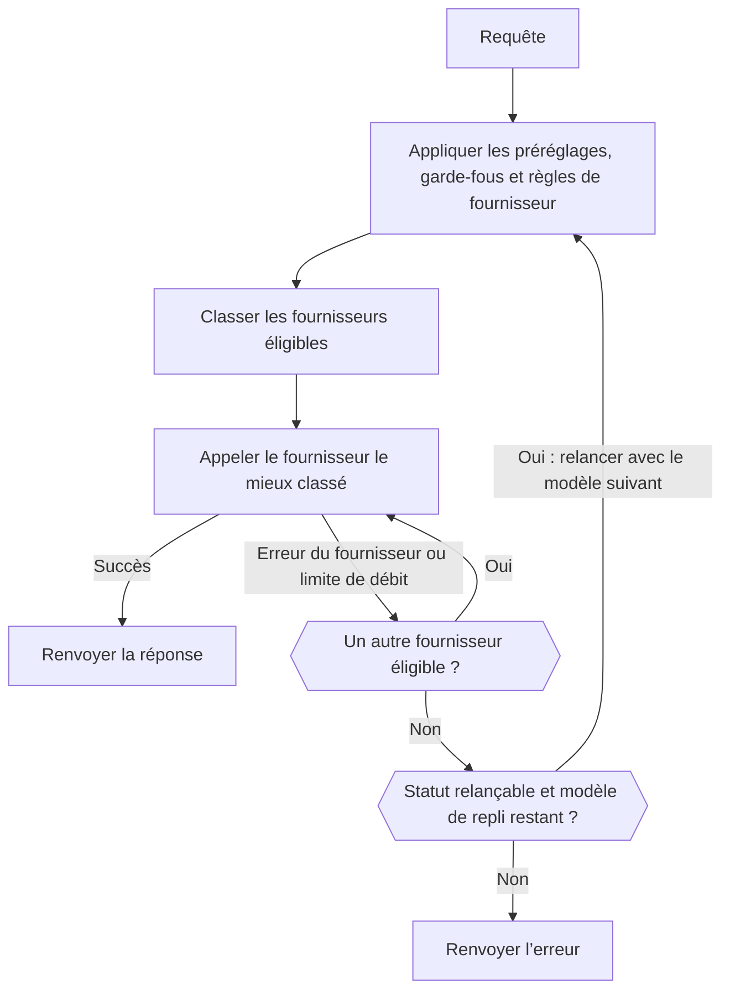

import { RoutingCostExplainer } from "/snippets/routing-cost.jsx";
import { FallbackChainExplorer } from "/snippets/fallback-chain.jsx";

La plupart des modèles sont servis par plusieurs fournisseurs. Pour chaque requête, le Gateway conserve les fournisseurs autorisés par vos règles, les classe et appelle le meilleur. Si ce fournisseur échoue, il essaie le suivant ; si tous les fournisseurs échouent avec une erreur pouvant être relancée, il peut passer à un modèle de repli.



Votre client doit tout de même relancer les réponses `429` et `5xx` avec un backoff exponentiel.

<span id="choose-how-providers-are-ranked"></span>
## Choisir comment les fournisseurs sont classés

| Mode | Classe selon | À utiliser quand |
| --- | --- | --- |
| `balanced` (par défaut) | Le coût par réponse réussie | Vous voulez le meilleur compromis entre prix, vitesse et fiabilité. |
| `price` | Le prix | Le coût compte plus que le temps de réponse. |
| `latency` | Le délai avant le premier token | Les réponses doivent commencer vite. |
| `throughput` | La vitesse de sortie | Les sorties longues doivent se terminer vite. |

Définissez la valeur par défaut de l’espace de travail dans **Tableau de bord -> Paramètres -> Routage**, avec `phaseo settings update --routing-mode <mode>`, ou avec `routing_mode` sur `PATCH /v1/settings`. Pour une seule requête, envoyez `provider.sort` ou `routing.mode`, ou ajoutez un suffixe à l’identifiant du modèle :

| Suffixe | Mode | Exemple |
| --- | --- | --- |
| `:nitro` | `throughput` | `openai/gpt-6-astra:nitro` |
| `:cheap` | `price` | `openai/gpt-6-astra:cheap` |
| `:fast` | `latency` | `openai/gpt-6-astra:fast` |

Un suffixe remplace `routing.mode`, `provider.sort`, ainsi que les modes du préréglage et de l’espace de travail. Les listes d’autorisation, les régions, les garde-fous et les plafonds de prix s’appliquent toujours.

La page des paramètres de routage propose aussi des interrupteurs pour les canaux bêta et alpha : les fournisseurs en préversion ne reçoivent du trafic que si vous les activez.

## Comment le mode balanced classe les fournisseurs

Pour les requêtes texte (Chat Completions, Responses et Messages), `balanced` estime le **coût par réponse réussie** de chaque fournisseur :

- **Tokens :** ce que coûte une requête typique pour ce modèle chez le fournisseur, d’après les tailles de prompt et de sortie mesurées pour le modèle et le taux de succès du cache mesuré chez le fournisseur.
- **Attente :** le délai avant le premier token et avant la réponse complète, converti en dollars au prix typique par seconde du modèle.
- **Échecs :** le total divisé par le taux de réussite récent du fournisseur, plus une pénalité pour les erreurs du fournisseur et une plus faible pour les limites de débit.

Les fournisseurs proches du coût le plus bas se partagent l’essentiel du trafic. Chaque fournisseur conserve une petite part, afin qu’un rétablissement soit remarqué. Choisissez un scénario pour voir comment cela se passe (les fournisseurs sont des exemples) :

<RoutingCostExplainer locale="fr" />

Les autres endpoints sont notés selon la fiabilité, la latence, la latence de queue, le débit, le prix et l’adéquation en tokens. Si vous êtes un fournisseur, [Comment les fournisseurs obtiennent du trafic](./how-providers-earn-traffic) explique comment gagner une part plus importante.

<span id="request-level-model-fallbacks"></span>
## Modèles de repli au niveau de la requête

Listez les modèles de repli dans `models`. Phaseo essaie d’abord `model`, puis chaque entrée dans l’ordre :

```json
{
  "model": "openai/gpt-6-astra",
  "models": ["anthropic/claude-sonnet-5.5", "google/gemini-4-argon"],
  "input": "Summarize this incident report."
}
```

Choisissez ce que renvoie chaque modèle pour voir quand Phaseo passe au suivant :

<FallbackChainExplorer locale="fr" />

**Ce qui fait passer au modèle suivant.** Un modèle n’est essayé qu’après que le précédent, avec toutes ses relances chez les fournisseurs, s’est terminé par `429`, `500`, `502`, `503` ou `504`. Un `429` dû à un budget Phaseo ou au quota d’un modèle gratuit fait aussi passer au suivant, car un autre modèle peut tenir dans la limite restante. C’est aussi le cas d’un modèle qu’aucun fournisseur ne sert plus, par exemple un modèle [retiré](#retired-models).

**Ce qui ne le fait pas.** Les erreurs client telles que `400`, `401`, `402`, `403`, `404`, `408`, `413` et `422` sont renvoyées immédiatement. De même pour les échecs survenant avant l’exécution du premier modèle, comme l’authentification ou les limites de débit de la clé API.

**Règles de la liste :**

- `model` est obligatoire ; envoyer `models` seul renvoie `400`.
- `models` accepte de 1 à 25 entrées. Les doublons et les copies de `model` sont ignorés.
- Les entrées peuvent être des identifiants de modèle, des [identifiants qualifiés par fournisseur](./provider-qualified-models) ou des préréglages tels que `@support`.
- Chaque tentative est validée comme une requête à part entière (endpoint, paramètres, modèles de l’espace de travail, garde-fous, préréglages, tarification, BYOK). Un modèle de repli qui ne peut pas servir la requête est ignoré et journalisé ; il ne remplace jamais l’erreur que vous auriez reçue sinon. Une tentative identique à une tentative déjà effectuée est aussi ignorée.

**Journaux et facturation.** Chaque tentative est une requête distincte avec son propre enregistrement d’utilisation, facturée comme si les solutions de repli n’existaient pas. Le champ `model` de la réponse nomme le modèle qui a répondu, et sa trace de routage liste l’identifiant de la requête principale, l’ordre de repli et chaque tentative antérieure.

**Streaming, vidéo et musique.** Un stream ne se replie qu’avant son premier octet ; ensuite, les erreurs arrivent dans le stream. La vidéo et la musique ne se replient que pendant la soumission de la tâche.

**Avec les autres contrôles de routage.** Les solutions de repli d’une route dynamique associée ont priorité sur `models`, et un modèle fixe choisi par la route s’applique toujours à chaque tentative. Un préréglage applique ses propres contraintes à chaque tentative où il est utilisé. [`phaseo/auto`](./auto-routing) gère ses propres solutions de repli et ne peut pas être combiné avec `models`.

| Endpoint | `models` |
| --- | --- |
| Chat Completions, Responses, Messages | Pris en charge, y compris les streams avant le premier octet |
| Embeddings, Moderations, Rerank | Pris en charge |
| Génération et retouche d’images | Pris en charge, y compris les envois multipart |
| Synthèse vocale, transcription et traduction | Pris en charge, y compris les envois multipart |
| OCR, Parse, Decisions | Pris en charge |
| Génération de vidéo et de musique | Pris en charge à la soumission de la tâche |
| Lots | `400` : chaque ligne d’un lot cible un seul modèle |
| Sessions temps réel et en direct | `400` : une session est liée à un seul modèle |
| Exécutions Council | `400` : les modèles proviennent de la configuration de l’exécution |

Les endpoints multipart acceptent des champs `models` répétés, des champs `models[]` ou une chaîne de tableau JSON unique. Consultez aussi [Limites de débit](../api-reference/limits.mdx) et [Erreurs](../api-reference/errors.mdx).

<span id="pin-one-provider"></span>
## Épingler un seul fournisseur

Placez le fournisseur devant l’identifiant du modèle pour utiliser exactement ce fournisseur :

```json
{
  "model": "baseten:thinking-machines/inkling-small",
  "input": "Hello"
}
```

Cela désactive le repli vers d’autres fournisseurs pour la requête. Les suffixes restent dans l’identifiant du modèle, comme dans `baseten:google/gemma-4-26b-a4b:free`. [Identifiants de modèle qualifiés par fournisseur](./provider-qualified-models) détaille la syntaxe complète et les erreurs.

## Limiter les fournisseurs utilisés

| Contrôle | Emplacement | Effet |
| --- | --- | --- |
| [Préréglages](./presets) | **Paramètres -> Préréglages** | Modèles autorisés et listes d’autorisation ou d’exclusion de fournisseurs, appliqués avant le classement : ils limitent donc aussi les solutions de repli. |
| [Routage régional](./regional-routing) | Requête ou espace de travail | Maintient l’exécution ou les données dans une région. |
| Routes dynamiques | **Paramètres -> Routage** | Règles par clé : voir ci-dessous. |
| Repli BYOK | **Paramètres -> BYOK** | Indique si une requête BYOK en échec peut être relancée avec des crédits Phaseo. |

<span id="attach-routing-rules-to-api-keys"></span>
### Associer des règles de routage à des clés API

Une route dynamique est un flux de règles associé à une ou plusieurs clés API d’inférence. Elle peut :

- créer des branches selon les champs du corps de la requête, les en-têtes, les `metadata` personnalisées, l’endpoint, le modèle ou l’identifiant de session
- répartir le trafic par pourcentage pour les tests A/B et les déploiements progressifs
- plafonner les requêtes ou le coût quotidien, hebdomadaire ou mensuel par clé
- changer de modèle, de mode de routage, de préférence de fournisseur et de modèles de repli (jusqu’à huit)
- activer l’affinité de fournisseur tenant compte du cache et de la session

Les conditions ont des sorties vrai et faux ; les nœuds de débit et de budget ont des sorties « dans la limite » et « dépassé ». Les répartitions en pourcentage sont déterministes par session ou par clé de cache de prompt : une conversation en cache ne change donc pas de branche.

L’enregistrement crée une version brouillon immuable. Le déploiement copie cette version dans le Gateway et vide les caches de politique de ses clés ; les versions antérieures restent disponibles pour un retour en arrière. Les recommandations sur l’état de santé des fournisseurs apparaissent sous **Insights**. Depuis la CLI : `phaseo routing dynamic-routes create`, `set-keys` et `deploy`, ou l’API `/v1/routing/dynamic-routes`.

Les métadonnées personnalisées se placent dans le corps de la requête sur les endpoints texte compatibles OpenAI :

```json
{
  "model": "openai/gpt-6-astra",
  "metadata": { "customer_plan": "pro", "workspace": "acme" }
}
```

## Garder une conversation chez un seul fournisseur

Le routage tenant compte du cache est activé par défaut pour la génération de texte. Une requête qui envoie `prompt_cache_key` ou `session_id`, ou qui active la mise en cache avec `cache_control` (au premier niveau, dans `provider_options.anthropic`, ou sous forme de marque `cache_control` ou `prompt_cache_breakpoint` sur un bloc de message ou un outil), est épinglée au fournisseur et à la route qui ont servi sa première requête réussie. Les autres requêtes sont épinglées pendant 15 minutes dès qu’un fournisseur signale une lecture ou une écriture de cache pour le même contexte d’ouverture, si l’entrée en cache de ce fournisseur coûte moins cher que son entrée standard.

| | |
| --- | --- |
| Durée de l’épinglage | De 15 minutes à 24 heures, selon la conservation du cache du fournisseur. Avec `session_id`, jusqu’à 24 heures d’activité de session. |
| Portée | Par espace de travail. Avec `session_id`, liée à la session plutôt qu’au contexte d’ouverture. |
| Un épinglage change quand | Le disjoncteur du fournisseur s’ouvre, son taux d’erreur est élevé, le quota géré par Phaseo chez lui est épuisé, ou vos règles ne l’autorisent plus. |

Désactivez-le pour une requête avec `provider.cache_aware_routing: false`, ou conservez l’affinité de cache en ignorant la session avec `routing.session_affinity: false` :

```json
{
  "model": "openai/gpt-6-astra",
  "session_id": "support-session-42",
  "routing": { "session_affinity": false }
}
```

[Affinité de fournisseur](./prompt-caching.mdx#provider-affinity) liste les indications que Phaseo envoie à chaque fournisseur.

<span id="explain-a-routing-decision"></span>
## Expliquer une décision de routage

Ouvrez **Tableau de bord -> Paramètres -> Utilisation -> Journaux des requêtes**, sélectionnez une requête, puis développez **Observabilité du routage** sous **Réponses des fournisseurs**. Vous y voyez :

- chaque fournisseur classé avec son score final, et ceux qui ont été sélectionnés et essayés
- les fournisseurs exclus avant le classement, avec la raison
- les fournisseurs rétrogradés en raison de leur état de déploiement ou de routage
- les entrées, pondérations, contributions et multiplicateurs de chaque score

Les facteurs de score modifient le score ; le contexte enregistré explique la décision sans nécessairement l’influencer. Les traces ne contiennent que des nombres et des statuts, jamais de prompts ni de sorties. Les requêtes effectuées avant l’activation de l’observabilité du routage peuvent afficher une trace partielle ou aucune trace.

### Ce qui compte contre la disponibilité d’un fournisseur

| Réduit la disponibilité | Ne la réduit pas |
| --- | --- |
| Échecs d’authentification `401` | Requêtes incorrectes `400` |
| Échecs de paiement `402` | Restrictions géographiques `403` |
| Modèle introuvable `404` | Charges utiles trop volumineuses `413` |
| `500` et au-delà | Limites de débit `429` |
| Erreurs après le début d’un stream | |
| Un `200` qui se termine avec un motif d’erreur | |

Les restrictions géographiques et les limites de débit sont suivies séparément, car elles ne signifient pas que le fournisseur est en panne. En production, journalisez les identifiants de requête, les codes de statut et les identifiants de modèle afin de pouvoir rapprocher les échecs de ces traces.

<span id="retired-models"></span>
## Modèles retirés

Un modèle retiré continue de fonctionner tant qu’un fournisseur le sert encore. Ensuite, les requêtes échouent avec `410 model_retired`, sauf si l’espace de travail les envoie vers un remplaçant grâce au routage des modèles retirés. Votre propre liste `models` est toujours essayée en premier. Consultez [Obsolescence et retrait des modèles](./model-retirement.mdx).

<span id="byok-considerations"></span>
## Points à considérer pour BYOK

Avec <Tooltip tip="Apportez votre propre clé : Phaseo route la requête avec votre propre clé API du fournisseur, et votre fournisseur vous facture directement l’utilisation du modèle.">BYOK</Tooltip>, Phaseo route et journalise la requête, tandis que votre fournisseur facture l’utilisation du modèle.

| | |
| --- | --- |
| Frais de service | Aucuns pour les 250 000 premières requêtes BYOK terminées chaque mois UTC, puis 2,5 % du coût équivalent chez le fournisseur. |
| Crédit Phaseo | Gardez au moins $1 disponible, pour le repli géré et les frais au-delà de la franchise. |
| Règles du fournisseur | Les quotas, la politique de données, l’accès aux modèles et les limites de compte de votre fournisseur s’appliquent toujours. |
| Stockage | Les clés sont chiffrées en AES-256-GCM, liées à leur espace de travail et à leur fournisseur. |

Limitez chaque clé aux modèles et aux clés API qui en ont besoin. Pour empêcher une requête BYOK en échec d’être relancée avec des crédits Phaseo, désactivez le repli dans **Tableau de bord -> Paramètres -> BYOK**, ou définissez `byok_fallback_enabled` sur `PATCH /v1/settings` (`phaseo settings update --body-json '{"byok_fallback_enabled":false}'`). Ajoutez des clés avec `phaseo byok create --provider <id> --name <name> --key-stdin`.
