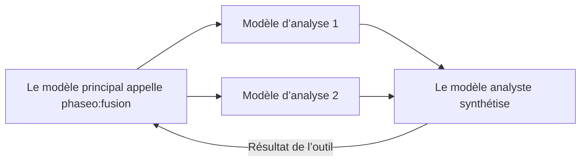

Ajoutez `phaseo:fusion` lorsqu’une réponse gagne à s’appuyer sur plusieurs avis indépendants, par exemple pour une décision de planification, une synthèse de recherche ou une revue de conception. Quand le modèle principal l’appelle, Phaseo envoie la question à chaque modèle d’analyse en parallèle, demande à un modèle analyste de fusionner leurs conclusions et renvoie cette synthèse. Cela ajoute de la latence ; utilisez un seul [Advisor](./advisor) lorsqu’une seule relecture suffit.



```json
{
  "tools": [
    {
      "type": "phaseo:fusion",
      "parameters": {
        "analysis_models": ["anthropic/claude-opus-5", "openai/gpt-5"],
        "model": "google/gemini-pro-latest",
        "instructions": "Reconcile disagreements and return concise synthesis guidance.",
        "max_uses": 1,
        "max_completion_tokens": 1400
      }
    }
  ]
}
```

Dans le Playground, le menu des outils serveur règle les mêmes éléments : les modèles d’analyse, un modèle juge (analyste) facultatif et une limite d’appels.

## Paramètres

| Paramètre | Type | Défaut | Description |
| --- | --- | --- | --- |
| `analysis_models` | string[] | Requis | Au moins 2 modèles. En dessous, la requête est refusée. |
| `model` | string | Le modèle de la requête | Le modèle analyste qui rédige la synthèse. |
| `instructions` | string | Aucun | Instructions pour les appels d’analyse et l’appel de l’analyste. |
| `max_uses` | integer | `1` | Nombre d’appels Fusion par requête, jusqu’à `4`. |
| `max_completion_tokens` | integer | `1400` | Tokens de sortie pour chaque analyse et pour la synthèse, jusqu’à `32000`. |

## Ce que le modèle envoie

Un `prompt` : la question qui nécessite plusieurs points de vue.

## Ce que renvoie l’outil

```json
{
  "status": "ok",
  "analyses": 2,
  "analysis": "Both reviewers flag the cutover order..."
}
```

`analyses` compte les modèles d’analyse qui ont répondu. Si certains échouent, la synthèse s’appuie sur les autres. Les résultats d’erreur sont `fusion_invalid_request` (pas de prompt), `fusion_max_uses_exceeded`, `fusion_panel_failed` (tous les modèles d’analyse ont échoué) et `fusion_request_failed` (l’analyste a échoué).

## Utilisation et tarification

Chaque appel ajoute 1 à `usage.server_tool_use.fusion_requests` et peut être facturé via `server_tool_fusion_requests`. Les tokens de chaque appel d’analyse et de l’analyste s’ajoutent à l’utilisation de la requête et sont facturés au tarif du modèle concerné.
