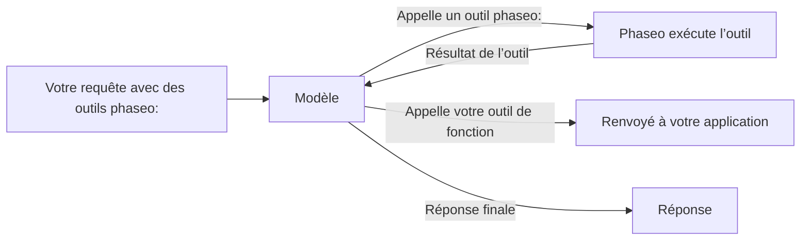

Ajoutez un outil `phaseo:` à `tools` et Phaseo l’exécute pour vous lorsque le modèle l’appelle : le modèle demande l’heure actuelle, une recherche web ou l’avis d’un second modèle, Phaseo exécute l’appel, lui renvoie le résultat, et le modèle termine sa réponse. Vous n’avez pas à écrire d’exécuteur d’outils.



<Note>
Les outils serveur sont en bêta. La forme des requêtes et le contenu des résultats peuvent changer à mesure que la prise en charge par les fournisseurs évolue.
</Note>

## Outils disponibles

| Outil | Type | À utiliser pour | Endpoints |
| --- | --- | --- | --- |
| [Datetime](./datetime) | `phaseo:datetime` | La date et l’heure actuelles dans jusqu’à 5 fuseaux horaires | Les trois |
| [Web Search](./web-search) | `phaseo:web_search` | Rechercher sur le web des informations récentes ou sourcées | Les trois |
| [Web Fetch](./web-fetch) | `phaseo:web_fetch` | Lire le texte d’une URL précise | Les trois |
| [Advisor](./advisor) | `phaseo:advisor` | Demander une relecture ou un plan à un autre modèle | Les trois |
| [Subagent](./subagent) | `phaseo:subagent` | Confier une tâche autonome à un modèle exécutant | Les trois |
| [Fusion](./fusion) | `phaseo:fusion` | Obtenir l’analyse de plusieurs modèles, puis une synthèse | Les trois |
| [Search Models](./search-models) | `phaseo:search_models` | Trouver un modèle dans le catalogue Phaseo en direct | Les trois |
| [Génération d’images](./image-generation) | `phaseo:image_generation` | Créer une image pendant la réponse | Les trois |
| [Apply Patch](./apply-patch) | `phaseo:apply_patch` | Renvoyer des patchs de fichiers validés | `/v1/responses` uniquement |

« Les trois » désigne `/v1/chat/completions`, `/v1/responses` et `/v1/messages`.

## Envoyer une requête

```bash
curl https://api.phaseo.app/v1/chat/completions \
  -H "Authorization: Bearer $PHASEO_API_KEY" \
  -H "Content-Type: application/json" \
  -d '{
    "model": "openai/gpt-6-astra",
    "messages": [
      { "role": "user", "content": "What are the latest AI policy updates this week?" }
    ],
    "tools": [
      { "type": "phaseo:web_search" },
      { "type": "phaseo:datetime", "parameters": { "timezones": ["Europe/London", "UTC"] } }
    ]
  }'
```

Chaque outil accepte un objet `parameters` facultatif, décrit sur sa page. `stream: true` fonctionne aussi : Phaseo exécute lui-même les tours d’outils et vous diffuse la réponse finale en streaming.

## Combiner les outils serveur avec vos propres fonctions

Phaseo n’exécute que les outils `phaseo:`. Un outil `function` classique dans la même requête est renvoyé à votre application comme d’habitude, et vous renvoyez son résultat dans une requête suivante, comme dans [Appel d’outils](../tool-calling).

```json
{
  "model": "openai/gpt-6-astra",
  "messages": [
    { "role": "user", "content": "Find recent funding news and save the best item." }
  ],
  "tools": [
    { "type": "phaseo:web_search", "parameters": { "max_results": 3 } },
    {
      "type": "function",
      "function": {
        "name": "save_research_item",
        "description": "Save a selected research item",
        "parameters": {
          "type": "object",
          "properties": {
            "title": { "type": "string" },
            "url": { "type": "string" }
          },
          "required": ["title", "url"]
        }
      }
    }
  ]
}
```

## Limites de la boucle d’outils

| Limite | Valeur | Quand elle est atteinte |
| --- | --- | --- |
| Appels d’outils serveur par requête | `max_tool_calls` dans la requête, `30` par défaut, `100` au maximum | `400 gateway_server_tool_limit` |
| Tours de suivi | `8` | `502 gateway_server_tool_error` |
| Appels à un même outil | Le `max_uses` de cet outil | L’outil renvoie un résultat d’erreur au modèle, qui peut continuer sans lui |

## Utilisation et tarification

Chaque outil serveur ajoute un compteur à `usage.server_tool_use`, et la grille tarifaire d’un modèle peut facturer le compteur de prix correspondant. Les tokens utilisés par un second modèle (Advisor, Subagent, Fusion, Génération d’images) s’ajoutent à l’utilisation de la requête et sont facturés au tarif de ce modèle.

```json
{
  "usage": {
    "input_tokens": 105,
    "output_tokens": 250,
    "server_tool_use": {
      "datetime_requests": 1,
      "web_search_requests": 2,
      "web_search_results": 8
    }
  }
}
```

| Outil | Compteur d’utilisation | Compteur de prix |
| --- | --- | --- |
| Datetime | `datetime_requests` | Aucun |
| Web Search | `web_search_requests`, `web_search_results`, `web_search_extra_results` | `server_tool_web_search_requests`, `server_tool_web_search_extra_results` |
| Web Fetch | `web_fetch_requests` | `server_tool_web_fetch_requests` |
| Advisor | `advisor_requests` | `server_tool_advisor_requests` |
| Subagent | `subagent_requests` | `server_tool_subagent_requests` |
| Fusion | `fusion_requests` | `server_tool_fusion_requests` |
| Search Models | `search_models_requests` | `server_tool_search_models_requests` |
| Génération d’images | `image_generation_requests` | `server_tool_image_generation_requests` |
| Apply Patch | `apply_patch_requests` | `server_tool_apply_patch_requests` |

Lorsque Web Search ou Web Fetch s’exécute en tant qu’outil propre au fournisseur (`engine: "native"`), il est facturé via `native_web_search_requests` ou `native_web_fetch_requests` à la place.
