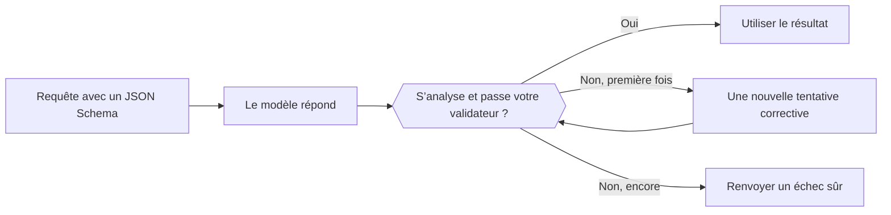

Envoyez un JSON Schema avec la requête : le modèle renvoie du JSON de cette forme au lieu d’un texte libre. Votre code doit quand même l’analyser et le valider avant de l’utiliser.



## Choisir un format

| `type` | Ce que vous obtenez |
| --- | --- |
| `json_schema` | Du JSON qui suit le schéma que vous envoyez. Utilisez-le par défaut. |
| `json_object` | Un objet JSON valide, sans forme imposée. |
| `text` | Du texte brut (par défaut). |

L’emplacement du format dépend du point de terminaison :

| Point de terminaison | Champ |
| --- | --- |
| `/v1/chat/completions` | `response_format` |
| `/v1/responses` | `text.format` |
| `/v1/messages` | `output_config.format` (`json_schema` uniquement) |

## Envoyer un schéma

<CodeGroup>
```bash Chat Completions
curl https://api.phaseo.app/v1/chat/completions \
  -H "Authorization: Bearer $PHASEO_API_KEY" \
  -H "Content-Type: application/json" \
  -d '{
    "model": "openai/gpt-6-astra",
    "messages": [
      { "role": "user", "content": "Return the city and weather for London." }
    ],
    "response_format": {
      "type": "json_schema",
      "json_schema": {
        "name": "weather",
        "strict": true,
        "schema": {
          "type": "object",
          "properties": {
            "city": { "type": "string" },
            "weather": { "type": "string" }
          },
          "required": ["city", "weather"],
          "additionalProperties": false
        }
      }
    }
  }'
```

```bash Responses
curl https://api.phaseo.app/v1/responses \
  -H "Authorization: Bearer $PHASEO_API_KEY" \
  -H "Content-Type: application/json" \
  -d '{
    "model": "openai/gpt-6-astra",
    "input": "Return the city and weather for London.",
    "text": {
      "format": {
        "type": "json_schema",
        "name": "weather",
        "strict": true,
        "schema": {
          "type": "object",
          "properties": {
            "city": { "type": "string" },
            "weather": { "type": "string" }
          },
          "required": ["city", "weather"],
          "additionalProperties": false
        }
      }
    }
  }'
```
</CodeGroup>

Le JSON revient sous forme de chaîne dans le contenu du message :

```json
{
  "choices": [
    {
      "finish_reason": "stop",
      "message": {
        "role": "assistant",
        "content": "{\"city\":\"London\",\"weather\":\"Cloudy\"}"
      }
    }
  ]
}
```

## Concevoir le schéma

Commencez par un petit objet. Listez chaque champ dans `required`, utilisez `enum` pour les catégories connues et définissez `additionalProperties: false` quand les clés supplémentaires doivent être rejetées. Versionnez le schéma avec votre validateur côté serveur pour qu’ils ne divergent jamais.

<span id="validate-the-result"></span>
## Valider le résultat

Avant l’analyse, vérifiez s’il y a un refus, un contenu manquant ou une réponse tronquée (`finish_reason` différent de `stop`). Validez ensuite l’objet analysé. Ce validateur Zod correspond au schéma ci-dessus :

```typescript
import { z } from "zod";

const Weather = z.object({
  city: z.string(),
  weather: z.string(),
}).strict();

function parseWeather(content: string) {
  return Weather.parse(JSON.parse(content));
}
```

Si la validation échoue, réessayez une fois avec l’erreur dans le prompt, puis renvoyez un échec sûr. Chaque nouvelle tentative est facturée. Un JSON valide ne prouve ni que les valeurs sont exactes, ni qu’une action est autorisée.

Suivez les échecs de validation par modèle et par version du schéma, et relancez vos cas d’évaluation quand l’un ou l’autre change. Pour réparer automatiquement un JSON mal formé, consultez la [réparation des réponses](../cookbook/response-healing-for-structured-json.mdx).
