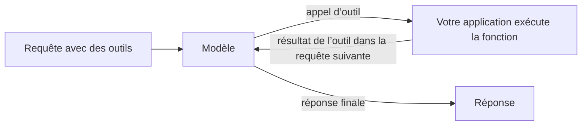

Décrivez vos fonctions dans `tools` : le modèle répond par un appel à l’une d’elles, comme une recherche en base de données ou une vérification de la météo, au lieu de deviner. Votre application exécute la fonction et renvoie le résultat ; le modèle écrit ensuite la réponse finale.



Les appels d’outils fonctionnent sur les trois points de terminaison texte, chacun dans son propre format :

| Point de terminaison | Appel du modèle | Votre résultat |
| --- | --- | --- |
| `/v1/chat/completions` | `tool_calls` sur le message de l’assistant, `finish_reason: "tool_calls"` | Un message `role: "tool"` |
| `/v1/responses` | Un élément de sortie `function_call` | Un élément d’entrée `function_call_output` |
| `/v1/messages` | Un bloc de contenu `tool_use` | Un bloc de contenu `tool_result` |

## Envoyer une requête avec des outils

```bash
curl https://api.phaseo.app/v1/chat/completions \
  -H "Authorization: Bearer $PHASEO_API_KEY" \
  -H "Content-Type: application/json" \
  -d '{
    "model": "openai/gpt-6-astra",
    "messages": [
      { "role": "user", "content": "What is the weather in London?" }
    ],
    "tools": [
      {
        "type": "function",
        "function": {
          "name": "get_weather",
          "description": "Get current weather by city",
          "parameters": {
            "type": "object",
            "properties": {
              "city": { "type": "string" }
            },
            "required": ["city"]
          }
        }
      }
    ],
    "tool_choice": {
      "type": "function",
      "function": { "name": "get_weather" }
    }
  }'
```

Ici, `tool_choice` force l’appel. Omettez-le, ou définissez `"auto"`, pour laisser le modèle décider.

Le modèle répond par un appel au lieu d’un texte :

```json
{
  "id": "chatcmpl_...",
  "object": "chat.completion",
  "choices": [
    {
      "index": 0,
      "finish_reason": "tool_calls",
      "message": {
        "role": "assistant",
        "content": null,
        "tool_calls": [
          {
            "id": "call_123",
            "type": "function",
            "function": {
              "name": "get_weather",
              "arguments": "{\"city\":\"London\"}"
            }
          }
        ]
      }
    }
  ]
}
```

Analysez et vérifiez `arguments` avant d’exécuter quoi que ce soit ; consultez [Sécurité et validation des appels d’outils](./tool-calling-safety). Renvoyez ensuite le message de l’assistant et votre résultat dans la requête suivante. [Modèles d’appel d’outils](./tool-calling-patterns) montre cette requête de suivi pour Chat Completions et Responses.

## Laisser Phaseo exécuter l’outil

Les outils dont le type commence par `phaseo:` s’exécutent côté Phaseo : le modèle les appelle, Phaseo les exécute et poursuit la boucle, et vous obtenez la réponse finale sans écrire d’exécuteur. Vous pouvez les combiner avec vos propres fonctions dans une même requête.

| Outil | Type |
| --- | --- |
| [Datetime](./server-tools/datetime) | `phaseo:datetime` |
| [Web Search](./server-tools/web-search) | `phaseo:web_search` |
| [Web Fetch](./server-tools/web-fetch) | `phaseo:web_fetch` |
| [Advisor](./server-tools/advisor) | `phaseo:advisor` |
| [Subagent](./server-tools/subagent) | `phaseo:subagent` |
| [Fusion](./server-tools/fusion) | `phaseo:fusion` |
| [Search Models](./server-tools/search-models) | `phaseo:search_models` |
| [Image Generation](./server-tools/image-generation) | `phaseo:image_generation` |
| [Apply Patch](./server-tools/apply-patch) | `phaseo:apply_patch` (Responses uniquement) |

```json
{
  "tools": [
    { "type": "phaseo:datetime", "parameters": { "timezones": ["Europe/London", "UTC"] } }
  ],
  "tool_choice": "auto"
}
```

Consultez [Outils serveur](./server-tools) pour les limites, les compteurs d’utilisation et les tarifs.

## Diffuser les appels d’outils

Les requêtes avec appels d’outils acceptent `stream: true`. Les arguments des appels de fonction arrivent par morceaux ; rassemblez-les tous avant d’analyser l’appel. Quand un outil serveur s’exécute, Phaseo termine ce tour d’outil, exécute l’outil, relance le modèle et vous diffuse la suite de la réponse : votre client lit donc toujours un seul flux. Consultez [Diffusion en continu](./streaming).

Pour des réponses qui doivent suivre un schéma plutôt qu’appeler une fonction, utilisez les [sorties structurées](./structured-outputs).
