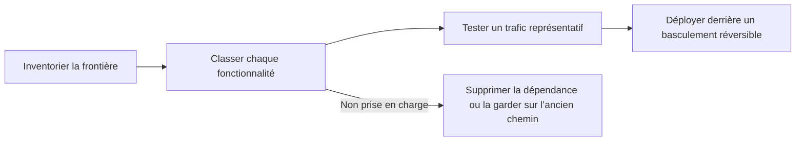

Repérez chaque fonctionnalité utilisée par votre intégration de passerelle actuelle, puis faites ce qu’indique la dernière colonne avant de déplacer le trafic. Dernière révision : 4 novembre 2026.

Menez la migration dans cet ordre. Il fait apparaître les comportements qui peuvent changer même lorsque les deux plateformes acceptent la même requête compatible OpenAI.

## Inventorier la frontière de l’intégration

Notez chaque endroit où apparaît la passerelle actuelle, pour que la migration ne laisse pas un second chemin de configuration caché :

- URL de base et variables d’environnement des clés API ;
- initialisation du SDK et en-têtes personnalisés ;
- identifiants de modèle et modèles de secours ;
- ordre des fournisseurs, listes d’autorisation et exigences de confidentialité ;
- code de streaming, d’appels d’outils et de sorties structurées ;
- tâches batch, fichiers, webhooks et interrogation de l’état des opérations asynchrones ;
- attribution des requêtes et métadonnées d’utilisateur ou de session.

## Requêtes

| Fonctionnalité | Sur Phaseo | Avant la bascule |
| --- | --- | --- |
| Authentification | `Authorization: Bearer $PHASEO_API_KEY` | Changez l’URL de base et la clé, puis envoyez une requête authentifiée. |
| Chat Completions | `/v1/chat/completions` | Testez des requêtes normales, en streaming, avec appels d’outils et avec sorties structurées. Les champs de premier niveau inconnus renvoient `400`. |
| Responses | `/v1/responses`, sans état stocké | Testez les formats d’entrée, les événements de streaming, les outils et l’analyse. `previous_response_id` et `conversation` renvoient `400` ; envoyez l’historique complet. |
| Anthropic Messages | `/v1/messages` sur l’hôte racine `https://api.phaseo.app` | Passez la clé comme jeton bearer et examinez chaque en-tête `anthropic-beta` ; Phaseo ne les transmet pas. |
| Identifiants de modèle | `<org>/<model>` | Vérifiez chaque identifiant de production dans `GET /v1/models?format=openai`. Ne supposez pas que les alias correspondent. |
| Embeddings, images, audio, modérations | Pris en charge selon le modèle et le fournisseur | Confirmez que le modèle prend en charge l’opération. |

## Routage et règles

| Fonctionnalité | Sur Phaseo | Avant la bascule |
| --- | --- | --- |
| Modèles de secours | Tableau `models`, de 1 à 25 entrées | Les secours s’exécutent sur `429`, `500`, `502`, `503` et `504`, jamais sur les erreurs de requête. |
| Ordre des fournisseurs | `provider.order` | Recréez uniquement l’ordre dont la charge de travail a encore besoin. |
| Listes d’autorisation et d’exclusion de fournisseurs | `provider.only`, `provider.ignore` | Vérifiez les identifiants de fournisseur et qu’il reste au moins une route. |
| Tri par prix, latence ou débit | `provider.sort` | Après les tests, vérifiez le fournisseur sélectionné dans les détails de la requête. |
| Conservation zéro des données | `provider.require_zero_data_retention` (alias `provider.zdr`) | Confirmez que le modèle a un fournisseur correspondant avant de l’imposer. |
| Exécution régionale et résidence des données | `provider.required_execution_region`, `provider.required_data_region`, paramètres de confidentialité par défaut de l’espace de travail | Testez à la fois une route réussie et l’erreur d’absence de fournisseur correspondant. |
| Prompts et valeurs par défaut partagés | [Préréglages](../guides/presets) | Déplacez la configuration partagée dans un préréglage au lieu de la copier dans chaque appelant. |

## Exploitation

| Fonctionnalité | Sur Phaseo | Avant la bascule |
| --- | --- | --- |
| Attribution des applications | `X-App-Id`, `X-App-Name`, `HTTP-Referer`, `X-Title`, `X-App-Categories` | Conservez les en-têtes qui décrivent l’application appelante ; les supprimer pendant la migration complique la comparaison des coûts et de l’utilisation. Vérifiez le regroupement des applications dans le tableau de bord. Consultez [Attribution des applications](../guides/app-attribution) pour les valeurs de catégorie. |
| Étiquettes de coût | Étiquettes `X-Phaseo-Metadata` | Associez les propriétés ou tags personnalisés à des étiquettes. |
| Détails des requêtes | Journaux des requêtes et `GET /v1/generations?id=<request_id>` | Comparez le fournisseur, la latence, l’utilisation des jetons et le prix pour des prompts représentatifs. |
| Relecture | `replay_request` lorsque `replay_supported` vaut `true` | Confirmez que l’endpoint et la charge utile d’une requête en échec peuvent être récupérés. |
| Tâches batch et asynchrones | API de batch, de fichiers, de vidéo, de webhooks et WebSocket | Vérifiez les transitions d’état, la facturation finale, l’annulation et la récupération des résultats. `/v1/files` ne contient que les entrées de batch. |
| Limites de débit | Quota de requêtes par minute par utilisateur, à partir de 10 pour un nouvel espace de travail | Un proxy qui fait passer le trafic d’une équipe par le propriétaire d’une seule clé peut l’atteindre. Consultez [Limites](../api-reference/limits). |
| Déploiement progressif | Répartition du trafic côté client ou infrastructure | Gardez le retour arrière limité à un changement d’URL de base et de clé jusqu’à ce que la bascule soit stable. |

## Non disponible

Ces fonctionnalités n’ont pas d’équivalent Phaseo. Gardez-les dans l’application ou sur l’ancienne plateforme :

- **Mise en cache des réponses.** Phaseo ne met pas les réponses en cache. La [mise en cache des prompts](../guides/prompt-caching) réduit tout de même le coût des entrées.
- **Réponses et conversations stockées.** Il n’existe ni `GET` ni `DELETE /v1/responses/{id}`.
- **Comptage des jetons** (`/v1/messages/count_tokens`).
- **Assistants, Threads, vector stores et fine-tuning d’OpenAI, ainsi que l’ancien `/v1/completions`.**

## Classer chaque fonctionnalité

Attribuez un statut à chaque comportement de production, à l’aide des tableaux ci-dessus et du guide de votre [plateforme d’origine](./index#platform-migrations) :

| Statut | Signification |
| --- | --- |
| Inchangé | Le même champ de requête et le même comportement de réponse ont été vérifiés. |
| Mappé | Phaseo donne le même résultat via un autre champ ou paramètre. |
| Adapté | Une couche de compatibilité traduit la requête ou la réponse. |
| Non pris en charge | Supprimez la dépendance ou gardez cette charge de travail sur son chemin actuel. |
| Non vérifié | La prise en charge existe peut-être, mais il n’y a pas encore de preuve en conditions proches de la production. |

## Valider sur votre propre trafic

La compatibilité de l’API ne garantit pas que ces éléments se comportent de la même façon :

- sélection automatique du fournisseur et ordre des secours ;
- affinité du cache de prompts et tarification du cache ;
- champs de requête propres au fournisseur et métadonnées présentes uniquement dans la réponse ;
- limites de débit et délais de nouvelle tentative ;
- règles de conservation, de résidence et d’entraînement sur les données ;
- disponibilité et prix exacts des modèles.

Constituez un petit jeu de tests à partir de schémas d’utilisation réels, sans copier de données de production sensibles, et exécutez :

1. une requête normale pour chaque endpoint utilisé ;
2. le streaming par le même chemin client qu’en production ;
3. des appels d’outils et des sorties structurées avec des schémas réalistes ;
4. chaque contrainte de fournisseur ou de confidentialité ;
5. des clés invalides, des modèles invalides, des limites de débit et des échecs de fournisseur indisponible ;
6. des tâches batch ou asynchrones en succès, en échec et en annulation.

Comparez la qualité des sorties, la latence, l’utilisation des jetons, le fournisseur sélectionné et le coût final. Notez chaque identifiant de requête pour pouvoir l’inspecter dans les journaux des requêtes ou avec `GET /v1/generations?id=<request_id>`.

## Déployer avec un basculement réversible

Commencez par le trafic de développement et le trafic interne. Ne déplacez une petite part de la production qu’une fois le jeu de tests réussi, et limitez le retour arrière à l’URL de base et à la clé jusqu’à ce que les résultats soient stables. Ne combinez pas la bascule avec des changements de prompt, de modèle ou de routage ; faites-les une fois la frontière de la passerelle vérifiée.
