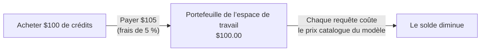

Achetez des crédits une fois et dépensez-les en requêtes au prix catalogue de chaque modèle. Les seuls frais de Phaseo sur les requêtes gérées sont de 5 % de chaque achat de crédits, avec un minimum de $1 ; les requêtes elles-mêmes ne comportent aucune majoration.

## Ce que coûte une recharge

Les frais correspondent au montant le plus élevé entre 5 % des crédits achetés et $1. Ils s’ajoutent au montant que vous payez.

| Crédits achetés | Frais | Vous payez |
| ---: | ---: | ---: |
| $5.00 | $1.00 (minimum) | $6.00 |
| $20.00 | $1.00 | $21.00 |
| $100.00 | $5.00 | $105.00 |
| $1,000.00 | $50.00 | $1,050.00 |

À l’inverse, un paiement de $100.00 ajoute $95.24 de crédits et $4.76 de frais. Les recharges depuis le tableau de bord commencent à $5.

Achetez des crédits dans **Paramètres -> Facturation -> Facturation et crédits**, ou depuis un terminal avec `phaseo credits add --amount <usd>` (voir le [démarrage rapide](../quickstart#add-credits-for-paid-models)). La même page affiche votre solde, les frais actuels et les dépenses récentes ; **Paramètres -> Facturation -> Transactions** liste chaque achat.

## Ce qui n’utilise pas de crédits

| Utilisation | Facturation Phaseo |
| --- | --- |
| Modèles gratuits (`phaseo/free` et modèles à $0) | Aucune. Les requêtes vers les modèles gratuits ont un quota quotidien ; consultez [Forfaits](../exploring/subscription-plans). |
| Apportez votre propre clé (BYOK) | Pas de recharge. Les 250 000 premières requêtes BYOK terminées par espace de travail et par mois UTC sont sans frais de service, puis 2.5 % du coût équivalent chez le fournisseur s’appliquent. Votre fournisseur facture l’utilisation du modèle. Consultez [Considérations BYOK](../guides/routing-and-fallbacks#byok-considerations). |

## Enterprise

Self Serve Enterprise est un abonnement mensuel distinct pour le SSO, le SCIM, la gestion de l’annuaire, les départements et l’assistance prioritaire par e-mail. Il commence à $29/mois pour jusqu’à 100 membres d’espace de travail et coûte $79/mois à 1 000 membres. Il n’inclut pas de crédits et ne modifie pas les frais de 5 % (minimum de $1). [Forfaits](../exploring/subscription-plans#enterprise-member-pricing) détaille la tarification complète par membre et la façon dont les membres sont comptés.

Pour la facturation sur facture, les achats ou des conditions commerciales personnalisées, contactez le [Centre d’aide](https://phaseo.app/help). L’utilisation standard de Gateway ne nécessite pas Enterprise.
