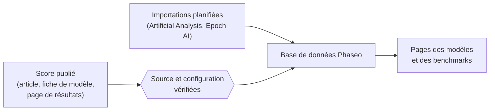

Phaseo publie des scores de benchmark mesurés par d’autres, chacun avec un lien vers sa provenance. Phaseo n’exécute pas de benchmarks et ne les fusionne pas en un score unique.

## D’où viennent les scores

| Source | Comment ils arrivent |
| --- | --- |
| Articles, fiches de modèle et annonces des développeurs de modèles | Ajoutés par les mainteneurs, marqués **autodéclarés** |
| Pages de résultats des organisateurs de benchmarks | Ajoutés par les mainteneurs |
| Index d’Artificial Analysis et d’Epoch AI | Importations planifiées, vérifiées toutes les heures |
| Signalements de la communauté | Issues GitHub, publiées après vérification des preuves par un mainteneur |

Chaque score doit avoir une source publique ou un journal d’évaluation reproductible avant d’être publié.

## Ce que signifie la normalisation

Phaseo conserve chaque benchmark sur sa propre échelle. Il normalise l’enregistrement autour du score, pas le score lui-même :

1. Chaque résultat est associé à un identifiant de benchmark unique, si bien que le même benchmark sous différents noms est regroupé.
2. La configuration est conservée comme variante lorsqu’elle diffère, par exemple le nombre d’exemples few-shot, le harnais d’évaluation ou l’effort de raisonnement, au lieu d’être fusionnée avec la configuration par défaut.
3. Chaque benchmark a un sens de tri. Les benchmarks où une valeur plus basse est meilleure, comme les taux d’erreur, classent le score le plus bas en premier.
4. Le lien vers la source et l’indicateur d’autodéclaration restent associés au score.

L’indicateur d’autodéclaration est une information, pas un rejet. Un score sans contexte suffisant peut être enregistré avec des notes sur la source ; ne le considérez pas comme équivalent à une ligne de classement entièrement vérifiée.

## Signaler une incohérence

1. Ouvrez une issue avec les preuves indiquées dans [Soumettre des scores de benchmark](./submitting-scores.mdx).
2. Répondez aux questions de revue dans l’issue. Les mainteneurs publient les corrections vérifiées via l’éditeur de la base de données.
3. Pour les contributions de recherche plus importantes, coordonnez-vous sur [Discord](https://discord.gg/aQyywCvgZ5).

La page publique sur la [normalisation des benchmarks](https://phaseo.app/how-phaseo-normalises-ai-benchmarks) présente les mêmes règles aux lecteurs du catalogue.
