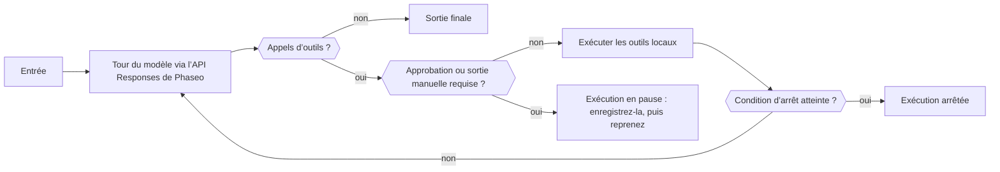

Utilisez un SDK Agent Phaseo quand une seule requête ne suffit pas : le SDK exécute dans votre processus une boucle bornée qui envoie chaque tour à l’API Responses, exécute les outils appelés par le modèle et se met en pause pour une personne quand un outil exige une approbation. Vous conservez l’état de l’exécution ; Phaseo n’héberge rien pour l’agent.

## Choisir votre package

| Langage | Package | Version | Client principal installé |
| --- | --- | --- | --- |
| TypeScript | [`@phaseo/agent-sdk`](https://www.npmjs.com/package/@phaseo/agent-sdk) | 0.3.0 | `@phaseo/sdk` |
| Python | [`phaseo-agent-sdk`](https://pypi.org/project/phaseo-agent-sdk/) (module `phaseo_agent`) | 0.3.0 | `phaseo` 3.x |
| Go | [`github.com/phaseoteam/Phaseo/packages/sdk/agent-sdk-go`](https://pkg.go.dev/github.com/phaseoteam/Phaseo/packages/sdk/agent-sdk-go) | v0.3.0 | `sdk-go/v4` |
| C# | [`Phaseo.AgentSdk`](https://www.nuget.org/packages/Phaseo.AgentSdk) | 0.3.0 | `Phaseo.Sdk` |
| PHP | [`phaseo/agent-sdk`](https://packagist.org/packages/phaseo/agent-sdk) | v0.3.0 | `phaseo/sdk` `^3.0.0` |
| Ruby | [`phaseo_agent_sdk`](https://rubygems.org/gems/phaseo_agent_sdk) | 0.3.0 | `phaseo_sdk` `>= 3.0.0, < 4.0.0` |
| Java | `app.phaseo:phaseo-agent-sdk` (Maven Central) | 0.3.0 | `app.phaseo:phaseo-sdk` 3.0.0 |
| Rust | [`phaseo-agent`](https://crates.io/crates/phaseo-agent) | 0.2.0 | `phaseo` 0.2 |

TypeScript sert de conception de référence. C++ n’a pas de SDK Agent. [Installation](./installation) donne les commandes d’installation et les prérequis d’exécution, et [Utilisation](./usage) construit un premier agent.

<Prompt description="Demandez à un agent de code de construire un premier agent avec le SDK Agent Phaseo dans votre langage." icon="bot" actions={["copy", "cursor"]}>
{`Build a small agent in this project with the Phaseo Agent SDK.

1. Install the Phaseo skills: npx skills add https://phaseo.app/docs
   For TypeScript, follow the phaseo-agent-sdk-typescript skill.
2. Read the Agent SDK pages at https://phaseo.app/docs/v1/sdk-reference/agent/overview, pick this project's language tab, and use only the APIs it documents.
3. Define one agent with at most two local tools that fit [AGENT TASK]. Keep the loop bounded with a step limit, and require approval for any tool that changes data.
4. Use a server-side PHASEO_API_KEY and check the model ID with GET /v1/models before using it.
5. Stream the agent's steps to the console so a run can be inspected.
6. Run the agent once, then report what you verified and what you could not verify.`}
</Prompt>

## Comparer ce que chaque runtime prend en charge

Chaque SDK exécute des outils locaux, se met en pause sur des ID d’appel d’outil exacts pour une approbation ou une sortie manuelle, et renvoie un état d’exécution sérialisable que votre application stocke. Le reste diffère selon le langage :

| Fonctionnalité | TypeScript | Python | Go | C# | PHP | Ruby | Java | Rust |
| --- | --- | --- | --- | --- | --- | --- | --- | --- |
| Limite d’étapes par défaut | 12 | 12 | 8 | 12 | 12 | 12 | 12 | 8 |
| Limite d’étapes atteinte | Lève `Max steps exceeded` | Lève `RuntimeError` | Renvoie une erreur | Lève `InvalidOperationException` | Lève une exception | Lève une exception | Lève une exception | Renvoie une exécution `stopped` (`max_steps:N`) |
| Streaming du modèle | Itérable asynchrone | Itérateur (thread en arrière-plan) | Channel | Énumérable asynchrone | Itérable ; ne s’exécute que pendant que vous itérez (Fiber) | Énumérateur (thread de travail) | Listes après l’exécution ; en direct via `onEvent` | Pas encore |
| Événements de progression des outils | Générateur asynchrone | `emit_progress` ou générateur | `EmitProgress` | `EmitProgress` | `emitProgress` | `emit_progress` | `emitProgress` | Pas encore |
| Outils concurrents | Oui | Oui (threads) | Oui | Oui | Non | Oui (threads) | Oui (pool de threads) | Non |
| Délai d’expiration des outils | Interrompt `context.signal` | Fait échouer l’exécution ; le thread continue | Fait échouer l’appel ; la goroutine continue | Annule le `CancellationToken` | Vérifié après le retour de l’outil | Interrompt l’appel | Interrompt le thread | Aucun |
| Validation du schéma à l’exécution | Oui | Oui | Oui | Oui | Oui | Oui | Oui | Non ; le JSON Schema est seulement envoyé au modèle |
| Erreur d’outil par défaut | Fait échouer l’exécution | Fait échouer l’exécution | Fait échouer l’exécution | Fait échouer l’exécution | Fait échouer l’exécution | Fait échouer l’exécution | Fait échouer l’exécution | Renvoyée au modèle |
| Approuver et rejeter par ID d’appel | Oui | Oui | Oui | Oui | Oui | Oui | Oui | Approbation seulement |
| Outils interactifs (humain dans la boucle) | Oui | Oui | Oui | Oui | Oui | Oui | Oui | `human_review` au niveau de l’agent seulement |
| Conditions d’arrêt | Composables | Composables ; vérifiées seulement sur les étapes sans appel d’outil | Composables | Composables | Composables | Composables | Composables | Limite d’étapes |
| Tours dynamiques | Oui | Modèle, instructions et échantillonnage ; outils via `next_turn_params` | Oui | Oui | Oui | Oui | Oui | Modèle, limite d’étapes et contexte par exécution |
| Éléments de chronologie typés | Union `AgentItem` | Dicts | Map `Details` | Dictionnaire `Details` | Tableaux | Hashes | Map `details()` | Non ; lisez `messages` et `steps` |
| Utilisation et coût | Oui | Oui | Oui | Oui | Oui | Oui | Oui | Tokens, plus le coût quand la réponse contient `meta.cost` ou `cost` |
| Annulation | `cancel()` | `cancel()` | Context | `CancellationToken` | `cancel()` | `cancel` | `cancel()` | Pas encore |
| Capture Devtools | Oui | Oui | Oui | Oui | Oui | Oui | Oui | Pas encore |

Rust (`phaseo-agent` 0.2) est synchrone : pas de streaming, d’exécution asynchrone, d’outils concurrents, de validation du schéma à l’exécution ni de capture Devtools. Exécutez-le sur un thread de travail quand une exécution ne doit pas bloquer un gestionnaire de requêtes. PHP exécute les outils un par un, et son flux n’avance que pendant que votre code itère.

## Choisir le SDK Agent, le client ou l’API brute

| Pour | Choisissez | Ce qu’il prend en charge |
| --- | --- | --- |
| Une requête API ou la couverture complète des endpoints | [SDK client](../client/overview) | Types d’API générés et transport |
| Une logique applicative multi-étapes qui utilise des outils | SDK Agent | Boucle locale, outils, points de reprise, revue, événements et Devtools |
| Un transport personnalisé ou un langage non pris en charge | API brute | Gestion des requêtes et réponses HTTP |

Le client gateway de chaque SDK Agent envoie les tours du modèle via le SDK client de ce langage. La plupart acceptent une map `requestOptions` (ou l’équivalent du langage) pour des champs supplémentaires de l’API Responses ; l’agent définit toujours `model`, `input`, `instructions` et ses outils de fonction. L’adaptateur Rust 0.2 n’envoie que les champs normalisés de l’agent et n’a pas de point d’extension pour des options supplémentaires.

## Partir d’une recette

| Recette | Langage |
| --- | --- |
| [Construire une boucle d’agent durable](../../cookbook/agent-sdk-durable-loop) | TypeScript |
| [Faire des recherches avec sortie structurée et recherche web](../../cookbook/agent-sdk-research-brief) | TypeScript |
| [Trier le support avec des préréglages et des échecs tenant compte des guardrails](../../cookbook/agent-sdk-support-triage) | TypeScript |
| [Exécuter un agent de revue de code avec des outils à l’exécution](../../cookbook/agent-sdk-coding-review) | TypeScript |
| [Répartir les outils d’agent locaux en parallèle](../../cookbook/agent-sdk-parallel-tools) | TypeScript |
| [Extraire du JSON structuré](../../cookbook/agent-sdk-python-structured-extraction) | Python |
| [Construire un agent de runbook d’exploitation](../../cookbook/agent-sdk-go-ops-runbook) | Go |
| [Trier des tickets](../../cookbook/agent-sdk-csharp-ticket-triage) | C# |
| [Relire du contenu CMS](../../cookbook/agent-sdk-php-content-review) | PHP |
| [Résumer des notes internes](../../cookbook/agent-sdk-ruby-rag-notes) | Ruby |

Les recettes TypeScript se transposent à n’importe quel langage avec les API décrites sur ces pages.
