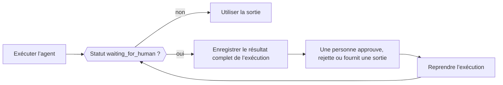

Quand un agent a besoin d’une personne, d’une tâche externe ou d’un outil exécuté par votre application, l’exécution se termine normalement (pas en erreur) avec le statut `waiting_for_human` et tout ce qu’il faut pour reprendre. Enregistrez le résultat complet, recueillez la décision dans votre application, puis passez le résultat enregistré et la décision à la méthode de reprise de l’agent.



<Note>
Phaseo ne stocke pas les exécutions du SDK Agent. Enregistrez l’état reprenable dans votre propre application quand il doit survivre à une requête ou à un redémarrage du processus.
</Note>

| Langage | Reprendre | Reprendre en streaming | Remarques |
| --- | --- | --- | --- |
| TypeScript | `agent.continueRun()` | `agent.continueStream()` | |
| Python | `agent.continue_run()` | `agent.continue_stream()` | |
| Go | `agent.Continue(ctx, ContinueOptions)` | `agent.ContinueStream` | |
| C# | `agent.ContinueRun(ContinueOptions)` | `agent.ContinueStream` | |
| PHP | `$agent->continueRun()` | `$agent->continueStream()` | `continueRunById()` charge d’abord l’exécution depuis un accesseur d’état |
| Ruby | `agent.continue_run` | `agent.continue_stream` | |
| Java | `agent.continueRun(ContinueOptions)` | `agent.continueStream` | `ContinueOptions` est un record positionnel |
| Rust | `agent.continue_run(&mut client, options)` | Aucune | `continue_with_events` ajoute un callback d’événements ; les exécutions sont synchrones |

## Approuver ou rejeter des appels d’outils

Les outils soumis à approbation, manuels et à humain dans la boucle mettent l’exécution en pause avant de s’exécuter. Chaque appel en attente contient le `call` du modèle (avec son `id`) et un `kind` : `approval`, `manual` ou `hitl`. Répondez à chaque appel par son ID d’appel exact, et non par le nom de l’outil, pour que deux appels au même outil restent distincts.

Un appel approuvé exécute son outil. Un appel rejeté envoie `{"error": "<reason>"}` au modèle comme résultat de l’outil, avec la raison par défaut `Tool call rejected`.

<CodeGroup>

```typescript TypeScript
const resumed = await agent.continueRun({
  run: paused,
  client,
  approvals: [{ toolCallId: "call_deploy_42" }],
  rejections: [
    { toolCallId: "call_delete_17", reason: "Not authorized" },
  ],
});
```

```python Python
from phaseo_agent import AgentToolDecision

pending = paused.run.pause.pending_tool_calls

continued = agent.continue_run(
    run=paused,
    client=client,
    approvals=[AgentToolDecision(pending[0].call.id)],
    rejections=[AgentToolDecision(pending[1].call.id, "Not authorized")],
)
```

```go Go
var approvals, rejections []phaseoagent.ToolDecision
for _, pending := range result.Run.Pause.PendingToolCalls {
  if pending.Kind != "approval" {
    continue
  }
  if userApproved(pending.Call) {
    approvals = append(approvals, phaseoagent.ToolDecision{ToolCallID: pending.Call.ID})
  } else {
    rejections = append(rejections, phaseoagent.ToolDecision{ToolCallID: pending.Call.ID, Reason: "Not now"})
  }
}

result, err = agent.Continue(ctx, phaseoagent.ContinueOptions{
  Run: result, Client: client, Approvals: approvals, Rejections: rejections,
})
```

```csharp C#
var pending = result.Run.Pause!.PendingToolCalls!.Where(item => item.Kind == "approval");

result = await agent.ContinueRun(new ContinueOptions
{
    Run = result,
    Client = client,
    Approvals = pending.Where(item => UserApproved(item.Call)).Select(item => new ToolDecision(item.Call.Id)).ToList(),
    Rejections = pending.Where(item => !UserApproved(item.Call)).Select(item => new ToolDecision(item.Call.Id, "Not now")).ToList(),
});
```

```php PHP
use Phaseo\AgentSdk\ToolDecision;

$approvals = $rejections = [];
foreach ($result->run->pause->pendingToolCalls as $pending) {
    if ($pending->kind !== "approval") continue;
    if (userApproved($pending->call)) {
        $approvals[] = new ToolDecision($pending->call->id);
    } else {
        $rejections[] = new ToolDecision($pending->call->id, "Not now");
    }
}

$result = $agent->continueRun(run: $result, client: $client, approvals: $approvals, rejections: $rejections);
```

```ruby Ruby
pending = result.run.pause.pending_tool_calls.select { |item| item.kind == "approval" }
approved, declined = pending.partition { |item| user_approved?(item.call) }

result = agent.continue_run(
  run: result,
  client: client,
  approvals: approved.map { |item| PhaseoAgentSdk::ToolDecision.new(tool_call_id: item.call.id) },
  rejections: declined.map { |item| PhaseoAgentSdk::ToolDecision.new(tool_call_id: item.call.id, reason: "Not now") }
)
```

```java Java
var pending = result.run().pause().pendingToolCalls();
var approvals = pending.stream().filter(item -> item.kind().equals("approval") && userApproved(item.call()))
    .map(item -> new AgentSdk.ToolDecision(item.call().id())).toList();
var rejections = pending.stream().filter(item -> item.kind().equals("approval") && !userApproved(item.call()))
    .map(item -> new AgentSdk.ToolDecision(item.call().id(), "Not now")).toList();

result = agent.continueRun(new AgentSdk.ContinueOptions(
    result, client, null, null, null, null, null, null, null, null, null,
    approvals, rejections, List.of()));
```

```rust Rust
use phaseo_agent::{ContinueOptions, ToolDecision};

let approvals = paused.run.pause.as_ref().unwrap()
    .pending_tool_calls
    .iter()
    .map(|pending| ToolDecision {
        tool_call_id: pending.call.id.clone(),
        reason: Some("Approved by the release operator".to_string()),
    })
    .collect();

let mut options = ContinueOptions::new(paused);
options.approvals = approvals;

let completed = agent.continue_run(&mut client, options)?;
```

</CodeGroup>

Où se trouvent les appels en attente, et ce qui se passe quand une décision manque :

| Langage | Appels en attente | Décision manquante |
| --- | --- | --- |
| TypeScript | `run.pause.pendingToolCalls` | Lève `Missing approval decision for tool call <id>` |
| Python | `run.pause.pending_tool_calls` | Lève `ValueError` |
| Go | `Run.Pause.PendingToolCalls` | Renvoie `missing approval decision for tool call <id>` |
| C# | `Run.Pause.PendingToolCalls` | Lève `Missing approval decision for tool call <id>` |
| PHP | `$result->run->pause->pendingToolCalls` | Lève `Missing approval decision for tool call <id>` |
| Ruby | `result.run.pause.pending_tool_calls` | Lève `Missing approval decision for tool call <id>` |
| Java | `run().pause().pendingToolCalls()` | Lève `Missing approval decision for tool call <id>` |
| Rust | `run.pause.pending_tool_calls` (une `Option`) | Renvoie une `AgentError` |

La pause elle-même a aussi un `kind`. Go et C# le définissent à `tool_approval` pour toute pause d’outil. PHP, Ruby et Java définissent `tool_approval` quand au moins un appel en attente exige une approbation, sinon le kind du premier appel. Rust utilise `tool_approval` pour les appels à approuver, `external_output` quand tous les appels en attente exigent un résultat externe, et `tool_input` pour un mélange des deux.

<Warning>
Rust `0.2` n’a ni type de rejet ni champ `rejections`. Laissez en pause un appel non approuvé, ou appliquez la politique de rejet de votre application avant de reprendre.
</Warning>

Pour exiger une approbation pour chaque appel d’outil plutôt qu’outil par outil, définissez `requireApproval` sur la définition de l’agent (`require_approval` en Python et Ruby, `RequireApproval` en Go et C#). En TypeScript, c’est une fonction `requireApproval(call, context)`. Rust ne prend en charge que l’approbation par outil, avec `Tool::require_approval()`. [Outils](./tools) montre comment chaque type d’outil est défini.

## Fournir les résultats des outils manuels et à humain dans la boucle

Pour les appels `manual` et `hitl`, passez le résultat produit par votre application, indexé par ID d’appel. En Rust, il s’agit des outils construits avec `Tool::external(...)`.

<CodeGroup>

```typescript TypeScript
await agent.continueRun({
  run: paused,
  client,
  toolOutputs: [{ toolCallId: callId, output: { status: "shipped" } }],
});
```

```python Python
from phaseo_agent import AgentToolOutput

agent.continue_run(
    run=paused,
    client=client,
    tool_outputs=[AgentToolOutput(call_id, {"status": "shipped"})],
)
```

```go Go
ToolOutputs: []phaseoagent.ToolOutput{{ToolCallID: callID, Output: map[string]any{"status": "shipped"}}},
```

```csharp C#
ToolOutputs = new[] { new ToolOutput(callId, new { status = "shipped" }) },
```

```php PHP
use Phaseo\AgentSdk\ToolOutput;

toolOutputs: [new ToolOutput($callId, ["status" => "shipped"])],
```

```ruby Ruby
tool_outputs: [PhaseoAgentSdk::ToolOutput.new(tool_call_id: call_id, output: { status: "shipped" })]
```

```java Java
// L’argument toolOutputs de ContinueOptions
List.of(new AgentSdk.ToolOutput(callId, Map.of("status", "shipped")))
```

```rust Rust
use phaseo_agent::{ContinueOptions, ToolOutput};
use serde_json::json;

let mut options = ContinueOptions::new(paused);
options.tool_outputs = vec![ToolOutput {
    tool_call_id: call_id,
    output: json!({ "status": "shipped" }),
}];

let completed = agent.continue_run(&mut client, options)?;
```

</CodeGroup>

Une sortie manquante fait échouer la reprise avec `Missing output for tool call <id>` (`missing` en minuscules en Go, une `ValueError` en Python, une `AgentError` en Rust). Un message de saisie humaine ne remplace pas une sortie d’outil.

## Mettre en pause pour une revue humaine

Définissez un callback de revue humaine sur la définition de l’agent pour vérifier chaque réponse du modèle avant que l’exécution continue. Renvoyez une demande de revue avec un `reason` (et éventuellement un `payload`) pour mettre en pause, ou rien pour continuer. Le `kind` de la pause est `human_review`. Le callback reçoit l’ID d’exécution, l’index de l’étape, les messages, la réponse du modèle et la sortie analysée (en Rust : les ID d’exécution et d’agent, l’index de l’étape, les messages, la réponse et le contexte applicatif).

<CodeGroup>

```typescript TypeScript
const agent = createAgent({
  id: "support-agent",
  humanReview: ({ response }) =>
    response.message.content.includes("needs approval")
      ? {
          reason: "approval_required",
          payload: { draft: response.message.content },
        }
      : null,
});
```

```python Python
from phaseo_agent import AgentHumanReviewRequest

def review(context):
    if "needs approval" in context.response.message.content:
        return AgentHumanReviewRequest("approval_required", {"draft": context.response.message.content})
    return None

agent = create_agent({"id": "support-agent", "human_review": review})
```

```go Go
HumanReview: func(review phaseoagent.HumanReviewContext) *phaseoagent.HumanReviewRequest {
  if strings.Contains(review.Response.Message.Content, "refund") {
    return &phaseoagent.HumanReviewRequest{Reason: "Refunds need sign-off"}
  }
  return nil
},
```

```csharp C#
HumanReview = review => Task.FromResult<HumanReviewRequest?>(
    review.Response.Message.Content.Contains("refund")
        ? new HumanReviewRequest("Refunds need sign-off")
        : null),
```

```php PHP
use Phaseo\AgentSdk\HumanReviewRequest;

humanReview: fn ($review) => str_contains($review->response->message->content, "refund")
    ? new HumanReviewRequest("Refunds need sign-off")
    : null,
```

```ruby Ruby
human_review: ->(review) {
  if review.response.message.content.include?("refund")
    PhaseoAgentSdk::HumanReviewRequest.new(reason: "Refunds need sign-off")
  end
}
```

```java Java
AgentSdk.HumanReview review = context ->
    context.response().message().content().contains("refund")
        ? new AgentSdk.HumanReviewRequest("Refunds need sign-off", null)
        : null;
```

```rust Rust
use phaseo_agent::{AgentDefinition, HumanReviewRequest};
use serde_json::json;

let definition = AgentDefinition::new("review-agent", "openai/gpt-6-astra")
    .human_review(|context| {
        if context.response.message.content.contains("needs approval") {
            Some(HumanReviewRequest {
                reason: "Review the proposed action".to_string(),
                payload: json!({ "draft": context.response.message.content }),
            })
        } else {
            None
        }
    });
```

</CodeGroup>

Reprenez avec une saisie humaine, qui est ajoutée à la conversation comme message utilisateur :

<CodeGroup>

```typescript TypeScript
const continued = await agent.continueRun({
  run: pausedResult,
  client,
  humanInput: "Approved. Continue and return the final answer.",
});
```

```python Python
continued = agent.continue_run(
    run=paused,
    client=client,
    human_input="Approved. Continue and return the final answer.",
)
```

```go Go
result, err = agent.Continue(ctx, phaseoagent.ContinueOptions{
  Run:        result,
  Client:     client,
  HumanInput: "Approved. Refund up to $50.",
})
```

```csharp C#
result = await agent.ContinueRun(new ContinueOptions
{
    Run = result,
    Client = client,
    HumanInput = "Approved. Refund up to $50.",
});
```

```php PHP
$result = $agent->continueRun(
    run: $result,
    client: $client,
    humanInput: "Approved. Refund up to $50."
);
```

```ruby Ruby
result = agent.continue_run(
  run: result,
  client: client,
  human_input: "Approved. Refund up to $50."
)
```

```java Java
result = agent.continueRun(new AgentSdk.ContinueOptions(
    result, client, null, null, null, null,
    "Approved. Refund up to $50.",          // humanInput
    null, null, null, null));
```

```rust Rust
use phaseo_agent::ContinueOptions;

let mut options = ContinueOptions::new(paused);
options.human_input = Some("Approved. Continue and return the final result.".to_string());

let completed = agent.continue_run(&mut client, options)?;
```

</CodeGroup>

Reprendre une pause de revue sans saisie humaine échoue avec `Run <id> is waiting for human input` (Go : `run <id> is waiting for human input` ; Java : `Run is waiting for human input`). Rust exige un `human_input` non vide. TypeScript accepte aussi des `humanMessages` structurés.

## Enregistrer l’état de l’exécution entre les requêtes

Le résultat d’exécution est une simple donnée : stockez-le dans votre base de données, votre stockage d’objets ou l’enregistrement de votre tâche, et gardez le `context` applicatif sérialisable. Seul un agent ayant le même ID peut reprendre une exécution. [La recette de boucle d’agent durable](../../cookbook/agent-sdk-durable-loop) montre un flux complet d’enregistrement et de reprise.

Pour laisser le SDK enregistrer et charger les exécutions à votre place, passez un accesseur d’état avec `load(runId)` et `save(result)`. Le SDK enregistre alors après chaque exécution et chaque reprise, et vous pouvez reprendre par ID d’exécution au lieu de faire transiter l’enregistrement à travers chaque couche.

| Langage | Accesseur d’état | Reprendre par ID |
| --- | --- | --- |
| TypeScript | `state` avec `load(runId)` et `save(result)` asynchrones | `continueRun({ runId, state, client })` |
| Python | `state`, qui implémente `AgentStateAccessor` | `continue_run(run_id=..., state=..., client=...)` |
| Go | `State`, qui implémente `StateAccessor`, sur `RunOptions` et `ContinueOptions` | `ContinueOptions{RunID: id, State: store}` |
| C# | `State`, qui implémente `IStateAccessor`, sur `RunOptions` et `ContinueOptions` | `new ContinueOptions { RunId = id, State = store, Client = client }` |
| PHP | `state`, qui implémente `StateAccessor` | `continueRunById($runId, $state, $client, approvals: ..., rejections: ..., toolOutputs: ...)` ; lève `Run <id> not found` s’il est absent |
| Ruby | `state:`, n’importe quel objet avec `load(run_id)` et `save(result)` | `continue_run(run_id: id, state: store, client: client)` |
| Java | `StateAccessor`, le dernier argument de `RunOptions` | Le `ContinueOptions` à 16 arguments avec `runId` et `state` en dernier et `run` à null. Il charge l’exécution mais n’enregistre pas le résultat repris ; enregistrez-le donc vous-même. |
| Rust | Aucun | Sérialisez `RunResult` avec Serde et passez-le à `ContinueOptions::new` |

<CodeGroup>

```go Go
type StateAccessor interface {
  Load(ctx context.Context, runID string) (*phaseoagent.RunResult, error)
  Save(ctx context.Context, result phaseoagent.RunResult) error
}
```

```csharp C#
public interface IStateAccessor
{
    Task<RunResult?> Load(string runId, CancellationToken cancellationToken = default);
    Task Save(RunResult result, CancellationToken cancellationToken = default);
}
```

```rust Rust
use phaseo_agent::RunResult;

// Enregistrer l’exécution en pause
std::fs::write("paused-run.json", serde_json::to_string_pretty(&paused)?)?;

// La restaurer plus tard
let paused: RunResult = serde_json::from_str(&std::fs::read_to_string("paused-run.json")?)?;
```

</CodeGroup>

En Rust, recréez la même définition d’agent et les mêmes outils avant de reprendre : les closures et `AgentDefinition` ne font pas partie de l’exécution sérialisée. Le modèle effectif et la limite d’étapes sont stockés dans `RunRecord`, donc les surcharges par exécution restent actives après la reprise.

Quoi que vous stockiez, votre application est responsable du chiffrement et de la conservation des exécutions enregistrées, de l’autorisation des approbations et des saisies humaines, et de l’idempotence des effets de bord qui se rejouent après une reprise.
