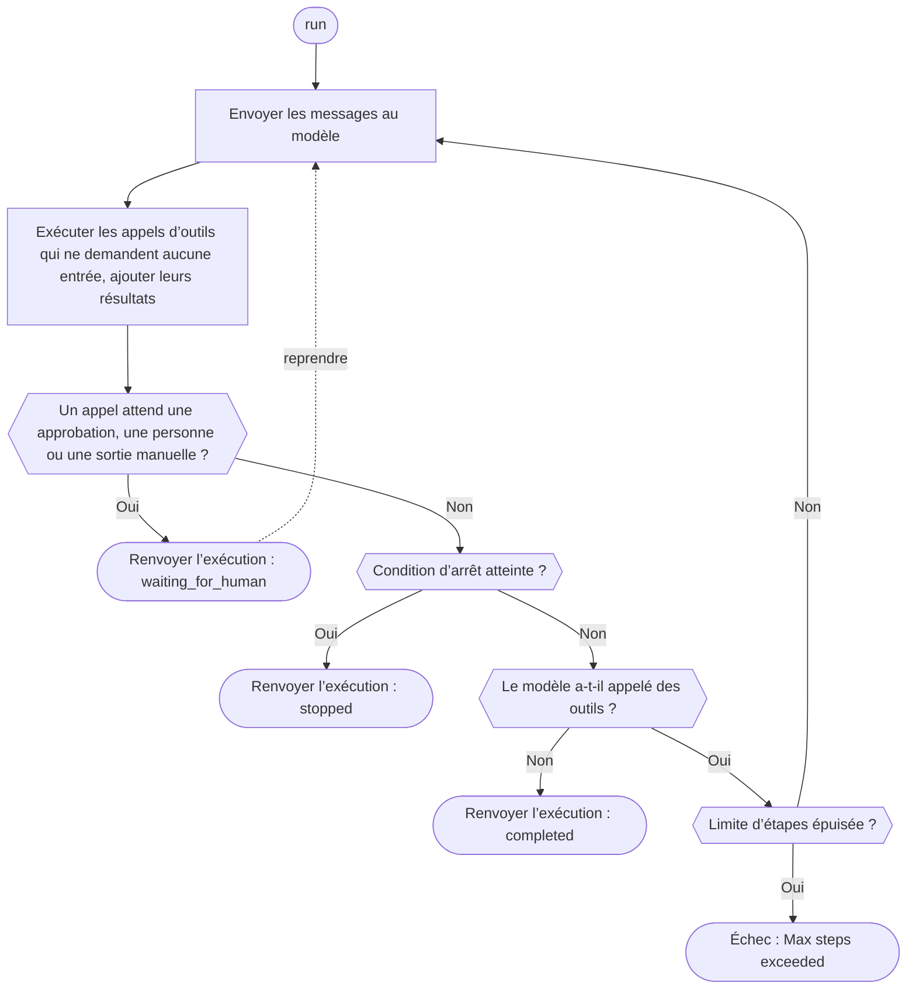

Définissez un outil, créez un agent et exécutez-le avec un client gateway. Le modèle appelle votre outil, le SDK l’exécute et renvoie le résultat, puis l’exécution se termine quand le modèle répond sans appeler d’outil, se met en pause pour une personne ou qu’une [condition d’arrêt](./stop-conditions) est remplie. Si l’exécution atteint d’abord sa limite d’étapes, le SDK lève une erreur ; seul Rust renvoie l’exécution avec le statut `stopped`. Phaseo n’héberge pas l’agent et ne stocke pas ses exécutions ; c’est votre application qui s’en charge.

## Construire un premier agent

<CodeGroup>

```typescript TypeScript
import {
  createAgent,
  createGatewayAgentClient,
  defineTool,
} from "@phaseo/agent-sdk";

const lookupDocs = defineTool({
  id: "lookup-docs",
  description: "Look up an internal docs page by slug.",
  parameters: {
    type: "object",
    properties: {
      slug: { type: "string" },
    },
    required: ["slug"],
    additionalProperties: false,
  },
  async execute(input: { slug: string }) {
    return {
      slug: input.slug,
      url: `https://phaseo.app/docs/v1/${input.slug}`,
    };
  },
});

const agent = createAgent({
  id: "support-docs-agent",
  model: "openai/gpt-6-astra",
  instructions: "Use tools when helpful and finish with a concise answer.",
  tools: [lookupDocs],
});

const result = await agent.run({
  input: "Find the docs page for presets and explain when to use them.",
  client: createGatewayAgentClient({
    clientOptions: {
      apiKey: process.env.PHASEO_API_KEY!,
    },
  }),
});

console.log(result.output);
```

```python Python
import os
from phaseo_agent import AgentTool, create_agent, create_gateway_agent_client, define_tool

lookup_docs = define_tool(AgentTool(
    id="lookup-docs",
    description="Look up an internal docs page by slug.",
    parameters={
        "type": "object",
        "properties": {"slug": {"type": "string"}},
        "required": ["slug"],
        "additionalProperties": False,
    },
    execute=lambda tool_input, runtime: {
        "slug": tool_input["slug"],
        "url": f"https://phaseo.app/docs/v1/{tool_input['slug']}",
    },
))

agent = create_agent({
    "id": "support-docs-agent",
    "model": "openai/gpt-6-astra",
    "instructions": "Use tools when helpful and finish with a concise answer.",
    "tools": [lookup_docs],
})

result = agent.run(
    input="Find the docs page for presets and explain when to use them.",
    client=create_gateway_agent_client(client_options={"api_key": os.environ["PHASEO_API_KEY"]}),
)

print(result.output)
```

```go Go
package main

import (
  "context"
  "fmt"

  phaseoagent "github.com/phaseoteam/Phaseo/packages/sdk/agent-sdk-go"
)

func main() {
  client, err := phaseoagent.CreateGatewayAgentClient(phaseoagent.GatewayAgentClientOptions{})
  if err != nil {
    panic(err) // PHASEO_API_KEY est obligatoire
  }

  lookup := phaseoagent.DefineTool(phaseoagent.Tool{
    ID:          "lookup_docs",
    Description: "Look up a Phaseo documentation topic",
    Parameters: map[string]any{
      "type":       "object",
      "properties": map[string]any{"topic": map[string]any{"type": "string"}},
      "required":   []string{"topic"},
    },
    Execute: func(input any, runtime phaseoagent.RuntimeContext) (any, error) {
      args, _ := input.(map[string]any)
      return map[string]any{"topic": args["topic"], "found": true}, nil
    },
  })

  agent := phaseoagent.CreateAgent(phaseoagent.AgentDefinition{
    ID:           "docs-agent",
    Model:        "openai/gpt-6-astra",
    Instructions: "Use tools when helpful and finish with a concise answer.",
    Tools:        []phaseoagent.Tool{lookup},
    MaxSteps:     6,
  })

  result, err := agent.Run(context.Background(), phaseoagent.RunOptions{
    Input:  "Explain when to use routing presets.",
    Client: client,
  })
  if err != nil {
    panic(err)
  }

  fmt.Println(result.Output)
  fmt.Println(result.Run.Status, result.Usage.TotalTokens)
}
```

```csharp C#
using System.Text.Json;
using PhaseoAgentSdk;

var lookup = AgentSdk.DefineTool(new Tool(
    "lookup_docs",
    async (input, runtime) =>
    {
        var topic = ((JsonElement)input!).GetProperty("topic").GetString();
        return new { topic, found = true };
    },
    "Look up a Phaseo documentation topic",
    new Dictionary<string, object?>
    {
        ["type"] = "object",
        ["properties"] = new Dictionary<string, object?> { ["topic"] = new { type = "string" } },
        ["required"] = new[] { "topic" },
    }));

var agent = AgentSdk.CreateAgent(new AgentDefinition
{
    Id = "docs-agent",
    Model = "openai/gpt-6-astra",
    Instructions = "Use tools when helpful and finish with a concise answer.",
    Tools = new[] { lookup },
    MaxSteps = 6,
});

var result = await agent.Run(new RunOptions
{
    Input = "Explain when to use routing presets.",
    Client = AgentSdk.CreateGatewayAgentClient(), // lève une exception si PHASEO_API_KEY manque
});

Console.WriteLine(result.Output);
Console.WriteLine($"{result.Run.Status} {result.Usage.TotalTokens}");
```

```php PHP
<?php
require "vendor/autoload.php";

use Phaseo\AgentSdk\AgentDefinition;
use Phaseo\AgentSdk\AgentSdk;
use Phaseo\AgentSdk\Tool;

$lookup = AgentSdk::defineTool(new Tool(
    id: "lookup_docs",
    execute: fn (array $input, $runtime) => ["topic" => $input["topic"], "found" => true],
    description: "Look up a Phaseo documentation topic",
    parameters: [
        "type" => "object",
        "properties" => ["topic" => ["type" => "string"]],
        "required" => ["topic"],
    ],
));

$agent = AgentSdk::createAgent(new AgentDefinition(
    id: "docs-agent",
    model: "openai/gpt-6-astra",
    instructions: "Use tools when helpful and finish with a concise answer.",
    tools: [$lookup],
    maxSteps: 6,
));

$result = $agent->run(
    input: "Explain when to use routing presets.",
    client: AgentSdk::createGatewayAgentClient() // lève une exception si PHASEO_API_KEY manque
);

echo $result->output . PHP_EOL;
echo $result->run->status . " " . $result->usage["total_tokens"] . PHP_EOL;
```

```ruby Ruby
require "phaseo_agent_sdk"

lookup = PhaseoAgentSdk.define_tool(
  PhaseoAgentSdk::Tool.new(
    id: "lookup_docs",
    description: "Look up a Phaseo documentation topic",
    parameters: {
      type: "object",
      properties: { topic: { type: "string" } },
      required: ["topic"]
    },
    execute: ->(input, runtime) { { topic: input["topic"], found: true } }
  )
)

agent = PhaseoAgentSdk.create_agent(
  id: "docs-agent",
  model: "openai/gpt-6-astra",
  instructions: "Use tools when helpful and finish with a concise answer.",
  tools: [lookup],
  max_steps: 6
)

result = agent.run(
  input: "Explain when to use routing presets.",
  client: PhaseoAgentSdk.create_gateway_agent_client # lève une exception si PHASEO_API_KEY manque
)

puts result.output
puts "#{result.run.status} #{result.usage[:total_tokens]}"
```

```java Java
import app.phaseo.agent.AgentSdk;
import java.time.Duration;
import java.util.List;
import java.util.Map;

var lookup = AgentSdk.defineTool(new AgentSdk.Tool(
    "lookup_docs",
    (input, context) -> Map.of("topic", ((Map<?, ?>) input).get("topic"), "found", true),
    "Look up a Phaseo documentation topic",
    Map.of(
        "type", "object",
        "properties", Map.of("topic", Map.of("type", "string")),
        "required", List.of("topic")),
    Duration.ofSeconds(10)
));

var agent = AgentSdk.createAgent(new AgentSdk.AgentDefinition(
    "docs-agent",                       // id
    "openai/gpt-6-astra",               // model
    null,                               // preset
    "Use tools when helpful and finish with a concise answer.", // instructions
    List.of(lookup),                    // tools
    6,                                  // maxSteps
    null, null, null, null              // parseOutput, humanReview, modelRetry, toolExecution
));

var result = agent.run(new AgentSdk.RunOptions(
    "Explain when to use routing presets.",  // input
    AgentSdk.createGatewayAgentClient(),     // lève une exception si PHASEO_API_KEY manque
    null, null, null, null, null, null, null, null
));

System.out.println(result.output());
System.out.println(result.run().status() + " " + result.usage().totalTokens());
```

```rust Rust
use phaseo_agent::{
    create_agent, create_gateway_agent_client, define_tool, AgentDefinition,
    RunOptions, Tool,
};
use serde_json::json;

fn main() -> Result<(), Box<dyn std::error::Error>> {
    let lookup = define_tool(Tool::new(
        "lookup_docs",
        "Look up a Phaseo documentation topic",
        json!({
            "type": "object",
            "properties": {
                "topic": { "type": "string" }
            },
            "required": ["topic"]
        }),
        |input, context| {
            Ok(json!({
                "topic": input["topic"],
                "run_id": context.run_id,
                "found": true
            }))
        },
    ));

    let agent = create_agent(
        AgentDefinition::new("docs-agent", "openai/gpt-6-astra")
            .instructions("Use lookup_docs when helpful. Answer concisely.")
            .max_steps(6)
            .tool(lookup),
    );

    let mut client = create_gateway_agent_client("openai/gpt-6-astra")?;
    let result = agent.run(
        &mut client,
        RunOptions::new("Explain when to use routing presets."),
    )?;

    println!("{}", result.output);
    println!("steps: {}", result.run.step_count);
    println!("tokens: {}", result.usage.total_tokens);
    Ok(())
}
```

</CodeGroup>

L’ID de l’outil est le nom de fonction que voit le modèle, et ses paramètres sont le JSON Schema que le modèle remplit. Les arguments arrivent dans votre code sous la forme native de chaque langage :

| Langage | L’outil reçoit | Remarques |
| --- | --- | --- |
| TypeScript | Objet typé | `execute(input, context)` |
| Python | `dict` | `execute(tool_input, runtime)` |
| Go | `any` (JSON décodé, généralement `map[string]any`) | `Execute(input, runtime) (any, error)` |
| C# | `JsonElement` | `Execute(input, runtime)`, attendu avec await |
| PHP | Tableau associatif | `execute(array $input, $runtime)` |
| Ruby | Hash à clés de type chaîne | Construisez les outils avec `PhaseoAgentSdk::Tool.new` ; `define_tool` renvoie ce que vous lui passez, donc un simple Hash ne fonctionne pas |
| Java | `Map` | Les records sont positionnels ; passez `null` pour tout ce que vous ne définissez pas |
| Rust | `serde_json::Value` | La closure s’exécute localement ; `RuntimeContext` contient l’ID d’exécution, l’ID de l’agent, l’index de l’étape, le contexte applicatif et l’appel d’outil |

Si l’agent, l’exécution et le client ne définissent ni modèle ni préréglage, le client gateway envoie `phaseo/free`. Le `create_gateway_agent_client` de Rust prend le modèle en argument.

## Déroulement d’une exécution



Chaque étape est enregistrée comme point de reprise dans le résultat d’exécution renvoyé. Pour reprendre entre plusieurs requêtes ou après un redémarrage, enregistrez ce résultat dans votre propre stockage et passez-le à la méthode de reprise, ou donnez à l’agent un accesseur d’état ; voir [État et approbation](./state-and-approval). La limite d’étapes et ce qui se passe quand elle est épuisée diffèrent selon le langage :

<Tabs>
<Tab title="TypeScript">

Chaque appel à `run()` ou `continueRun()` effectue au plus 12 étapes, sauf si vous définissez `maxSteps` ; au-delà, il lève `Max steps exceeded`. Utilisez les [conditions d’arrêt](./stop-conditions) pour terminer proprement une exécution.

</Tab>
<Tab title="Python">

Une exécution effectue au plus 12 étapes, sauf si vous définissez `max_steps` ; au-delà, elle lève `RuntimeError`. Les conditions d’arrêt ne sont vérifiées que sur une étape où le modèle ne fait aucun appel d’outil, donc l’ordre diffère du diagramme : une boucle d’outils continue jusqu’à ce qu’elle se mette en pause, réponde ou épuise `max_steps`.

</Tab>
<Tab title="Go">

Une exécution qui demande plus de `MaxSteps` tours du modèle (8 par défaut) échoue avec `Max steps exceeded (N)`.

</Tab>
<Tab title="C#">

Une exécution qui demande plus de `MaxSteps` tours du modèle (12 par défaut) lève `InvalidOperationException("Max steps exceeded (N)")`.

</Tab>
<Tab title="PHP">

Une exécution qui demande plus de `maxSteps` tours du modèle (12 par défaut) lève `Max steps exceeded (N)`.

</Tab>
<Tab title="Ruby">

Une exécution qui demande plus de `max_steps` tours du modèle (12 par défaut) lève `Max steps exceeded (N)`.

</Tab>
<Tab title="Java">

Une exécution qui demande plus de `maxSteps` tours du modèle (12 par défaut) lève `Max steps exceeded (N)`.

</Tab>
<Tab title="Rust">

Une exécution effectue au plus 8 tours du modèle, sauf si vous appelez `.max_steps(n)` ou définissez `RunOptions.max_steps`. Atteindre la limite ne provoque pas d’échec : l’exécution se termine avec `run.status` à `stopped` et `run.stop_reason` à `max_steps:<limit>`. Les exécutions sont synchrones et les outils locaux s’exécutent un par un ; utilisez donc un thread de travail ou une frontière de tâche quand une exécution ne doit pas bloquer un gestionnaire de requêtes.

</Tab>
</Tabs>

## Lire le résultat de l’exécution

Chaque exécution renvoie les mêmes parties. Les noms de champs suivent la casse de chaque langage (`output`, `Output`, `output()`) :

| Partie | Contenu |
| --- | --- |
| `run` | Statut, ID, modèle effectif, limite d’étapes, contexte, état de pause et raison d’arrêt |
| `steps` | Un enregistrement par tour du modèle : ID de requête, fournisseur, modèle, raison de fin, avertissements, appels d’outils et utilisation |
| `messages` | Toute la conversation, y compris les résultats des outils |
| `output` | La sortie finale |
| `usage` | Tokens d’entrée, de sortie, en cache et totaux, et coût |

Le `usage.cost` de Rust provient uniquement d’un `meta.cost` ou `cost` numérique dans la réponse ; il ne convertit pas `cost_nanos` ni `cost_cents`. Utilisez la réponse du Gateway ou l’enregistrement de génération pour le suivi des dépenses en Rust.

## Trouver la bonne fonctionnalité

| Pour… | Page |
| --- | --- |
| Donner au modèle des outils locaux, manuels ou qui signalent leur progression | [Outils](./tools) |
| Se mettre en pause pour une approbation ou une personne, puis reprendre | [État et approbation](./state-and-approval) |
| Afficher le texte et l’activité des outils au fil de l’eau | [Streaming](./streaming) |
| Afficher une chronologie des messages, du raisonnement et des appels d’outils | [Éléments](./items) |
| Borner les étapes, les tokens, le coût ou la durée | [Conditions d’arrêt](./stop-conditions) |
| Changer de modèle ou d’outils entre les tours | [Tours dynamiques](./dynamic-turns) |
| Obtenir une sortie typée, réessayer les appels au modèle, utiliser un préréglage | [Sorties et nouvelles tentatives](./run-controls) |
| Journaliser ou auditer chaque étape | [Hooks de cycle de vie](./lifecycle-hooks) |
| Enregistrer l’utilisation, le coût et les ID de requête d’une exécution | [Observabilité](./observability) |
| Gérer les erreurs du gateway, de schéma et de limite d’étapes | [Événements et erreurs](./events-and-errors) |
| Inspecter les exécutions en local | [DevTools](./devtools) |

Chaque export est listé dans la [référence de l’API](./api-reference), et des agents complets se trouvent dans [Exemples](./examples).
