import { ChangelogFilters } from "/snippets/changelog-filters.jsx";

<ChangelogFilters labels={{"product":"उत्पाद","api":"API और SDK","models":"मॉडल"}} clearLabel="साफ़ करें" />

<Update label="31 मई 2026">

API और SDK

- **असंगत बदलाव:** टेक्स्ट अनुरोध अब टियर केवल `service_tier` से चुनते हैं; `speed: "fast"` की जगह `service_tier: "priority"` लिखें, और सिंक्रोनस `service_tier: "batch"` अनुरोध अब वैलिडेशन त्रुटि लौटाते हैं; देखें [सर्विस टियर](../guides/service-tiers.mdx) ([#565](https://github.com/phaseoteam/Phaseo/pull/565))।

मॉडल

- [Nvidia: Cosmos3 Super Reasoner](https://phaseo.app/models/nvidia/cosmos3-super-reasoner)

</Update>

<Update label="30 मई 2026">

मॉडल

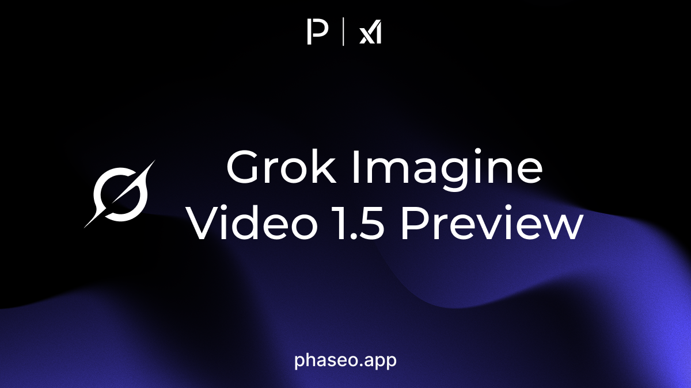

- [xAI: Grok Imagine Video 1.5 Preview](https://phaseo.app/models/x-ai/grok-imagine-video-1.5-preview)

</Update>

<Update label="29 मई 2026">

उत्पाद

- मॉडल पेज के क्विकस्टार्ट में मॉडल के समर्थित एंडपॉइंट उनके HTTP मेथड के साथ दिखते हैं, और किसी एक को चुनने पर उदाहरण कोड बदल जाता है ([#521](https://github.com/phaseoteam/Phaseo/pull/521))।

API और SDK

- `service_tier: "priority"` वाले अनुरोध अब केवल उन प्रदाताओं को भेजे जाते हैं जो यह टियर देते हैं, और Venice उसी मॉडल ID से Claude Opus 4.8 के priority अनुरोध संभालता है; देखें [सर्विस टियर](../guides/service-tiers.mdx) ([#524](https://github.com/phaseoteam/Phaseo/pull/524), [#530](https://github.com/phaseoteam/Phaseo/pull/530))।

मॉडल

- [StepFun: Step 3.7 Flash](https://phaseo.app/models/stepfun/step-3.7-flash)

</Update>

<Update label="28 मई 2026">

उत्पाद

- जब किसी प्रदाता का केवल एक सक्रिय प्लान हो, जैसे सिर्फ़ बैच मूल्य, तब भी मॉडल मूल्य पैनल में प्लान चयनकर्ता दिखता रहता है ([#515](https://github.com/phaseoteam/Phaseo/pull/515))।
- Anthropic on AWS रूट मॉडल मूल्य और प्रदाता सूचियों में AWS लोगो और साफ़ प्रदाता नाम दिखाते हैं ([#519](https://github.com/phaseoteam/Phaseo/pull/519), [#525](https://github.com/phaseoteam/Phaseo/pull/525), [#526](https://github.com/phaseoteam/Phaseo/pull/526))।

मॉडल

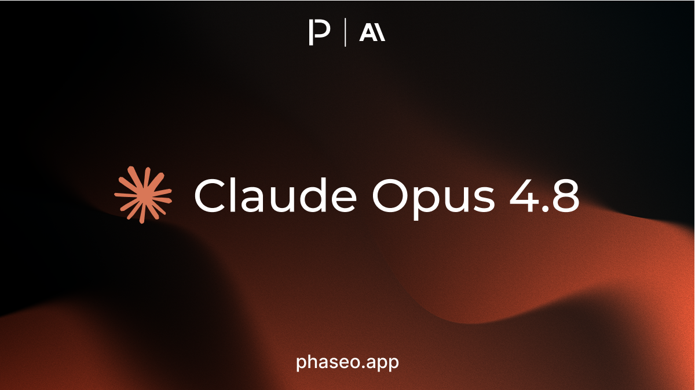

- [Anthropic: Claude Opus 4.8](https://phaseo.app/models/anthropic/claude-opus-4.8)
- [CrofAI: Greg RP](https://phaseo.app/models/crofai/greg-rp)
- [Google: Gemini 3 Pro Image (Nano Banana Pro)](https://phaseo.app/models/google/gemini-3-pro-image)
- [Google: Gemini 3.1 Flash Image (Nano Banana 2)](https://phaseo.app/models/google/gemini-3.1-flash-image)

</Update>

<Update label="26 मई 2026">

मॉडल

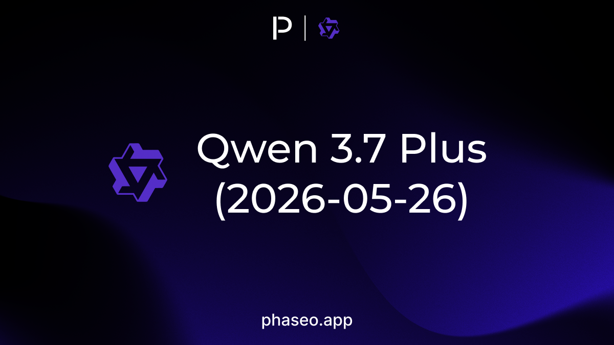

- [Qwen: Qwen 3.7 Plus (2026-05-26)](https://phaseo.app/models/qwen/qwen3.7-plus-2026-05-26)

</Update>

<Update label="25 मई 2026">

मॉडल

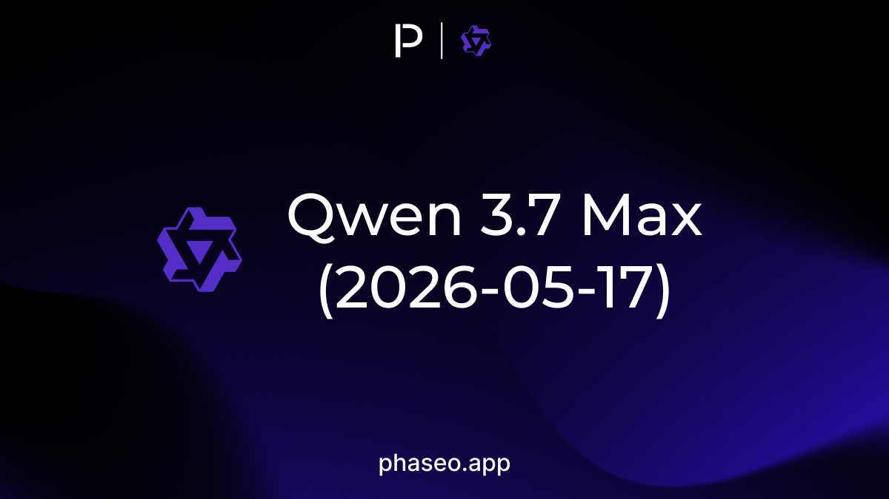

- [Qwen: Qwen 3.7 Max (2026-05-17)](https://phaseo.app/models/qwen/qwen3.7-max-2026-05-17)
- [Qwen: Qwen 3.7 Max Preview](https://phaseo.app/models/qwen/qwen3.7-max-preview)

</Update>

<Update label="21 मई 2026">

मॉडल

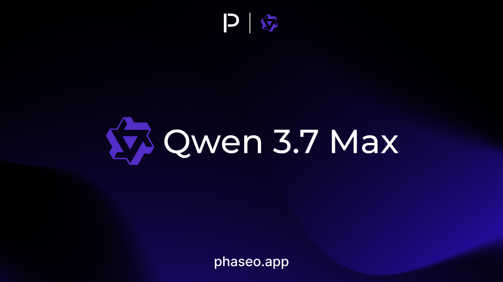

- [Qwen: Qwen 3.7 Max](https://phaseo.app/models/qwen/qwen3.7-max)

</Update>

<Update label="20 मई 2026">

मॉडल

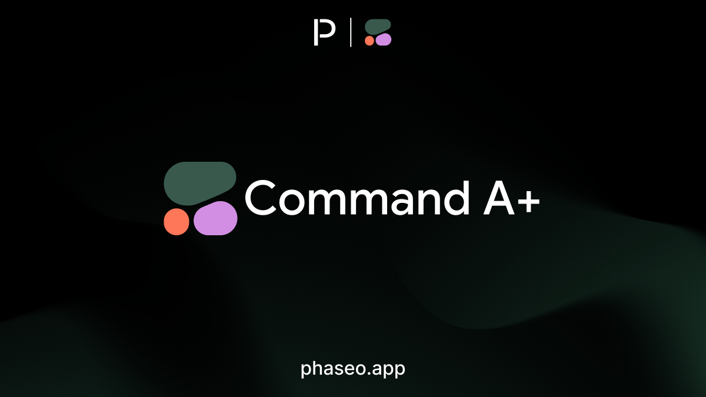

- [Cohere: Command A+](https://phaseo.app/models/cohere/command-a-plus)

</Update>

<Update label="19 मई 2026">

उत्पाद

- **Models** में मुफ़्त राउटर दिखता है, और उसके पेज पर वे मुफ़्त मॉडल दिखते हैं जिन तक वह रूट कर सकता है, साथ में हाल का उपयोग; देखें [मुफ़्त राउटर से शुरुआत](../cookbook/free-router-first-deploy.mdx) ([#495](https://github.com/phaseoteam/Phaseo/pull/495))।

मॉडल

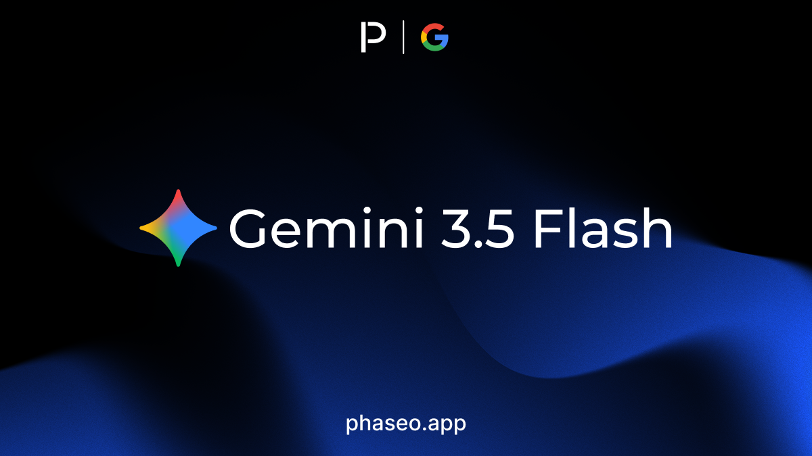

- [Google: Gemini 3.5 Flash](https://phaseo.app/models/google/gemini-3.5-flash)
- [Qwen: Qwen 3.5 LiveTranslate Flash Realtime (2026-05-19)](https://phaseo.app/models/qwen/qwen3.5-livetranslate-flash-realtime-2026-05-19)

</Update>

<Update label="18 मई 2026">

मॉडल

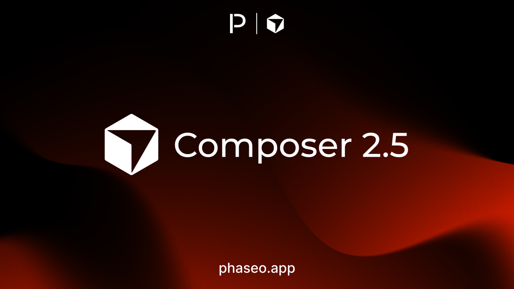

- [Cursor: Composer 2.5](https://phaseo.app/models/cursor/composer-2.5)

</Update>

<Update label="16 मई 2026">

मॉडल

- [xAI: Grok TTS](https://phaseo.app/models/x-ai/grok-tts)

</Update>

<Update label="15 मई 2026">

मॉडल

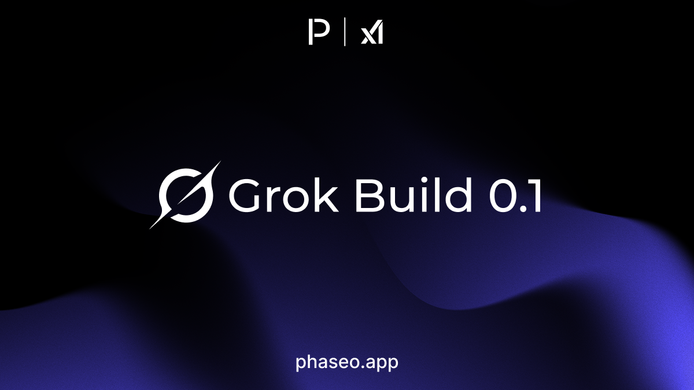

- [xAI: Grok Build 0.1](https://phaseo.app/models/x-ai/grok-build-0.1)

</Update>

<Update label="9 मई 2026">

उत्पाद

- Chat विफल इमेज या वीडियो जनरेशन को उसी प्रॉम्प्ट, उसी मॉडल और उसी अस्थायी चैट सेटिंग के साथ दोबारा चला सकता है ([#479](https://github.com/phaseoteam/Phaseo/pull/479))।

</Update>

<Update label="8 मई 2026">

API और SDK

- TypeScript, Python, Go, C#, Java, PHP और Ruby SDK `2.0.4` अपने टाइप में `session_id`, संरचित त्रुटि निदान और मॉडल उपलब्धता फ़ील्ड जोड़ते हैं; देखें [रिलीज़ नोट्स](https://github.com/phaseoteam/Phaseo/releases/tag/%40ai-stats%2Fsdk%402.0.4) ([#476](https://github.com/phaseoteam/Phaseo/pull/476))।

</Update>

<Update label="7 मई 2026">

उत्पाद

- **Models** के मूल्य होवर कार्ड इमेज, वीडियो और स्तरीय टेक्स्ट मूल्य दिखाते हैं, जो गुणवत्ता, रिज़ॉल्यूशन, अवधि, ऑडियो और कॉन्टेक्स्ट आकार के अनुसार समूहित होते हैं ([#474](https://github.com/phaseoteam/Phaseo/pull/474))।
- **Models** प्रति मिनट बिल होने वाले ऑडियो मॉडल, जैसे `whisper-1`, को राउंड किए गए टोकन मूल्य के बजाय प्रति मिनट मूल्य में दिखाता है, जैसे $0.006 प्रति मिनट ([#477](https://github.com/phaseoteam/Phaseo/pull/477))।
- मॉडल पेज के हेडर में मॉडल ID कंट्रोल जुड़ा है, जो मॉडल के उपनामों के बीच बदलता है और चुनी गई ID कॉपी करता है ([#473](https://github.com/phaseoteam/Phaseo/pull/473))।
- **Models** साइडबार में फ़िल्टर की गिनती अब चुने गए दूसरे फ़िल्टर के अनुसार अपडेट होती है ([#473](https://github.com/phaseoteam/Phaseo/pull/473))।

API और SDK

- **असंगत बदलाव:** `/v1/videos`, `/v1/batches`, `/v1/files` और `/v1/music/generations` अस्थायी रूप से बंद हैं और `501 not_implemented` लौटाते हैं; दोबारा चालू होने तक इन्हें कॉल करना रोक दें ([#473](https://github.com/phaseoteam/Phaseo/pull/473))।

मॉडल

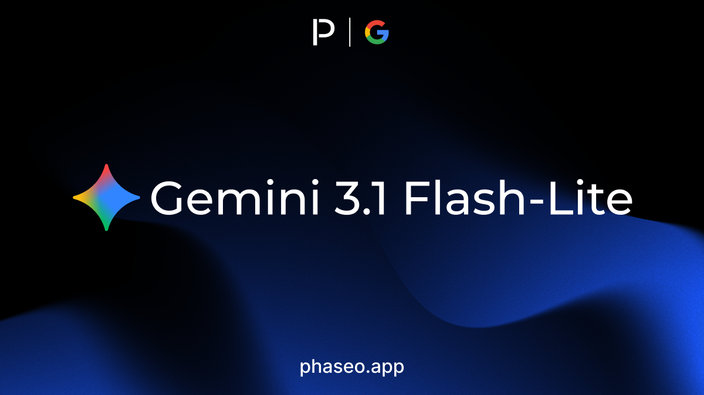

- [Google: Gemini 3.1 Flash-Lite](https://phaseo.app/models/google/gemini-3.1-flash-lite)
- [OpenAI: GPT Realtime 2](https://phaseo.app/models/openai/gpt-realtime-2)
- [OpenAI: GPT Realtime Translate](https://phaseo.app/models/openai/gpt-realtime-translate)
- [OpenAI: GPT Realtime Whisper](https://phaseo.app/models/openai/gpt-realtime-whisper)

</Update>

<Update label="6 मई 2026">

API और SDK

- मॉडल सूची एंडपॉइंट आने वाले और निष्क्रिय मॉडल शामिल करने के लिए `availability=all` स्वीकार करता है, और हर प्रदाता प्रविष्टि `availability_status` और `availability_reason` लौटाती है; देखें [मॉडल सूची](../api-reference/endpoint/models.mdx) ([#466](https://github.com/phaseoteam/Phaseo/pull/466))।
- त्रुटि प्रतिक्रियाओं में `failed_providers`, `routing_diagnostics` और `provider_failure_diagnostics` शामिल हैं, जो क्रेडेंशियल की कमी या क्षेत्रीय सीमा जैसे कारण बताते हैं; देखें [त्रुटियाँ और डिबगिंग](../api-reference/errors.mdx) ([#467](https://github.com/phaseoteam/Phaseo/pull/467))।
- जनरेशन पाने वाला एंडपॉइंट `replay_request` और `replay_supported` लौटाता है, ताकि लॉग किया गया अनुरोध उसके मूल एंडपॉइंट पर दोबारा भेजा जा सके; देखें [जनरेशन प्राप्त करें](../api-reference/endpoint/generation.mdx) ([#467](https://github.com/phaseoteam/Phaseo/pull/467))।

मॉडल

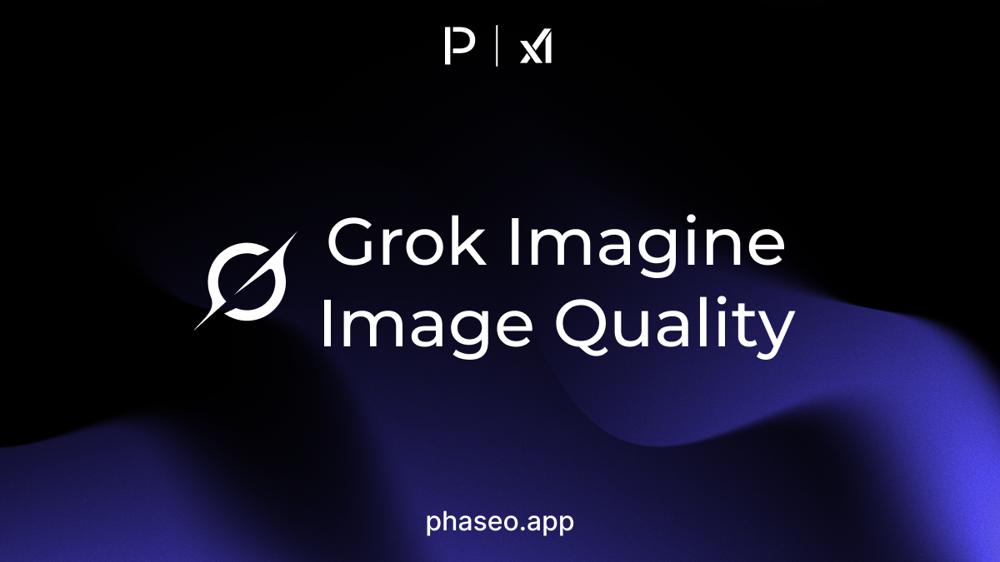

- [xAI: Grok Imagine Image Quality](https://phaseo.app/models/x-ai/grok-imagine-image-quality)

</Update>

<Update label="5 मई 2026">

मॉडल

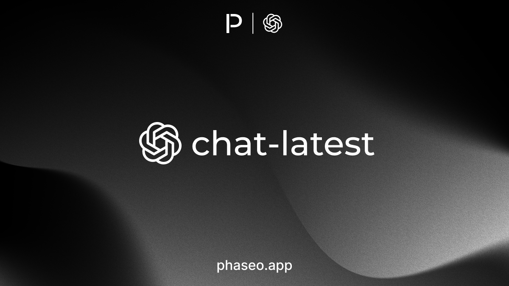

- [OpenAI: chat-latest](https://phaseo.app/models/openai/chat-latest)

</Update>

<Update label="4 मई 2026">

उत्पाद

- **Settings -> Usage** गतिविधि को **Logs**, **Jobs** और **Sessions** व्यू में बाँटता है, लाइव रीफ़्रेश के साथ, और फ़िल्टर व समय सीमा URL में रहती हैं ([#463](https://github.com/phaseoteam/Phaseo/pull/463), [#467](https://github.com/phaseoteam/Phaseo/pull/467))।
- मॉडल प्लेग्राउंड विफल इमेज और वीडियो जनरेशन पर **Retry** और **Delete** दिखाता है, और **Retry** वही प्रॉम्प्ट और मॉडल दोबारा इस्तेमाल करता है ([#465](https://github.com/phaseoteam/Phaseo/pull/465))।

API और SDK

- Chat Completions और Responses अनुरोध `session_id` स्वीकार करते हैं, जो उपयोग लॉग में संबंधित अनुरोधों को एक सत्र में समूहित करता है ([#463](https://github.com/phaseoteam/Phaseo/pull/463))।

</Update>

<Update label="2 मई 2026">

API और SDK

- मॉडल या प्रदाता ब्लॉक करने वाली वर्कस्पेस नीतियाँ फिर से लागू होती हैं, इसलिए ब्लॉक किए गए अनुरोध रूटिंग से पहले अस्वीकार हो जाते हैं ([#444](https://github.com/phaseoteam/Phaseo/pull/444))।

</Update>

<Update label="1 मई 2026">

उत्पाद

- मॉडल प्लेग्राउंड में टेक्स्ट-टू-स्पीच और संगीत जनरेशन मॉडल के लिए **TTS** और **Music** मोड जुड़े हैं ([#441](https://github.com/phaseoteam/Phaseo/pull/441))।
- **Models** के मॉडल कार्ड अब सशुल्क मॉडल पर **Free** नहीं दिखाते, और आने वाले मॉडल फ़िल्टर की गिनती सूचीबद्ध मॉडल से मेल खाती है ([#441](https://github.com/phaseoteam/Phaseo/pull/441))।

API और SDK

- TypeScript, Python, Go, C#, Java, PHP और Ruby SDK `2.0.3` अपनी टाइप की गई सूचियों में नवीनतम मॉडल और बेंचमार्क ID जोड़ते हैं; देखें [रिलीज़ नोट्स](https://github.com/phaseoteam/Phaseo/releases/tag/%40ai-stats%2Fsdk%402.0.3) ([#439](https://github.com/phaseoteam/Phaseo/pull/439))।

</Update>
