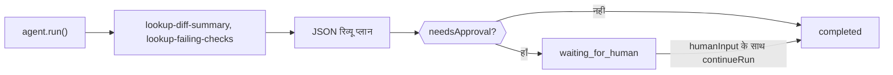

एक TypeScript एजेंट बनाएँ जो स्थानीय टूल से pull request की जाँच करे, सख्त JSON रिव्यू प्लान लौटाए, और जब प्लान कहे कि अनुमोदन चाहिए, तब किसी व्यक्ति के लिए रुक जाए। अंत में आपके पास एक स्क्रिप्ट होगी जो सत्यापित `CodeReviewPlan` प्रिंट करती है और किसी के अनुमोदन तक `waiting_for_human` पर रुकी रहती है।

टूल तय नमूना डेटा लौटाते हैं, इसलिए यह स्क्रिप्ट उदाहरण के लिए है; इन्हें अपने कोड होस्ट और CI की कॉल से बदलें। पैकेज किया गया संस्करण `packages/sdk/agent-sdk-ts/examples/coding-review-agent.ts` में है।



## इसे बनाएँ

<Steps>
<Step title="इंस्टॉल करें">

```bash
npm install @phaseo/agent-sdk zod
export PHASEO_API_KEY="phaseo_v1_sk_..."
```

</Step>
<Step title="एजेंट लिखें">

```ts review-agent.ts
import { z } from "zod";
import { createAgent, createGatewayAgentClient, defineTool } from "@phaseo/agent-sdk";

const CodeReviewPlan = z
  .object({
    risk: z.enum(["low", "medium", "high"]),
    summary: z.string().min(1),
    recommendedActions: z.array(z.string()).min(1),
    needsApproval: z.boolean(),
  })
  .strict();
type CodeReviewPlan = z.infer<typeof CodeReviewPlan>;

const PullRequestInput = z.object({ pullRequestId: z.string().regex(/^pr_\d+$/) }).strict();
const pullRequestParameters = {
  type: "object",
  properties: { pullRequestId: { type: "string", pattern: "^pr_\\d+$" } },
  required: ["pullRequestId"],
  additionalProperties: false,
};

// सिर्फ़ पढ़ने वाले, निर्धारक टूल: worker रन फिर से शुरू करे तो इन्हें दोबारा चलाना सुरक्षित है।
const lookupDiffSummary = defineTool({
  id: "lookup-diff-summary",
  description: "Return a short summary of the changed files in one pull request.",
  parameters: pullRequestParameters,
  inputSchema: PullRequestInput,
  async execute({ pullRequestId }) {
    return {
      pullRequestId,
      files: ["apps/api/src/pipeline/before/index.ts"],
      summary: "Changes touch request validation.",
    };
  },
});

const lookupFailingChecks = defineTool({
  id: "lookup-failing-checks",
  description: "Return the failing CI checks for one pull request.",
  parameters: pullRequestParameters,
  inputSchema: PullRequestInput,
  async execute({ pullRequestId }) {
    return { pullRequestId, failingChecks: ["web-typecheck"] };
  },
});

const codingReviewAgent = createAgent<string, CodeReviewPlan>({
  id: "coding-review-agent",
  model: "openai/gpt-6-astra",
  instructions:
    "Use the available tools to inspect the coding task, then return a strict JSON review plan.",
  tools: [lookupDiffSummary, lookupFailingChecks],
  maxSteps: 6,
  parseOutput: (text) => JSON.parse(text),
  outputSchema: CodeReviewPlan,
  humanReview: ({ parsedOutput }) =>
    parsedOutput?.needsApproval
      ? { reason: "coding_review_approval_required", payload: parsedOutput }
      : null,
});

// Gateway से ठीक यही JSON आकार माँगें, और लगभग-सही JSON की मरम्मत करें।
const client = createGatewayAgentClient({
  clientOptions: { apiKey: process.env.PHASEO_API_KEY! },
  responseFormat: {
    type: "json_schema",
    name: "code_review_plan",
    schema: {
      type: "object",
      properties: {
        risk: { type: "string", enum: ["low", "medium", "high"] },
        summary: { type: "string" },
        recommendedActions: { type: "array", items: { type: "string" }, minItems: 1 },
        needsApproval: { type: "boolean" },
      },
      required: ["risk", "summary", "recommendedActions", "needsApproval"],
      additionalProperties: false,
    },
  },
  plugins: [{ id: "response-healing", mode: "strict" }],
});

const result = await codingReviewAgent.run({
  input: "Review pull request pr_482 and produce a remediation plan.",
  client,
  onEvent(event) {
    console.log(event.type, event.runId);
  },
});

if (result.run.status === "waiting_for_human") {
  console.log("Needs approval:", result.run.pause?.payload);

  // असली ऐप में `result` सहेजें और रिव्यूअर के अनुमोदन पर आगे बढ़ें।
  if (process.env.APPROVE === "yes") {
    const continued = await codingReviewAgent.continueRun({
      run: result,
      client,
      humanInput: "Approved. Finalize the plan.",
    });
    console.log(continued.output);
  }
} else {
  console.log(result.output);
}
```

`responseFormat` से Gateway यही स्कीमा माँगता है, और `outputSchema` आपकी प्रोसेस में पार्स किए गए नतीजे को फिर से जाँचता है। सख्त [response healing](./response-healing-for-structured-json) मोड सिर्फ़ उसी JSON को खोलता है जो पहले से वैध है।

</Step>
<Step title="इसे चलाएँ">

```bash
npx tsx review-agent.ts
APPROVE=yes npx tsx review-agent.ts
```

</Step>
</Steps>

## जाँचें कि यह काम किया

- इवेंट लॉग में दोनों टूल के लिए `tool.started` और `tool.completed` दिखते हैं, फिर टूल चरण के बाद `checkpoint.saved`।
- `needsApproval: true` वाला प्लान पहले रन को `waiting_for_human` पर रोकता है, और प्लान `result.run.pause.payload` में होता है; `APPROVE=yes` के साथ रन `completed` तक जारी रहता है।
- **सेटिंग → उपयोग → लॉग्स** में हर मॉडल टर्न के टूल कॉल दिखते हैं, और अनुरोध का प्लगइन रिकॉर्ड बताता है कि healing चली या नहीं।
- स्कीमा तोड़ने वाला प्लान गलत डेटा लौटाने के बजाय रन को `AgentSchemaValidationError` के साथ विफल कर देता है।

## असली रिपॉज़िटरी के लिए इसे सुरक्षित बनाएँ

रिव्यू टूल सिर्फ़ पढ़ने वाले रखें। अगर आप ऐसा टूल जोड़ते हैं जो टिप्पणी करे, push करे या merge करे, तो उस पर `requireApproval: true` सेट करें ताकि उसके चलने से पहले रन रुक जाए, और उसे `continueRun({ run, client, approvals: [toolCallId] })` से अनुमोदित करें। diff की सामग्री को अविश्वसनीय इनपुट मानें: कोड टिप्पणियों में मॉडल के लिए लिखे निर्देश हो सकते हैं। रिव्यू के इंतज़ार के दौरान रीस्टार्ट से बचे रहने के लिए, [टिकाऊ लूप](./agent-sdk-durable-loop) की तरह `state` एक्सेसर से रन सहेजें। [स्थिति और अनुमोदन](../sdk-reference/agent/state-and-approval) में अनुमोदन और अस्वीकृति की जानकारी है।
