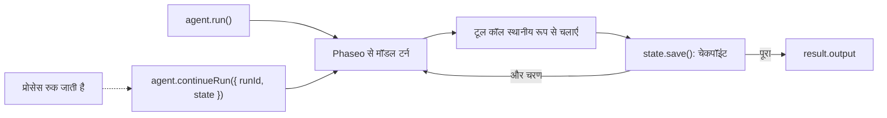

TypeScript Agent SDK से टूल इस्तेमाल करने वाला एजेंट चलाएँ और हर चरण के बाद उसकी स्थिति सहेजें, ताकि क्रैश या रीस्टार्ट हुई प्रोसेस वहीं से आगे बढ़े जहाँ रुकी थी। अंत में आपके पास एक स्क्रिप्ट होगी जो lookup टूल से दस्तावेज़ का सवाल हल करती है, हर रन को `.agent-runs/<run id>.json` में लिखती है, और रन ID देने पर उस रन को फिर से शुरू करती है।

यह स्क्रिप्ट उदाहरण के लिए है: फ़ाइल स्टोर एक ही मशीन के लिए ठीक है। प्रोडक्शन में वही `load`/`save` जोड़ी रखें, लेकिन उसके पीछे अपना डेटाबेस लगाएँ। Phaseo आपके लिए Agent SDK रन संग्रहीत नहीं करता।



## इसे बनाएँ

<Steps>
<Step title="इंस्टॉल करें">

<CodeGroup>
```bash npm
npm install @phaseo/agent-sdk zod
```

```bash pnpm
pnpm add @phaseo/agent-sdk zod
```

```bash yarn
yarn add @phaseo/agent-sdk zod
```

```bash bun
bun add @phaseo/agent-sdk zod
```
</CodeGroup>

`@phaseo/agent-sdk` अपने साथ `@phaseo/sdk` इंस्टॉल करता है। अपनी कुंजी सेट करें:

```bash
export PHASEO_API_KEY="phaseo_v1_sk_..."
```

</Step>
<Step title="एजेंट लिखें">

```ts agent.ts
import { mkdir, readFile, writeFile } from "node:fs/promises";
import { z } from "zod";
import {
  createAgent,
  createGatewayAgentClient,
  defineTool,
  type AgentStateAccessor,
} from "@phaseo/agent-sdk";

const DOC_SLUGS = ["guides/presets", "guides/routing-and-fallbacks", "guides/streaming"] as const;

// मॉडल सिर्फ़ `parameters` देखता है; `inputSchema` execute चलने से पहले बाकी सब अस्वीकार कर देता है।
const lookupDocs = defineTool({
  id: "lookup-docs",
  description: "Return the URL of one Phaseo docs page by slug.",
  parameters: {
    type: "object",
    properties: { slug: { type: "string", enum: [...DOC_SLUGS] } },
    required: ["slug"],
    additionalProperties: false,
  },
  inputSchema: z.object({ slug: z.enum(DOC_SLUGS) }).strict(),
  async execute({ slug }) {
    return { slug, url: `https://phaseo.app/docs/v1/${slug}` };
  },
});

const agent = createAgent<string, string>({
  id: "support-docs-agent",
  model: "openai/gpt-6-astra",
  instructions: "Use tools when helpful and finish with a concise answer that includes the docs URL.",
  tools: [lookupDocs],
  maxSteps: 6,
});

// हर चरण के बाद पूरा रन सहेजें। इन दो फ़ंक्शन को अपने डेटाबेस से बदलें।
const RUNS_DIR = ".agent-runs";
const state: AgentStateAccessor<string, unknown, string> = {
  async load(runId) {
    try {
      return JSON.parse(await readFile(`${RUNS_DIR}/${runId}.json`, "utf8"));
    } catch {
      return null;
    }
  },
  async save(result) {
    await mkdir(RUNS_DIR, { recursive: true });
    await writeFile(`${RUNS_DIR}/${result.run.id}.json`, JSON.stringify(result));
  },
};

const client = createGatewayAgentClient({
  clientOptions: { apiKey: process.env.PHASEO_API_KEY! },
});

const onEvent = (event: { type: string; runId: string }) => {
  if (event.type === "checkpoint.saved") console.log("checkpoint", event.runId);
};

const resumeId = process.argv[2];
let result;

if (resumeId) {
  const saved = await state.load(resumeId);
  if (!saved) throw new Error(`No saved run ${resumeId}`);
  result = saved.run.status === "completed"
    ? saved
    : await agent.continueRun({ run: saved, client, state, onEvent });
} else {
  result = await agent.run({
    input: "Find the docs page for presets and explain when to use them.",
    client,
    state,
    onEvent,
  });
}

console.log(result.run.id, result.run.status);
console.log(result.output);
```

</Step>
<Step title="इसे चलाएँ">

```bash
npx tsx agent.ts
```

रीज़्यूम आज़माने के लिए, पहली `checkpoint` लाइन के बाद `Ctrl+C` से स्क्रिप्ट रोकें, फिर उसने जो रन ID (एक UUID) प्रिंट किया था उसे पास करें:

```bash
npx tsx agent.ts 3f6c1d2e-...
```

</Step>
</Steps>

## जाँचें कि यह काम किया

- स्क्रिप्ट हर चरण में एक बार `checkpoint` प्रिंट करती है, फिर रन ID, `completed`, और `phaseo.app/docs` URL वाला जवाब।
- `.agent-runs/<run id>.json` में रन ID, स्थिति, संदेश इतिहास, हर चरण के टूल कॉल और उनके नतीजे, और अंतिम आउटपुट होता है।
- बाधित रन के बाद, रीज़्यूम कमांड नया रन शुरू करने के बजाय उसी रन ID को पूरा करता है।
- हर मॉडल टर्न **सेटिंग → उपयोग → लॉग्स** में दिखता है। रन ID को हर अनुरोध ID के साथ लॉग करें ताकि आप उन्हें मिला सकें।

## सहेजी गई स्थिति में क्या होता है

हर सहेजा गया नतीजा पूरा `AgentRunResult` होता है: `run` (ID, स्थिति, संदेश, उपयोग, कोई भी पॉज़), गेटवे अनुरोध ID और टूल कॉल वाले `steps`, और रन पूरा होने पर `output`। `continueRun()` इसे सीधे स्वीकार करता है, या `runId` के साथ `state` लेकर खुद `load()` कॉल करता है।

प्रोसेस रुकते समय चल रही टूल कॉल का असर शायद पहले ही हो चुका हो, इसलिए टूल idempotent रखें। आगे बढ़ने से पहले SDK उस कॉल का इतिहास ठीक करता है जिसे कभी नतीजा नहीं मिला। [स्थिति और अनुमोदन](../sdk-reference/agent/state-and-approval) में पॉज़ और अनुमोदन की जानकारी है।

## इसे सावधानी से बढ़ाएँ

हर वर्कफ़्लो के लिए एक एजेंट, टूल की छोटी सूची, और हर रन के लिए रन ID और अनुरोध ID वाली एक लॉग लाइन रखें। जब आपको अनुमोदन पॉज़ या एक ही टूल साझा करने वाले कई एजेंट चाहिए, तो यही गेटवे क्लाइंट और स्थिति वाली जोड़ी रखें और उनके आसपास निर्माण करें: [कोड रिव्यू एजेंट](./agent-sdk-coding-review) अनुमोदन पॉज़ जोड़ता है, और [समानांतर टूल](./agent-sdk-parallel-tools) टूल को साथ-साथ चलाता है। साझा अनुरोध डिफ़ॉल्ट के लिए तय मॉडल के बजाय [प्रीसेट](../guides/presets) कॉल करें।
