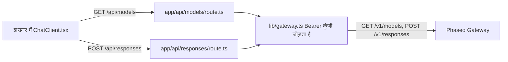

एक छोटा Next.js चैट ऐप चलाएँ जिसका ब्राउज़र कोड सिर्फ़ आपके अपने सर्वर रूट से बात करता है, ताकि आपकी Phaseo API कुंजी कभी ब्राउज़र तक न पहुँचे। अंत में आपके पास एक स्थानीय चैट पेज होगा, जिसमें `GET /v1/models` से भरा मॉडल पिकर और `POST /v1/responses` से आए जवाब होंगे।

यह सैंपल उदाहरण के लिए है: इसके रूट में न साइन-इन है, न रेट लिमिट, इसलिए जो भी उन तक पहुँच सकता है वह आपकी कुंजी खर्च कर सकता है। पहले [डिप्लॉय करने से पहले](#before-you-deploy-it) वाली जाँचें जोड़ें।

किसी कोडिंग एजेंट से यही ऐप शुरू से बनवाने के लिए, यह प्रॉम्प्ट पेस्ट करें:

<Prompt
  description="Phaseo Gateway पर **Next.js वेब चैट ऐप** बनाएँ।"
  icon="message-square"
  actions={["copy", "cursor"]}
>
{`You are building a small production-style chat app with Phaseo Gateway.

Create a Next.js app with:
- a chat UI
- a model picker backed by GET https://api.phaseo.app/v1/models
- a server-side route that calls POST https://api.phaseo.app/v1/responses
- server-side API key handling using PHASEO_API_KEY (Authorization: Bearer)
- loading, success, and error states

Keep the app intentionally small and easy to inspect.

Implementation requirements:
- Use one local API route for model discovery.
- Use one local API route for responses generation.
- Keep secrets server-side only.
- Send the whole conversation in input on every turn. The gateway rejects previous_response_id.
- Only accept model IDs from an allowlist on the server, and cap the input length.
- Show the request/response flow clearly in code.
- Add a short README with setup and run steps.

Verification:
- Run the app if possible.
- Verify two successful chat turns in a row.
- Report the exact files changed, what you verified, and any remaining assumptions.`}
</Prompt>

## सैंपल कैसे बना है



सैंपल [examples/web-chat-nextjs](https://github.com/phaseoteam/Phaseo/tree/main/examples/web-chat-nextjs) में है:

| फ़ाइल | क्या करती है |
| --- | --- |
| `app/components/ChatClient.tsx` | इनपुट, लोडिंग और त्रुटि की स्थिति, रेंडर किए गए संदेश, मॉडल पिकर |
| `app/api/models/route.ts` | `GET /v1/models` से मॉडल ID लौटाती है |
| `app/api/responses/route.ts` | जाँचती है कि `model` और `input` खाली न होने वाली स्ट्रिंग हैं (`400 missing_model`, `400 missing_input`), फिर `POST /v1/responses` कॉल करती है |
| `lib/gateway.ts` | URL और हेडर बनाती है: `Authorization: Bearer $PHASEO_API_KEY`, `x-title`, और सेट होने पर `http-referer` |

## इसे चलाएँ

आपको Node.js और एक Phaseo API कुंजी चाहिए।

<Steps>
<Step title="इंस्टॉल करें">

```bash
cd examples/web-chat-nextjs
npm install
```

सैंपल के साथ `package-lock.json` आता है, इसलिए `npm` परखे हुए संस्करण इंस्टॉल करता है।

</Step>
<Step title=".env.local बनाएँ">

सैंपल में `.env.example` नहीं है। `.env.local` खुद बनाएँ:

```bash .env.local
PHASEO_API_KEY=phaseo_v1_sk_...
# वैकल्पिक। डिफ़ॉल्ट https://api.phaseo.app है; /v1 अपने आप जुड़ जाता है।
NEXT_PUBLIC_GATEWAY_URL=https://api.phaseo.app
# वैकल्पिक ऐप एट्रिब्यूशन हेडर।
GATEWAY_APP_TITLE=My chat app
GATEWAY_HTTP_REFERER=https://myapp.example
```

यहाँ `NEXT_PUBLIC_GATEWAY_URL` सिर्फ़ सर्वर पर पढ़ा जाता है, लेकिन `NEXT_PUBLIC_` प्रीफ़िक्स इसे ब्राउज़र कोड के सामने खोल देगा, इसलिए इसमें कभी कुंजी न डालें। [ऐप एट्रिब्यूशन](../guides/app-attribution) दोनों वैकल्पिक हेडर समझाता है।

</Step>
<Step title="दूसरा चैट टर्न ठीक करें">

`ChatClient.tsx` पिछले जवाब का `id` `previous_response_id` के रूप में भेजता है। Gateway प्रतिक्रियाएँ संग्रहीत नहीं करता, इसलिए वह इस फ़ील्ड को `400 validation_error` (कीवर्ड `unsupported_param`) के साथ अस्वीकार कर देता है और दूसरा संदेश विफल हो जाता है। `app/api/responses/route.ts` में वह ब्लॉक हटाएँ जो `previous_response_id` को payload में कॉपी करता है:

```ts app/api/responses/route.ts
  // ये लाइनें हटाएँ:
  if (typeof body.previous_response_id === 'string' && body.previous_response_id.trim()) {
    payload.previous_response_id = body.previous_response_id.trim();
  }
```

इसके बाद हर टर्न का जवाब अलग से दिया जाता है। संदर्भ बनाए रखने के लिए, पिछले टर्न को `input` में संदेशों की array के रूप में भेजें।

</Step>
<Step title="डेव सर्वर शुरू करें">

```bash
npm run dev
```

`http://localhost:3000` खोलें।

</Step>
</Steps>

## जाँचें कि यह काम किया

- मॉडल पिकर मॉडल ID से भर जाता है।
- लगातार दो संदेशों में से हर एक को जवाब मिलता है।
- ब्राउज़र के नेटवर्क पैनल में अनुरोध सिर्फ़ `/api/models` और `/api/responses` पर जाते हैं, और किसी अनुरोध में `PHASEO_API_KEY` नहीं होती।
- गलत मॉडल ID खाली जवाब के बजाय Gateway का त्रुटि संदेश दिखाता है।
- अनुरोध **सेटिंग → उपयोग → लॉग्स** में आपके सेट किए ऐप टाइटल के साथ दिखते हैं।

<span id="before-you-deploy-it"></span>
## डिप्लॉय करने से पहले

- **रूट प्रमाणित करें।** `/api/responses` और `/api/models` पर साइन-इन किया हुआ उपयोगकर्ता ज़रूरी करें, या [OAuth workbench](./build-an-oauth-nextjs-workbench) इस्तेमाल करें ताकि हर उपयोगकर्ता अपने क्रेडिट खर्च करे।
- **मॉडल की अनुमति-सूची बनाएँ।** रूट ब्राउज़र से आई कोई भी `model` स्ट्रिंग आगे भेज देता है। सर्वर पर उसे एक तय सूची से जाँचें।
- **इनपुट और दर सीमित करें।** इनपुट की लंबाई और हर उपयोगकर्ता के अनुरोध सीमित करें, और [कुंजी पर खर्च सीमा](../api-reference/limits#key-limits-and-budgets) सेट करें।
- **ज़रूरत हो तो स्ट्रीम करें।** `stream: true` सेट करें और इवेंट आगे भेजें; [स्ट्रीमिंग](../guides/streaming) बताता है कि कौन-सा इवेंट Responses स्ट्रीम खत्म करता है।

UI के बजाय बैकएंड स्क्रिप्ट के लिए, [Node REST smoke ऐप](./build-a-node-rest-smoke-app) या [Python gateway CLI](./build-a-python-gateway-cli) से शुरू करें।
