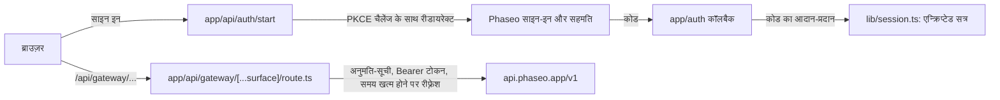

लोगों को Phaseo से साइन इन करके आपके ऐप में अपने खुद के क्रेडिट खर्च करने दें: PKCE के साथ OAuth 2.1 आपके सर्वर को एक एक्सेस टोकन देता है, और सर्वर-साइड का एक प्रॉक्सी उसे हर गेटवे कॉल के साथ जोड़ता है। अंत में आपके पास एक लोकल ऐप होगा जिसमें साइन-इन, सत्र में रखे गए रीफ़्रेश होने वाले टोकन, मॉडल खोज, `/responses` पर चैट फ़्लो, और दूसरे एंडपॉइंट के लिए एक टेस्टर होगा।

यह सैंपल उदाहरण के लिए है। इसकी `lib/oauth.ts` अब भी एक पुराने साइन-इन एंडपॉइंट को कॉल करती है, जिसे [इसे चलाएँ](#run-it) का चरण 3 ठीक करता है, और इसकी प्रॉक्सी अनुमति-सूची किसी प्रोडक्ट की ज़रूरत से ज़्यादा चौड़ी है।

किसी कोडिंग एजेंट से यही ऐप शुरू से बनवाने के लिए, यह प्रॉम्प्ट पेस्ट करें:

<Prompt
  description="OAuth और यूनिफ़ाइड Phaseo प्रॉक्सी के साथ **साइन-इन वाला Next.js वर्कबेंच** बनाएँ।"
  icon="shield-user"
  actions={["copy", "cursor"]}
>
{`You are building a signed-in Next.js app on top of Phaseo Gateway.

Create a workbench-style app with:
- OAuth 2.1 + PKCE sign-in against https://api.phaseo.app/oauth/authorize and https://api.phaseo.app/oauth/token (discover them from https://api.phaseo.app/.well-known/oauth-authorization-server), requesting the gateway:access scope
- session-backed token storage in an encrypted, httpOnly cookie
- one unified gateway proxy route on the server that calls https://api.phaseo.app/v1
- model discovery
- one chat flow using the Responses API, sending the whole conversation in input on every turn
- one generic endpoint tester for additional Phaseo endpoints

Requirements:
- Keep gateway credentials and access tokens server-side.
- Use a proxy allowlist of exact paths for safety.
- Support token refresh. Store the new refresh token from every refresh and drop the old one.
- Sign out by sending the refresh token to https://api.phaseo.app/oauth/revoke.
- Keep the workbench understandable rather than over-engineered.
- Add a short README with setup, env vars, and run steps.

Verification:
- run the app if possible
- verify sign-in flow as far as local setup allows
- verify at least one proxied gateway request path
- report exactly what you verified and what remains dependent on external OAuth configuration.`}
</Prompt>

## सैंपल कैसे बना है



सैंपल [examples/oauth-client-nextjs](https://github.com/phaseoteam/Phaseo/tree/main/examples/oauth-client-nextjs) में है:

| फ़ाइल | काम |
| --- | --- |
| `app/page.tsx` | साइन-इन का शुरुआती पेज |
| `app/dashboard/page.tsx` | सुरक्षित शेल |
| `app/dashboard/GatewayWorkbench.tsx` | कंट्रोल रूट लोड करता है, मॉडल ID सूचीबद्ध करता है, `POST /responses` पर चैट चलाता है, और दूसरे एंडपॉइंट टेस्ट करता है |
| `app/api/gateway/[...surface]/route.ts` | कैच-ऑल प्रॉक्सी: अनुमति-सूची जाँचता है, Bearer टोकन जोड़ता है, समय खत्म होने पर उसे रीफ़्रेश करता है, बॉडी और स्टेटस आगे भेजता है |
| `lib/oauth.ts` | PKCE, कोड का आदान-प्रदान और रीफ़्रेश |
| `lib/session.ts` | एन्क्रिप्टेड सत्र स्टोरेज |

साइन-इन को गेटवे कॉल से अलग रखने का मतलब है कि साइन-इन की समस्या कभी मॉडल की समस्या जैसी नहीं दिखती, और हर एंडपॉइंट टोकन संभालने वाली एक ही जगह साझा करता है।

<span id="run-it"></span>
## इसे चलाएँ

आपको Node.js, रीडायरेक्ट URI के रूप में `http://localhost:3000/auth/callback` (या आपका अपना कॉलबैक) वाला एक OAuth ऐप, और एक लंबा रैंडम सत्र सीक्रेट चाहिए। OAuth ऐप **सेटिंग्स → OAuth ऐप्स** में या [OAuth clients API](../api-reference/endpoint/oauth-clients-create) से बनाएँ।

<Steps>
<Step title="इंस्टॉल करें">

```bash
cd examples/oauth-client-nextjs
npm install
```

</Step>
<Step title=".env.local बनाएँ">

सैंपल में `.env.example` नहीं है। कोड जिन नामों को पढ़ता है, उनके साथ `.env.local` बनाएँ:

```bash .env.local
NEXT_PUBLIC_OAUTH_CLIENT_ID=your_client_id
OAUTH_CLIENT_SECRET=your_client_secret
# The sample reads this name for the OAuth server's base URL.
NEXT_PUBLIC_AISTATS_URL=https://api.phaseo.app
NEXT_PUBLIC_REDIRECT_URI=http://localhost:3000/auth/callback
SESSION_SECRET=a-long-random-string
NEXT_PUBLIC_GATEWAY_URL=https://api.phaseo.app
```

`OAUTH_CLIENT_SECRET` या `SESSION_SECRET` को कभी किसी `NEXT_PUBLIC_` वेरिएबल में न रखें।

</Step>
<Step title="सैंपल को मौजूदा OAuth एंडपॉइंट पर लगाएँ">

`lib/oauth.ts` `${NEXT_PUBLIC_AISTATS_URL}/auth/v1/oauth/authorize` और `/auth/v1/token` बनाती है और `openid email profile` माँगती है। Phaseo का OAuth सर्वर अपने एंडपॉइंट `https://api.phaseo.app/.well-known/oauth-authorization-server` पर प्रकाशित करता है:

| उपयोग | URL |
| --- | --- |
| अधिकृत करना | `https://api.phaseo.app/oauth/authorize` |
| टोकन | `https://api.phaseo.app/oauth/token` |
| रद्द करना | `https://api.phaseo.app/oauth/revoke` |

`lib/oauth.ts` के तीनों URL इनसे बदलें, और `scope` में `gateway:access` जोड़ें ताकि टोकन Gateway को कॉल कर सके।

</Step>
<Step title="डेव सर्वर शुरू करें">

```bash
npm run dev
```

`http://localhost:3000` खोलें, साइन इन करें, और डैशबोर्ड खोलें।

</Step>
</Steps>

## जाँचें कि यह काम कर गया

- साइन-इन आपके कॉलबैक URL पर लौटता है और एक सत्र बनाता है।
- डैशबोर्ड `/api/gateway/models` के ज़रिए मॉडल सूचीबद्ध करता है।
- `/api/gateway/responses` के ज़रिए चैट का एक टर्न जवाब पाता है, और किसी भी ब्राउज़र अनुरोध में एक्सेस टोकन नहीं जाता।
- प्रॉक्सी अनुमति-सूची से बाहर का पाथ अस्वीकार हो जाता है।

## टोकन की अवधि

टोकन एंडपॉइंट दो टोकन लौटाता है:

| टोकन | अवधि | उपयोग |
| --- | --- | --- |
| `access_token` | 7 दिन (`expires_in`) | इसे गेटवे अनुरोधों पर `Authorization: Bearer` के रूप में भेजें। यह उस वर्कस्पेस में क्रेडिट खर्च करता है जिसे व्यक्ति ने चुना था। |
| `refresh_token` | आखिरी उपयोग से 90 दिन | नई जोड़ी पाने के लिए इसे `grant_type=refresh_token` के साथ भेजें। |

- **हर रीफ़्रेश पर बदलें।** हर रीफ़्रेश एक नया एक्सेस टोकन और एक नया रीफ़्रेश टोकन लौटाता है। दोनों सहेजें और पुराने हटा दें: पुराना एक्सेस टोकन तुरंत काम करना बंद कर देता है, और पुराना रीफ़्रेश टोकन दोबारा इस्तेमाल नहीं हो सकता।
- **समय खत्म होने के बाद रीफ़्रेश करें।** एक्सेस टोकन की अवधि खत्म होने के बाद भी आप रीफ़्रेश कर सकते हैं, जब तक रीफ़्रेश टोकन की अवधि खत्म नहीं हुई है।
- **रीफ़्रेश टोकन कभी दोबारा इस्तेमाल न करें।** किसी को दूसरी बार इस्तेमाल करने से साइन-इन खत्म हो जाता है। Phaseo इसे लीक हुआ टोकन मानता है और उस साइन-इन का एक्सेस टोकन और हर रीफ़्रेश टोकन रद्द कर देता है, इसलिए व्यक्ति को फिर से साइन इन करना पड़ता है।
- **स्कोप सिर्फ़ घटते हैं।** रीफ़्रेश कभी स्कोप नहीं जोड़ता। यह वही स्कोप रखता है जो व्यक्ति ने मंज़ूर किए थे, उनमें से वे घटाकर जो उसने बाद में हटा दिए।
- **जब रीफ़्रेश विफल हो।** जब व्यक्ति आपके ऐप को रद्द करता है, उसकी कुंजी रद्द या बंद करता है, कुंजी को ज़रूरी कोई स्कोप (जैसे `gateway:access`) हटाता है, या वर्कस्पेस छोड़ देता है, तो रीफ़्रेश विफल हो जाता है। `gateway:access` हटाने से कुंजी भी रद्द हो जाती है, इसलिए उसका एक्सेस टोकन तुरंत काम करना बंद कर देता है। स्कोप फिर से देने से रीफ़्रेश टोकन वापस नहीं आता। व्यक्ति को फिर से साइन-इन से गुज़ारें।
- **फिर से साइन इन करने पर कुंजी नवीनीकृत होती है।** यह नई कुंजी जोड़ने के बजाय उसी कुंजी को नवीनीकृत करता है, चाहे आप `resource=https://api.phaseo.app/v1` भेजें या नहीं। आपको नया एक्सेस टोकन और रीफ़्रेश टोकन मिलता है, पिछले काम करना बंद कर देते हैं, और कुंजी इस महीने का खर्च बनाए रखती है। उसकी मासिक खर्च सीमा वही हो जाती है जो व्यक्ति ने अभी मंज़ूर की। पिछले साइन-इन का रीफ़्रेश टोकन बस अस्वीकार कर दिया जाता है, और उसे टोकन या revoke एंडपॉइंट पर भेजने से नया साइन-इन खत्म नहीं होता।
- **रोकी गई कुंजी साइन-इन रोकती है।** अगर उस व्यक्ति और वर्कस्पेस के लिए आपके ऐप की कोई भी कुंजी रोकी गई है, चाहे उसका resource कुछ भी हो, तो टोकन एंडपॉइंट `invalid_grant` लौटाता है, जब तक कोई **सेटिंग्स → API कुंजियाँ** में कुंजी फिर से चालू नहीं करता। नवीनीकरण सिर्फ़ तब काम करता है जब कुंजी रद्द न हुई हो: साइन-आउट या किसी और रद्दीकरण के बाद, साइन इन करने पर नई कुंजी जारी होती है, और उसकी सीमाएँ और खर्च शून्य से शुरू होते हैं।
- **revoke से साइन आउट करें।** रीफ़्रेश टोकन `https://api.phaseo.app/oauth/revoke` पर भेजें। इससे कुंजी और उस साइन-इन का हर रीफ़्रेश टोकन रद्द हो जाता है, उस टोकन समेत जो किसी रीफ़्रेश ने कुछ ही पल पहले जारी किया था।

## खर्च सीमाएँ

सहमति स्क्रीन पर व्यक्ति आपके ऐप के लिए एक मासिक खर्च सीमा तय करता है: डिफ़ॉल्ट रूप से $20.00, कोई दूसरी राशि, या कोई सीमा नहीं। जब कुंजी किसी कैलेंडर महीने में उतना खर्च कर लेती है, तो गेटवे अनुरोध अगले महीने तक, या जब तक व्यक्ति **सेटिंग्स → API कुंजियाँ** में सीमा नहीं बढ़ाता, `key_limit_exceeded` के साथ `429` लौटाते हैं।

उसके पास कोई भी स्कोप हो, आपका ऐप API के ज़रिए उस सीमा को हटा या उससे बच नहीं सकता। वह सिर्फ़ API कुंजियों का नाम बदल या उन्हें मिटा सकता है। वह कुंजियाँ बना या रोटेट नहीं कर सकता, किसी कुंजी की सीमाएँ, स्टेटस या समाप्ति नहीं बदल सकता, मैनेजमेंट कुंजियाँ या भरोसेमंद वर्कलोड नहीं बना सकता, सदस्य नहीं जोड़ सकता, बजट, गार्डरेल, रेट लिमिट या खर्च नियम नहीं बदल सकता, और न ही रूटिंग के लिए वर्कस्पेस की मूल्य सीमाएँ या उसका BYOK से क्रेडिट पर फ़ॉलबैक बदल सकता है।

## इसे शिप करने से पहले

- **अनुमति-सूची छोटी करें।** `lib/gateway.ts` सटीक पाथ के साथ-साथ `videos/`, `music/generate/`, `control/` और `internal/` के नीचे के हर पाथ की अनुमति देती है। सिर्फ़ वे सटीक पाथ रखें जिन्हें आपका प्रोडक्ट कॉल करता है।
- **पूरी बातचीत भेजें।** Gateway प्रतिक्रियाएँ सहेजता नहीं है और `previous_response_id` अस्वीकार करता है, इसलिए पिछले टर्न `input` में दोबारा भेजें।
- **टेस्टर बदलें।** वर्कबेंच को आंतरिक QA के लिए रखें और एंड यूज़र के लिए खास मकसद वाले फ़्लो बनाएँ।

बिना साइन-इन वाले API-कुंजी ऐप के लिए, [Next.js वेब चैट ऐप](./build-a-nextjs-web-chat-app) से शुरू करें।
