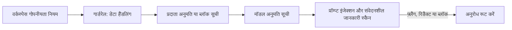

**सेटिंग्स → गार्डरेल** में एक गार्डरेल बनाएँ, उसे किसी कम जोखिम वाली API कुंजी से जोड़ें, और लॉग में उसका सही व्यवहार दिखने के बाद ही उसका दायरा बढ़ाएँ। अंत में वह कुंजी सिर्फ़ उन्हीं प्रदाताओं और मॉडलों तक पहुँच पाएगी जिनकी आप अनुमति देते हैं, और उसके प्रॉम्प्ट किसी मॉडल तक पहुँचने से पहले प्रॉम्प्ट इंजेक्शन और संवेदनशील डेटा के लिए स्कैन होंगे।

यह डैशबोर्ड की प्रक्रिया है; यही नीति [guardrails API](../api-reference/endpoint/guardrails-create) से स्क्रिप्ट भी की जा सकती है।

वर्कस्पेस के गोपनीयता नियम पहले लागू होते हैं; गार्डरेल उन्हें सिर्फ़ और सख्त कर सकता है। गार्डरेल खर्च की सीमा नहीं लगाते: इसके बजाय कुंजी पर सीमा या [वर्कस्पेस बजट](../api-reference/limits#key-limits-and-budgets) सेट करें।

## इसे लागू करें

<Steps>
<Step title="गार्डरेल बनाएँ">

**सेटिंग्स → गार्डरेल → New Guardrail** खोलें। उसका नाम किसी टीम के बजाय इस पर रखें कि वह क्या लागू करता है, जैसे `eu-models-pii-redact`, ताकि उसे कई कुंजियों में दोबारा इस्तेमाल किया जा सके।

कंटेंट जाँच से पहले रूट एक्सेस सेट करें:

| सेटिंग | विकल्प |
| --- | --- |
| **Provider mode** | Allow all providers, Only allow selected providers, या Allow all except selected providers |
| **Model mode** | Allow all models, या Only allow selected models (प्रदाता फ़िल्टरिंग के बाद लागू) |
| **Data handling** | ZDR only, और यह कि इनपुट पर ट्रेनिंग कर सकने वाले फ़्री या पेड एंडपॉइंट पात्र रहें या नहीं |

एक आम पहली नीति कम भरोसे वाले प्रदाताओं को ब्लॉक करती है और सिर्फ़ उन्हीं सटीक प्रोडक्शन मॉडलों की अनुमति देती है जिन तक कुंजी को पहुँचना चाहिए। प्रीव्यू से जाँचें कि कौन से प्रदाता और मॉडल रूट होने लायक बचे हैं, और कहीं **Only allow** आपके इरादे से ज़्यादा सख्त तो नहीं है।

</Step>
<Step title="कंटेंट जाँच जोड़ें">

**Prompt injection** उपयोगकर्ता के दिए कंटेंट में आम इंजेक्शन पैटर्न स्कैन करता है। **Sensitive info** अनुरोध के Phaseo से बाहर जाने से पहले डेटा पहचानता है:

| डिटेक्टर | इस रूप में रिडैक्ट | लेटेंसी बढ़ाता है |
| --- | --- | --- |
| ईमेल पता | `[EMAIL]` | नहीं |
| फ़ोन नंबर | `[PHONE]` | नहीं |
| US सोशल सिक्योरिटी नंबर | `[SSN]` | नहीं |
| क्रेडिट कार्ड नंबर | `[CREDIT_CARD]` | नहीं |
| IP पता (IPv4) | `[IP_ADDRESS]` | नहीं |
| व्यक्ति का नाम | `[PERSON_NAME]` | हाँ |
| भौतिक पता | `[ADDRESS]` | हाँ |

हर जाँच की एक कार्रवाई होती है: **Flag**, **Redact** या **Block**। प्रॉम्प्ट इंजेक्शन को **Flag** या **Redact** पर शुरू करें, और फ़ॉल्स पॉज़िटिव की समीक्षा के बाद ही **Block** पर ले जाएँ। पहले तेज़ डिटेक्टर इस्तेमाल करें। कस्टम पैटर्न स्पष्ट regex नियमों के रूप में जोड़ें।

</Step>
<Step title="प्रीव्यू में टेस्ट करें">

सहेजने से पहले, प्रीव्यू में तीन इनपुट चलाएँ: एक हानिरहित, एक जिसे साफ़ तौर पर रोका जाना चाहिए, और एक असली जैसा प्रोडक्शन प्रॉम्प्ट। रिडैक्शन टेक्स्ट, ब्लॉक या अनुमति का नतीजा जाँचें, और यह भी कि कोई असंबंधित चीज़ मेल न खाए।

</Step>
<Step title="इसे एक कुंजी से जोड़ें">

**Apply to keys** में, कोई स्टेजिंग या कम जोखिम वाली कुंजी चुनें। आप गार्डरेल बनाते समय ही उसे जोड़ सकते हैं। **Apply to members** इसके बजाय उन सदस्यों की बनाई API कुंजियों पर इसे लागू करता है। सदस्य उस गार्डरेल को संपादित या हटा नहीं सकते जिसे किसी वर्कस्पेस मालिक या एडमिन ने सौंपा हो।

</Step>
<Step title="पालन की जाँच करें">

कुंजी से असली अनुरोध भेजें, फिर जाँचें:

- ब्लॉक, रिडैक्ट और फ़्लैग हुए अनुरोधों की गिनती के लिए **सेटिंग्स → उपयोग → गार्डरेल**।
- कौन सा गार्डरेल और डिटेक्टर ट्रिगर हुआ, यह जानने के लिए **सेटिंग्स → उपयोग → लॉग्स** में किसी अनुरोध का **Guardrail enforcement** सेक्शन।
- यह पुष्टि करने के लिए कि यह किन कुंजियों से जुड़ा है, **सेटिंग्स → API कुंजियाँ** में **गार्डरेल** कॉलम।

</Step>
<Step title="रोलआउट बढ़ाएँ">

वही गार्डरेल और कुंजियों से जोड़ें, कार्रवाइयों को **Flag** से **Redact** या **Block** तक सख्त करें, और व्यक्ति-नाम और पता डिटेक्टर सिर्फ़ वहीं जोड़ें जहाँ उनकी लेटेंसी स्वीकार्य हो।

</Step>
</Steps>

बंद किया गया गार्डरेल अपना कॉन्फ़िगरेशन रखता है, लेकिन लागू नहीं होता। रूटिंग नियमों को कुंजियों पर लागू करने के बजाय कॉल करने वालों के बीच साझा करने के लिए, [प्रीसेट](../guides/presets) का उपयोग करें।
