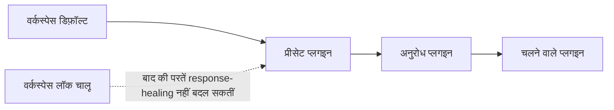

[रिस्पॉन्स हीलिंग](./response-healing-for-structured-json) को हर अनुरोध में चालू करने के बजाय, पूरे वर्कस्पेस या एक प्रीसेट के लिए एक बार चालू करें। अंत में संरचित आउटपुट वाले हर कॉलर को एक जैसी हीलिंग नीति मिलेगी, और आप उसे लॉक कर सकेंगे ताकि कोई प्रीसेट या अनुरोध उसे बंद न कर सके।

यह डैशबोर्ड की प्रक्रिया है; आखिर में दिया गया अनुरोध उदाहरण प्रोडक्शन के लिए तैयार है।

## परतें कैसे मिलती हैं

Phaseo हर अनुरोध की प्लगइन सूची तीन परतों से बनाता है। बाद वाली परत उसी प्लगइन के लिए पहले वाली परत की सेटिंग्स बदल देती है, जब तक पहले वाली लॉक न हो:



| परत | कहाँ सेट होती है | किसे ओवरराइड करती है |
| --- | --- | --- |
| वर्कस्पेस | **सेटिंग्स → रूटिंग → Response Healing** | किसी को नहीं |
| प्रीसेट | **सेटिंग्स → प्रीसेट → (प्रीसेट) → Response Healing** | वर्कस्पेस को, जब तक वह लॉक न हो |
| अनुरोध | बॉडी में `plugins` | प्रीसेट और वर्कस्पेस को, जब तक वर्कस्पेस लॉक न हो |

## इसे सेट अप करें

<Steps>
<Step title="वर्कस्पेस डिफ़ॉल्ट चालू करें">

**सेटिंग्स → रूटिंग → Response Healing** में, **Enable by Default** चालू करें और एक **Healing Mode** चुनें: सीमित सिंटैक्स सुधार के लिए `safe`, और सिर्फ़ पहले से मान्य JSON को खोलने के लिए `strict`। इसका उपयोग उन व्यापक डिफ़ॉल्ट के लिए करें जिन्हें वर्कस्पेस की हर API कुंजी साझा करती है।

</Step>
<Step title="अगर यह ज़रूरी है तो लॉक करें">

**Lock Workspace Policy** चालू करें। तब प्रीसेट और अनुरोध न तो हीलिंग बंद कर सकते हैं और न ही उसका मोड बदल सकते हैं। लॉग फिर भी दिखाते हैं कि यह लागू हुआ या छोड़ा गया।

</Step>
<Step title="एक वर्कफ़्लो के लिए प्रीसेट डिफ़ॉल्ट सेट करें">

जब अनुरोधों के किसी एक परिवार में संरचित आउटपुट फ़ॉर्मेट और हीलिंग दोनों होने चाहिए, तो प्रीसेट एडिटर में **Response Healing** चालू करें और उसका मोड चुनें। तब उस प्रीसेट के कॉलर सिर्फ़ अपना इनपुट भेजते हैं।

</Step>
</Steps>

## किसी एक अनुरोध के लिए इसे ओवरराइड करें

जब वर्कस्पेस लॉक नहीं है, तो अनुरोध खुद प्लगइन सेट कर सकता है। `"enabled": false` उस अनुरोध के लिए इसे बंद कर देता है:

```json
{
  "model": "openai/gpt-6-astra",
  "input": "Return the summary as JSON.",
  "text": {
    "format": {
      "type": "json_schema",
      "name": "answer",
      "schema": {
        "type": "object",
        "properties": { "summary": { "type": "string" } },
        "required": ["summary"],
        "additionalProperties": false
      }
    }
  },
  "plugins": [{ "id": "response-healing", "enabled": true, "mode": "strict" }],
  "meta": true
}
```

## चली हुई नीति जाँचें

**सेटिंग्स → उपयोग → लॉग्स** में अनुरोध खोलें, या अगर आपने `meta: true` भेजा था तो `meta.plugin_executions` पढ़ें। यह स्टेटस (`applied`, `skipped` या `failed`), असल में चला मोड, और जब ठीक किया गया उम्मीदवार स्कीमा से मेल न खाए तो कोई भी `validation_errors` दिखाता है।

अगर दो सेवाएँ अलग-अलग व्यवहार करती हैं, तो इसे मॉडल की समस्या मानने से पहले वर्कस्पेस सेटिंग और उसका लॉक, प्रीसेट के प्लगइन, और हर अनुरोध के `plugins` की तुलना करें।
