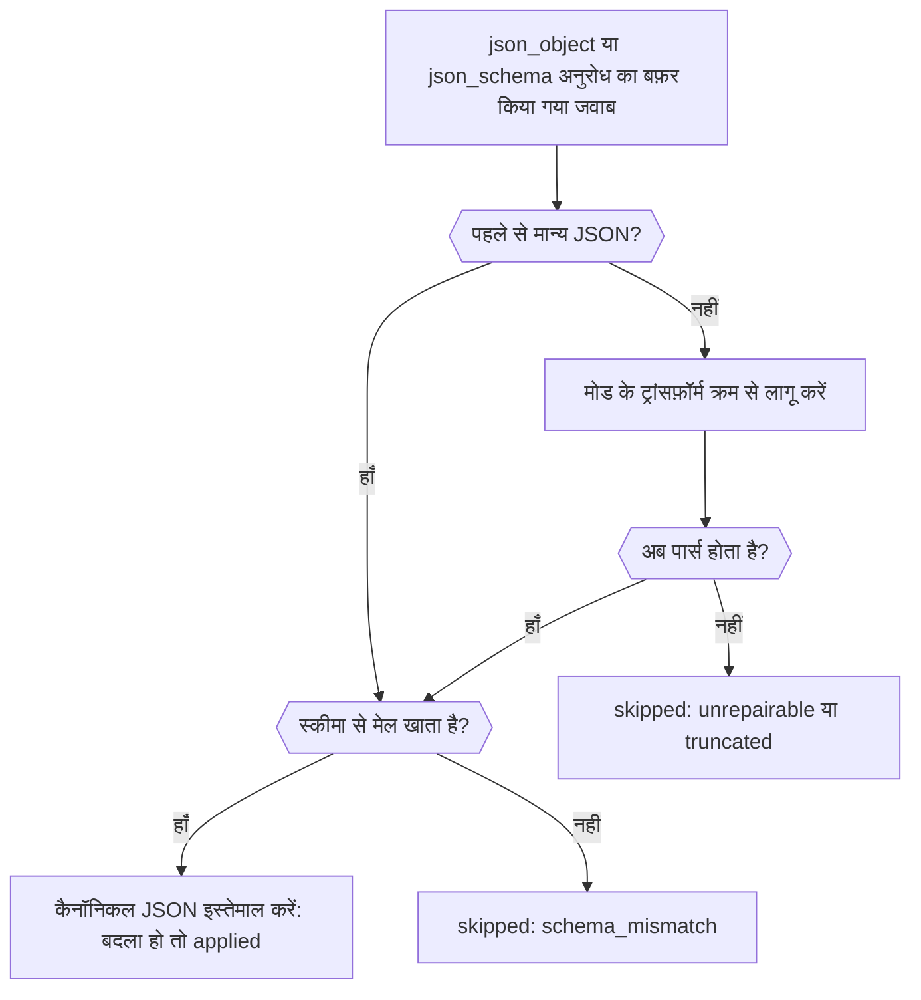

संरचित आउटपुट वाले अनुरोध में `response-healing` प्लगइन जोड़ें और Phaseo लगभग मान्य JSON, जैसे Markdown फ़ेंस में लिपटा JSON या आखिर में अतिरिक्त कॉमा वाला JSON, आपके पार्सर तक पहुँचने से पहले ठीक कर देता है। अंत में आपके पास एक ऐसा अनुरोध होगा जो JSON Schema माँगता है, ज़रूरत पड़ने पर जवाब ठीक करता है, और प्रतिक्रिया में बताता है कि उसने ऐसा किया या नहीं।

यह अनुरोध प्रोडक्शन के लिए तैयार है। हीलिंग सिर्फ़ सिंटैक्स ठीक करती है, इसलिए आपका कोड फिर भी नतीजे को वैलिडेट करता है, जैसा [नतीजा वैलिडेट करें](../guides/structured-outputs#validate-the-result) में बताया गया है।



## हीलिंग वाला अनुरोध भेजें

<CodeGroup>
```bash cURL
curl https://api.phaseo.app/v1/responses \
  -H "Authorization: Bearer $PHASEO_API_KEY" \
  -H "Content-Type: application/json" \
  -d '{
    "model": "openai/gpt-6-astra",
    "input": "Summarize this release in one sentence: dark mode and faster search.",
    "text": {
      "format": {
        "type": "json_schema",
        "name": "answer",
        "strict": true,
        "schema": {
          "type": "object",
          "properties": { "summary": { "type": "string" } },
          "required": ["summary"],
          "additionalProperties": false
        }
      }
    },
    "plugins": [{ "id": "response-healing", "mode": "safe" }],
    "meta": true
  }'
```

```typescript TypeScript
import Phaseo from "@phaseo/sdk";

const client = new Phaseo({ apiKey: process.env.PHASEO_API_KEY! });

const response = await client.generateResponse({
  model: "openai/gpt-6-astra",
  input: "Summarize this release in one sentence: dark mode and faster search.",
  text: {
    format: {
      type: "json_schema",
      name: "answer",
      strict: true,
      schema: {
        type: "object",
        properties: { summary: { type: "string" } },
        required: ["summary"],
        additionalProperties: false,
      },
    },
  },
  plugins: [{ id: "response-healing", mode: "safe" }],
  meta: true,
});

console.log(response.meta?.plugin_executions);
```

```python Python
import os

from phaseo import Phaseo

client = Phaseo(api_key=os.environ["PHASEO_API_KEY"])

response = client.generate_response(
    {
        "model": "openai/gpt-6-astra",
        "input": "Summarize this release in one sentence: dark mode and faster search.",
        "text": {
            "format": {
                "type": "json_schema",
                "name": "answer",
                "strict": True,
                "schema": {
                    "type": "object",
                    "properties": {"summary": {"type": "string"}},
                    "required": ["summary"],
                    "additionalProperties": False,
                },
            }
        },
        "plugins": [{"id": "response-healing", "mode": "safe"}],
        "meta": True,
    }
)

print(response["meta"].get("plugin_executions"))
```
</CodeGroup>

Chat Completions पर, वही स्कीमा `text.format` के बजाय `response_format` में भेजें। हीलिंग सिर्फ़ तब चलती है जब अनुरोध `json_object` या `json_schema` माँगता है, और स्ट्रीम पर कभी नहीं: स्ट्रीम किया गया अनुरोध इसे `streaming_unsupported` के साथ छोड़ देता है।

## जाँचें कि यह चला

`meta: true` होने पर, जब प्लगइन चलता है तो `meta.plugin_executions` उसे सूचीबद्ध करता है:

```json
{
  "id": "response-healing",
  "stage": "response.post_provider",
  "status": "applied",
  "changed": true,
  "metadata": {
    "attempted": true,
    "healed": true,
    "mode": "safe",
    "transforms_applied": ["strip_markdown_fence"]
  }
}
```

| `status` | अर्थ |
| --- | --- |
| `applied` | जवाब को मान्य JSON में दोबारा लिखा गया। |
| `skipped` | जवाब जैसा था वैसा छोड़ दिया गया। `attempted: false` होने पर अनुरोध पात्र नहीं था; वरना JSON पहले से मान्य था या ठीक नहीं हो सका। `metadata.failure_reason` वजह बताता है: `streaming_unsupported`, `not_json` (संरचित आउटपुट नहीं माँगा गया, या कोई टेक्स्ट नहीं), `unrepairable`, `truncated` (जवाब टोकन सीमा पर रुक गया), या `validation_errors` के साथ `schema_mismatch`। |
| `failed` | प्लगइन में खुद त्रुटि हुई (`reason: plugin_error`); जवाब नहीं बदला। |

यही रिकॉर्ड **सेटिंग्स → उपयोग → लॉग्स** में अनुरोध पर दिखता है। अगर प्लगइन कभी नहीं दिखता, तो जाँचें कि अनुरोध, उसके प्रीसेट या वर्कस्पेस ने इसे असल में चालू किया था; [प्लगइन डिफ़ॉल्ट सेट करें](./plugin-defaults-and-response-healing) बताता है कहाँ।

## मोड चुनें

| मोड | ट्रांसफ़ॉर्म, क्रम से |
| --- | --- |
| `safe` (डिफ़ॉल्ट) | Markdown फ़ेंस हटाना, सबसे बाहरी `{…}` या `[…]` तक काटना, आखिरी कॉमा हटाना, बिना उद्धरण वाली कुंजियों पर उद्धरण लगाना, और छूटे हुए बंद होने वाले ब्रैकेट जोड़ना (तब नहीं जब जवाब टोकन सीमा पर पहुँच गया हो) |
| `strict` | सिर्फ़ Markdown फ़ेंस हटाना और सबसे बाहरी `{…}` या `[…]` तक काटना, इसलिए यह सिर्फ़ वही JSON स्वीकार करता है जो अपने रैपर के अंदर पहले से मान्य था |

JSON Schema होने पर, ठीक किया गया नतीजा जवाब की जगह लेने से पहले जाँचा जाता है: ज़रूरी कुंजियाँ, टाइप, `enum` और `const`, ऐरे की सीमाएँ और `uniqueItems`, स्ट्रिंग की लंबाई, `pattern` और `email`, `uri`, `uuid` और `date-time` फ़ॉर्मेट, संख्या की सीमाएँ और `multipleOf`, प्रॉपर्टी की गिनती और `additionalProperties: false`।

## जानें कि यह कब मदद नहीं करेगा

हीलिंग कभी छूटे फ़ील्ड नहीं गढ़ती, मानों का अनुमान नहीं लगाती और गद्य को डेटा में नहीं बदलती। इसका सहारा लेने से पहले इन विफलताओं को अलग-अलग पहचानें:

| विफलता | समाधान |
| --- | --- |
| ढाँचे में लगभग सही JSON | रिस्पॉन्स हीलिंग |
| गलत फ़ील्ड वाला मान्य JSON | स्कीमा और प्रॉम्प्ट को सख्त करें |
| JSON के बजाय गद्य | सिर्फ़ प्रॉम्प्ट निर्देश नहीं, `json_schema` माँगें |
| टोकन सीमा पर कट गया | `max_output_tokens` बढ़ाएँ |

हीलिंग सबसे अच्छा तब काम करती है जब एक ऑब्जेक्ट हो जिसकी ज़रूरी कुंजियाँ स्पष्ट हों, temperature कम हो, और JSON के बाहर टेक्स्ट न माँगा गया हो। पहले इसे एक प्रीसेट के लिए चालू करें, लॉग में `plugin_executions` देखें, और ठीक किए गए पेलोड आपके स्कीमा से मेल खाने लगें तो दायरा बढ़ाएँ।
