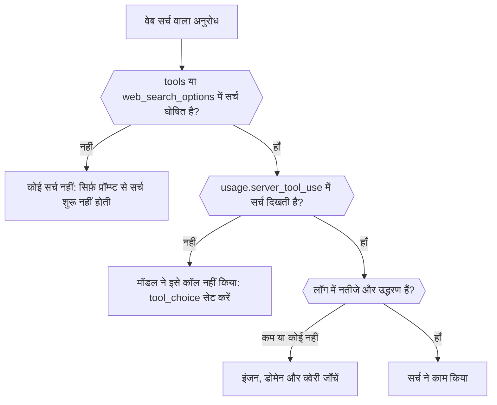

प्रतिक्रिया और अनुरोध लॉग से पता लगाएँ कि वेब सर्च असल में चली या नहीं, उसे किस इंजन ने चलाया, और उसने क्या लौटाया। अंत में आप उस सर्च को, जो कभी हुई ही नहीं, उस सर्च से अलग पहचान सकेंगे जो चली लेकिन जिसे कम नतीजे मिले।



## अनुरोध में सर्च घोषित करें

प्रॉम्प्ट में "the latest news" माँगने से सर्च नहीं चलती। इसे स्पष्ट रूप से जोड़ें:

```json
{
  "model": "openai/gpt-6-astra",
  "input": "What changed in the Phaseo changelog this week?",
  "tools": [{ "type": "phaseo:web_search", "parameters": { "max_results": 5 } }],
  "tool_choice": "phaseo:web_search"
}
```

`phaseo:web_search` Chat Completions, Responses और Messages पर काम करता है। `web_search_options` वहाँ काम करता है जहाँ एंडपॉइंट इसे सपोर्ट करता है। `tool_choice` कॉल को ज़रूरी बनाता है; इसके बिना मॉडल याददाश्त से जवाब दे सकता है। [वेब सर्च गाइड](../guides/server-tools/web-search) हर पैरामीटर सूचीबद्ध करती है।

## जाँचें कि यह चली

| कहाँ देखें | क्या दिखाता है |
| --- | --- |
| प्रतिक्रिया में `usage.server_tool_use.web_search_requests` | कितनी मैनेज्ड सर्च चलीं |
| **सेटिंग्स → उपयोग → लॉग्स** में अनुरोध पर **Web search observability** | मैनेज्ड सर्च, नेटिव सर्च, नतीजों की गिनती और उद्धरणों की गिनती, निकाले गए नतीजे और उद्धरण रिकॉर्ड के साथ |
| उसी अनुरोध पर **Routing observability** | किन प्रदाताओं पर विचार हुआ, और कौन से अनुरोध को सपोर्ट न करने की वजह से हटाए गए |

## विफलता के मामलों को अलग पहचानें

| आपको क्या दिखता है | कारण | समाधान |
| --- | --- | --- |
| कोई सर्च काउंटर ही नहीं | सर्च घोषित नहीं की गई, या मॉडल ने इसे कॉल न करना चुना | टूल जोड़ें और `tool_choice` सेट करें |
| टूल मॉडल को `search_not_configured` लौटाता है | आपका चुना मैनेज्ड इंजन चालू नहीं है | डिफ़ॉल्ट इंजन या कोई दूसरा इंजन इस्तेमाल करें |
| टूल `unsupported_search_engine` लौटाता है | मॉडल ने किसी कॉल के अंदर `engine: "native"` माँगा | `native` सिर्फ़ टूल परिभाषा में सेट करें |
| `400 not_supported`, वजह `regional_hosted_tool_not_supported` | `eu.api.phaseo.app` या `us.api.phaseo.app` पर भेजा गया, जो सर्वर टूल अस्वीकार करते हैं | `api.phaseo.app` का उपयोग करें |
| सर्च चली लेकिन उद्धरण कम हैं | क्वेरी या स्रोत कमज़ोर थे | `max_results`, `allowed_domains` या `engine` को समायोजित करें |

`engine: "native"` के साथ, अनुरोध सिर्फ़ उन प्रदाताओं के पास जाता है जो वेब सर्च खुद चलाते हैं। अगर उनमें से कोई मॉडल सर्व नहीं करता, तो Phaseo इसके बजाय अपना डिफ़ॉल्ट इंजन चलाता है और उसका बिल मैनेज्ड सर्च के रूप में बनाता है, इसलिए नेटिव अनुरोध में भी मैनेज्ड काउंटर दिख सकते हैं।

## अनुरोधों की तुलना करें

जब अलग-अलग रन में नतीजे अलग हों, तो मॉडल ID, चुने गए प्रदाता, सर्च पैरामीटर, और नतीजों और उद्धरणों की गिनती की तुलना करें। गिनतियाँ सभी प्रदाताओं में सामान्यीकृत होती हैं, इसलिए सर्च की गुणवत्ता में अंतर कच्चे पेलोड पढ़े बिना दिख जाते हैं। स्रोतों पर आधारित पूरे वर्कफ़्लो के लिए, [TypeScript में मैनेज्ड वेब सर्च](./sdk-typescript-managed-search) देखें; किसी ज्ञात URL के लिए, इसके बजाय [वेब फ़ेच](./tool-grounding-with-web-fetch) का उपयोग करें।
