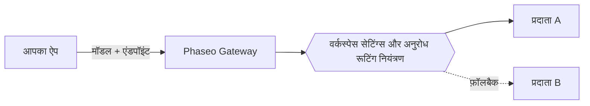

Phaseo के एक एंडपॉइंट पर मॉडल ID भेजें, और Phaseo अनुरोध को उस प्रदाता पर रूट करता है जो उस मॉडल को होस्ट करता है। आपका ऐप्लिकेशन मॉडल और एंडपॉइंट चुनता है; आपकी वर्कस्पेस सेटिंग्स और अनुरोध के रूटिंग नियंत्रण तय करते हैं कि कौन से प्रदाता उसे सर्व कर सकते हैं।

## मॉडल और प्रदाता

मॉडल वह सिस्टम है जो आउटपुट जनरेट करता है। प्रदाता मॉडल को होस्ट करता है और उसकी उपलब्धता, सपोर्ट किए गए पैरामीटर, मूल्य और प्रदर्शन तय करता है। एक मॉडल के कई प्रदाता ऑफ़र हो सकते हैं।

सार्वजनिक कैटलॉग में वे मॉडल भी सूचीबद्ध हैं जो अभी Gateway के ज़रिए उपलब्ध नहीं हैं। किसी ID को अनुरोध में इस्तेमाल करने से पहले [मॉडल की उपलब्धता](../exploring/models.mdx) जाँचें।

## अनुरोध और रूटिंग

[Responses, Chat Completions या Messages](../api-reference/introduction.mdx) में से वह इस्तेमाल करें जो आपके ऐप्लिकेशन के प्रोटोकॉल से मेल खाता हो। साझा एंडपॉइंट का मतलब यह नहीं कि हर मॉडल हर पैरामीटर सपोर्ट करता है; प्रदाताओं की क्षमताएँ फिर भी अलग-अलग होती हैं।

[रूटिंग नियंत्रण](../guides/routing-and-fallbacks.mdx) यह सीमित करते हैं कि कौन से प्रदाता अनुरोध सर्व कर सकते हैं और उन्हें कैसे रैंक किया जाता है। फ़ॉलबैक इन्हीं सीमाओं के अंदर रहते हैं और उपलब्ध क्षमता पर निर्भर करते हैं, इसलिए वे सफलता की गारंटी नहीं देते।

## बिलिंग और एक्सेस

मैनेज्ड अनुरोध आपके Phaseo वर्कस्पेस बैलेंस का उपयोग करते हैं, और `:free` मॉडल जमा क्रेडिट के बिना चलते हैं। अपने खुद के प्रदाता क्रेडेंशियल (BYOK) के साथ, प्रदाता की बिलिंग और खाता सीमाएँ लागू होती हैं। रोलआउट से पहले [मूल्य और बिलिंग](../pricing/tiers.mdx) देखें।

[वीडियो और बैच जॉब](../guides/async-video-and-batch.mdx) प्रोसेसिंग पूरी होने से पहले एक जॉब लौटाते हैं; इनका प्रीव्यू एक्सेस हर वर्कस्पेस के लिए अलग से प्रबंधित होता है। स्टेटस के लिए पोल करें या वेबहुक पाएँ, फिर नतीजा डाउनलोड करें।

## आगे के कदम

[क्विकस्टार्ट](../quickstart.mdx) से अपना पहला अनुरोध भेजें, फिर कुंजी को अपने बैकएंड पर रखते हुए [Gateway को अपने ऐप्लिकेशन में जोड़ें](./integrating-with-the-gateway.mdx)। जब कुछ विफल हो, तो [विश्वसनीयता और स्टेटस](./reliability-and-status.mdx) बताता है कि जाँच कैसे करें, और [अनुरोध लॉग](../guides/integrations/observability.mdx) हर अनुरोध का उपयोग, लेटेंसी, लागत और त्रुटियाँ दिखाते हैं।
