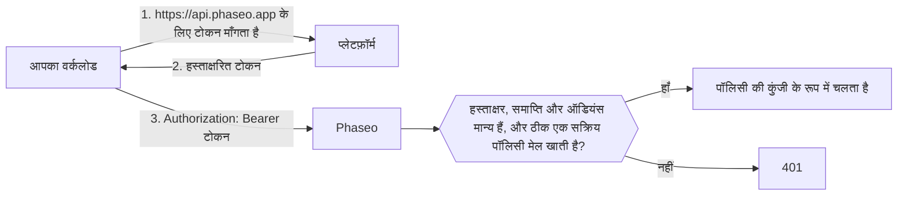

<Note>
भरोसेमंद वर्कलोड बीटा में है और धीरे-धीरे वर्कस्पेस के लिए उपलब्ध कराया जा रहा है। अगर आपके डैशबोर्ड में **सेटिंग्स → API कुंजियाँ → भरोसेमंद वर्कलोड** नहीं दिखता, तो आपके वर्कस्पेस को यह सुविधा अभी नहीं मिली है।
</Note>

Phaseo API कुंजी के बजाय अपने प्लेटफ़ॉर्म का कम समय वाला OIDC टोकन बेयरर टोकन के रूप में भेजें, ताकि आपकी प्रोजेक्ट सेटिंग्स या CI सीक्रेट में लंबे समय तक चलने वाली कोई चीज़ न रखनी पड़े। प्लेटफ़ॉर्म हर डिप्लॉयमेंट, जॉब या वर्कलोड को एक हस्ताक्षरित टोकन देते हैं जो बताता है कि वह कौन है, जैसे "`website` प्रोजेक्ट का प्रोडक्शन डिप्लॉयमेंट" या "GitLab प्रोजेक्ट `4815162` का एक जॉब", और यह टोकन कुछ घंटों में समाप्त हो जाता है। आप Phaseo को बताते हैं कि किन वर्कलोड पर भरोसा करना है।

Phaseo, Vercel, GitHub Actions, GitLab, Google Cloud, Buildkite, CircleCI और AWS के टोकन पर भरोसा करता है, और उस OIDC इश्यूअर के टोकन पर भी जिसे आप ख़ुद चलाते हैं, जैसे Kubernetes क्लस्टर, Bitbucket Pipelines या सेल्फ़-मैनेज्ड GitLab। बाकी सब के लिए API कुंजियाँ इस्तेमाल करते रहें, जैसे लोकल स्क्रिप्ट और मोबाइल ऐप।

## यह कैसे काम करता है



वर्कस्पेस का मालिक या एडमिन एक **ट्रस्ट पॉलिसी** बनाता है, जिसमें प्लेटफ़ॉर्म, वह मालिक जिस पर वह भरोसा करती है (जैसे GitHub मालिक, GitLab प्रोजेक्ट या AWS रोल), और वैकल्पिक शर्तें होती हैं, जैसे कोई प्रोजेक्ट, रिपॉज़िटरी, ब्रांच या एनवायरनमेंट। मेल खाने वाला अनुरोध पॉलिसी की कुंजी के रूप में चलता है, और उस पर वही रेट लिमिट, बजट, लॉग और बिलिंग लागू होते हैं जो API कुंजी से किए गए अनुरोध पर होते हैं।

टोकन ऑडियंस `https://api.phaseo.app` के लिए जारी होने चाहिए; Phaseo किसी भी दूसरी ऑडियंस को अस्वीकार करता है। ज़्यादातर प्लेटफ़ॉर्म डिफ़ॉल्ट रूप से ऐसी ऑडियंस इस्तेमाल करते हैं जो आपके वर्कलोड द्वारा कॉल की जाने वाली हर सेवा में साझा होती है, और उन्हें स्वीकार करने पर किसी दूसरी सेवा को भेजा गया टोकन Phaseo पर दोबारा इस्तेमाल किया जा सकता था।

## ट्रस्ट पॉलिसी बनाएँ

<Steps>
<Step title="भरोसेमंद वर्कलोड खोलें">
**सेटिंग्स → API कुंजियाँ → भरोसेमंद वर्कलोड** पर जाएँ और **नई पॉलिसी** चुनें। सिर्फ़ वर्कस्पेस के मालिक और एडमिन पॉलिसी प्रबंधित कर सकते हैं।
</Step>
<Step title="प्लेटफ़ॉर्म चुनें और ID भरें">
हर प्लेटफ़ॉर्म पॉलिसी को एक ऐसी ID से बाँधता है जिसका नाम बदला नहीं जा सकता और जिसे कोई और नहीं ले सकता। नाम किसी और के हाथ जा सकते हैं, इसलिए Phaseo कभी सिर्फ़ नाम पर भरोसा नहीं करता।

<Tabs>
<Tab title="Vercel">
- **टीम स्लग**: टीम का स्लग, जैसा `vercel.com/<team-slug>` में होता है। अगर आपका प्रोजेक्ट Vercel का ग्लोबल इश्यूअर मोड इस्तेमाल करता है (इश्यूअर `https://oidc.vercel.com/<team-slug>` के बजाय `https://oidc.vercel.com`), तो इसे खाली छोड़ें।
- **टीम ID**: `team_` से शुरू होती है। यह आपकी Vercel टीम सेटिंग्स में मिलती है।
- **प्रोजेक्ट ID** (सुझाया गया): `prj_` से शुरू होती है। यह आपकी Vercel प्रोजेक्ट सेटिंग्स में मिलती है। इसके बिना टीम के हर प्रोजेक्ट पर भरोसा किया जाता है।
- **एनवायरनमेंट**: प्रोडक्शन, प्रीव्यू या डेवलपमेंट। किसी भी एनवायरनमेंट को स्वीकार करने के लिए सभी को अनचेक छोड़ें।
</Tab>
<Tab title="GitHub Actions">
- **मालिक ID**: रिपॉज़िटरी के मालिक उपयोगकर्ता या संगठन की संख्या वाली ID।
- **रिपॉज़िटरी ID** (सुझाया गया): संख्या वाली रिपॉज़िटरी ID। इसके बिना मालिक की हर रिपॉज़िटरी पर भरोसा किया जाता है।
- **ब्रांच या टैग** और **एनवायरनमेंट** (वैकल्पिक): उदाहरण के लिए `refs/heads/main` या `production`।

GitHub CLI से दोनों ID पाएँ:

```bash
gh api repos/OWNER/REPO --jq '.id, .owner.id'
```
</Tab>
<Tab title="GitLab">
GitLab.com पर मौजूद प्रोजेक्ट के लिए। सेल्फ़-मैनेज्ड GitLab के लिए **कस्टम OIDC इश्यूअर** इस्तेमाल करें।

- **प्रोजेक्ट ID**: प्रोजेक्ट के ओवरव्यू पेज पर दिखने वाली संख्या वाली ID। प्रोजेक्ट का नाम बदलने या उसे किसी दूसरे ग्रुप में ले जाने पर भी यह नहीं बदलती, इसीलिए Phaseo ग्रुप के बजाय इसे बाँधता है।
- **ब्रांच या टैग** (वैकल्पिक): ब्रांच या टैग का नाम, जैसे `main`।
- **एनवायरनमेंट** (वैकल्पिक): जॉब का एनवायरनमेंट, जैसे `production`।

प्रोजेक्ट के हर जॉब को स्वीकार करने के लिए दोनों शर्तें खाली छोड़ें।
</Tab>
<Tab title="Google Cloud">
Cloud Run, Compute Engine, GKE, Cloud Run functions, App Engine और Cloud Build पर मेटाडेटा सर्वर से मिलने वाले टोकन के लिए।

- **सर्विस अकाउंट की यूनिक ID**: Google Cloud कंसोल में सर्विस अकाउंट के डिटेल पेज पर दिखने वाली संख्या वाली यूनिक ID। हर Google अकाउंट एक ही इश्यूअर साझा करता है, इसलिए यही ID आपके वर्कलोड को अलग पहचानती है। इसके बजाय ईमेल इस्तेमाल न करें: अगर सर्विस अकाउंट डिलीट हो जाए, तो कोई उसी ईमेल से नया अकाउंट बना सकता है।
- **सर्विस अकाउंट ईमेल** (वैकल्पिक): एक अतिरिक्त जाँच। टोकन में ईमेल तभी होता है जब वर्कलोड उन्हें `format=full` के साथ माँगता है।
</Tab>
<Tab title="Buildkite">
- **ऑर्गनाइज़ेशन ID**: ऑर्गनाइज़ेशन का UUID। हर Buildkite टोकन इसे अपने `organization_id` क्लेम में रखता है, इसलिए आप इसे अपनी किसी पाइपलाइन द्वारा माँगे गए टोकन से पढ़ सकते हैं। ऑर्गनाइज़ेशन स्लग के विपरीत, यह कभी नहीं बदलता।
- **पाइपलाइन स्लग** (वैकल्पिक): इसके बिना ऑर्गनाइज़ेशन की हर पाइपलाइन पर भरोसा किया जाता है।
</Tab>
<Tab title="CircleCI">
- **ऑर्गनाइज़ेशन ID**: यह **Organization Settings → Overview** में मिलती है। हर CircleCI ऑर्गनाइज़ेशन का अपना इश्यूअर होता है, `https://oidc.circleci.com/org/<organisation ID>`, और Phaseo इसे इसी ID से बनाता है।
- **प्रोजेक्ट ID** (वैकल्पिक): यह **Project Settings → Overview** में मिलती है। इसके बिना ऑर्गनाइज़ेशन के हर प्रोजेक्ट पर भरोसा किया जाता है।
</Tab>
<Tab title="AWS">
IAM आउटबाउंड आइडेंटिटी फ़ेडरेशन से मिलने वाले टोकन के लिए, जो किसी IAM रोल को बाहरी सेवा के लिए हस्ताक्षरित टोकन देता है।

- **इश्यूअर URL**: हर AWS अकाउंट का अपना इश्यूअर होता है, जो `.tokens.sts.global.api.aws` पर खत्म होता है। `aws iam get-outbound-web-identity-federation-info` चलाएँ और `IssuerIdentifier` कॉपी करें। अगर यह विफल हो, तो पहले `aws iam enable-outbound-web-identity-federation` से सुविधा चालू करें।
- **IAM रोल ARN**: सिर्फ़ इस रोल के टोकन स्वीकार किए जाते हैं, जैसे `arn:aws:iam::123456789012:role/evals`। इश्यूअर पहले से आपके अकाउंट की पहचान करता है, इसलिए रोल ARN वर्कलोड की पहचान करता है।
</Tab>
<Tab title="कस्टम OIDC इश्यूअर">
इसे किसी भी ऐसे दूसरे OIDC इश्यूअर के लिए इस्तेमाल करें जो ये सभी शर्तें पूरी करता हो:

- उसका इश्यूअर URL एक सार्वजनिक `https://` URL हो, जिसमें पोर्ट, क्वेरी या फ़्रैगमेंट न हो, और जो ऊपर दिए किसी प्लेटफ़ॉर्म के होस्ट पर न हो।
- वह `<issuer>/.well-known/openid-configuration` पर डिस्कवरी दस्तावेज़ देता हो।
- उसकी साइनिंग कुंजियाँ (`jwks_uri`) इश्यूअर वाले होस्ट पर ही हों।
- वह RS256, ES256 या ES384 से टोकन पर हस्ताक्षर करता हो, और ऑडियंस `https://api.phaseo.app` के लिए टोकन जारी कर सकता हो।

भरें:

- **इश्यूअर URL**: इसे ठीक वैसे ही कॉपी करें जैसे यह टोकन के `iss` क्लेम में दिखता है, आख़िरी स्लैश समेत।
- **मालिक क्लेम** और **मालिक वैल्यू**: वह क्लेम जो हर टोकन में होना चाहिए, और उसकी सटीक वैल्यू। ऐसा क्लेम चुनें जिसे कोई और दोबारा इस्तेमाल न कर सके, जैसे संख्या वाली ID, न कि कोई नाम जिसे बदला या फिर से रजिस्टर किया जा सके।
- **अतिरिक्त क्लेम** और **ज़रूरी वैल्यू** (वैकल्पिक): एक और क्लेम जिससे टोकन का मेल खाना ज़रूरी है।

शर्तें सिर्फ़ टॉप-लेवल क्लेम से मेल खाती हैं। नेस्टेड क्लेम, जैसे Kubernetes का `kubernetes.io` ऑब्जेक्ट, इस्तेमाल नहीं किए जा सकते।

**Kubernetes (EKS, GKE, AKS)**: हर क्लस्टर का अपना इश्यूअर होता है। EKS पर `aws eks describe-cluster --name <cluster> --query cluster.identity.oidc.issuer` चलाएँ। AKS पर OIDC इश्यूअर चालू करें और `az aks show -n <cluster> -g <resource-group> --query oidcIssuerProfile.issuerUrl` चलाएँ। GKE पर इश्यूअर `https://container.googleapis.com/v1/projects/<project>/locations/<location>/clusters/<cluster>` है। मालिक क्लेम के रूप में `sub` इस्तेमाल करें, वैल्यू `system:serviceaccount:<namespace>:<service-account>` के साथ।

जिन सेल्फ़-मैनेज्ड Kubernetes क्लस्टर का डिस्कवरी एंडपॉइंट सार्वजनिक नहीं है, वे काम नहीं करेंगे। Phaseo को डिस्कवरी दस्तावेज़ और कुंजियाँ बिना क्रेडेंशियल के इंटरनेट से लानी होती हैं, और ज़्यादातर क्लस्टर डिफ़ॉल्ट रूप से इसकी अनुमति नहीं देते।

**Bitbucket Pipelines**: इश्यूअर `https://api.bitbucket.org/2.0/workspaces/<workspace>/pipelines-config/identity/oidc` है। मालिक क्लेम के रूप में `workspaceUuid` इस्तेमाल करें, और वैल्यू में उसके ब्रेसेस भी रखें, जैसे `{a1b2c3d4-...}`। स्टेप में Phaseo ऑडियंस माँगें:

```yaml
- step:
    oidc:
      audiences:
        - https://api.phaseo.app
```

**सेल्फ़-मैनेज्ड GitLab**: इश्यूअर आपका GitLab URL है, जैसे `https://gitlab.example.com`। मालिक क्लेम के रूप में `project_id` इस्तेमाल करें, प्रोजेक्ट की संख्या वाली ID के साथ। आपका इंस्टेंस इंटरनेट से पहुँचने योग्य होना चाहिए।
</Tab>
</Tabs>
</Step>
<Step title="स्वीकार किया जाने वाला सबसे लंबा टोकन सेट करें">
**स्वीकार किया जाने वाला सबसे लंबा टोकन (घंटे)** में वह सबसे लंबी अवधि सेट करें जिसे आप स्वीकार करते हैं। इससे ज़्यादा समय के लिए जारी किए गए टोकन अस्वीकार किए जाते हैं। अधिकतम, और डिफ़ॉल्ट, 12 घंटे है, जो Vercel डेवलपमेंट टोकन को कवर करता है।
</Step>
</Steps>

पॉलिसी लगभग एक मिनट में लागू हो जाती हैं। किसी पॉलिसी को बंद करने या डिलीट करने पर उसके टोकन भी इतने ही समय में काम करना बंद कर देते हैं।

## Terraform या API से पॉलिसी प्रबंधित करें

`keys:read`, `keys:write` और `keys:delete` क्षमताओं वाली [मैनेजमेंट कुंजी](./management-api-keys.mdx) से पॉलिसी को कोड के रूप में प्रबंधित करें। सिर्फ़ वे वर्कस्पेस इन रूट का इस्तेमाल कर सकते हैं जिनके पास भरोसेमंद वर्कलोड है।

Terraform के साथ `phaseo_trusted_workload` रिसोर्स इस्तेमाल करें:

```hcl
resource "phaseo_trusted_workload" "deploy" {
  name     = "GitHub deploy (main)"
  platform = "github_actions"
  owner_id = "123456"

  claim_conditions = {
    repository_id = ["987654321"]
    ref           = ["refs/heads/main"]
  }
}
```

`owner_id` प्लेटफ़ॉर्म के मालिक क्लेम की वैल्यू है। जहाँ प्लेटफ़ॉर्म को ज़रूरत हो, वहाँ `issuer` सेट करें:

| `platform` | `issuer` | मालिक क्लेम |
| --- | --- | --- |
| `vercel` | ज़रूरी: `https://oidc.vercel.com/<team-slug>`, या ग्लोबल इश्यूअर मोड के लिए `https://oidc.vercel.com` | `owner_id` (टीम ID) |
| `github_actions` | डिफ़ॉल्ट `https://token.actions.githubusercontent.com` | `repository_owner_id` |
| `gitlab` | डिफ़ॉल्ट `https://gitlab.com` | `project_id` |
| `google_cloud` | डिफ़ॉल्ट `https://accounts.google.com` | `sub` (सर्विस अकाउंट की यूनिक ID) |
| `buildkite` | डिफ़ॉल्ट `https://agent.buildkite.com` | `organization_id` |
| `circleci` | ज़रूरी: `https://oidc.circleci.com/org/<organisation ID>` | `oidc.circleci.com/org-id` |
| `aws` | ज़रूरी: आपके अकाउंट का इश्यूअर | `sub` (IAM रोल ARN) |
| `custom` | ज़रूरी: आपका इश्यूअर URL | वह क्लेम जो आपने `owner_claim` में सेट किया |

कस्टम इश्यूअर के लिए `owner_claim` भी सेट करें:

```hcl
resource "phaseo_trusted_workload" "cluster" {
  name        = "Production cluster"
  platform    = "custom"
  issuer      = "https://oidc.eks.us-east-1.amazonaws.com/id/EXAMPLED539D4633E53DE1B71EXAMPLE"
  owner_claim = "sub"
  owner_id    = "system:serviceaccount:prod:api"
}
```

अन्य फ़ील्ड:

| फ़ील्ड | वैल्यू |
| --- | --- |
| `claim_conditions` | क्लेम नाम से अनुमत वैल्यू तक; हर क्लेम को अपनी किसी एक वैल्यू से मेल खाना चाहिए। मालिक क्लेम के अलावा अधिकतम 15 क्लेम, और हर क्लेम पर 20 वैल्यू। `iss`, `aud`, `exp`, `iat`, `nbf`, `jti` और मालिक क्लेम इस्तेमाल नहीं किए जा सकते। |
| `max_token_lifetime_seconds` | स्वीकार की जाने वाली सबसे लंबी टोकन अवधि, `60` से `43200` (12 घंटे)। डिफ़ॉल्ट `43200`। |
| `enabled` (Terraform) या `status` (API: `active` या `disabled`) | मेल खाने वाले टोकन स्वीकार किए जाएँ या नहीं। |

प्लेटफ़ॉर्म, इश्यूअर, मालिक क्लेम या मालिक बदलने पर पॉलिसी बदल दी जाती है। पॉलिसी में कोई सीक्रेट नहीं होता, इसलिए Terraform स्टेट में कुछ भी संवेदनशील सेव नहीं होता।

API के साथ, यही फ़ील्ड `/v1/workload-identity/policies` पर भेजें। API प्लेटफ़ॉर्म को `provider` कहता है:

```bash
curl https://api.phaseo.app/v1/workload-identity/policies \
  -H "Authorization: Bearer $PHASEO_MANAGEMENT_KEY" \
  -H "Content-Type: application/json" \
  -d '{"name":"GitHub deploy (main)","provider":"github_actions","owner_id":"123456","claim_conditions":{"repository_id":["987654321"],"ref":["refs/heads/main"]}}'
```

कस्टम इश्यूअर के लिए:

```bash
curl https://api.phaseo.app/v1/workload-identity/policies \
  -H "Authorization: Bearer $PHASEO_MANAGEMENT_KEY" \
  -H "Content-Type: application/json" \
  -d '{"name":"Production cluster","provider":"custom","issuer":"https://oidc.eks.us-east-1.amazonaws.com/id/EXAMPLED539D4633E53DE1B71EXAMPLE","owner_claim":"sub","owner_id":"system:serviceaccount:prod:api"}'
```

[API संदर्भ](../api-reference/endpoint/trusted-workloads-create.mdx) हर फ़ील्ड और प्रतिक्रिया की सूची देता है।

## टोकन से Phaseo को कॉल करें

हर Phaseo SDK API कुंजी की जगह एक फ़ंक्शन स्वीकार करता है और हर अनुरोध और रीट्राई से पहले उसे कॉल करता है, ताकि हर अनुरोध मौजूदा टोकन इस्तेमाल करे। C++ को छोड़कर हर SDK में GitHub Actions और Vercel के लिए एक हेल्पर है। यह `https://api.phaseo.app` के लिए जारी टोकन लाता है और उसकी समाप्ति से एक मिनट पहले तक उसे दोबारा इस्तेमाल करता है:

| SDK | GitHub Actions | Vercel |
| --- | --- | --- |
| TypeScript | `githubActionsToken()` | `vercelToken()` |
| Python | `github_actions_token()` | `vercel_token()` |
| Go | `phaseo.GitHubActionsToken()` | `phaseo.VercelToken()` |
| Java | `WorkloadTokens.gitHubActions()` | `WorkloadTokens.vercel()` |
| C# | `WorkloadTokens.GitHubActions()` | `WorkloadTokens.Vercel()` |
| PHP | `WorkloadTokens::githubActions()` | `WorkloadTokens::vercel()` |
| Ruby | `PhaseoSdk::WorkloadTokens.github_actions` | `PhaseoSdk::WorkloadTokens.vercel` |
| Rust | `phaseo::auth::github_actions_token()` | `phaseo::auth::vercel_token()` |
| C++ | `set_api_key_provider` को अपना फ़ंक्शन दें | `set_api_key_provider` को अपना फ़ंक्शन दें |

हेल्पर के लिए हर SDK की अगली रिलीज़ चाहिए। Vercel पर, हेल्पर `VERCEL_OIDC_TOKEN_FILE` या `VERCEL_OIDC_TOKEN` से डिप्लॉयमेंट का टोकन बदलता है। Vercel Functions में टोकन हर अनुरोध पर `x-vercel-oidc-token` हेडर के रूप में आता है; इसे हेल्पर को उसके टोकन स्रोत के रूप में दें।

दूसरे प्लेटफ़ॉर्म पर, अपना ऐसा फ़ंक्शन दें जो टोकन लौटाए, जैसे वह फ़ंक्शन जो GitLab जॉब का वेरिएबल पढ़ता है या Google Cloud मेटाडेटा सर्वर को कॉल करता है:

```ts
import Phaseo from "@phaseo/sdk";

const client = new Phaseo({
	apiKey: async () => {
		const response = await fetch(
			"http://metadata.google.internal/computeMetadata/v1/instance/service-accounts/default/identity?audience=https://api.phaseo.app",
			{ headers: { "Metadata-Flavor": "Google" } },
		);
		return response.text();
	},
});
```

<Tabs>
<Tab title="Vercel">
`@vercel/oidc` 4.x के सर्वर एंट्री से `getVercelOidcToken` इस्तेमाल करें। `audience` देने पर डिप्लॉयमेंट का टोकन Phaseo के लिए जारी टोकन से बदल जाता है।

[TypeScript SDK](../sdk-reference/client/overview.mdx) के साथ, इसे `apiKey` फ़ंक्शन के रूप में दें:

```ts
import Phaseo from "@phaseo/sdk";
import { getVercelOidcToken } from "@vercel/oidc";

const client = new Phaseo({
	apiKey: () => getVercelOidcToken({ audience: "https://api.phaseo.app" }),
});

const response = await client.responses.create({
	model: "openai/gpt-6-astra",
	input: "Hello from a trusted workload",
});
```

`apiKey` के रूप में फ़ंक्शन देने के लिए `@phaseo/sdk` का 3.0.0 से नया वर्शन चाहिए।

किसी भी HTTP क्लाइंट के साथ, हर अनुरोध के लिए टोकन माँगें और उसे बेयरर टोकन के रूप में भेजें:

```ts
import { getVercelOidcToken } from "@vercel/oidc";

const token = await getVercelOidcToken({ audience: "https://api.phaseo.app" });

const response = await fetch("https://api.phaseo.app/v1/chat/completions", {
	method: "POST",
	headers: {
		Authorization: `Bearer ${token}`,
		"Content-Type": "application/json",
	},
	body: JSON.stringify({
		model: "openai/gpt-6-astra",
		messages: [{ role: "user", content: "Hello from a trusted workload" }],
	}),
});
```

टोकन को मॉड्यूल-लेवल वेरिएबल में सेव न करें: Vercel अनुरोधों के बीच इसे बदल सकता है।
</Tab>
<Tab title="GitHub Actions">
टोकन माँगने के लिए जॉब को `id-token: write` अनुमति चाहिए।

```yaml
permissions:
  id-token: write
  contents: read

jobs:
  evals:
    runs-on: ubuntu-latest
    steps:
      - uses: actions/github-script@v7
        with:
          script: |
            const token = await core.getIDToken("https://api.phaseo.app");
            const response = await fetch("https://api.phaseo.app/v1/chat/completions", {
              method: "POST",
              headers: {
                Authorization: `Bearer ${token}`,
                "Content-Type": "application/json",
              },
              body: JSON.stringify({
                model: "openai/gpt-6-astra",
                messages: [{ role: "user", content: "Hello from GitHub Actions" }],
              }),
            });
            core.info(String(response.status));
```

शेल स्टेप से, `curl` के साथ टोकन माँगें:

```bash
TOKEN=$(curl -sS -H "Authorization: bearer $ACTIONS_ID_TOKEN_REQUEST_TOKEN" \
  "$ACTIONS_ID_TOKEN_REQUEST_URL&audience=https://api.phaseo.app" | jq -r .value)

curl https://api.phaseo.app/v1/chat/completions \
  -H "Authorization: Bearer $TOKEN" \
  -H "Content-Type: application/json" \
  -d '{"model":"openai/gpt-6-astra","messages":[{"role":"user","content":"Hello"}]}'
```

GitHub Actions टोकन कम समय तक चलते हैं, इसलिए लंबे जॉब के लिए नया टोकन माँगें।
</Tab>
<Tab title="GitLab">
`.gitlab-ci.yml` में जॉब में एक `id_tokens` एंट्री जोड़ें। GitLab टोकन को आपके दिए नाम वाले वेरिएबल में रखता है:

```yaml
evals:
  id_tokens:
    PHASEO_TOKEN:
      aud: https://api.phaseo.app
  script:
    - >
      curl https://api.phaseo.app/v1/chat/completions
      -H "Authorization: Bearer $PHASEO_TOKEN"
      -H "Content-Type: application/json"
      -d '{"model":"openai/gpt-6-astra","messages":[{"role":"user","content":"Hello from GitLab"}]}'
```

टोकन तब तक चलता है जब तक जॉब का टाइमआउट।
</Tab>
<Tab title="Google Cloud">
मेटाडेटा सर्वर से टोकन माँगें। यह Cloud Run, Compute Engine, GKE, Cloud Run functions, App Engine और Cloud Build पर काम करता है:

```bash
TOKEN=$(curl -sS -H "Metadata-Flavor: Google" \
  "http://metadata.google.internal/computeMetadata/v1/instance/service-accounts/default/identity?audience=https://api.phaseo.app")

curl https://api.phaseo.app/v1/chat/completions \
  -H "Authorization: Bearer $TOKEN" \
  -H "Content-Type: application/json" \
  -d '{"model":"openai/gpt-6-astra","messages":[{"role":"user","content":"Hello from Google Cloud"}]}'
```

अगर आपकी पॉलिसी सर्विस अकाउंट ईमेल जाँचती है, तो URL में `&format=full` जोड़ें। टोकन 1 घंटे चलते हैं।
</Tab>
<Tab title="Buildkite">
स्टेप के कमांड में एजेंट से टोकन माँगें:

```bash
TOKEN=$(buildkite-agent oidc request-token --audience https://api.phaseo.app)

curl https://api.phaseo.app/v1/chat/completions \
  -H "Authorization: Bearer $TOKEN" \
  -H "Content-Type: application/json" \
  -d '{"model":"openai/gpt-6-astra","messages":[{"role":"user","content":"Hello from Buildkite"}]}'
```

टोकन डिफ़ॉल्ट रूप से 5 मिनट चलते हैं। लंबे स्टेप के लिए नया टोकन माँगें या सेकंड में `--lifetime` दें।
</Tab>
<Tab title="CircleCI">
जॉब स्टेप में CircleCI CLI से टोकन माँगें:

```bash
TOKEN=$(circleci run oidc get --claims '{"aud":"https://api.phaseo.app"}')

curl https://api.phaseo.app/v1/chat/completions \
  -H "Authorization: Bearer $TOKEN" \
  -H "Content-Type: application/json" \
  -d '{"model":"openai/gpt-6-astra","messages":[{"role":"user","content":"Hello from CircleCI"}]}'
```

टोकन 1 घंटे चलते हैं।
</Tab>
<Tab title="AWS">
हर AWS अकाउंट के लिए एक बार आउटबाउंड आइडेंटिटी फ़ेडरेशन चालू करें, फिर IAM रोल के रूप में टोकन माँगें। रोल को `sts:GetWebIdentityToken` की अनुमति चाहिए।

```bash
# हर अकाउंट के लिए एक बार
aws iam enable-outbound-web-identity-federation

# वर्कलोड में
TOKEN=$(aws sts get-web-identity-token --audience https://api.phaseo.app \
  --signing-algorithm ES384 --query WebIdentityToken --output text)

curl https://api.phaseo.app/v1/chat/completions \
  -H "Authorization: Bearer $TOKEN" \
  -H "Content-Type: application/json" \
  -d '{"model":"openai/gpt-6-astra","messages":[{"role":"user","content":"Hello from AWS"}]}'
```

Phaseo `ES384` और `RS256` स्वीकार करता है। टोकन डिफ़ॉल्ट रूप से 5 मिनट चलते हैं; अधिकतम 1 घंटे के लिए `--duration-seconds` दें।
</Tab>
<Tab title="कस्टम OIDC इश्यूअर">
Kubernetes पर, Phaseo ऑडियंस के लिए जारी किया गया प्रोजेक्टेड सर्विस अकाउंट टोकन माउंट करें:

```yaml
spec:
  serviceAccountName: api
  containers:
    - name: app
      volumeMounts:
        - name: phaseo-token
          mountPath: /var/run/secrets/phaseo
  volumes:
    - name: phaseo-token
      projected:
        sources:
          - serviceAccountToken:
              audience: https://api.phaseo.app
              expirationSeconds: 3600
              path: token
```

हर अनुरोध से पहले `/var/run/secrets/phaseo/token` पढ़ें और उसकी सामग्री बेयरर टोकन के रूप में भेजें। Kubernetes टोकन की समाप्ति से पहले फ़ाइल रीफ़्रेश करता है, इसलिए वैल्यू को मेमोरी में न रखें।

Bitbucket Pipelines में, जिस स्टेप में `oidc` ऑडियंस सेट हैं, उसे टोकन `BITBUCKET_STEP_OIDC_TOKEN` में मिलता है।
</Tab>
</Tabs>

## व्यवहार और सीमाएँ

- **कुंजी जैसे ही नियंत्रण।** अनुरोध पॉलिसी की कुंजी के रूप में चलते हैं, इसलिए कुंजी की रेट लिमिट, बजट, विभाग लिंक, IP अनुमति-सूची, लॉगिंग सेटिंग और बिलिंग सामान्य रूप से लागू होते हैं।
- **सिर्फ़ मॉडल कॉल।** वर्कलोड टोकन वहीं काम करते हैं जहाँ Gateway API कुंजी काम करती है। मैनेजमेंट API उन्हें अस्वीकार करते हैं।
- **एक मेल खाने वाली पॉलिसी।** एक से ज़्यादा सक्रिय पॉलिसी से मेल खाने वाला टोकन अस्वीकार किया जाता है। अगर पॉलिसी अलग-अलग वर्कस्पेस में हैं, तो एक चुनने के लिए `x-phaseo-workspace` हेडर में वर्कस्पेस ID भेजें। अगर वे एक ही वर्कस्पेस में हैं, तो उनकी शर्तें सीमित करें ताकि सिर्फ़ एक मेल खाए।
- **टोकन अवधि।** पॉलिसी के **स्वीकार किया जाने वाला सबसे लंबा टोकन** से ज़्यादा समय के लिए जारी टोकन अस्वीकार किए जाते हैं, और Phaseo 12 घंटे से ज़्यादा के लिए जारी टोकन कभी स्वीकार नहीं करता। Buildkite और AWS टोकन डिफ़ॉल्ट रूप से 5 मिनट चलते हैं; Google Cloud और CircleCI टोकन 1 घंटे चलते हैं। GitLab टोकन जॉब के टाइमआउट तक चलते हैं, इसलिए 12 घंटे से ज़्यादा टाइमआउट वाले जॉब को ऐसा टोकन मिलता है जिसे Phaseo अस्वीकार करता है। AKS 24 घंटे तक के टोकन जारी कर सकता है, इसलिए कम `expirationSeconds` सेट करें।
- **Azure अभी समर्थित नहीं है।** Azure मैनेज्ड आइडेंटिटी Phaseo ऑडियंस के लिए टोकन नहीं माँग सकतीं। AKS पर पॉड फिर भी कस्टम इश्यूअर के ज़रिए Kubernetes सर्विस अकाउंट टोकन इस्तेमाल कर सकते हैं।
- **API कुंजियों पर कोई असर नहीं।** भरोसेमंद वर्कलोड प्रमाणीकरण का दूसरा तरीका जोड़ते हैं; वे API कुंजियों को न बदलते हैं, न अक्षम करते हैं।

## अस्वीकार किया गया टोकन ठीक करें

अस्वीकार किया गया टोकन त्रुटि कोड `unauthorised` और इनमें से किसी एक `reason` वैल्यू के साथ `401` लौटाता है:

| `reason` | इसका अर्थ | क्या करें |
| --- | --- | --- |
| `workload_token_wrong_audience` | टोकन `https://api.phaseo.app` के लिए जारी नहीं हुआ था। | उसी ऑडियंस के साथ टोकन माँगें। |
| `workload_token_malformed` | टोकन सही बना OIDC टोकन नहीं है: उसमें कुंजी ID, इश्यूअर या मान्य समय क्लेम नहीं हैं। | टोकन को बिना बदले, ठीक वैसा ही भेजें जैसा प्लेटफ़ॉर्म ने जारी किया। |
| `workload_issuer_not_trusted` | कोई सक्रिय पॉलिसी इस टोकन का इश्यूअर इस्तेमाल नहीं करती। | जाँचें कि पॉलिसी चालू है, और उसका इश्यूअर टोकन के `iss` क्लेम से बिल्कुल मेल खाता है, Vercel टीम स्लग या इश्यूअर मोड और कस्टम इश्यूअर पर किसी आख़िरी स्लैश समेत। |
| `workload_identity_no_matching_policy` | टोकन मान्य है, लेकिन कोई सक्रिय पॉलिसी उससे मेल नहीं खाती। | मालिक ID, प्रोजेक्ट, रिपॉज़िटरी, पाइपलाइन, ब्रांच, टैग या एनवायरनमेंट शर्तें जाँचें, और यह भी कि टोकन पॉलिसी के **स्वीकार किया जाने वाला सबसे लंबा टोकन** से ज़्यादा न चले। |
| `workload_identity_ambiguous` | एक से ज़्यादा सक्रिय पॉलिसी इस टोकन से मेल खाती हैं। | अलग-अलग वर्कस्पेस में हों तो `x-phaseo-workspace: <workspace id>` भेजें। एक ही वर्कस्पेस में हों तो पॉलिसी की शर्तें सीमित करें। |
| `workload_identity_not_enabled` | इस वर्कस्पेस के लिए भरोसेमंद वर्कलोड अभी उपलब्ध नहीं है। | फ़िलहाल API कुंजी इस्तेमाल करें। |
| `workload_token_expired` | टोकन समाप्त हो गया है। | हर अनुरोध या जॉब स्टेप के लिए नया टोकन माँगें। |
| `workload_token_not_yet_valid` | टोकन का `nbf` समय भविष्य में एक मिनट से ज़्यादा आगे है। | टोकन जारी करने वाली मशीन की घड़ी जाँचें। |
| `workload_token_lifetime_too_long` | टोकन 12 घंटे से ज़्यादा चलने के लिए जारी हुआ था, जो Phaseo की अधिकतम सीमा है। | कम समय वाला टोकन माँगें, जैसे Kubernetes पर कम `expirationSeconds` या GitLab पर छोटा जॉब टाइमआउट। |
| `workload_token_too_many_claims` | कस्टम इश्यूअर के टोकन में 100 से ज़्यादा अलग टॉप-लेवल क्लेम वैल्यू हैं। | इश्यूअर को कम क्लेम भेजने के लिए कॉन्फ़िगर करें, या अतिरिक्त वैल्यू किसी नेस्टेड ऑब्जेक्ट में ले जाएँ। |
| `workload_token_unsupported_alg` | टोकन पर RS256, ES256 या ES384 से हस्ताक्षर नहीं हुए हैं। | इश्यूअर को इनमें से कोई एक इस्तेमाल करने के लिए कॉन्फ़िगर करें। |
| `workload_token_invalid_signature` | टोकन का हस्ताक्षर प्लेटफ़ॉर्म की कुंजियों से मेल नहीं खाता। | टोकन को बिना बदले, ठीक वैसा ही भेजें जैसा प्लेटफ़ॉर्म ने जारी किया। |
| `workload_token_key_not_found` | इश्यूअर की प्रकाशित कुंजियों में वह कुंजी नहीं है जिसने टोकन पर हस्ताक्षर किए। | थोड़ी देर बाद फिर से आज़माएँ। कस्टम इश्यूअर के लिए जाँचें कि उसका `jwks_uri` मौजूदा साइनिंग कुंजी देता है। |
| `key_ip_not_allowed` | पॉलिसी की कुंजी की IP अनुमति-सूची में कॉल करने वाला शामिल नहीं है। | वर्कलोड के IP पते कुंजी की अनुमति-सूची में जोड़ें। |
| `workload_jwks_unavailable` | Phaseo प्लेटफ़ॉर्म की साइनिंग कुंजियाँ नहीं ला सका। | थोड़ी देर बाद फिर से आज़माएँ। कस्टम इश्यूअर के लिए जाँचें कि `<issuer>/.well-known/openid-configuration` सार्वजनिक इंटरनेट से बिना क्रेडेंशियल के लोड होता है और उसका `jwks_uri` उसी होस्ट पर है। |
