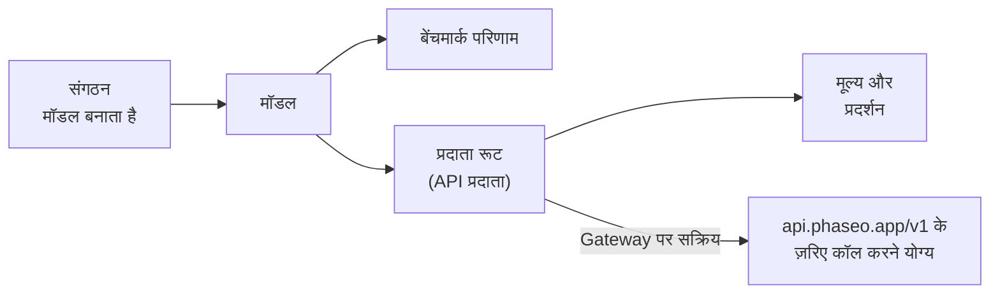

[phaseo.app](https://phaseo.app/models) पर कोई भी मॉडल खोजें और देखें कि उसे किसने बनाया, कौन से प्रदाता उसे उपलब्ध कराते हैं, उसकी लागत कितनी है और उसके स्कोर क्या हैं, फिर जब उसका सक्रिय रूट हो तो उसे Gateway के ज़रिए कॉल करें।

## कैटलॉग में क्या है

| रिकॉर्ड | यह क्या है | कहाँ देखें |
| --- | --- | --- |
| [संगठन](./organisations.mdx) | मॉडल बनाने और प्रकाशित करने वाली कंपनियाँ और रिसर्च लैब। | [संगठन](https://phaseo.app/organisations) |
| [मॉडल](./models.mdx) | हर जारी किया गया मॉडल, संबंधित मॉडलों के परिवारों में समूहबद्ध। | [मॉडल](https://phaseo.app/models) |
| [बेंचमार्क](./benchmarks.mdx) | मूल्यांकन और उन पर मॉडलों को मिलने वाले स्कोर। | [बेंचमार्क](https://phaseo.app/benchmarks) |
| [API प्रदाता](./api-providers.mdx) | वे प्लेटफ़ॉर्म जो API के ज़रिए मॉडल उपलब्ध कराते हैं। | [API प्रदाता](https://phaseo.app/api-providers) |
| [मूल्य और प्रदर्शन](./pricing-performance.mdx) | हर प्रदाता का प्रति टोकन, इमेज, सेकंड या अनुरोध मूल्य, और मापी गई Gateway गति। | मॉडल पेज, [तुलना करें](https://phaseo.app/compare) |
| [सदस्यता योजनाएँ](./subscription-plans.mdx) | Phaseo योजनाएँ, और प्रदाताओं द्वारा बेची जाने वाली सदस्यताएँ। | [सदस्यता योजनाएँ](https://phaseo.app/subscription-plans) |

कैटलॉग रिकॉर्ड का मतलब यह नहीं कि आप मॉडल को कॉल कर सकते हैं। सिर्फ़ **Gateway पर सक्रिय** चिह्नित मॉडलों का रूट होता है; `GET /v1/models` सिर्फ़ वही लौटाता है।

## डेटा कैसे पढ़ें

- **मूल्य** USD में होते हैं, टेक्स्ट के लिए प्रति 10 लाख टोकन, या मीडिया के लिए प्रदाता की अपनी इकाई में (प्रति इमेज, प्रति सेकंड, प्रति अनुरोध)।
- **तिथियाँ** UTC दिन होती हैं, जो अंग्रेज़ी में `01 Jan 2026` के रूप में दिखती हैं।
- **बेंचमार्क स्कोर** बेंचमार्क का अपना पैमाना और दिशा रखते हैं। Phaseo उन्हें एक साझा स्कोर में नहीं बदलता; [बेंचमार्क](./benchmarks.mdx) देखें।
- **परिवार** संबंधित मॉडलों को समूहबद्ध करते हैं, जैसे किसी एक मॉडल लाइन के आकार और वर्शन।

## डेटा को अपडेट कैसे रखा जाता है

प्रदाता सिंक जॉब नए मूल्य प्रस्तावित करते हैं, जिनकी प्रकाशन से पहले एक एडमिन समीक्षा करता है। बेंचमार्क इम्पोर्ट और मॉडल लाइफ़साइकल जॉब निर्धारित समय पर डेटाबेस अपडेट करते हैं। कोई भी GitHub issue के ज़रिए सुधार या छूटे हुए रिकॉर्ड की रिपोर्ट कर सकता है; मेंटेनर सबूत की समीक्षा करते हैं और स्वीकृत बदलाव लागू करते हैं। [योगदान](../contributing/overview.mdx) देखें।

## उदाहरण सवाल

| लक्ष्य | जवाब कहाँ मिलेगा |
| --- | --- |
| किसी बेंचमार्क पर दो मॉडलों की तुलना करना | [तुलना करें](https://phaseo.app/compare) या बेंचमार्क का पेज |
| किसी काम के लिए सबसे सस्ता मॉडल ढूँढना | मूल्य के अनुसार सॉर्ट की गई [मॉडल](https://phaseo.app/models) सूची, फिर [मूल्य कैलकुलेटर](https://phaseo.app/tools/pricing-calculator) |
| देखना कि समय के साथ कोई बेंचमार्क कैसे बदला | बेंचमार्क का **प्रगति** चार्ट |
| किसी फ़ीचर को सपोर्ट करने वाले प्रदाता ढूँढना | मॉडल पेज का **प्रदाता** सेक्शन, या `GET /v1/models/{author}/{slug}/endpoints` |
| योगदान के लिए रिकॉर्ड ढूँढना | छूटे हुए बेंचमार्क या मेटाडेटा वाले मॉडल पेज; [योगदान](../contributing/overview.mdx) देखें |
