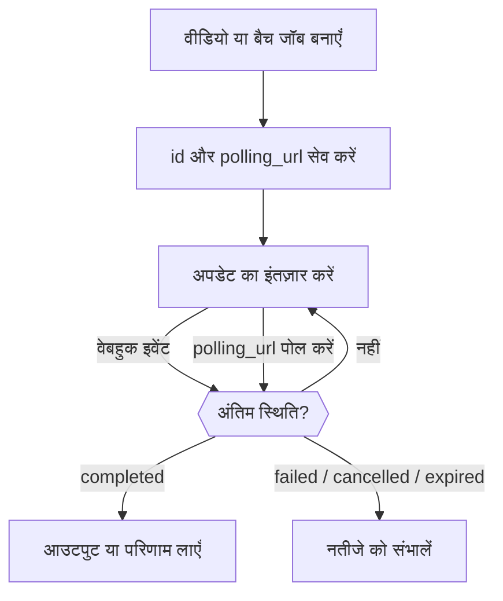

<Note>
Video API और Batch API चुने हुए वर्कस्पेस के लिए सिर्फ़ आमंत्रण वाले बीटा प्रीव्यू हैं। उपलब्धता के लिए **सेटिंग्स → फ़ीचर पूर्वावलोकन** देखें। ऐक्सेस हर वर्कस्पेस के लिए अलग प्रबंधित होता है; व्यक्तिगत वेब प्राथमिकता चालू करने से API ऐक्सेस नहीं मिलता। सामान्य मॉडल उपयोग शुल्क लागू होते हैं।
</Note>

वीडियो या बैच बनाने पर काम पूरा होने से पहले ही एक जॉब लौटता है। उसका `id` और `polling_url` सेव करें, फिर वेबहुक का इंतज़ार करें या तब तक पोल करें जब तक जॉब किसी अंतिम स्थिति में न पहुँच जाए: `completed`, `failed`, `cancelled` या `expired`। सफल create प्रतिक्रिया का मतलब सिर्फ़ इतना है कि जॉब स्वीकार हो गया।



वेबहुक इस्तेमाल करते समय भी पोलिंग का रास्ता बनाए रखें। बीटा के दौरान छोटे अनुरोधों और API कुंजी खर्च सीमा से शुरू करें। रेफ़रेंस इनपुट, रद्दीकरण और आउटपुट रिटेंशन प्रदाता और मॉडल पर निर्भर करते हैं। पूरे हुए आउटपुट समाप्त होने से पहले उनकी अपनी कॉपी सेव करें।

<span id="receive-updates"></span>
## अपडेट प्राप्त करें

किसी भी तरह का जॉब बनाते समय अपने वर्कस्पेस का एक वेबहुक एंडपॉइंट जोड़ें:

```json
{
  "webhook": {
    "endpoint_id": "YOUR_ENDPOINT_ID",
    "events": ["job.status_changed", "job.completed", "job.failed", "job.cancelled", "job.expired"]
  }
}
```

Phaseo प्रदाता की स्थिति का मिलान करता है और सूचनाएँ भेजता है, इसलिए जो प्रदाता सिर्फ़ पोलिंग सपोर्ट करते हैं, जैसे Anthropic message batches, उनसे भी वेबहुक मिलते हैं। वेबहुक डिलीवरी विफल होने का मतलब यह नहीं कि जॉब विफल हुआ।

Batch और Video इवेंट की सदस्यता `batch.completed` या `video.failed` जैसे नेमस्पेस वाले इवेंट टाइप के साथ अलग-अलग लें। सामान्य `job.*` इवेंट टाइप अब भी काम करते हैं और दोनों तरह के जॉब के मेल खाते चरण की सदस्यता लेते हैं।

### डिलीवरी सत्यापित करें और स्वीकार करें

एंडपॉइंट सीक्रेट से `x-phaseo-signature` सत्यापित करें: यह `x-phaseo-timestamp`, एक शाब्दिक पूर्णविराम (period), और **बिना बदले अनुरोध बॉडी** का हेक्साडेसिमल HMAC-SHA256 है। जाँचें कि टाइमस्टैम्प ताज़ा है, `x-phaseo-event-id` पर डुप्लिकेट हटाएँ, और स्वीकार की गई डिलीवरी को 2xx प्रतिक्रिया से स्वीकार करें। डिलीवरी दोबारा भेजी जा सकती हैं या क्रम से बाहर आ सकती हैं, इसलिए किसी विरोधी स्थिति बदलाव को लागू करने से पहले जॉब फिर से प्राप्त करें।

| प्रयास | कब |
| --- | --- |
| 1 | इवेंट होते ही |
| 2 | विफल प्रयास के लगभग 1 मिनट बाद |
| 3 | लगभग 5 मिनट बाद |
| 4 | लगभग 15 मिनट बाद; अगर यह विफल हो, तो डिलीवरी स्थायी रूप से विफल चिह्नित होती है |

2xx प्रतिक्रिया डिलीवरी खत्म कर देती है। रीट्राई बैकग्राउंड स्वीप भेजते हैं, इसलिए कोई रीट्राई तय समय से बाद में आ सकता है। हर प्रयास अपनी संख्या, समय, HTTP स्टेटस, त्रुटि और अगले रीट्राई का समय दर्ज करता है। फिर भी डुप्लिकेट हटाएँ: खोई हुई स्वीकृति या बीच में रुका वर्कर किसी डिलीवरी को अनिश्चित बना सकता है।

एंडपॉइंट सेव करने के बाद, साइन किया हुआ `webhook.test` पेलोड भेजने के लिए सेटिंग्स में **परीक्षण इवेंट भेजें** इस्तेमाल करें। टेस्ट डिलीवरी एक बार आज़माई जाती है, दोबारा नहीं भेजी जाती, और जॉब डिलीवरी इतिहास में नहीं जुड़ती।

## जॉब और अनुरोध लॉग देखें

**सेटिंग्स → उपयोग → लॉग्स** में, इन्फ़रेंस अनुरोध के विवरण के लिए **अनुरोध**, वीडियो लाइफ़साइकल के लिए **वीडियो**, और बैच जॉब और पंक्ति परिणामों के लिए **बैच** इस्तेमाल करें। Video और Batch विवरण व्यू में बिलिंग स्थिति, प्रदाता प्रयास और वेबहुक प्रयास शामिल होते हैं। कोई जॉब सफलतापूर्वक पूरा हो सकता है, जबकि उसकी वेबहुक डिलीवरी विफल हो।

वीडियो सबमिशन प्रदाता से संपर्क करने से पहले क्रेडिट आरक्षित करता है। बिना टास्क ID वाला टाइमआउट मिलान के लिए आरक्षण बनाए रखता है; यह विफल जनरेशन का सबूत नहीं है। अगर सफल काम के बाद कोई पेड Video या Batch आरक्षण अप्रत्याशित रूप से शून्य कीमत पर आता है, तो जाँच के लिए बिलिंग `unexpected_zero_cost` के साथ खुली रहती है। असिंक्रोनस जनरेशन के लिए सिर्फ़ शून्य-लागत वाली create प्रतिक्रिया सामान्य है।

## वीडियो की लागत का अनुमान लगाएँ

वीडियो की कीमतें प्रदाता और मॉडल पर निर्भर करती हैं। प्रति सेकंड कीमत को बिल योग्य अवधि से गुणा करना होता है; प्रति क्लिप कीमत सिर्फ़ उसकी तय अवधि और रिज़ॉल्यूशन पर लागू होती है। कई आउटपुट और शुल्क योग्य रेफ़रेंस इनपुट कुल राशि बढ़ा सकते हैं।

LTX टेक्स्ट/इमेज जनरेशन आउटपुट सेकंड पर बिल करता है, जबकि ऑडियो-से-वीडियो इनपुट ऑडियो सेकंड पर। BytePlus Seedance वीडियो टोकन इस्तेमाल करता है, और रेफ़रेंस वीडियो होने पर दरें अलग होती हैं। MiniMax Hailuo V1 तय-अवधि वाली क्लिप कीमतें इस्तेमाल करता है; H3 सेकंड इस्तेमाल करता है और रेफ़रेंस इनपुट के लिए शुल्क ले सकता है। किसी मुख्य कीमत को पूरे अनुरोध की लागत मानने के बजाय चुने गए प्रदाता के मूल्य आयाम जाँचें।

आरक्षण सबमिशन से पहले रखे गए अनुमान होते हैं। अंतिम बिलिंग जॉब के बिल योग्य उपयोग पर होती है; मिलान के बाद अनुपयोगी आरक्षित क्रेडिट छोड़ दिया जाता है। किसी प्रदाता का समर्थित रिज़ॉल्यूशन या विकल्प इस बात की गारंटी नहीं है कि वह बीटा में उपलब्ध है।

## अवधि, फ़्रेम और रेफ़रेंस सेट करें

आउटपुट अवधि के लिए `seconds` या `duration` इस्तेमाल करें। अगर दोनों मौजूद हैं, तो उन्हें मेल खाना चाहिए। `aspect_ratio` के साथ `resolution` इस्तेमाल करें, या `1280x720` जैसा पिक्सेल `size`।

स्पष्ट पहले और आख़िरी फ़्रेम के लिए `frame_images` इस्तेमाल करें:

```json
{
  "frame_images": [
    {
      "type": "image_url",
      "frame_type": "first_frame",
      "image_url": { "url": "https://example.com/start.png" }
    }
  ],
  "input_references": [
    {
      "type": "image_url",
      "role": "reference",
      "image_url": { "url": "https://example.com/character.png" }
    }
  ]
}
```

रेफ़रेंस URL में HTTPS होना ज़रूरी है। सिर्फ़ रेफ़रेंस वाली इमेज के लिए `role: "reference"` स्पष्ट रूप से दें: `frame_images` के बिना पुराने अनुरोध पहली बिना लेबल वाली इमेज को पहला फ़्रेम मानते हैं। `frame_images` को `input_references` में पहले/आख़िरी फ़्रेम वाली भूमिकाओं के साथ या `input_reference` के साथ न मिलाएँ।

वीडियो और ऑडियो रेफ़रेंस `type: "video_url"` या `"audio_url"` और `media_url: { "url": "https://..." }` इस्तेमाल करते हैं। मॉडल और प्रदाता अलग-अलग संयोजन सपोर्ट करते हैं। जहाँ रेफ़रेंस की अवधि कीमत पर असर डालती है, वहाँ सेकंड में `input_video_duration` और `input_audio_duration` दें।

## प्रदाता-विशिष्ट वीडियो विकल्प भेजें

मॉडल, अवधि, रिज़ॉल्यूशन, ऑडियो जनरेशन, इनपुट मीडिया और आउटपुट संख्या को मानक फ़ील्ड में रखें। प्रदाता-विशिष्ट एक्सटेंशन मानक प्रदाता ID के तहत भेजें:

```json
{
  "provider_options": {
    "atlascloud": { "watermark": false, "output_format": "mp4" },
    "byteplus": { "camera_fixed": true }
  }
}
```

सिर्फ़ चुने गए प्रदाता के विकल्प आगे भेजे जाते हैं। विकल्प प्रदाता नहीं चुनते; उसके लिए `provider` रूटिंग कॉन्फ़िगरेशन इस्तेमाल करें। `provider_options` को पुराने `provider_params` के साथ न मिलाएँ। नेस्टेड विकल्प Gateway-नियंत्रित बिलिंग या कॉलबैक फ़ील्ड को ओवरराइड नहीं कर सकते।

| प्रदाता | नेटिव एक्सटेंशन के उदाहरण | संदर्भ |
| --- | --- | --- |
| AtlasCloud Seedance 2.5 | `watermark`, `output_format`, `return_last_frame`, `omni_reference_task_type` | [Model API](https://www.atlascloud.ai/models/bytedance/seedance-2.5/reference-to-video) |
| Novita Seedance 1.5 | `watermark`, `camera_fixed`, `fps` (24), `service_tier` (`default`) | [Unified video API](https://docs.novita.ai/api-reference/reference-unified-video-generation) |
| BytePlus Seedance | `camera_fixed` | इस्तेमाल से पहले चुने गए मॉडल का प्रदाता कॉन्ट्रैक्ट जाँचें। |
| MiniMax V1 | `fast_pretreatment`; प्रॉम्प्ट ऑप्टिमाइज़ेशन के लिए मानक `enhance_prompt` इस्तेमाल करें | [Video API](https://platform.minimax.io/docs/api-reference/video-generation-t2v) |

AtlasCloud Seedance नेटिव `resolution`, `ratio` और `last_image` फ़ील्ड इस्तेमाल करता है। इसका रेफ़रेंस-से-वीडियो वैरिएंट क्रम से इमेज, वीडियो और ऑडियो रेफ़रेंस लेता है। स्वचालित-अवधि एडिटिंग (`duration: -1`) Gateway के तय-अवधि आरक्षण कॉन्ट्रैक्ट में समर्थित नहीं है। किसी मॉडल को रूट करने से पहले प्रदाता मॉडल की उपलब्धता और कीमत कॉन्फ़िगर होनी चाहिए; प्रदाता विकल्प किसी अनुपलब्ध मॉडल को सक्षम नहीं करता।

MiniMax H3, V2 इस्तेमाल करता है: `768P` या `2K` पर 4–15 पूरे सेकंड। H3 Max `480P` या `768P` पर 5–15 पूरे सेकंड सपोर्ट करता है, टेक्स्ट या फ़्रेम इमेज के साथ। H3 रेफ़रेंस इमेज, वीडियो और ऑडियो सपोर्ट करता है; रेफ़रेंस को पहले/आख़िरी फ़्रेम के साथ नहीं मिलाया जा सकता। दोनों मॉडल हर अनुरोध पर एक वीडियो बनाते हैं और V1 के प्रॉम्प्ट ऑप्टिमाइज़ेशन विकल्प सपोर्ट नहीं करते। मानक `aspect_ratio` इस्तेमाल करें; फ़्रेम इनपुट अपना अनुपात ख़ुद तय करते हैं। रेफ़रेंस-वीडियो आरक्षण प्रदाता की 15 सेकंड की इनपुट सीमा को कवर करते हैं, और असल उपयोग पूरा होने पर तय होता है। [MiniMax V2 कॉन्ट्रैक्ट](https://platform.minimax.io/docs/api-reference/video-generation-v2-create) देखें।

## जाँचें कि हर बैच प्रदाता क्या सपोर्ट करता है

बैच अनुरोध भी `provider_options` स्वीकार करते हैं: OpenAI `output_expires_after` सपोर्ट करता है, और Mistral `metadata`। मानक प्रदाता ID इस्तेमाल करें और इन फ़ील्ड को टॉप लेवल पर दोहराएँ नहीं। उदाहरण के लिए, `provider_options: { "openai": { "output_expires_after": { "anchor": "created_at", "seconds": 86400 } } }` OpenAI आउटपुट रिटेंशन सेट करता है। पंक्ति इनपुट, मॉडल, एंडपॉइंट और वेबहुक गंतव्य विकल्पों के ज़रिए ओवरराइड नहीं किए जा सकते।

Mistral के पास पहले से नेटिव बैच एडेप्टर है। Anthropic message batches पोल किए जाते हैं; दूसरे प्रदाता पोलिंग को नेटिव पूर्णता सूचनाओं के साथ जोड़ सकते हैं। उपलब्धता प्रदाता के समर्थित एंडपॉइंट और डिप्लॉयमेंट की बैच अनुमति-सूची पर निर्भर करती है। फ़ाइल या इनलाइन अनुरोध सबमिट करने से पहले बैच क्षमता प्रतिक्रिया जाँचें।

Vertex Gemini बैच `/v1/generateContent` के साथ इनलाइन `requests`, या `model` और `prompts` स्वीकार करते हैं। Vertex इस्तेमाल करने के लिए `provider: "google-vertex"` चुनें। सफल पंक्तियों पर Batch दरों से शुल्क लगता है। इस एडेप्टर के लिए मैनेज्ड क्रेडेंशियल चाहिए; BYOK, अपलोड की गई Files, एम्बेडिंग और `google-vertex-eu` बैच उपलब्ध नहीं हैं। इनपुट 20 MB और 10,000 अनुरोधों तक सीमित है। सेव किया गया इनपुट और आउटपुट 30 दिन बाद समाप्त हो जाता है।

Vertex परिणाम हर सबमिट की गई पंक्ति की पहचान के लिए `custom_id` इस्तेमाल करते हैं, जिसमें सफल जनरेशन `response.body` में या प्रति-अनुरोध `error` होता है। आउटपुट का क्रम इनपुट के क्रम से अलग हो सकता है। जिस सबमिशन का प्रदाता नतीजा अनिश्चित है, वह अपने क्रेडिट होल्ड के साथ मैन्युअल समीक्षा में रहता है; उसका नतीजा पक्का होने तक उसकी जगह नया न बनाएँ।

बैच पूरा होने में विफल पंक्तियाँ भी हो सकती हैं। यह मानने के बजाय कि हर पंक्ति सफल हुई, हर परिणाम को उसकी custom ID से जाँचें। परिणाम और बिलिंग का मिलान होने तक मूल इनपुट और जॉब ID रखें। किसी अनिश्चित सबमिशन की दोबारा सबमिट करने से पहले जाँच ज़रूरी है, क्योंकि हो सकता है कि प्रदाता ने मूल अनुरोध स्वीकार कर लिया हो।

### बैच परिणाम डाउनलोड करें

किसी समर्थित बैच के अंतिम स्थिति में पहुँचने के बाद, उसका `results_url` एक प्रमाणित Phaseo डाउनलोड की ओर इशारा करता है। बैच के मालिक वर्कस्पेस की अपनी सामान्य Phaseo API कुंजी इस्तेमाल करें:

```bash
curl --fail "https://api.phaseo.app/v1/batches/$BATCH_ID/results" \
  -H "Authorization: Bearer $PHASEO_API_KEY" \
  --output results.jsonl
```

प्रतिक्रिया हर समर्थित बैच प्रदाता के लिए एक ही एंडपॉइंट से JSONL स्ट्रीम करती है। Phaseo अलग-अलग सफलता और त्रुटि फ़ाइलों को जोड़ता है, इनलाइन परिणाम ऐरे को JSONL में बदलता है, और परिणाम पेजिनेशन का पालन करता है। जनरेट किया गया कंटेंट और प्रति-अनुरोध त्रुटियाँ सुरक्षित रहती हैं। पंक्ति फ़ील्ड प्रदाता-नेटिव रहते हैं: OpenAI-संगत और Anthropic पंक्तियों के लिए `custom_id`, Gemini के लिए अनुरोध मेटाडेटा, और xAI के लिए `batch_request_id` इस्तेमाल करें। Anthropic की सफल पंक्तियों में जनरेट किया गया संदेश `result.message` में होता है।

डाउनलोड OpenAI, Anthropic, Google AI Studio, Mistral, Together, Groq, Alibaba Cloud, Moonshot, Parasail, OVHcloud और xAI एडेप्टर सपोर्ट करते हैं। प्रदाता की उपलब्धता फिर भी प्रीव्यू ऐक्सेस और सबमिशन अनुमति-सूची पर निर्भर करती है; डाउनलोड सपोर्ट अतिरिक्त रूट सक्षम नहीं करता। मौजूदा `output_file_id`, `error_file_id` और फ़ाइल-कंटेंट एंडपॉइंट उपलब्ध रहते हैं। बैच अनुरोध-पंक्ति एंडपॉइंट में ट्रैकिंग और बिलिंग मेटाडेटा होता है, जनरेट किए गए संदेश की बॉडी नहीं।

परिणाम डाउनलोड करने से कोई दूसरा बैच सबमिट नहीं होता और न ही इन्फ़रेंस शुल्क जुड़ता है। आपको प्रदाता क्रेडेंशियल की ज़रूरत नहीं है। वेबहुक जॉब अपडेट का संकेत देते हैं; परिणाम अलग से डाउनलोड करें। किसी अंतिम जॉब के परिणाम आंशिक हो सकते हैं या कोई आउटपुट ही न हो: प्रोसेसिंग के दौरान एंडपॉइंट `409` लौटाता है और कोई आउटपुट उपलब्ध न होने पर `404`। प्रदाता की रिटेंशन अवधि खत्म होने से पहले परिणाम सेव करें। अगर डाउनलोड बीच में रुक जाए, तो आंशिक फ़ाइल हटाएँ और डाउनलोड दोबारा आज़माएँ, बैच सबमिशन नहीं। इनलाइन JSON परिणाम प्रति पंक्ति 8 MiB की सुरक्षा सीमा के साथ स्ट्रीम होते हैं; नेटिव JSONL फ़ाइलें इस पंक्ति सीमा के बिना स्ट्रीम होती हैं।

बड़े आउटपुट के लिए, TypeScript का `client.batches.streamResults(batchId, { signal })` बिना बफ़रिंग के `ReadableStream<Uint8Array>` लौटाता है। इसे अपने गंतव्य पर पाइप करें, और जल्दी रोकने के लिए स्ट्रीम रद्द करें या सिग्नल को abort करें; कुल डाउनलोड का कोई तय टाइमआउट नहीं है। Python का `client.batches.stream_results(batch_id)` कॉन्फ़िगर किए गए HTTP टाइमआउट के साथ बाइट चंक देता है; जल्दी रोकते समय इटरेटर बंद करें। जनरेट किए गए `retrieveBatchResults` ऑपरेशन पूरा JSONL टेक्स्ट लौटाते हैं और छोटे आउटपुट के लिए सबसे उपयुक्त हैं।

### बैच डाउनलोड सीमाएँ

बैच परिणाम डाउनलोड में हर बैच के लिए हर वर्कस्पेस को रोलिंग 30 मिनट की अवधि में 10 प्रयास मिलते हैं, जो API कुंजियों और `/batches` और `/batch` उपनामों में साझा होते हैं। डाउनलोड प्रवेश तक पहुँचने वाले प्रयास गिने जाते हैं, भले ही अपस्ट्रीम डाउनलोड विफल हो या रद्द हो जाए। स्वामित्व और तैयारी से जुड़ी विफलताएँ नहीं गिनी जातीं। `429` प्रतिक्रिया में सेकंड में `Retry-After` शामिल होता है। अगर लिमिटर उपलब्ध नहीं है, तो डाउनलोड `Retry-After: 30` के साथ `503` लौटाते हैं।
