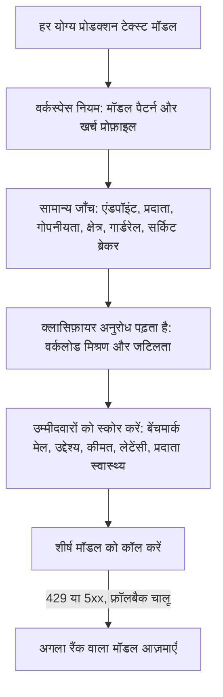

`"model": "phaseo/auto"` भेजें, और Phaseo हर अनुरोध के लिए वर्कलोड, आपके वर्कस्पेस के उद्देश्य और उसकी कीमत सीमाओं के आधार पर एक मॉडल चुनता है। ऑटो रूटिंग एक अल्फा सुविधा है जो चुने हुए वर्कस्पेस के लिए उपलब्ध है।

```json
{
  "model": "phaseo/auto",
  "input": "Review this TypeScript function for correctness."
}
```

प्रतिक्रिया का `model` फ़ील्ड दिखाता है कि किस मॉडल ने जवाब दिया।

## मॉडल कैसे चुना जाता है



1. **उम्मीदवार।** Phaseo ज्ञात मानक कीमत वाले हर प्रोडक्शन टेक्स्ट मॉडल से शुरू करता है, फिर सिर्फ़ उन्हें रखता है जो आपके मॉडल पैटर्न और खर्च प्रोफ़ाइल से मेल खाते हैं।
2. **जाँच।** हर उम्मीदवार को वही एंडपॉइंट, वर्कस्पेस मॉडल, प्रदाता, गोपनीयता, गार्डरेल और सर्किट-ब्रेकर जाँच पास करनी होती है जो किसी तय मॉडल वाले अनुरोध पर होती है।
3. **क्लासिफ़ायर।** एक तय कम लागत वाला मॉडल अनुरोध पढ़ता है और वर्कलोड मिश्रण (कोड, रीज़निंग, टूल उपयोग आदि), एक जटिलता स्कोर और एक विश्वास स्तर लौटाता है। यह कभी ख़ुद मॉडल नहीं चुनता। अनुरोध में मौजूद टूल और संरचित आउटपुट उसे भरोसेमंद तथ्यों के रूप में दिए जाते हैं।
4. **स्कोरिंग।** जटिलता वह सबसे कम सक्षम मॉडल तय करती है जिससे स्वीकार्य जवाब मिलने की संभावना हो, साथ में एक मार्जिन। फिर Phaseo स्व-रिपोर्टेड न होने वाले कैटलॉग बेंचमार्क को आपके उद्देश्य और हर उम्मीदवार की मौजूदा कीमत, लेटेंसी, स्वास्थ्य और विश्वसनीयता के साथ जोड़ता है। अनुपलब्ध डेटा को तटस्थ गिना जाता है; यह कभी शॉर्टलिस्ट को बड़ा नहीं करता।

अनुरोध वर्कस्पेस के उद्देश्य, खर्च प्रोफ़ाइल या पैटर्न को नहीं बदल सकता। तय मॉडल वाला अनुरोध ऑटो रूटिंग को पूरी तरह छोड़ देता है।

## इसे कॉन्फ़िगर करें

<Steps>
<Step title="ऑटो रूटिंग खोलें">

**डैशबोर्ड -> सेटिंग्स -> रूटिंग -> ऑटो रूटिंग** पर जाएँ।

</Step>
<Step title="उद्देश्य चुनें">

| उद्देश्य | किसे सबसे ज़्यादा महत्व देता है |
| --- | --- |
| `balanced` | गुणवत्ता, कीमत, लेटेंसी और विश्वसनीयता का व्यावहारिक मिश्रण। |
| `quality` | वर्कलोड से जुड़े बेंचमार्क परिणाम। |
| `cost` | कम इनपुट और आउटपुट टोकन कीमत। |
| `latency` | प्रदाता की कम हालिया लेटेंसी। |

</Step>
<Step title="खर्च प्रोफ़ाइल चुनें">

हर प्रोफ़ाइल मानक-टियर टेक्स्ट कीमतों पर एक सख़्त अधिकतम सीमा है, USD प्रति 10 लाख टोकन में। इससे ऊपर के मॉडलों पर कभी विचार नहीं किया जाता।

| खर्च प्रोफ़ाइल | अधिकतम इनपुट | अधिकतम आउटपुट |
| --- | ---: | ---: |
| किफ़ायती | $0.10 | $0.50 |
| मानक | $0.30 | $1.50 |
| प्रीमियम | $1 | $5 |
| कोई भी कीमत | कोई नहीं | कोई नहीं |

**कस्टम** से आप दोनों सीमाएँ ख़ुद सेट करते हैं।

</Step>
<Step title="मॉडल सीमित करें (वैकल्पिक)">

`anthropic/*`, `openai/gpt-5.*` जैसे पैटर्न या कोई सटीक मॉडल ID जोड़ें।

</Step>
<Step title="फ़ॉलबैक की अनुमति दें और सेव करें">

फ़ॉलबैक चालू होने पर, `429`, `500`, `502`, `503` या `504` के बाद Phaseo अगला रैंक वाला मॉडल आज़माता है। हर फ़ॉलबैक फिर से हर जाँच से गुज़रता है। क्लाइंट त्रुटियों पर मॉडल नहीं बदलता।

</Step>
</Steps>

CLI से: `phaseo routing auto update --objective <o> --spend-profile <p> --allowed-patterns <list> --allow-fallbacks`, और इसे वापस पढ़ने के लिए `phaseo routing auto get`। API `PATCH /v1/routing/auto` है।

<Warning>
  खर्च प्रोफ़ाइल और पैटर्न तय करते हैं कि कौन से मॉडल योग्य हैं। वे गुणवत्ता की गारंटी नहीं देते, इसलिए नतीजे में मिले मॉडल मिश्रण को अपने वर्कलोड पर जाँचें।
</Warning>

## क्लासिफ़ायर अनुरोध

हर `phaseo/auto` अनुरोध उसी वर्कस्पेस और बिलिंग पहचान के तहत क्लासिफ़ायर मॉडल के लिए एक अलग चाइल्ड अनुरोध बनाता है। यह अनुरोध लॉग में `purpose=auto_routing_classifier` और पैरेंट अनुरोध ID के साथ अलग से दिखता है, और इसका मीटरिंग अलग होता है।

अगर क्लासिफ़ायर विफल हो जाए, टाइमआउट हो जाए या अमान्य डेटा लौटाए, तो Phaseo इसके बजाय एक लोकल नियम-आधारित क्लासिफ़ायर इस्तेमाल करता है (कोड, रीज़निंग, टूल उपयोग, संरचित आउटपुट, अनुवाद, सारांश या सामान्य), ताकि मुख्य अनुरोध फिर भी चले।

## गोपनीयता और क्षेत्र सीमाएँ

अनुरोध पर लगी डेटा सीमाएँ ऑटो रूटिंग पर भी लागू होती हैं:

- `provider.require_zero_data_retention: true` के साथ, या ऐसे वर्कस्पेस या कुंजी गार्डरेल के साथ जो सिर्फ़ ज़ीरो-रिटेंशन प्रदाताओं की अनुमति देता है, सिर्फ़ ऐसे प्रदाता वाले मॉडल शॉर्टलिस्ट होते हैं।
- ज़रूरी क्षेत्रों को हर उम्मीदवार के प्रदाताओं से जाँचा जाता है।
- क्लासिफ़ायर अनुरोध पर भी यही सीमाएँ लागू होती हैं, साथ में `only` और `ignore` प्रदाता सूचियाँ। अगर उसका मॉडल इन्हें पूरा नहीं कर सकता, तो Phaseo लोकल क्लासिफ़ायर इस्तेमाल करता है।

अगर सिर्फ़ रेज़िडेंसी ज़रूरतों के कारण कोई मॉडल नहीं बचता, तो अनुरोध `403 model_region_unavailable` और `unmet_requirements` के साथ विफल होता है, जैसे किसी तय मॉडल के साथ होता। अगर मॉडल दूसरे कारणों से भी बाहर हुए थे, तो यह `400 unsupported_model_or_endpoint` के साथ विफल होता है।

## किसी निर्णय की जाँच करें

अनुरोध विवरण में वर्कलोड, उद्देश्य, चुना गया मॉडल, फ़ॉलबैक क्रम, हर उम्मीदवार के स्कोर और फ़ैक्टर स्कोर, बेंचमार्क ID, बहिष्करण और एल्गोरिदम वर्शन दिखते हैं। ट्रेस में कोई प्रॉम्प्ट या प्रतिक्रिया कंटेंट नहीं होता।

## दूसरी रूटिंग के साथ जोड़ें

- **डायनामिक रूट।** जुड़े हुए [डायनामिक रूट](./routing-and-fallbacks#attach-routing-rules-to-api-keys) द्वारा चुना गया तय मॉडल जीतता है। ओवरराइड दर्ज होता है और उस अनुरोध के लिए ऑटो रूटिंग के फ़ॉलबैक बंद रहते हैं।
- **अनुरोध फ़ॉलबैक।** `phaseo/auto` अपने रैंक वाले फ़ॉलबैक ख़ुद संभालता है, इसलिए इसे [`models` सूची](./routing-and-fallbacks#request-level-model-fallbacks) के साथ नहीं जोड़ा जा सकता और न ही यह उसमें दिख सकता है।
