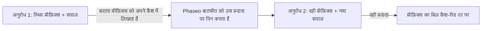

अनुरोधों में अपने प्रॉम्प्ट की शुरुआत एक जैसी रखें, और प्रदाता उसे दोबारा प्रोसेस करने के बजाय अपने कैश से पढ़ता है: उन टोकन का बिल कैश-रीड दर पर बनता है और पहला टोकन जल्दी आता है। ज़्यादातर प्रदाता दोहराए गए प्रीफ़िक्स को अपने आप कैश करते हैं। Claude सिर्फ़ वही कैश करता है जिसे आप `cache_control` से चिह्नित करते हैं।



प्रॉम्प्ट कैशिंग फिर भी हर अनुरोध पर इन्फ़रेंस चलाती है। यह एक जैसे अनुरोध पर पहले वाला जवाब नहीं लौटाती।

## प्रॉम्प्ट कैश करें

स्थिर हिस्से के आखिरी ब्लॉक को चिह्नित करें। उस ब्लॉक तक और उसे मिलाकर सब कुछ कैश होता है।

<CodeGroup>
```bash Chat Completions
curl https://api.phaseo.app/v1/chat/completions \
  -H "Authorization: Bearer $PHASEO_API_KEY" \
  -H "Content-Type: application/json" \
  -d '{
    "model": "anthropic/claude-sonnet-5.5",
    "messages": [
      {
        "role": "system",
        "content": [
          {
            "type": "text",
            "text": "You are a support assistant. Follow the company policy exactly.",
            "cache_control": { "type": "ephemeral", "ttl": "1h" }
          }
        ]
      },
      { "role": "user", "content": "Summarise the latest ticket." }
    ]
  }'
```

```bash Responses
curl https://api.phaseo.app/v1/responses \
  -H "Authorization: Bearer $PHASEO_API_KEY" \
  -H "Content-Type: application/json" \
  -d '{
    "model": "anthropic/claude-sonnet-5.5",
    "input": [
      {
        "role": "user",
        "content": [
          {
            "type": "input_text",
            "text": "Reference document: Refunds are available for 30 days when...",
            "cache_control": { "type": "ephemeral", "ttl": "5m" }
          },
          {
            "type": "input_text",
            "text": "Answer this customer: Can I return an item after 20 days?"
          }
        ]
      }
    ]
  }'
```

```bash Anthropic Messages
curl https://api.phaseo.app/v1/messages \
  -H "Authorization: Bearer $PHASEO_API_KEY" \
  -H "Content-Type: application/json" \
  -d '{
    "model": "anthropic/claude-sonnet-5.5",
    "max_tokens": 512,
    "system": [
      {
        "type": "text",
        "text": "You are a careful support assistant. Use the policy below.",
        "cache_control": { "type": "ephemeral", "ttl": "1h" }
      }
    ],
    "messages": [
      {
        "role": "user",
        "content": [
          {
            "type": "text",
            "text": "Policy: refunds are available for 30 days when...",
            "cache_control": { "type": "ephemeral", "ttl": "5m" }
          },
          { "type": "text", "text": "Can this customer return an item after 20 days?" }
        ]
      }
    ],
    "tools": [
      {
        "name": "lookup_order",
        "description": "Look up order status.",
        "input_schema": {
          "type": "object",
          "properties": { "order_id": { "type": "string" } },
          "required": ["order_id"]
        },
        "cache_control": { "type": "ephemeral", "ttl": "5m" }
      }
    ]
  }'
```
</CodeGroup>

फिर जाँचें कि यह काम किया:

1. कैश लिखने के लिए अनुरोध एक बार भेजें।
2. उसी कैश होने योग्य कंटेंट के साथ उसे फिर से भेजें।
3. प्रतिक्रिया के उपयोग में `cached_tokens` और `cache_write_tokens` ([उपयोग और प्राइसिंग फ़ील्ड](#usage-and-pricing-fields) देखें), और अनुरोध विवरण में कैश मीटर जाँचें।
4. सिर्फ़ पहली कॉल नहीं, कई कॉल में लेटेंसी और लागत की तुलना करें।

वह कंटेंट कैश करें जो अनुरोधों में एक जैसा रहता है: लंबे सिस्टम निर्देश, दोबारा उपयोग होने वाले दस्तावेज़, फ़्यू-शॉट उदाहरण, टूल परिभाषाएँ, और बड़े टूल परिणाम जिन्हें अगला टर्न फिर से भेजता है। हर अनुरोध पर बदलने वाले कंटेंट, छोटे एक-बार के इनपुट, या ऐसे डेटा को चिह्नित न करें जिसे आपकी नीति प्रदाता को सेव करने की अनुमति नहीं देती।

<Note>
Phaseo हर प्रदाता को सिर्फ़ वही कैश नियंत्रण भेजता है जिन्हें वह दस्तावेज़ में बताता है, और बाकी हटा देता है। कैश नियंत्रण कभी किसी प्रदाता को रूटिंग से बाहर नहीं करते। हर मॉडल पेज उसकी कैश रीड और राइट कीमतें दिखाता है।
</Note>

## कौन-से प्रदाता अपने आप कैश करते हैं

| प्रदाता | कैशिंग | Phaseo क्या भेजता है |
| --- | --- | --- |
| [OpenAI](https://developers.openai.com/api/docs/guides/prompt-caching), [Azure OpenAI](https://learn.microsoft.com/en-us/azure/foundry/openai/how-to/prompt-caching) | 1,024 या ज़्यादा टोकन वाले प्रॉम्प्ट के लिए अपने आप | `prompt_cache_key`; GPT-5.6 और बाद के मॉडलों पर ब्रेकपॉइंट और `prompt_cache_options`; पहले के मॉडलों पर `prompt_cache_retention` |
| Anthropic पर [Anthropic Claude](https://platform.claude.com/docs/en/build-with-claude/prompt-caching), Claude on AWS, Amazon Bedrock और Google Vertex AI | ऑप्ट-इन | `cache_control` ब्रेकपॉइंट, प्रति अनुरोध अधिकतम चार |
| Google AI Studio और [Vertex AI](https://docs.cloud.google.com/vertex-ai/generative-ai/docs/context-cache/context-cache-overview) पर [Google Gemini](https://ai.google.dev/gemini-api/docs/caching) | Gemini 2.5 और बाद के मॉडलों पर अपने आप | आपके बनाए स्पष्ट कैश के लिए `cached_content` |
| [xAI](https://docs.x.ai/developers/advanced-api-usage/prompt-caching/maximizing-cache-hits) | अपने आप | `prompt_cache_key` और `x-grok-conv-id` हेडर |
| [DeepSeek](https://api-docs.deepseek.com/guides/kv_cache) | अपने आप | कुछ अतिरिक्त नहीं |
| [Moonshot AI](https://platform.kimi.ai/docs/guide/context-caching) | अपने आप, 5 मिनट के TTL के साथ; Kimi K3 पर 1 घंटे का TTL ऑप्ट-इन है | `prompt_cache_key` और `prompt_cache_options` |
| [Groq](https://console.groq.com/docs/prompt-caching) | Groq द्वारा सूचीबद्ध मॉडलों पर अपने आप | कुछ अतिरिक्त नहीं |
| [Fireworks](https://docs.fireworks.ai/guides/prompt-caching) | अपने आप | `prompt_cache_key`, साथ में `x-session-affinity` हेडर और `user` |
| [Cerebras](https://inference-docs.cerebras.ai/capabilities/prompt-caching) | अपने आप | `prompt_cache_key` |
| [Cloudflare Workers AI](https://developers.cloudflare.com/workers-ai/features/prompt-caching) | चुने हुए मॉडलों पर अपने आप | `x-session-affinity` हेडर |
| [Together AI](https://docs.together.ai/docs/inference/chat/prompt-caching), [Mistral](https://docs.mistral.ai/studio-api/conversations/advanced/prompt-caching) | अपने आप; `prompt_cache_key` हिट दर बेहतर करता है | `prompt_cache_key` |
| [Alibaba Model Studio](https://www.alibabacloud.com/help/en/model-studio/context-cache) | अपने आप (अंतर्निहित); स्पष्ट कैश ऑप्ट-इन हैं | ब्लॉक `cache_control` |
| [Venice](https://docs.venice.ai/overview/guides/prompt-caching) | अपने आप; Venice Claude ब्रेकपॉइंट खुद जोड़ता है | ब्लॉक `cache_control` |
| [DeepInfra](https://docs.deepinfra.com/chat/prompt-cache-retention) | अपने आप; रिटेंशन अवधि ऑप्ट-इन है | `prompt_cache_key`, `prompt_cache_breakpoint` और `prompt_cache_options` |
| [Inference.net](https://inference.net/models/claude-opus-5/) | अपने आप; Claude और Gemini 2.5 मॉडलों पर स्पष्ट कैशिंग | Claude और Gemini 2.5 मॉडलों पर ब्लॉक `cache_control`, बिना `ttl` के |
| [Baseten](https://docs.baseten.co/inference/model-apis/pricing-and-limits) | अपने आप | `prompt_cache_key` और `x-session-affinity` हेडर |
| [Morph](https://docs.morphllm.com/sdk/components/caching) | अपने आप | `prompt_cache_key` और `x-session-id` हेडर |

दूसरे OpenAI-संगत प्रदाताओं को `prompt_cache_key` तब मिलता है जब उनका API उसे स्वीकार करता है, और कोई दूसरा कैश नियंत्रण नहीं। Phaseo हमेशा कुंजी के बजाय आपके वर्कस्पेस और कुंजी का हैश भेजता है; [प्रदाता अफ़िनिटी](#provider-affinity) देखें।

<span id="cache-controls"></span>
## कैश नियंत्रण

### Phaseo को Claude ब्रेकपॉइंट लगाने दें

Chat Completions, Responses या Anthropic Messages पर टॉप-लेवल `cache_control` Claude रूट के लिए कैशिंग चालू करता है, और Phaseo आपके लिए ब्रेकपॉइंट लगाता है। दूसरे प्रदाता इसे अनदेखा करते हैं।

```json
{
  "cache_control": { "type": "ephemeral", "ttl": "5m" }
}
```

कम समय तक रहने वाले साझा कॉन्टेक्स्ट के लिए `ttl: "5m"` (डिफ़ॉल्ट) का उपयोग करें, और जब मॉडल लंबे समय तक रहने वाली कैश एंट्री सपोर्ट करता हो तो `ttl: "1h"` का। टॉप-लेवल `cache_control` बातचीत को एक प्रदाता पर भी रखता है; [प्रदाता अफ़िनिटी](#provider-affinity) देखें।

`provider_options.anthropic.cache_control` वही सेटिंग है, और यह `scope` भी लेती है। जब कोई अनुरोध दोनों भेजता है, तो `provider_options` वाला मान लागू होता है:

```json
{
  "provider_options": {
    "anthropic": {
      "cache_control": { "type": "ephemeral", "ttl": "5m", "scope": "agent" }
    }
  }
}
```

| `scope` | Phaseo ब्रेकपॉइंट कहाँ लगाता है |
| --- | --- |
| `all_text` (डिफ़ॉल्ट) | सिस्टम टेक्स्ट और टेक्स्ट या इमेज वाले तीन सबसे हाल के उपयोगकर्ता संदेश। |
| `last_user_message` | सिर्फ़ सबसे हाल का उपयोगकर्ता संदेश। |
| `agent` | टूल लूप के लिए: आखिरी टूल परिभाषा, सिस्टम टेक्स्ट, अंतिम संदेश (टूल परिणामों सहित), और पिछले चरण का संदेश। `conversation` इसका उपनाम है। |
| `none` | कहीं नहीं। |

कई चरणों वाले टूल लूप के लिए `agent` का उपयोग करें। `all_text` और `last_user_message` सिर्फ़ टूल परिणाम वाले संदेशों को चिह्नित नहीं करते, इसलिए कैश किया गया प्रीफ़िक्स बढ़ना बंद हो जाता है। पहचाने न गए `scope` मान `agent` माने जाते हैं।

आप ब्लॉक पर खुद जो ब्रेकपॉइंट लगाते हैं, वे डिफ़ॉल्ट नीति पर प्राथमिकता रखते हैं, और Anthropic की प्रति अनुरोध चार की सीमा में गिने जाते हैं: डिफ़ॉल्ट नीति चार पर चिह्न जोड़ना बंद कर देती है। अगर आपके अपने ब्लॉक पर चार से ज़्यादा चिह्न हैं, तो Phaseo पहला और सबसे हाल के तीन रखता है और बाकी हटा देता है, ताकि अनुरोध अस्वीकार न हो।

### ब्लॉक पर कैश ब्रेकपॉइंट

किसी कंटेंट ब्लॉक पर कैश चिह्न उस ब्लॉक तक और उसे मिलाकर सब कुछ कैश करता है। Phaseo दो रूप स्वीकार करता है:

- `cache_control`: `{"type": "ephemeral"}`, `5m` या `1h` के वैकल्पिक `ttl` के साथ।
- `prompt_cache_breakpoint`: OpenAI का `{"mode": "explicit"}`, `30m` या `12h` के वैकल्पिक `ttl` के साथ ([OpenAI पर 12 घंटे का कैश](#12-hour-cache-on-openai) देखें)। जब किसी ब्लॉक पर दोनों हों, तो `prompt_cache_breakpoint` लागू होता है।

Chat Completions और Responses पर चिह्न टेक्स्ट और इमेज हिस्सों पर, फ़ंक्शन टूल परिभाषाओं पर, और उन टूल परिणामों पर स्वीकार किए जाते हैं जिनका कंटेंट टेक्स्ट हिस्सों का ऐरे हो। Anthropic Messages `cache_control` को हर उस जगह स्वीकार करता है जहाँ Anthropic करता है: `system` टेक्स्ट ब्लॉक, संदेश के टेक्स्ट और इमेज ब्लॉक, टूल परिणाम ब्लॉक, और टूल परिभाषाएँ। जब एक अनुरोध में कई TTL हों, तो Anthropic को `1h` ब्रेकपॉइंट `5m` वालों से पहले चाहिए।

हर प्रदाता को चिह्न उसके अपने रूप में मिलता है:

| प्रदाता | ब्लॉक `cache_control` | `prompt_cache_breakpoint` |
| --- | --- | --- |
| Anthropic पर Claude, Claude on AWS, Amazon Bedrock और Google Vertex AI | आपके `ttl` के साथ `{"type": "ephemeral"}` के रूप में भेजा जाता है | `cache_control: {"type": "ephemeral"}` के रूप में भेजा जाता है |
| OpenAI, GPT-5.6 और बाद के | `prompt_cache_breakpoint: {"mode": "explicit"}` के रूप में भेजा जाता है; `ttl` हटा दिया जाता है | अपने `ttl` के साथ भेजा जाता है |
| Azure OpenAI, GPT-5.6 और बाद के | `prompt_cache_breakpoint: {"mode": "explicit"}` के रूप में भेजा जाता है; `ttl` हटा दिया जाता है | बिना `ttl` के भेजा जाता है |
| OpenAI और Azure OpenAI, पहले के मॉडल | हटा दिया जाता है | हटा दिया जाता है |
| DeepInfra | हटा दिया जाता है | बिना `ttl` के भेजा जाता है |
| Alibaba Model Studio और Venice | भेजा जाता है | हटा दिया जाता है |
| Inference.net, Claude और Gemini 2.5 मॉडल | बिना `ttl` के भेजा जाता है | हटा दिया जाता है |
| दूसरे प्रदाता | हटा दिया जाता है | हटा दिया जाता है |

टूल परिभाषाओं पर चिह्न सिर्फ़ Claude रूट, Alibaba Model Studio, Venice, और Inference.net के Claude और Gemini 2.5 मॉडलों तक पहुँचते हैं; OpenAI टूल पर ब्रेकपॉइंट स्वीकार नहीं करता। चिह्न हटाने से प्रॉम्प्ट का बाकी हिस्सा नहीं बदलता, इसलिए कैश किया गया प्रीफ़िक्स बिना चिह्न वाले अनुरोध से मेल खाता है।

Amazon Bedrock और Google Vertex AI, Claude 3.7 Sonnet, 3.5 Sonnet और 3 Opus को सिर्फ़ 5 मिनट के लिए कैश करते हैं, और Bedrock इन मॉडलों पर `ttl` अस्वीकार कर सकता है। इन रूट पर Phaseo आपके ब्रेकपॉइंट बिना `ttl` के भेजता है, इसलिए वे 5 मिनट के लिए कैश होते हैं, और हटाए गए `1h` को `X-Phaseo-Dropped-Params` हेडर और `meta.routing.dropped_params` में `cache_control.ttl` के रूप में रिपोर्ट करता है। Inference.net ब्रेकपॉइंट को बिना `ttl` के दस्तावेज़ में बताता है, इसलिए Phaseo वहाँ भी `ttl` को इसी तरह हटाता और रिपोर्ट करता है, और राइट का बिल 5-मिनट राइट के रूप में बनता है।

<span id="openai-retention-and-options"></span>
### OpenAI रिटेंशन और विकल्प

OpenAI के कैश नियंत्रण मॉडल पीढ़ी पर निर्भर करते हैं। Phaseo हर एक को सिर्फ़ वहीं भेजता है जहाँ वह स्वीकार किया जाता है:

| फ़ील्ड | मान | किसे भेजा जाता है |
| --- | --- | --- |
| `prompt_cache_options` | `mode`: `implicit` या `explicit`; `ttl`: `30m` (डिफ़ॉल्ट) या `12h` | OpenAI GPT-5.6 और बाद के |
| `prompt_cache_options` | `mode`: `implicit` या `explicit`; `ttl`: `30m` | Azure OpenAI GPT-5.6 और बाद के |
| `prompt_cache_options` | `mode`: `explicit`; `ttl`: `5m` या `1h` | DeepInfra |
| `prompt_cache_options` | `mode`: `implicit`; `ttl`: `5m` (डिफ़ॉल्ट), या Kimi K3 पर `1h` | Moonshot AI |
| `prompt_cache_retention` | `in_memory` या `24h` | GPT-5.6 से पहले के OpenAI और Azure OpenAI मॉडल |

`explicit` मोड सिर्फ़ आपके लगाए ब्रेकपॉइंट कैश करता है। DeepInfra को सत्र के हर अनुरोध पर `prompt_cache_key` भी चाहिए। Phaseo Moonshot AI का `1h` सिर्फ़ उन Kimi K3 रूट को भेजता है जिनकी 1-घंटे की राइट कीमत है, इसलिए उन राइट का बिल उसी कीमत पर बनता है; बाकी जगह यह `ttl` हटा देता है और उसे `X-Phaseo-Dropped-Params` हेडर में `prompt_cache_options.ttl` के रूप में रिपोर्ट करता है। दूसरे प्रदाताओं को इनमें से कोई फ़ील्ड नहीं मिलता।

कोई भी फ़ील्ड टॉप-लेवल पर या `provider_options.openai` के तहत भेजें। जब दोनों मौजूद हों, तो टॉप-लेवल मान लागू होता है:

```json
{
  "prompt_cache_retention": "24h",
  "provider_options": {
    "openai": { "prompt_cache_retention": "in_memory" }
  }
}
```

यहाँ अनुरोध `24h` उपयोग करता है।

<span id="12-hour-cache-on-openai"></span>
### OpenAI पर 12 घंटे का कैश

GPT-5.6 और बाद के मॉडलों पर, जब आप `ttl: "12h"` सेट करते हैं, तो OpenAI कैश एंट्री को कम से कम 12 घंटे रखता है, चाहे पूरे अनुरोध के लिए `prompt_cache_options` में हो या एक ब्रेकपॉइंट के लिए `prompt_cache_breakpoint` में। अपने `ttl` के बिना ब्रेकपॉइंट अनुरोध वाला उपयोग करता है। OpenAI 12 घंटे की राइट का बिल इनपुट दर के 2.5× पर और 30 मिनट की राइट का 1.25× पर बनाता है; कैश रीड की कीमत दोनों के लिए एक जैसी है।

```json
{
  "model": "openai/gpt-5.6-sol",
  "prompt_cache_options": { "ttl": "30m" },
  "input": [
    {
      "role": "developer",
      "content": [
        {
          "type": "input_text",
          "text": "Shared tool manual...",
          "prompt_cache_breakpoint": { "mode": "explicit", "ttl": "12h" }
        }
      ]
    },
    { "role": "user", "content": "Find the failing test." }
  ]
}
```

- OpenAI 12 घंटे की अवधि सिर्फ़ अपने Responses API पर दस्तावेज़ में बताता है। इसे माँगने वाला Chat Completions अनुरोध OpenAI के Responses API पर चलता है, और प्रतिक्रिया Chat Completions फ़ॉर्मैट में ही रहती है।
- 12 घंटे का कैश लेने वाले रूट पहले आज़माए जाते हैं: OpenAI का अपना API (`openai` और `openai-eu`), ऐसे GPT-5.6 या बाद के मॉडल पर जिसके प्राइस कार्ड में 12 घंटे की राइट कीमत हो। कोई भी दूसरा रूट, जैसे Azure OpenAI, कोई दूसरा प्रदाता, या GPT-5.6 से पहले का मॉडल, अनुरोध इसके बिना पाता है, इसलिए 30 मिनट का डिफ़ॉल्ट लागू होता है। अनुरोध फिर भी चलता है, और हटाया गया फ़ील्ड `X-Phaseo-Dropped-Params` हेडर और `meta.routing.dropped_params` में `prompt_cache_options.ttl` या `prompt_cache_breakpoint.ttl` के रूप में रिपोर्ट किया जाता है।

### स्पष्ट Gemini कैश का उपयोग करें

Gemini 2.5 और बाद के मॉडल बिना कुछ भेजे अंतर्निहित रूप से कैश करते हैं। Google के कैशिंग API से बनाए गए स्पष्ट कैश का उपयोग करने के लिए, उसका नाम `provider_options.google.cached_content` में दें:

```json
{
  "provider_options": {
    "google": { "cached_content": "cachedContents/abc123" }
  }
}
```

- Google AI Studio पर `cached_content` सिर्फ़ आपकी अपनी Google API कुंजी (BYOK) के साथ काम करता है। Phaseo की कुंजी के साथ अनुरोध `400` लौटाता है, क्योंकि कैश उसे बनाने वाले खाते का होता है।
- Vertex AI पर `cached_content` सिर्फ़ आपके अपने Vertex AI क्रेडेंशियल के साथ काम करता है; Phaseo के क्रेडेंशियल के साथ अनुरोध `400` लौटाता है। कैश का पूरा नाम `projects/{project}/locations/{location}/cachedContents/{id}` भेजें, और Phaseo अनुरोध को उस प्रोजेक्ट और लोकेशन पर भेजता है। `cachedContents/abc123` जैसा छोटा नाम आपके सर्विस-अकाउंट JSON के `project_id` और `region` का उपयोग करता है, और इनमें से कोई भी गायब हो तो `400` लौटाता है।
- Google, Gemini 4 Argon और बाद के मॉडलों पर स्पष्ट कैश सपोर्ट नहीं करता।

`provider_options.google.cache_control` और `provider_options.google.cache_ttl` स्वीकार किए जाते हैं लेकिन Google को नहीं भेजे जाते।

### Responses: पूरी बातचीत भेजें

Phaseo प्रतिक्रियाएँ सेव नहीं करता। `previous_response_id` या `conversation` सेट करने वाले अनुरोध `400` `unsupported_param` लौटाते हैं, इसलिए हर चरण पर पूरी बातचीत `input` में भेजें। इसकी स्थिर शुरुआत ही वह प्रीफ़िक्स है जो कैश होता है। टूल लूप में `reasoning` आउटपुट आइटम भी वापस भेजें; [टूल लूप में रीज़निंग](../api-reference/endpoint/responses.mdx#reasoning-in-tool-loops) देखें।

<span id="usage-and-pricing-fields"></span>
## उपयोग और प्राइसिंग फ़ील्ड

हर टेक्स्ट एंडपॉइंट कैश रीड और राइट रिपोर्ट करता है। Chat Completions और Responses OpenAI के अर्थ का पालन करते हैं: इनपुट गिनती में कैश रीड और राइट शामिल होते हैं। Anthropic Messages, Anthropic के अर्थ का पालन करता है: `input_tokens` में ये शामिल नहीं होते।

| एंडपॉइंट | कुल इनपुट | कैश रीड | कैश राइट |
| --- | --- | --- | --- |
| Chat Completions | `prompt_tokens`, रीड और राइट सहित | `prompt_tokens_details.cached_tokens` | `prompt_tokens_details.cache_write_tokens` |
| Responses | `input_tokens`, रीड और राइट सहित | `input_tokens_details.cached_tokens` | `input_tokens_details.cache_write_tokens`, OpenAI GPT-5.6 और बाद के मॉडलों पर अवधि के अनुसार `input_tokens_details.cache_write_tokens_details.ttl_30m_tokens` और `ttl_12h_tokens` में बँटा हुआ |
| Anthropic Messages | `input_tokens` + `cache_read_input_tokens` + `cache_creation_input_tokens` | `cache_read_input_tokens` | `cache_creation_input_tokens`, TTL के अनुसार `cache_creation.ephemeral_5m_input_tokens` और `cache_creation.ephemeral_1h_input_tokens` में बँटा हुआ |

Chat Completions और Responses पर, बिना कैश वाला इनपुट कुल इनपुट में से कैश रीड और कैश राइट घटाकर निकलता है। स्ट्रीम की गई Anthropic Messages प्रतिक्रियाओं में कैश फ़ील्ड `message_delta` पर होते हैं। Chat Completions उपयोग में अवधि के अनुसार बँटवारा नहीं होता, क्योंकि OpenAI वहाँ कोई बँटवारा दस्तावेज़ में नहीं बताता; अनुरोध विवरण फिर भी इसे दर्ज करते हैं।

<Note>
पहले की प्रतिक्रियाएँ कैश राइट को `output_tokens_details.cached_tokens` (Chat Completions पर `completion_tokens_details.cached_tokens`) के रूप में रिपोर्ट करती थीं, और Claude रूट Chat Completions और Responses पर कैश रीड और राइट को `input_tokens` से बाहर रखते थे। अब इनमें से कुछ भी लागू नहीं है: राइट `cache_write_tokens` से पढ़ें। बिना स्ट्रीम वाली Anthropic Messages प्रतिक्रियाएँ पहले `cache_creation_input_tokens: null` लौटाती थीं; अब वे असली गिनती लौटाती हैं।
</Note>

अनुरोध विवरण और प्राइसिंग ब्रेकडाउन ये मीटर उपयोग करते हैं:

| मीटर | क्या गिनता है |
| --- | --- |
| `cached_read_text_tokens` | कैश रीड। |
| `cached_write_text_tokens` | कैश राइट, जब प्रदाता की एक ही कैश-राइट कीमत हो। |
| `cached_write_text_tokens_5m`, `cached_write_text_tokens_1h` | 5 मिनट या 1 घंटे के TTL वाले Claude कैश राइट, जब प्रदाता उन्हें अलग से रिपोर्ट करता है। |
| `cached_write_text_tokens_30m`, `cached_write_text_tokens_12h` | 30 मिनट या 12 घंटे की अवधि वाले OpenAI कैश राइट। |

### कैश किए गए टोकन की कीमत कैसे तय होती है

Phaseo हर इनपुट टोकन का बिल एक बार, एक दर पर बनाता है: बिना कैश वाला इनपुट इनपुट दर पर, कैश रीड कैश-रीड दर पर, और कैश राइट कैश-राइट दर पर, या जब प्रदाता उनकी अलग कीमत रखता है तो 5 मिनट और 1 घंटे की दरों (Claude) या 30 मिनट और 12 घंटे की दरों (OpenAI) पर। कुछ प्रदाता कैश राइट को इनपुट कुल के अंदर गिनते हैं और कुछ उसके ऊपर रिपोर्ट करते हैं; दोनों तरह से, लिखे गए टोकन का बिल कभी सामान्य इनपुट के रूप में भी नहीं बनता।

उदाहरण के लिए, $5.00 प्रति 1M इनपुट टोकन, कैश रीड के लिए $0.50, 30-मिनट कैश राइट के लिए $6.25 और आउटपुट के लिए $30.00 की उदाहरणात्मक दरों पर, 53,100 इनपुट टोकन वाला अनुरोध, जिनमें से 48,000 कैश रीड और 3,000 कैश राइट हैं, साथ में 850 आउटपुट टोकन, की लागत:

| टोकन | प्रति 1M दर | लागत |
| --- | ---: | ---: |
| 2,100 बिना कैश वाला इनपुट | $5.00 | $0.01050 |
| 48,000 कैश रीड | $0.50 | $0.02400 |
| 3,000 कैश राइट | $6.25 | $0.01875 |
| 850 आउटपुट | $30.00 | $0.02550 |
| कुल | | $0.07875 |

अगर उनमें से 2,000 राइट की अवधि 12 घंटे होती, तो उनकी लागत $6.25 के बजाय $12.50 प्रति 1M होती, और अनुरोध की लागत $0.09125 होती।

कुछ प्रदाता कुछ मॉडलों पर कैश किए गए टोकन पर छूट नहीं देते। उनके मॉडल पेज इनपुट और कैश रीड के लिए एक जैसी कीमत दिखाते हैं।

### जब किसी रूट की अभी कोई कैश कीमत न हो

अगर कोई प्रदाता ऐसे रूट पर कैश किए गए टोकन रिपोर्ट करता है जिसकी कैटलॉग में अभी कोई कैश कीमत नहीं है, तो अनुरोध विफल नहीं होता:

- कैश रीड का बिल रूट की इनपुट दर पर बनता है।
- कैश राइट का बिल इनपुट दर गुणा प्रदाता के दस्तावेज़ में बताए गए राइट गुणक पर बनता है।
- प्राइसिंग लाइन `pricing_fallback: "input_rate"` से चिह्नित होती है।

| राइट | इनपुट दर का गुणक |
| --- | --- |
| Claude, कोई भी प्लेटफ़ॉर्म | 5-मिनट राइट के लिए 1.25×, 1-घंटे राइट के लिए 2× |
| OpenAI 30-मिनट राइट, कोई भी रूट | 1.25× |
| OpenAI 12-घंटे राइट, कोई भी रूट | 2.5× |
| OpenAI, Azure OpenAI और Alibaba, अन्य राइट | 1.25× |
| Moonshot AI और Kimi K3 | 5-मिनट राइट के लिए 1×, 1-घंटे राइट के लिए 2× |
| दूसरे प्रदाता | 1× |

जिस Claude रूट के कैटलॉग में एक ही कैश-राइट कीमत है, वहाँ वह कीमत 5-मिनट दर होती है। प्रदाता जिन राइट को 1-घंटे राइट के रूप में रिपोर्ट करता है, उनका बिल इनपुट दर के 2× पर, `pricing_fallback: "input_rate"` से चिह्नित `cached_write_text_tokens_1h` लाइन पर बनता है।

स्ट्रीम की गई Claude प्रतिक्रिया का अंतिम `message_delta` कुल कैश राइट को TTL बँटवारे के बिना रिपोर्ट करता है। बँटवारे से आगे के राइट का बिल 5-मिनट राइट के रूप में बनता है, क्योंकि सर्वर-टूल राइट 5 मिनट उपयोग कर सकते हैं, तब भी जब अनुरोध 1 घंटा माँगता है।

<span id="provider-affinity"></span>
## प्रदाता अफ़िनिटी

प्रॉम्प्ट कैश एक प्रदाता के पास रहता है, और अक्सर उस प्रदाता के एक क्षेत्र या डिप्लॉयमेंट के पास। Phaseo संबंधित अनुरोधों को उसी प्रदाता और रूट पर रखता है जिसने उन्हें सर्व किया, ताकि एजेंट लूप को कहीं और अपना कैश दोबारा बनाने की कीमत न चुकानी पड़े।

बातचीत को पिन करने के लिए `prompt_cache_key` या `session_id` भेजें, या `cache_control` से कैशिंग में ऑप्ट इन करें (टॉप-लेवल, `provider_options.anthropic.cache_control`, या किसी संदेश ब्लॉक या टूल पर `cache_control` या `prompt_cache_breakpoint` चिह्न)। Phaseo इसे उस प्रदाता और रूट पर पिन करता है जिसने पहला सफल अनुरोध सर्व किया, और उसी कुंजी वाले बाद के अनुरोध भी वहीं जाते हैं। पिन हर वर्कस्पेस, एंडपॉइंट और मॉडल के लिए अलग रखे जाते हैं।

पिन कितनी देर रहता है, यह प्रदाता के कैश रिटेंशन पर निर्भर करता है:

| अनुरोध | पिन की अवधि |
| --- | --- |
| `session_id` | 24 घंटे, सत्र के सक्रिय रहने तक रीफ़्रेश होता है |
| `ttl: "1h"` के साथ Anthropic `cache_control` | 90 मिनट |
| `prompt_cache_retention: "24h"` के साथ OpenAI या Azure OpenAI | 24 घंटे |
| इन-मेमोरी रिटेंशन (डिफ़ॉल्ट) के साथ OpenAI या Azure OpenAI | 90 मिनट |
| `prompt_cache_options` में या किसी ब्रेकपॉइंट पर `ttl: "12h"` के साथ OpenAI, या रिपोर्ट की गई 12-घंटे की राइट | 18 घंटे |
| `prompt_cache_options.ttl: "30m"` के साथ OpenAI या Azure OpenAI | 45 मिनट |
| बाकी सब | 15 मिनट |

पिन सिर्फ़ तब बदलता है जब उसका प्रदाता विफल हो (खुला सर्किट ब्रेकर या हाल की ऊँची त्रुटि दर), जब उस प्रदाता पर Phaseo का प्रबंधित कोटा खत्म हो जाए, या जब सक्रिय रूट, प्रीसेट, गार्डरेल या अनुरोध नीति अब उसकी अनुमति न दे। तब अनुरोध फ़ेलओवर करता है, और पिन उस प्रदाता पर चला जाता है जिसने उसे सर्व किया। अनुरोध विवरण इसे रूटिंग डायग्नोस्टिक्स में `sticky_routing.demotionReason` के रूप में दर्ज करते हैं। पिन किए गए अनुरोध रिकवर हो रहे प्रदाताओं को जाँचने के लिए उपयोग नहीं किए जाते।

कुंजी, `session_id` या कैश चिह्न के बिना भी, Phaseo शुरुआती कॉन्टेक्स्ट को 15 मिनट के लिए उस प्रदाता पर पिन करता है जिसने उसके लिए कैश रीड या कैश राइट रिपोर्ट की हो, बशर्ते उस प्रदाता का कैश किया गया इनपुट उसके सामान्य इनपुट से सस्ता हो।

Phaseo प्रदाताओं को आपके वर्कस्पेस और `prompt_cache_key` का हैश भेजता है, कभी मूल कुंजी नहीं, इसलिए दो वर्कस्पेस में एक ही कुंजी कभी प्रदाता कैश साझा नहीं करती। सिर्फ़ `session_id` होने पर, Phaseo OpenAI, xAI, Fireworks और Cerebras के लिए वह हैश सत्र से निकालता है। Fireworks, Cloudflare Workers AI और Baseten को यह `x-session-affinity` हेडर में भी मिलता है, Morph को `x-session-id` हेडर में, और xAI को `x-grok-conv-id` के रूप में, जब तक आप `provider_options.xai.conversation_id` सेट न करें। प्रतिक्रियाएँ फिर भी आपका अपना `prompt_cache_key` लौटाती हैं।

एक अनुरोध के लिए ऑप्ट आउट करने के लिए `provider.cache_aware_routing` को `false` पर सेट करें। जब अनुरोध में `session_id` हो लेकिन उसे सिर्फ़ सामान्य कॉन्टेक्स्ट-आधारित रूटिंग उपयोग करनी हो, तो `routing.session_affinity` को `false` पर सेट करें; तब Phaseo सत्र से प्रदाता कैश कुंजी निकालना भी बंद कर देता है। अफ़िनिटी प्रदाता क्रम और फ़ॉलबैक के साथ कैसे मेल खाती है, यह जानने के लिए [रूटिंग और फ़ॉलबैक](./routing-and-fallbacks.mdx) देखें। हर कैश फ़ील्ड [पैरामीटर संदर्भ](../api-reference/parameters.mdx) में भी सूचीबद्ध है।
