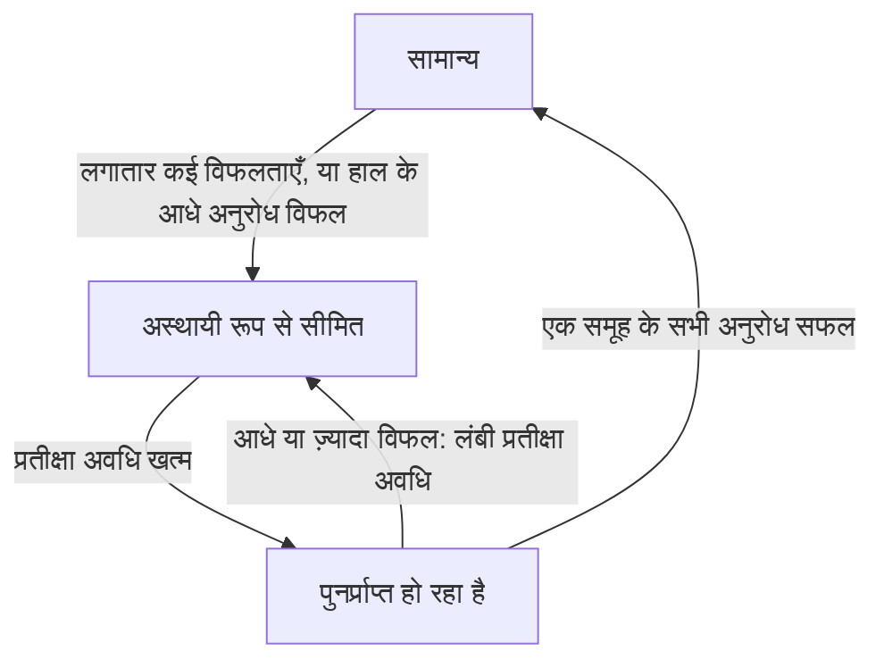

import { ProviderStatusExplorer } from "/snippets/provider-status.jsx";

मॉडल पेज पर हर प्रदाता के नाम के बाद अधिकतम दो आइकन दिखते हैं: Phaseo द्वारा सेट किया गया **स्टेटस आइकन**, और **लाइव रूटिंग आइकन**, जो सिर्फ़ तब दिखता है जब Gateway किसी विफल हो रहे प्रदाता से ट्रैफ़िक हटा रहा हो।

<ProviderStatusExplorer locale="hi" />

## स्टेटस आइकन

Phaseo यह स्टेटस मैन्युअल रूप से सेट करता है, और यह तब तक बना रहता है जब तक Phaseo इसे नहीं बदलता। कम प्राथमिकता वाला रूट अंतिम विकल्प होता है: Gateway उसे बाकी सभी स्वस्थ प्रदाताओं के बाद ही आज़माता है।

| आइकन | स्टेटस | रूटिंग |
| --- | --- | --- |
| <Icon icon="circle-check" color="#16a34a" /> | `Active` | सामान्य रूप से रूट होता है। |
| <Icon icon="triangle-alert" color="#d97706" /> | `कम प्राथमिकता` | सिर्फ़ बैकअप के रूप में, बाकी सभी स्वस्थ प्रदाताओं के बाद। |
| <Icon icon="ban" color="#dc2626" /> | `Disabled` | रूट नहीं होता। |

## लाइव रूटिंग

Gateway इसे हर प्रदाता, मॉडल और एंडपॉइंट के लिए, अभी संभाले जा रहे अनुरोधों के आधार पर, अपने आप सेट करता है। सीमित या पुनर्प्राप्त हो रहा रूट अब भी रूट किया जा सकता है, लेकिन पहले दूसरे प्रदाता आज़माए जाते हैं।

## उपलब्धता और इंटीग्रेशन

स्टेटस होवर कार्ड यह भी दिखाता है कि प्रदाता मॉडल उपलब्ध कराता है या नहीं, और Phaseo ने उसे सक्षम किया है या नहीं। रूट तभी सार्वजनिक होता है जब दोनों अनुमति दें। उदाहरण के लिए, प्रदाता कोई नया मॉडल उपलब्ध करा सकता है (`Available`) जबकि Phaseo अभी उसका सपोर्ट बना रहा हो (`Implementing`)।

### प्रदाता उपलब्धता

| स्थिति | अर्थ |
| --- | --- |
| `Available` | प्रदाता इस ऑफ़र के अनुरोध अभी स्वीकार करता है। |
| `Preview` | प्रदाता इस ऑफ़र को पूर्वावलोकन के रूप में उपलब्ध कराता है। |
| `Limited Access` | ऑफ़र मौजूद है, लेकिन पहुंच खाता, क्षेत्र, अनुमति-सूची या क्षमता पर निर्भर है। |
| `Coming Soon` | प्रदाता ने ऑफ़र की घोषणा या सूची दी है, लेकिन अभी इसका उपयोग नहीं किया जा सकता। |
| `Deprecated` | ऑफ़र उपलब्ध है, लेकिन प्रदाता माइग्रेशन की सलाह देता है। |
| `Removed` | प्रदाता ने ऑफ़र देना बंद कर दिया है। |
| `Unknown` | Phaseo ने अपस्ट्रीम उपलब्धता की पुष्टि नहीं की है। |

### Phaseo इंटीग्रेशन

| स्थिति | अर्थ | Phaseo रूटिंग |
| --- | --- | --- |
| `Unsupported` | Phaseo के पास इस ऑफ़र के लिए संगत इंटीग्रेशन नहीं है। | रूट नहीं किया जा सकता। |
| `Planned` | इंटीग्रेशन कार्य स्वीकृत है, लेकिन शुरू नहीं हुआ। | रूट नहीं किया जा सकता। |
| `Implementing` | इंटीग्रेशन कार्य जारी है। | रूट नहीं किया जा सकता। |
| `Testing` | इम्प्लीमेंटेशन पूरा है और कॉन्ट्रैक्ट, स्टेजिंग या कैनरी टेस्ट चल रहे हैं। | सार्वजनिक रूप से रूट नहीं किया जा सकता। |
| `Enabled` | प्रोडक्शन उपयोग के लिए समर्थित और सक्षम है। | रूटिंग स्विच और स्वास्थ्य अनुमति दें तो रूट किया जा सकता है। |
| `Disabled` | Phaseo ने जानबूझकर इंटीग्रेशन बंद किया है। | रूट नहीं किया जा सकता। |
| `Blocked` | कोई बाहरी या अनसुलझी निर्भरता रोलआउट रोकती है। | रूट नहीं किया जा सकता। |

सिर्फ़ `Enabled` रूट सार्वजनिक हो सकते हैं। `Internal` रूट सिर्फ़ Phaseo के अपने टेस्ट ट्रैफ़िक के लिए होते हैं।

## संगतता

`availability_status`, `routing_status`, `is_active_gateway` और `routable` मौजूदा इंटीग्रेशन के लिए API में बने रहते हैं। नए इंटीग्रेशन को प्रदाता और Phaseo के अलग-अलग फ़ील्ड पढ़ने चाहिए।

## संबंधित पेज

- [रूटिंग और फ़ॉलबैक](./routing-and-fallbacks.mdx)
- [सेवा स्तर](./service-tiers.mdx)
- [Models API संदर्भ](../api-reference/endpoint/models.mdx)
