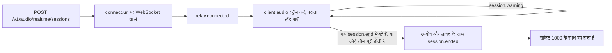

अपने सर्वर से एक सत्र बनाएँ, अपने क्लाइंट को WebSocket से Phaseo रिले से कनेक्ट करें, और माइक्रोफ़ोन ऑडियो को किसी प्रदाता के रियलटाइम मॉडल पर स्ट्रीम करें। रिले प्रदाता के अपने इवेंट बिना बदलाव के आगे भेजता है, कॉल चलते समय उसकी मीटरिंग करता है, और अपने तीन इवेंट जोड़ता है: कॉल चलते समय `session.warning`, कॉल काटने के लिए `session.end`, और अंतिम बिल के साथ `session.ended`।

<Note>
रियलटाइम वॉइस बीटा में है और पहुँच हर वर्कस्पेस के लिए सीमित है।
</Note>



## सत्र शुरू करें

अपने सर्वर से सत्र बनाएँ:

```bash
curl https://api.phaseo.app/v1/audio/realtime/sessions \
  -H "Authorization: Bearer $PHASEO_API_KEY" \
  -H "Content-Type: application/json" \
  -d '{"model": "openai/gpt-realtime-2", "voice": "marin"}'
```

प्रतिक्रिया में `client_secret`, `connect.url`, `max_duration_seconds` और `idle_timeout_seconds` (API सत्रों के लिए हमेशा `null`) शामिल होते हैं।

`api.phaseo.app` पर `connect.url` के लिए WebSocket खोलें और दो सबप्रोटोकॉल दें: `statsync-realtime` और `rtsec.<client_secret>`। रिले `statsync-realtime` चुनता है। अगर आप सिर्फ़ `rtsec.<client_secret>` देते हैं, तो ब्राउज़र और ज़्यादातर WebSocket लाइब्रेरी हैंडशेक विफल कर देती हैं क्योंकि कोई प्रोटोकॉल नहीं चुना जाता।

प्रदाता के तैयार होते ही रिले `relay.connected` भेजता है। फिर माइक्रोफ़ोन ऑडियो को प्रदाता की सैंपल दर पर `{"type": "client.audio", "audio": "<base64 PCM16>"}` के रूप में भेजें:

| प्रदाता | इनपुट ऑडियो |
| --- | --- |
| OpenAI, xAI, ElevenLabs, GPT Live | 24 kHz PCM16 |
| Google, Mistral | 16 kHz PCM16 |

सत्र शुरू होने पर Phaseo $5 का क्रेडिट होल्ड करता है और कॉल चलने के साथ होल्ड बढ़ाता है।

[TypeScript और Python SDK](/hi/v1/sdk-reference/client/audio-realtime) यह सब आपके लिए करते हैं: `client.realtime.connect()` सत्र बनाता है और सॉकेट खोलता है, और `session.end()` `session.ended` लौटाता है। दूसरे SDK में भी यही छोटा क्लाइंट है; हर पैकेज के README में एक उदाहरण है।

| SDK | कनेक्ट | WebSocket लाइब्रेरी |
| --- | --- | --- |
| Go | `realtime.Connect(ctx, client, realtime.Options{...})` | `github.com/coder/websocket`, अलग `realtime` पैकेज में |
| Java | `client.realtime.connect(Map.of("model", ...))` | JDK `java.net.http.WebSocket` |
| C# | `await client.Realtime.ConnectAsync(new RealtimeConnectOptions { ... })` | `System.Net.WebSockets.ClientWebSocket` |
| PHP | `$client->realtime()->connect(["model" => ...])` | `phrity/websocket` (वैकल्पिक, `composer require phrity/websocket`) |
| Ruby | `client.realtime.connect(model: ...)` | `websocket` gem (वैकल्पिक) |
| Rust | `client.realtime().connect(RealtimeOptions::new(...))` | `tungstenite`, `realtime` फ़ीचर के पीछे |

C++ SDK में कोई रियलटाइम क्लाइंट नहीं है।

### Google Live कनेक्शन

पूरी कॉल के दौरान माइक्रोफ़ोन ऑडियो स्ट्रीम करते रहें, खामोशी सहित। Google उस कनेक्शन को बंद कर देता है जिसे लगभग 150 सेकंड तक कोई ऑडियो नहीं मिलता (क्लोज़ कोड `1008`), और तब कॉल `provider_closed` के साथ खत्म होती है। 2 मिनट तक ऑडियो न मिलने पर रिले `threshold: "input_idle"` के साथ `provider_closing` चेतावनी भेजता है। टर्न के बीच की खामोशी किसी टर्न का हिस्सा नहीं होती, इसलिए उसका बिल नहीं बनता।

Google हर कनेक्शन को लगभग 10 मिनट बाद बदल भी देता है। रिले Google के सत्र रिज़्यूम्पशन से कॉल को नए कनेक्शन पर ले जाता है, आपका सॉकेट खुला रखता है और बदलाव पूरा होने पर `{"type": "relay.provider_reconnected", "reconnects": 1}` भेजता है। बदलाव के दौरान आप जो ऑडियो भेजते हैं (आमतौर पर एक सेकंड से कम), उसे रोककर आगे भेजा जाता है। फिर से शुरू हुआ कनेक्शन अब तक की बातचीत को दोबारा प्रोसेस करता है, और Google अगले टर्न पर उसका फिर से इनपुट टोकन के रूप में बिल बनाता है, इसलिए लंबी कॉल हर बदलाव के बाद प्रति टर्न थोड़ी महँगी होती है। यह सब `usage` और बिल में शामिल है। रिले सिर्फ़ तब `provider_closing` चेतावनी देता है जब वह रिज़्यूम नहीं कर पाता, और तब Google के कनेक्शन बंद करने पर कॉल खत्म हो जाती है।

### GPT Live सत्र

GPT Live (`openai/gpt-live-1`) आवाज़ संभालता है और रीज़निंग एक Responses बैकएंड मॉडल को सौंपता है। इसे `POST /v1/live/sessions` से बनाएँ:

```bash
curl https://api.phaseo.app/v1/live/sessions \
  -H "Authorization: Bearer $PHASEO_API_KEY" \
  -H "Content-Type: application/json" \
  -d '{
    "model": "openai/gpt-live-1",
    "provider": "openai",
    "voice": "marin",
    "backend_model": "openai/gpt-5.6-luna",
    "backend_settings": {
      "tools": [{ "type": "function", "name": "get_time", "description": "Returns the current UTC time.", "parameters": { "type": "object", "properties": {} } }]
    }
  }'
```

`voice` इनमें से एक है: `alloy`, `ash`, `ballad`, `beacon`, `bossa`, `cedar`, `cinder`, `coral`, `delta`, `echo`, `gleam`, `marin`, `meridian`, `quartz`, `ripple`, `sage`, `shimmer`, `stone`, `tempo`, `verse`, `vesper` या `willow`। `backend_model` `openai/gpt-5.6-luna` (डिफ़ॉल्ट) या `openai/gpt-5.6-terra` है। दूसरे सत्रों की तरह ही कनेक्ट करें और 24 kHz ऑडियो स्ट्रीम करें।

फ़ंक्शन टूल आपके क्लाइंट पर चलते हैं। बैकएंड की कॉल एक `response.event` के रूप में आती है जिसका `event.item.type` `function_call` होता है। इसका नाम और `arguments` मॉडल से आते हैं, और कॉलर जो कहता है उससे इन्हें प्रभावित किया जा सकता है, इसलिए इन्हें अविश्वसनीय इनपुट मानें:

1. सिर्फ़ वही टूल चलाएँ जो आपने घोषित किए हैं, उन्हें `name` से खोजें, और किसी दूसरे नाम को अस्वीकार करें।
2. `arguments` को JSON के रूप में पार्स करें और उपयोग करने से पहले उसे टूल के `parameters` स्कीमा से वैलिडेट करें।
3. जाँचें कि साइन-इन किए हुए उपयोगकर्ता को वह करने की अनुमति है जो कॉल माँगती है, और डेटा बदलने, पैसा खर्च करने या किसी से संपर्क करने वाली किसी भी चीज़ से पहले उनसे पुष्टि करें।

फिर टूल चलाएँ, परिणाम भेजें और आगे का जवाब माँगें। अगर कोई कॉल इन जाँचों में विफल होती है, तो उसे चलाने के बजाय एक `output` भेजें जो कारण बताए:

```json
{ "type": "response.item.create", "item": { "type": "function_call_output", "call_id": "call_63hZ...", "output": "{\"utc\":\"2026-10-22T09:42:48Z\"}" } }
{ "type": "response.create" }
```

रिले `function_call_output` सिर्फ़ उसी कॉल के लिए स्वीकार करता है जो बैकएंड ने की हो, हर कॉल के लिए एक बार और अधिकतम 64 KB, और `response.create` सिर्फ़ कम से कम एक आउटपुट के बाद। बाकी किसी भी चीज़ पर `{"type": "relay.client_event_rejected", "reason": "..."}` मिलता है और कॉल जारी रहती है। Phaseo कभी खुद फ़ंक्शन टूल नहीं चलाता।

GPT Live कॉल का बिल प्रति सेकंड आवाज़ पर बनता है ($0.05 प्रति मिनट, GPT Live के अपने `usage.seconds` से), साथ में हर प्रतिक्रिया के लिए बैकएंड मॉडल के टोकन, जिसमें टूल परिणामों के बाद के जवाब भी शामिल हैं। GPT Live उस सत्र को समाप्त कर देता है जिसे लगभग 30 सेकंड तक कोई ऑडियो नहीं मिलता, जिससे कॉल `provider_idle_timeout` के साथ खत्म होती है। माइक्रोफ़ोन ऑडियो स्ट्रीम करते रहें, खामोशी सहित।

### ElevenLabs Realtime सत्र

ElevenLabs Realtime दो मॉडलों में आता है: `eleven-labs/eleven-realtime-v1-mini`, जो तेज़ और सस्ता डिफ़ॉल्ट है, और `eleven-labs/eleven-realtime-v1-max`, जो जवाब देने से पहले रीज़निंग करता है और जटिल निर्देशों और कई चरणों वाले टूल उपयोग के लिए उपयुक्त है। दोनों OpenAI वाला ही create अनुरोध और रिले उपयोग करते हैं, 24 kHz ऑडियो के साथ। Phaseo अपनी कुंजी से ElevenLabs से कनेक्ट करता है; आपका क्लाइंट सिर्फ़ रिले को देखता है।

ElevenLabs कॉल के कनेक्ट रहने के हर सेकंड का बिल बनाता है, साथ में उपयोग किए गए भाषा-मॉडल टोकन का भी, और कॉल के दौरान उपयोग रिपोर्ट नहीं करता। रिले कॉल चलते समय कनेक्ट रहने के समय की मीटरिंग करता है, इसलिए होल्ड और ओवरड्राफ़्ट सीमा दूसरे प्रदाताओं की तरह काम करते हैं। कॉल खत्म होने पर Phaseo बातचीत के लिए ElevenLabs का बिल पढ़ता है और उसमें से और अपनी सूची-कीमत के कुल में से जो ज़्यादा हो वह चार्ज करता है। इसमें आमतौर पर कुछ सेकंड लगते हैं। अगर ज़्यादा समय लगता है, तो `session.ended` `billing_status: "pending"` और एक `final_bill` अनुरोध के साथ आता है, और ElevenLabs के रिपोर्ट करते ही बिल सेटल हो जाता है, आमतौर पर कुछ मिनटों में। तब तक आपके होल्ड बने रहते हैं। अगर ElevenLabs 24 घंटे बाद भी बिल रिपोर्ट नहीं करता, तो सत्र सिर्फ़ कनेक्ट रहने के समय के लिए चार्ज होने के बजाय बिलिंग समीक्षा में चला जाता है।

### स्ट्रीमिंग ट्रांसक्रिप्शन

Mistral के Voxtral Realtime मॉडल लाइव ऑडियो को आते ही ट्रांसक्राइब करते हैं: `mistral/voxtral-mini-transcribe-realtime-3` और `mistral/voxtral-mini-transcribe-realtime`। ये जवाब में बोलते नहीं, इसलिए सत्र `voice` या `instructions` के बिना बनाएँ:

```bash
curl https://api.phaseo.app/v1/audio/realtime/sessions \
  -H "Authorization: Bearer $PHASEO_API_KEY" \
  -H "Content-Type: application/json" \
  -d '{"model": "mistral/voxtral-mini-transcribe-realtime-3"}'
```

उसी तरह कनेक्ट करें और 16 kHz PCM16 को `client.audio` के रूप में स्ट्रीम करें। Mistral के इवेंट बिना बदलाव के आगे भेजे जाते हैं: `session.created`, फिर हर नए टेक्स्ट टुकड़े के साथ `transcription.text.delta`, और जहाँ Mistral भेजता है वहाँ `transcription.language` और `transcription.segment`। ट्रांसक्रिप्शन सेटिंग बदलने के लिए `language`, `target_streaming_delay_ms` (80 से 1,200, या 2,400), `context_bias`, `diarize` और `turn_detection` में से किसी के साथ `{"type": "session.update", "session": {...}}` भेजें। ऑडियो फ़ॉर्मैट सहित दूसरे फ़ील्ड `relay.client_event_rejected` के साथ अस्वीकार किए जाते हैं। ऑडियो शुरू होने के बाद सेटिंग तय हो जाती हैं, इसलिए पहले `client.audio` से पहले `session.update` भेजें; बाद के अपडेट भी इसी तरह अस्वीकार किए जाते हैं। पुराना `mistral/voxtral-mini-transcribe-realtime` सिर्फ़ `target_streaming_delay_ms` स्वीकार करता है।

जब आप `session.end` भेजते हैं, तो रिले Mistral की ऑडियो स्ट्रीम खत्म करता है और सेटल करने और `session.ended` भेजने से पहले `transcription.done` के लिए 10 सेकंड तक इंतज़ार करता है, जिसमें पूरा ट्रांसक्रिप्ट होता है। आपके द्वारा पहले भेजा गया ऑडियो उपयोग होता है; कुछ भी हटाया नहीं जाता।

स्ट्रीमिंग ट्रांसक्रिप्शन का बिल आपके द्वारा भेजे गए ऑडियो के प्रति मिनट पर बनता है (Voxtral Mini Transcribe Realtime 3 के लिए $0.008 प्रति मिनट), जिसे रिले मापता है। `transcription.done` में Mistral की अपनी गिनती न्यूनतम चार्ज है। पहले से मौजूद रिकॉर्डिंग के लिए इसके बजाय [ऑडियो ट्रांसक्रिप्शन](/hi/v1/api-reference/endpoint/audio-transcriptions) का उपयोग करें।

## सत्र खत्म करें

जब कॉलर कॉल काट दे, तो `session.end` भेजें:

```json
{ "type": "session.end", "reason": "caller hung up" }
```

| फ़ील्ड | प्रकार | डिफ़ॉल्ट | अर्थ |
| --- | --- | --- | --- |
| `reason` | string | कोई नहीं | आपका अपना नोट, अधिकतम 120 प्रिंट होने योग्य अक्षर, जो `client_reason` के रूप में वापस आता है। |
| `cancel_response` | boolean | `true` | `true` अभी चल रहे जवाब को रद्द करता है। `false` उसे 20 सेकंड तक पूरा होने देता है। |

इसके बाद रिले:

1. ऑडियो स्वीकार करना बंद करता है;
2. वह माइक्रोफ़ोन ऑडियो हटा देता है जिसे प्रदाता ने किसी टर्न में शामिल नहीं किया है;
3. चल रहे जवाब को रद्द करता है, या उसे पूरा होने देता है, और उसके उपयोग के लिए 10 सेकंड तक इंतज़ार करता है;
4. GPT Live के लिए, प्रदाता को `session.close` भेजता है और `session.closed` का इंतज़ार करता है;
5. बिल सेटल करता है;
6. `session.ended` भेजता है;
7. कोड `1000` के साथ सॉकेट बंद करता है।

`session.end` के बिना सॉकेट बंद करने से भी कॉल खत्म होती है और उसका बिल इसी तरह बनता है, लेकिन आपके क्लाइंट को `session.ended` नहीं मिलेगा।

## अंतिम बिल पढ़ें: `session.ended`

रिले हर समाप्ति पर `session.ended` भेजता है: जो आपने माँगी, जो प्रदाता ने शुरू की और जो Gateway ने शुरू की। यह तब भेजा जाता है जब आपका सॉकेट अभी खुला होता है, रिले के उसे बंद करने से ठीक पहले।

```json
{
  "type": "session.ended",
  "session_id": "rt_01k8...",
  "reason": "client_requested",
  "initiated_by": "client",
  "client_reason": "caller hung up",
  "duration_seconds": 184.2,
  "usage": { "input_audio_tokens": 1840, "output_audio_tokens": 3120, "input_text_tokens": 412 },
  "cost": {
    "total_usd": 0.231,
    "total_nanos": 231000000,
    "estimated": false,
    "estimate_basis": null,
    "debt_nanos": 0,
    "uncollected_nanos": 0,
    "currency": "USD"
  },
  "billing_status": "settled"
}
```

| फ़ील्ड | अर्थ |
| --- | --- |
| `reason` | एक स्थिर कारण कोड। [कारण कोड](#reason-codes) देखें। |
| `initiated_by` | `client`, `gateway` या `provider`। |
| `duration_seconds` | रिले के कनेक्ट होने के बाद से समय। |
| `usage` | वह उपयोग जिस पर कॉल का बिल बनता है: मोडैलिटी के अनुसार टोकन गिनती, कैश से पढ़ना और कैश में लिखना सहित; `audio_seconds`, यानी कॉल के ऑडियो की अवधि, जिस पर xAI, ElevenLabs, Mistral और GPT Live की आवाज़ का बिल बनता है (टोकन के आधार पर बिल होने वाली कॉल में यह केवल जानकारी के लिए दिखाया जाता है); और GPT Live की वेब खोजों के लिए `native_web_search_requests`। जब `billing_status` `pending` या `unresolved` हो, तो यह अब तक ज्ञात उपयोग होता है, और `final_bill` अंतिम मीटर लौटाता है। |
| `cost.estimated` | `true` तब, जब उपयोग का कुछ हिस्सा मीटर किए गए ऑडियो से अनुमानित किया गया क्योंकि किसी बाधित टर्न के लिए प्रदाता का उपयोग कभी नहीं आया। `estimate_basis` कारण बताता है। |
| `cost.debt_nanos` | लागत का वह हिस्सा जो आपके होल्ड और मुक्त बैलेंस से आगे ओवरड्राफ़्ट के रूप में चार्ज हुआ। |
| `cost.uncollected_nanos` | ओवरड्राफ़्ट सीमा से आगे की लागत जो चार्ज नहीं हुई। |
| `provider_close_code` | प्रदाता का WebSocket क्लोज़ कोड, जब प्रदाता ने कॉल खत्म की। |
| `billing_status` | `settled`, `pending` या `unresolved`। |

अगर सेटलमेंट अभी भी दोबारा आज़माया जा रहा है, तो `billing_status` `pending` होता है और `cost` चालू अनुमान दिखाता है। अगर सत्र को बिलिंग समीक्षा चाहिए, तो यह `unresolved` होता है। दोनों मामलों में `final_bill` वह अनुरोध देता है जिससे सेटल होने के बाद अंतिम लागत ली जा सके:

```json
"final_bill": { "method": "GET", "path": "/v1/generations?id=realtime%3Art_01k8..." }
```

<span id="reason-codes"></span>
### कारण कोड

| `reason` | `initiated_by` | कब |
| --- | --- | --- |
| `client_requested` | client | आपने `session.end` भेजा। |
| `client_disconnected` | client | आपका सॉकेट `session.end` के बिना बंद हुआ। |
| `provider_closed` | provider | प्रदाता ने अपना कनेक्शन बंद किया, उदाहरण के लिए Google ने लगभग 150 सेकंड तक ऑडियो न मिलने के बाद (कोड `1008`), या ऐसे `goAway` के बाद जिससे रिले रिज़्यूम नहीं कर पाया। |
| `provider_idle_timeout` | provider | GPT Live ने सत्र समाप्त किया क्योंकि उसे लगभग 30 सेकंड तक कोई ऑडियो नहीं मिला। |
| `provider_error` | provider | प्रदाता कनेक्शन विफल हुआ या उसने कोई त्रुटि रिपोर्ट की। |
| `max_duration_reached` | gateway | प्रदाता की सत्र सीमा पूरी हो गई। |
| `insufficient_funds` | gateway | ओवरड्राफ़्ट सीमा पूरी हो गई। |
| `key_revoked` | gateway | कॉल के दौरान API कुंजी रद्द या डिलीट कर दी गई। |
| `key_expired` | gateway | कॉल के दौरान API कुंजी की अवधि खत्म हो गई। |
| `key_blocked` | gateway | कॉल के दौरान API कुंजी रोक दी गई। |
| `workspace_disabled` | gateway | वर्कस्पेस अब मौजूद नहीं है। |
| `policy_blocked` | gateway | वर्कस्पेस नीति के किसी बदलाव ने मॉडल को ब्लॉक किया, या प्रदाता को अनुमत सूची से हटा दिया, और `policy_blocked` चेतावनी के 30 सेकंड बाद भी वह लागू था। |
| `input_rejected` | gateway | रिले ने क्लाइंट ऑडियो अस्वीकार किया: बहुत बड़ा, रियल टाइम से तेज़, या प्रदाता पीछे रह गया। |
| `session_reconciled` | gateway | रिले की स्टेट खो गई और रीकंसिलिएशन से सत्र बंद किया गया। |
| `gateway_error` | gateway | Phaseo प्रदाता इवेंट प्रोसेस नहीं कर सका या उपयोग दर्ज नहीं कर सका। |
| `idle_timeout` | gateway | सिर्फ़ प्लेग्राउंड: पाँच मिनट तक कोई ऑडियो नहीं। |
| `spend_limit_reached` | gateway | सिर्फ़ प्लेग्राउंड: कुंजी की खर्च सीमा या वर्कस्पेस बजट पूरा हो गया। |

नए कोड जोड़े जा सकते हैं, इसलिए अज्ञात `reason` को `gateway_error` की तरह मानें।

## चेतावनियाँ संभालें: `session.warning`

चेतावनियाँ कॉल खत्म किए बिना बताती हैं कि आगे क्या होने वाला है। हर कोड हर सीमा के लिए अधिकतम एक बार भेजा जाता है।

```json
{ "type": "session.warning", "code": "max_duration_approaching", "message": "...", "seconds_remaining": 120, "expires_at": "2026-10-22T11:00:00.000Z" }
```

| `code` | अतिरिक्त फ़ील्ड | कब |
| --- | --- | --- |
| `max_duration_approaching` | `seconds_remaining`, `expires_at` | प्रदाता की सत्र सीमा से 2 मिनट पहले, और फिर 30 सेकंड पहले। |
| `provider_closing` | `seconds_remaining`, और निष्क्रिय मामले के लिए `threshold: "input_idle"` | Google कनेक्शन बंद करेगा: ऐसे `goAway` के बाद जिससे रिले रिज़्यूम नहीं कर पाया, या (`input_idle`) क्योंकि 2 मिनट से कोई ऑडियो नहीं आया। |
| `funds_low` | `remaining_usd` | क्रेडिट होल्ड बढ़ाया नहीं जा सका। कॉल आपके मुक्त बैलेंस पर जारी रहती है। |
| `overdraft_in_use` | `remaining_usd`, `overdraft_used_usd` | आपका मुक्त बैलेंस खत्म हो गया है और कॉल ओवरड्राफ़्ट पर चल रही है। सीमा में $0.25 से कम बचने पर फिर से भेजा जाता है। |
| `spend_limit_exceeded` | `limit` (`key` या `workspace_budget`) | कुंजी की खर्च सीमा या वर्कस्पेस बजट पूरा हो गया। कॉल जारी रहती है; नए अनुरोध अस्वीकार किए जाते हैं। |
| `policy_blocked` | `status`, और जब `status` `ending` हो तो `seconds_remaining` और `ends_at` | कोई वर्कस्पेस नीति अब कॉल को ब्लॉक करती है, या उसके प्रदाता को अनुमत सूची से हटा दिया गया। अगर बदलाव वापस न लिया जाए तो कॉल 30 सेकंड बाद खत्म होती है; वापस लेने पर `status: "cleared"` के साथ दूसरी चेतावनी आती है। |

`remaining_usd` वह राशि है जो कॉल खत्म होने से पहले अभी भी खर्च कर सकती है, ओवरड्राफ़्ट सहित।

## जब कॉल अपने आप खत्म होती है

Phaseo API सत्रों को निष्क्रिय होने की वजह से कभी खत्म नहीं करता, और खर्च सीमाएँ सिर्फ़ चेतावनी देती हैं। कॉल अपने आप सिर्फ़ तब खत्म होती है जब इनमें से कुछ होता है:

| सीमा | मान |
| --- | --- |
| OpenAI Realtime | 60 मिनट |
| xAI | 120 मिनट |
| Google Live | 60 मिनट, उन कनेक्शनों में कुल मिलाकर जिन्हें रिले रिज़्यूम करता है। अगर आपका क्लाइंट लगभग 150 सेकंड तक ऑडियो भेजना बंद कर दे, तब भी कॉल खत्म होती है। |
| GPT Live | 25 मिनट |
| ElevenLabs Realtime | 30 मिनट |
| Mistral स्ट्रीमिंग ट्रांसक्रिप्शन | 60 मिनट |
| ओवरड्राफ़्ट सीमा | आपके होल्ड और मुक्त बैलेंस से आगे $1 |
| पहुँच खोना | कुंजी रद्द, समाप्त या रोक दी गई, या वर्कस्पेस हटा दिया गया। लगभग एक मिनट में पता चलता है, फिर कॉल बिना किसी अतिरिक्त समय के खत्म होती है। |
| नीति बदलाव | `policy_blocked` चेतावनी के 30 सेकंड बाद, अगर नीति अब भी कॉल को ब्लॉक करती है |

सत्र सीमाएँ रिले के कनेक्ट होने से गिनी जाती हैं, सत्र बनने से नहीं।
