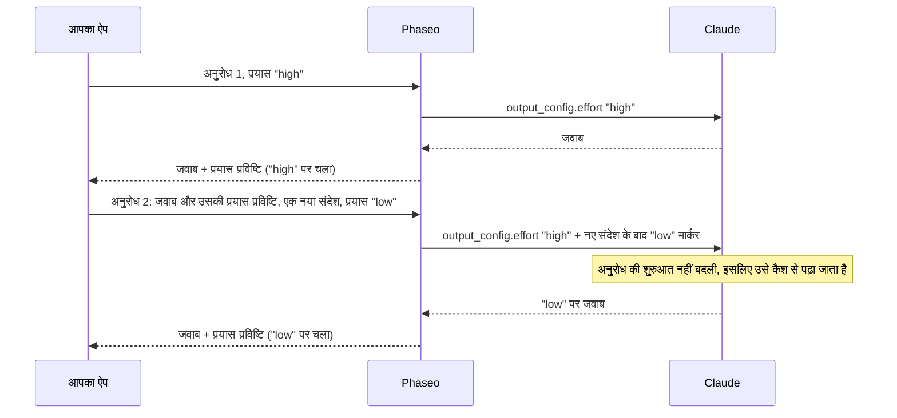

import { EffortCacheExplorer } from "/snippets/effort-cache.jsx";

किसी भी अनुरोध पर अलग `reasoning_effort` (Chat Completions) या `reasoning.effort` (Responses) भेजें, और Phaseo Claude का प्रयास उसके प्रॉम्प्ट कैश को दोबारा शुरू किए बिना बदल देता है। जब तक आप हर अनुरोध पर Claude की रीज़निंग बिना बदले वापस भेजते हैं, आपको अपने कोड में और कुछ नहीं बदलना पड़ता।

<EffortCacheExplorer locale="hi" />

Phaseo Claude को आपकी बातचीत के पहले अनुरोध का प्रयास ही भेजता रहता है और हर बदलाव को आपके नए संदेश के बाद एक प्रयास मार्कर के रूप में जोड़ता है। मार्कर से पहले का सब कुछ वैसा ही रहता है, इसलिए Claude उसे कैश से पढ़ता है। अगर आप रीज़निंग हटा देते हैं, तो Phaseo इसके बजाय टॉप-लेवल प्रयास बदलता है, और Claude अपने पहले जवाब से आगे का सब कुछ कैश से पढ़ने के बजाय दोबारा प्रोसेस करता है।

## Phaseo कैश को कैसे बनाए रखता है

Claude कैश की गई बातचीत तभी पढ़ता है जब अनुरोध की शुरुआत बाइट-दर-बाइट एक जैसी हो, और टॉप-लेवल प्रयास उसी शुरुआत का हिस्सा है। Anthropic का [प्रति-संदेश प्रयास](https://platform.claude.com/docs/en/build-with-claude/effort-per-message) इसके बजाय `messages` के अंदर लेवल बदलता है, एक ऐसे `system` संदेश से जिसमें खाली `content` और एक `output_config.effort` होता है। Phaseo ये मार्कर आपके लिए लिखता है:



Phaseo अनुरोधों के बीच कुछ भी सेव नहीं करता। Claude का हर जवाब एक रीज़निंग प्रविष्टि पर खत्म होता है जो दर्ज करती है कि वह किस लेवल पर चला, और Phaseo आपकी वापस भेजी गई प्रविष्टियों से हर पिछला मार्कर उसी जगह फिर से बनाता है:

| अनुरोध | आप भेजते हैं | Phaseo Claude को भेजता है |
| --- | --- | --- |
| 1 | `"high"` | `output_config.effort: "high"` |
| 2 | `"low"` | `"high"`, साथ में आपके नए संदेश के बाद एक `low` मार्कर |
| 3 | `"low"` | `"high"`, साथ में वही मार्कर उसी जगह |
| 4 | `"high"` | `"high"`, पिछला मार्कर, और आपके नए संदेश के बाद एक `high` मार्कर |

आपके वापस भेजे गए संदेश कभी नहीं बदले जाते। मार्कर सिर्फ़ उस अनुरोध में होते हैं जो Phaseo Claude को भेजता है।

## रीज़निंग बिना बदले वापस भेजें

<Warning>
हर रीज़निंग प्रविष्टि को, हर अनुरोध पर, ठीक वैसे ही वापस भेजें जैसे आपको मिली थी: Chat `reasoning_details`, Responses `reasoning` items और Anthropic `thinking` ब्लॉक, चाहे वे एन्क्रिप्टेड हों या नहीं। उन्हें न हटाएं, न संपादित करें, न क्रम बदलें और न उनका सारांश बनाएं। उनके बिना, प्रयास बदलने पर Claude का कैश दोबारा शुरू होता है, और Claude टूल लूप के चरणों के बीच अपनी रीज़निंग खो देता है।
</Warning>

प्रयास प्रविष्टि में कोई टेक्स्ट नहीं होता। Chat Completions पर यह `reasoning_details` में आखिरी `reasoning.encrypted` प्रविष्टि है:

```json
{
  "role": "assistant",
  "content": "1. Export the data. 2. Create the schema. 3. Import and verify.",
  "reasoning_details": [
    { "type": "reasoning.text", "text": "…", "signature": "phx1.…", "format": "anthropic-claude-v1" },
    { "type": "reasoning.encrypted", "data": "phx1.…", "format": "anthropic-claude-v1" }
  ]
}
```

Responses पर यह `output` में आखिरी `reasoning` item है, जिसका `id` `rs_effort_` से शुरू होता है:

```json
{ "type": "reasoning", "id": "rs_effort_req_123", "summary": [], "content": [], "encrypted_content": "phx1.…" }
```

यह मान अपारदर्शी है, और बातचीत किसी भी प्रदाता तक पहुंचने से पहले Phaseo इसे हटा देता है।

## अपने कोड में प्रयास बदलें

Claude का पूरा जवाब अपनी बातचीत में जोड़ें, फिर अगले अनुरोध पर अपना मनचाहा प्रयास सेट करें। टॉप-लेवल `cache_control` Claude रूट पर कैशिंग चालू करता है; [प्रॉम्प्ट कैशिंग](./prompt-caching.mdx#which-providers-cache-automatically) देखें।

### Chat Completions

<CodeGroup>
```ts TypeScript
import OpenAI from "openai";

const client = new OpenAI({
	apiKey: process.env.PHASEO_API_KEY,
	baseURL: "https://api.phaseo.app/v1",
});

const messages: OpenAI.ChatCompletionMessageParam[] = [
	{ role: "user", content: "Plan a migration from SQLite to PostgreSQL." },
];

async function ask(effort: "low" | "medium" | "high") {
	const response = await client.chat.completions.create({
		model: "anthropic/claude-opus-5.5",
		reasoning_effort: effort,
		messages,
		// @ts-expect-error Phaseo field: cache the conversation on Claude routes
		cache_control: { type: "ephemeral" },
	});
	const message = response.choices[0].message;
	messages.push(message); // the whole message, reasoning_details included
	return message.content;
}

await ask("high");
messages.push({ role: "user", content: "Summarise the plan in one sentence." });
await ask("low"); // Claude reads request 1 from cache
```

```python Python
import os
from openai import OpenAI

client = OpenAI(
    api_key=os.environ["PHASEO_API_KEY"],
    base_url="https://api.phaseo.app/v1",
)

messages = [{"role": "user", "content": "Plan a migration from SQLite to PostgreSQL."}]

def ask(effort: str) -> str | None:
    response = client.chat.completions.create(
        model="anthropic/claude-opus-5.5",
        reasoning_effort=effort,
        messages=messages,
        extra_body={"cache_control": {"type": "ephemeral"}},
    )
    message = response.choices[0].message
    # The whole message, reasoning_details included
    messages.append(message.model_dump(exclude_none=True))
    return message.content

ask("high")
messages.append({"role": "user", "content": "Summarise the plan in one sentence."})
ask("low")  # Claude reads request 1 from cache
```
</CodeGroup>

### Responses

Phaseo प्रतिक्रियाएं सेव नहीं करता, इसलिए पूरी बातचीत `input` में भेजें, जिसमें हर `output` item शामिल हो।

<CodeGroup>
```ts TypeScript
import OpenAI from "openai";

const client = new OpenAI({
	apiKey: process.env.PHASEO_API_KEY,
	baseURL: "https://api.phaseo.app/v1",
});

const input: OpenAI.Responses.ResponseInput = [
	{ role: "user", content: "Plan a migration from SQLite to PostgreSQL." },
];

async function ask(effort: "low" | "medium" | "high") {
	const response = await client.responses.create({
		model: "anthropic/claude-opus-5.5",
		reasoning: { effort },
		input,
		// @ts-expect-error Phaseo field: cache the conversation on Claude routes
		cache_control: { type: "ephemeral" },
	});
	input.push(...response.output); // every item, reasoning items included
	return response.output_text;
}

await ask("high");
input.push({ role: "user", content: "Summarise the plan in one sentence." });
await ask("low"); // Claude reads request 1 from cache
```

```python Python
import os
from openai import OpenAI

client = OpenAI(
    api_key=os.environ["PHASEO_API_KEY"],
    base_url="https://api.phaseo.app/v1",
)

conversation = [{"role": "user", "content": "Plan a migration from SQLite to PostgreSQL."}]

def ask(effort: str) -> str:
    response = client.responses.create(
        model="anthropic/claude-opus-5.5",
        reasoning={"effort": effort},
        input=conversation,
        extra_body={"cache_control": {"type": "ephemeral"}},
    )
    # Every item, reasoning items included
    conversation.extend(item.model_dump(exclude_none=True) for item in response.output)
    return response.output_text

ask("high")
conversation.append({"role": "user", "content": "Summarise the plan in one sentence."})
ask("low")  # Claude reads request 1 from cache
```
</CodeGroup>

### Anthropic Messages

`/v1/messages` पर मार्कर आप खुद भेजते हैं: खाली `content` और `output_config.effort` वाला एक `system` संदेश। हर अनुरोध पर टॉप-लेवल `output_config.effort` एक जैसा रखें, और बाद के अनुरोधों में हर मार्कर को उसी जगह रखें। Phaseo `mid-conversation-output-config-2026-07-01` बीटा हेडर जोड़ता है, इसलिए आपको उसे भेजने की ज़रूरत नहीं है।

```bash cURL
curl https://api.phaseo.app/v1/messages \
  -H "x-api-key: $PHASEO_API_KEY" \
  -H "anthropic-version: 2023-06-01" \
  -H "Content-Type: application/json" \
  -d '{
    "model": "anthropic/claude-opus-5.5",
    "max_tokens": 4096,
    "cache_control": { "type": "ephemeral" },
    "output_config": { "effort": "high" },
    "messages": [
      { "role": "user", "content": "Plan a migration from SQLite to PostgreSQL." },
      { "role": "assistant", "content": "1. Export the data. 2. Create the schema. 3. Import and verify." },
      { "role": "system", "content": [], "output_config": { "effort": "low" } },
      { "role": "user", "content": "Summarise the plan in one sentence." }
    ]
  }'
```

मार्कर कहां है, इससे तय होता है कि नया लेवल कब शुरू होगा:

- **किसी उपयोगकर्ता संदेश के ठीक बाद:** उस संदेश पर Claude का जवाब नए लेवल का उपयोग करता है।
- **कहीं और**, जैसे ऊपर की तरह Claude के जवाब और आपके अगले संदेश के बीच: नया लेवल आपके अगले संदेश से शुरू होता है।

जिस उपयोगकर्ता संदेश में सिर्फ़ टूल परिणाम हों, उसे नया संदेश नहीं गिना जाता। जिन रूट पर प्रति-संदेश प्रयास नहीं है, वहां Phaseo मार्कर हटा देता है और लागू लेवल को टॉप-लेवल प्रयास के रूप में भेजता है।

## बदलाव कब कैश को दोबारा शुरू करता है

Phaseo इन स्थितियों में टॉप-लेवल प्रयास बदलता है, जैसा वह दूसरे प्रदाताओं के लिए करता है:

- **रीज़निंग मौजूद नहीं है।** आपके सबसे नए Claude जवाब में कोई प्रयास प्रविष्टि नहीं है, क्योंकि आपके क्लाइंट ने `reasoning_details` या `reasoning` items हटा दिए।
- **बदलाव टूल लूप के चरणों के बीच आता है।** आपके सबसे नए संदेश में सिर्फ़ टूल परिणाम हैं, इसलिए मार्कर आपके अगले संदेश से ही लागू होगा। Phaseo टॉप-लेवल प्रयास बदलता है ताकि यह चरण आपके मांगे गए लेवल पर चले, और बाद के बदलाव फिर से मार्कर का उपयोग करते हैं।
- **अनुरोध कोई प्रयास सेट नहीं करता, या रीज़निंग बंद करता है।** हर अनुरोध पर `reasoning_effort` या `reasoning.effort` भेजें। `"none"` और `reasoning.enabled: false` रीज़निंग बंद करते हैं।
- **रूट इसका समर्थन नहीं करता।** [समर्थित मॉडल](#supported-models) देखें।

टॉप-लेवल बदलाव बातचीत के उस हिस्से को कैश में रखता है जो Claude के पहले जवाब से पहले है। Claude उस जवाब से आगे का सब कुछ दोबारा प्रोसेस करता है, और उसे नए इनपुट के रूप में बिल करता है।

<span id="supported-models"></span>
## समर्थित मॉडल

| रूट | मॉडल |
| --- | --- |
| Anthropic, Google Vertex AI | Claude Fable 5.2 और 5.1, Mythos 5.2 और 5.1, Opus 5.5 और 5, Sonnet 5.5, Haiku 5.5 |
| Claude on AWS | Mythos को छोड़कर यही मॉडल |
| Amazon Bedrock | Claude Fable 5.1 और Opus 5.5 |

बाकी हर रूट पर, Azure पर Claude समेत, प्रयास का बदलाव टॉप-लेवल पर जाता है।

## जांचें कि कैश बना रहा

बदलाव के बाद वाले अनुरोध पर कैश की गिनती पढ़ें: Chat Completions पर `usage.prompt_tokens_details.cached_tokens`, Responses पर `usage.input_tokens_details.cached_tokens` और Anthropic Messages पर `usage.cache_read_input_tokens`। [उपयोग और प्राइसिंग फ़ील्ड](./prompt-caching.mdx#usage-and-pricing-fields) में हर फ़ील्ड की सूची है।

हमने 11 नवंबर 2026 को `anthropic/claude-haiku-5.5` पर पांच अनुरोधों वाली एक ही Chat Completions बातचीत को मापा, एक बार प्रयास प्रविष्टियां वापस भेजकर और एक बार उनके बिना। प्रयास `high`, `high`, `low`, `low`, `high` था, और दूसरे संदेश में 3,400 टोकन का एक दस्तावेज़ आया:

| अनुरोध 3 (प्रयास `high` से `low`) | प्रयास प्रविष्टियां हटाई गईं | प्रयास प्रविष्टियां वापस भेजी गईं |
| --- | --- | --- |
| कैश से पढ़े गए टोकन | 0 | 3,575 |
| दोबारा प्रोसेस करके कैश में लिखे गए टोकन | 3,499 | 75 |
