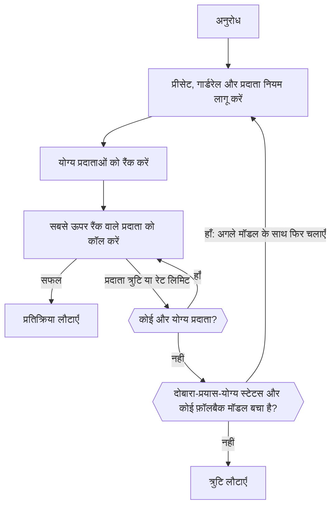

import { RoutingCostExplainer } from "/snippets/routing-cost.jsx";
import { FallbackChainExplorer } from "/snippets/fallback-chain.jsx";

ज़्यादातर मॉडल कई प्रदाताओं द्वारा सर्व किए जाते हैं। हर अनुरोध के लिए Gateway उन प्रदाताओं को रखता है जिनकी आपके नियम अनुमति देते हैं, उन्हें रैंक करता है, और सबसे अच्छे प्रदाता को कॉल करता है। अगर वह प्रदाता विफल होता है, तो वह अगला आज़माता है; अगर हर प्रदाता दोबारा-प्रयास-योग्य त्रुटि के साथ विफल होता है, तो वह किसी फ़ॉलबैक मॉडल पर जा सकता है।



आपके क्लाइंट को फिर भी `429` और `5xx` प्रतिक्रियाओं को एक्सपोनेंशियल बैकऑफ़ के साथ दोबारा आज़माना चाहिए।

<span id="choose-how-providers-are-ranked"></span>
## चुनें कि प्रदाताओं को कैसे रैंक किया जाए

| मोड | किस आधार पर रैंक | कब उपयोग करें |
| --- | --- | --- |
| `balanced` (डिफ़ॉल्ट) | प्रति सफल जवाब लागत | आप कीमत, गति और विश्वसनीयता का सबसे अच्छा मेल चाहते हैं। |
| `price` | कीमत | प्रतिक्रिया समय से ज़्यादा लागत मायने रखती है। |
| `latency` | पहले टोकन तक का समय | प्रतिक्रियाएँ जल्दी शुरू होनी चाहिए। |
| `throughput` | आउटपुट गति | लंबे आउटपुट जल्दी पूरे होने चाहिए। |

वर्कस्पेस डिफ़ॉल्ट **डैशबोर्ड -> सेटिंग्स -> रूटिंग** में, `phaseo settings update --routing-mode <mode>` से, या `PATCH /v1/settings` पर `routing_mode` से सेट करें। एक अनुरोध के लिए `provider.sort` या `routing.mode` भेजें, या मॉडल ID में एक सफ़िक्स जोड़ें:

| सफ़िक्स | मोड | उदाहरण |
| --- | --- | --- |
| `:nitro` | `throughput` | `openai/gpt-6-astra:nitro` |
| `:cheap` | `price` | `openai/gpt-6-astra:cheap` |
| `:fast` | `latency` | `openai/gpt-6-astra:fast` |

सफ़िक्स `routing.mode`, `provider.sort`, और प्रीसेट व वर्कस्पेस मोड को ओवरराइड करता है। अनुमति सूचियाँ, क्षेत्र, गार्डरेल और कीमत की ऊपरी सीमाएँ फिर भी लागू होती हैं।

रूटिंग सेटिंग्स पेज पर beta और alpha चैनल टॉगल भी हैं, ताकि पूर्वावलोकन प्रदाताओं को ट्रैफ़िक तभी मिले जब आप ऑप्ट इन करें।

## balanced मोड प्रदाताओं को कैसे रैंक करता है

टेक्स्ट अनुरोधों (Chat Completions, Responses और Messages) के लिए `balanced` हर प्रदाता की **प्रति सफल जवाब लागत** का अनुमान लगाता है:

- **टोकन:** इस मॉडल के एक सामान्य अनुरोध की उस प्रदाता पर लागत, जिसमें मॉडल के मापे गए प्रॉम्प्ट और आउटपुट आकार और प्रदाता की मापी गई कैश-हिट दर का उपयोग होता है।
- **प्रतीक्षा:** पहले टोकन और पूरी प्रतिक्रिया तक का समय, जिसे मॉडल की प्रति सेकंड सामान्य कीमत पर डॉलर में बदला जाता है।
- **विफलताएँ:** कुल को प्रदाता की हाल की सफलता दर से भाग दिया जाता है, साथ में प्रदाता त्रुटियों के लिए एक दंड और रेट लिमिट के लिए एक छोटा दंड जोड़ा जाता है।

सबसे कम लागत के करीब वाले प्रदाता ज़्यादातर ट्रैफ़िक साझा करते हैं। हर प्रदाता को थोड़ा हिस्सा मिलता रहता है, ताकि उसकी रिकवरी पर ध्यान जाए। यह कैसे काम करता है, देखने के लिए कोई परिदृश्य चुनें (प्रदाता उदाहरण हैं):

<RoutingCostExplainer locale="hi" />

दूसरे एंडपॉइंट को विश्वसनीयता, लेटेंसी, टेल लेटेंसी, थ्रूपुट, कीमत और टोकन फ़िट पर स्कोर किया जाता है। अगर आप प्रदाता हैं, तो [प्रदाता ट्रैफ़िक कैसे कमाते हैं](./how-providers-earn-traffic) बताता है कि बड़ा हिस्सा कैसे पाएँ।

<span id="request-level-model-fallbacks"></span>
## अनुरोध-स्तर मॉडल फ़ॉलबैक

फ़ॉलबैक मॉडलों को `models` में सूचीबद्ध करें। Phaseo पहले `model` आज़माता है, फिर क्रम से हर एंट्री:

```json
{
  "model": "openai/gpt-6-astra",
  "models": ["anthropic/claude-sonnet-5.5", "google/gemini-4-argon"],
  "input": "Summarize this incident report."
}
```

हर मॉडल क्या लौटाता है, यह चुनें और देखें कि Phaseo कब आगे बढ़ता है:

<FallbackChainExplorer locale="hi" />

**क्या अगले मॉडल पर ले जाता है।** कोई मॉडल तभी आज़माया जाता है जब पिछला मॉडल, अपने सभी प्रदाता प्रयासों के बाद, `429`, `500`, `502`, `503` या `504` पर खत्म हो। Phaseo बजट या मुफ़्त-मॉडल कोटा से आया `429` भी आगे बढ़ाता है, क्योंकि कोई दूसरा मॉडल बची हुई सीमा में फ़िट हो सकता है। ऐसा ही उस मॉडल के साथ होता है जिसे अब कोई प्रदाता सर्व नहीं करता, जैसे कोई [रिटायर](#retired-models) मॉडल।

**क्या नहीं ले जाता।** `400`, `401`, `402`, `403`, `404`, `408`, `413` और `422` जैसी क्लाइंट त्रुटियाँ तुरंत लौट आती हैं। पहले मॉडल के चलने से पहले की विफलताएँ भी, जैसे प्रमाणीकरण या API कुंजी की रेट लिमिट।

**सूची के नियम:**

- `model` ज़रूरी है; सिर्फ़ `models` भेजने पर `400` मिलता है।
- `models` में 1 से 25 एंट्री होती हैं। दोहराव और `model` की कॉपी अनदेखी की जाती हैं।
- एंट्री मॉडल ID, [प्रदाता-योग्य ID](./provider-qualified-models) या `@support` जैसे प्रीसेट हो सकती हैं।
- हर प्रयास को उसके अपने अनुरोध के रूप में वैलिडेट किया जाता है (एंडपॉइंट, पैरामीटर, वर्कस्पेस मॉडल, गार्डरेल, प्रीसेट, कीमत, BYOK)। जो फ़ॉलबैक अनुरोध को सर्व नहीं कर सकता, उसे छोड़ दिया जाता है और लॉग किया जाता है; वह कभी उस त्रुटि की जगह नहीं लेता जो आपको वैसे मिलती। पहले किए जा चुके प्रयास जैसा ही प्रयास भी छोड़ दिया जाता है।

**लॉग और बिलिंग।** हर प्रयास अपने उपयोग रिकॉर्ड वाला एक अलग अनुरोध है, और उसका बिल ऐसे बनता है जैसे फ़ॉलबैक मौजूद ही न हों। प्रतिक्रिया का `model` फ़ील्ड उस मॉडल का नाम बताता है जिसने जवाब दिया, और उसका रूटिंग ट्रेस प्राथमिक अनुरोध ID, फ़ॉलबैक क्रम और हर पिछले प्रयास की सूची देता है।

**स्ट्रीमिंग, वीडियो और संगीत।** स्ट्रीम सिर्फ़ अपने पहले बाइट से पहले फ़ॉलबैक करती है; उसके बाद त्रुटियाँ स्ट्रीम में आती हैं। वीडियो और संगीत सिर्फ़ तब फ़ॉलबैक करते हैं जब जॉब सबमिट हो रहा हो।

**दूसरे रूटिंग नियंत्रणों के साथ।** जुड़े हुए डायनैमिक रूट के फ़ॉलबैक `models` पर प्राथमिकता रखते हैं, और रूट द्वारा चुना गया तय मॉडल हर प्रयास पर फिर भी लागू होता है। प्रीसेट जिस भी प्रयास में उपयोग होता है, उस पर अपनी शर्तें लागू करता है। [`phaseo/auto`](./auto-routing) अपने फ़ॉलबैक खुद प्रबंधित करता है और उसे `models` के साथ नहीं जोड़ा जा सकता।

| एंडपॉइंट | `models` |
| --- | --- |
| Chat Completions, Responses, Messages | समर्थित, पहले बाइट से पहले की स्ट्रीम सहित |
| Embeddings, Moderations, Rerank | समर्थित |
| इमेज जनरेशन और एडिट | समर्थित, मल्टीपार्ट अपलोड सहित |
| स्पीच, ट्रांसक्रिप्शन और अनुवाद | समर्थित, मल्टीपार्ट अपलोड सहित |
| OCR, Parse, Decisions | समर्थित |
| वीडियो और संगीत जनरेशन | जॉब सबमिशन पर समर्थित |
| Batches | `400`: हर बैच पंक्ति एक मॉडल को लक्षित करती है |
| रियलटाइम और लाइव सत्र | `400`: एक सत्र एक मॉडल से बंधा होता है |
| Council रन | `400`: मॉडल रन कॉन्फ़िगरेशन से आते हैं |

मल्टीपार्ट एंडपॉइंट दोहराए गए `models` फ़ील्ड, `models[]` फ़ील्ड, या एक JSON ऐरे स्ट्रिंग स्वीकार करते हैं। [रेट लिमिट](../api-reference/limits.mdx) और [त्रुटियाँ](../api-reference/errors.mdx) भी देखें।

<span id="pin-one-provider"></span>
## एक प्रदाता पिन करें

ठीक उसी प्रदाता का उपयोग करने के लिए मॉडल ID के आगे प्रदाता लगाएँ:

```json
{
  "model": "baseten:thinking-machines/inkling-small",
  "input": "Hello"
}
```

इससे उस अनुरोध के लिए क्रॉस-प्रदाता फ़ॉलबैक बंद हो जाता है। सफ़िक्स मॉडल ID का हिस्सा बने रहते हैं, जैसे `baseten:google/gemma-4-26b-a4b:free` में। [प्रदाता-योग्य मॉडल ID](./provider-qualified-models) पूरा सिंटैक्स और त्रुटियाँ बताता है।

## सीमित करें कि कौन-से प्रदाता उपयोग हों

| नियंत्रण | कहाँ | यह क्या करता है |
| --- | --- | --- |
| [प्रीसेट](./presets) | **सेटिंग्स -> प्रीसेट** | अनुमत मॉडल और प्रदाता अनुमति या अनदेखी सूचियाँ, जो रैंकिंग से पहले लागू होती हैं, इसलिए ये फ़ॉलबैक को भी सीमित करती हैं। |
| [क्षेत्रीय रूटिंग](./regional-routing) | अनुरोध या वर्कस्पेस | निष्पादन या डेटा को किसी क्षेत्र में रखता है। |
| डायनैमिक रूट | **सेटिंग्स -> रूटिंग** | प्रति-कुंजी नियम: नीचे देखें। |
| BYOK फ़ॉलबैक | **सेटिंग्स -> BYOK** | क्या विफल BYOK अनुरोध Phaseo क्रेडिट पर दोबारा आज़माया जा सकता है। |

<span id="attach-routing-rules-to-api-keys"></span>
### API कुंजियों से रूटिंग नियम जोड़ें

डायनैमिक रूट नियमों का एक फ़्लो है जो एक या ज़्यादा इन्फ़रेंस API कुंजियों से जुड़ा होता है। यह:

- अनुरोध-बॉडी फ़ील्ड, हेडर, कस्टम `metadata`, एंडपॉइंट, मॉडल या सत्र ID पर शाखाएँ बना सकता है
- A/B टेस्ट और रोलआउट के लिए ट्रैफ़िक को प्रतिशत में बाँट सकता है
- प्रति कुंजी दैनिक, साप्ताहिक या मासिक अनुरोधों या लागत की सीमा लगा सकता है
- मॉडल, रूटिंग मोड, प्रदाता प्राथमिकता और फ़ॉलबैक मॉडल (अधिकतम आठ) बदल सकता है
- कैश-अवेयर और सत्र-अवेयर प्रदाता अफ़िनिटी चालू कर सकता है

शर्तों के true और false आउटपुट होते हैं; रेट और बजट नोड के within और exceeded आउटपुट होते हैं। प्रतिशत विभाजन हर सत्र या प्रॉम्प्ट-कैश कुंजी के लिए निर्धारित होते हैं, इसलिए कैश की गई बातचीत शाखाओं के बीच नहीं बदलती।

सेव करने से एक अपरिवर्तनीय ड्राफ़्ट संस्करण बनता है। डिप्लॉय करने से वह संस्करण Gateway पर कॉपी होता है और उसकी कुंजियों के नीति कैश साफ़ होते हैं; पिछले संस्करण रोलबैक के लिए उपलब्ध रहते हैं। प्रदाता-स्वास्थ्य सुझाव **इनसाइट्स** के तहत दिखते हैं। CLI से: `phaseo routing dynamic-routes create`, `set-keys` और `deploy`, या `/v1/routing/dynamic-routes` API।

कस्टम मेटाडेटा OpenAI-संगत टेक्स्ट एंडपॉइंट पर अनुरोध बॉडी में जाता है:

```json
{
  "model": "openai/gpt-6-astra",
  "metadata": { "customer_plan": "pro", "workspace": "acme" }
}
```

## बातचीत को एक प्रदाता पर रखें

टेक्स्ट जनरेशन के लिए कैश-अवेयर रूटिंग डिफ़ॉल्ट रूप से चालू है। जो अनुरोध `prompt_cache_key` या `session_id` भेजता है, या `cache_control` से कैशिंग में ऑप्ट इन करता है (टॉप-लेवल पर, `provider_options.anthropic` में, या किसी संदेश ब्लॉक या टूल पर `cache_control` या `prompt_cache_breakpoint` चिह्न के रूप में), वह उस प्रदाता और रूट पर पिन हो जाता है जिसने उसका पहला सफल अनुरोध सर्व किया था। दूसरे अनुरोध 15 मिनट के लिए तब पिन होते हैं जब कोई प्रदाता उसी शुरुआती कॉन्टेक्स्ट के लिए कैश रीड या राइट रिपोर्ट करता है, बशर्ते उस प्रदाता का कैश किया गया इनपुट उसके सामान्य इनपुट से सस्ता हो।

| | |
| --- | --- |
| पिन की अवधि | प्रदाता के कैश रिटेंशन के अनुसार 15 मिनट से 24 घंटे। `session_id` के साथ, सत्र गतिविधि के अधिकतम 24 घंटे। |
| दायरा | प्रति वर्कस्पेस। `session_id` के साथ, शुरुआती कॉन्टेक्स्ट के बजाय सत्र पर आधारित। |
| पिन कब बदलता है | प्रदाता का सर्किट ब्रेकर खुल जाए, उसकी त्रुटि दर ज़्यादा हो, उस पर Phaseo का प्रबंधित कोटा खत्म हो जाए, या आपके नियम अब उसकी अनुमति न दें। |

इसे एक अनुरोध के लिए `provider.cache_aware_routing: false` से बंद करें, या कैश अफ़िनिटी रखते हुए सत्र को `routing.session_affinity: false` से अनदेखा करें:

```json
{
  "model": "openai/gpt-6-astra",
  "session_id": "support-session-42",
  "routing": { "session_affinity": false }
}
```

[प्रदाता अफ़िनिटी](./prompt-caching.mdx#provider-affinity) उन संकेतों की सूची देता है जो Phaseo हर प्रदाता को भेजता है।

<span id="explain-a-routing-decision"></span>
## रूटिंग निर्णय समझें

**डैशबोर्ड -> सेटिंग्स -> उपयोग -> अनुरोध लॉग** खोलें, कोई अनुरोध चुनें, और **प्रदाता प्रतिक्रियाएँ** के तहत **रूटिंग अवलोकन** खोलें। यह दिखाता है:

- हर रैंक किया गया प्रदाता उसके अंतिम स्कोर के साथ, और कौन-से चुने गए और आज़माए गए
- रैंकिंग से पहले बाहर किए गए प्रदाता, कारण के साथ
- अपने रोलआउट या रूटिंग स्टेटस के कारण नीचे रैंक किए गए प्रदाता
- हर स्कोर के इनपुट, वेट, योगदान और गुणक

स्कोर कारक स्कोर बदलते हैं; दर्ज किया गया संदर्भ निर्णय को समझाता है, ज़रूरी नहीं कि उस पर असर डाले। ट्रेस में सिर्फ़ संख्याएँ और स्टेटस होते हैं, कभी प्रॉम्प्ट या आउटपुट नहीं। रूटिंग अवलोकन सक्षम होने से पहले किए गए अनुरोधों में आंशिक ट्रेस या कोई ट्रेस नहीं दिख सकता।

### प्रदाता के अपटाइम के खिलाफ़ क्या गिना जाता है

| अपटाइम घटाता है | नहीं घटाता |
| --- | --- |
| `401` प्रमाणीकरण विफलताएँ | `400` गलत अनुरोध |
| `402` भुगतान विफलताएँ | `403` भौगोलिक प्रतिबंध |
| `404` मॉडल नहीं मिला | `413` बहुत बड़े पेलोड |
| `500` और उससे ऊपर | `429` रेट लिमिट |
| स्ट्रीम शुरू होने के बाद की त्रुटियाँ | |
| ऐसा `200` जो त्रुटि कारण के साथ खत्म हो | |

भौगोलिक प्रतिबंध और रेट लिमिट अलग से ट्रैक किए जाते हैं, क्योंकि उनका मतलब यह नहीं कि प्रदाता डाउन है। प्रोडक्शन के लिए अनुरोध ID, स्टेटस कोड और मॉडल ID लॉग करें, ताकि आप विफलताओं को इन ट्रेस से मिला सकें।

<span id="retired-models"></span>
## रिटायर मॉडल

रिटायर मॉडल तब तक काम करता रहता है जब तक कोई प्रदाता उसे सर्व करता है। उसके बाद अनुरोध `410 model_retired` के साथ विफल होते हैं, जब तक वर्कस्पेस उन्हें रिटायर मॉडल रूटिंग से किसी विकल्प पर न भेजे। आपकी अपनी `models` सूची हमेशा पहले आज़माई जाती है। [मॉडल डेप्रिकेशन और रिटायरमेंट](./model-retirement.mdx) देखें।

<span id="byok-considerations"></span>
## BYOK से जुड़ी बातें

<Tooltip tip="अपनी कुंजी लाएँ: Phaseo आपके अपने प्रदाता API कुंजी से अनुरोध रूट करता है, और आपका प्रदाता मॉडल उपयोग का बिल सीधे बनाता है।">BYOK</Tooltip> के साथ, Phaseo अनुरोध को रूट और लॉग करता है जबकि आपका प्रदाता मॉडल उपयोग का बिल बनाता है।

| | |
| --- | --- |
| सेवा शुल्क | हर UTC महीने के पहले 250,000 पूरे हुए BYOK अनुरोधों पर कुछ नहीं, फिर प्रदाता-समतुल्य लागत का 2.5%। |
| Phaseo क्रेडिट | प्रबंधित फ़ॉलबैक और छूट के बाद के शुल्कों के लिए कम से कम $1 उपलब्ध रखें। |
| प्रदाता नियम | आपके प्रदाता के कोटा, डेटा नीति, मॉडल पहुँच और खाता सीमाएँ फिर भी लागू होती हैं। |
| स्टोरेज | कुंजियाँ AES-256-GCM से एन्क्रिप्ट होती हैं और अपने वर्कस्पेस और प्रदाता से बंधी रहती हैं। |

हर कुंजी को उन्हीं मॉडलों और API कुंजियों तक सीमित रखें जिन्हें उसकी ज़रूरत है। किसी विफल BYOK अनुरोध को Phaseo क्रेडिट पर दोबारा आज़माने से रोकने के लिए **डैशबोर्ड -> सेटिंग्स -> BYOK** में फ़ॉलबैक बंद करें, या `PATCH /v1/settings` पर `byok_fallback_enabled` सेट करें (`phaseo settings update --body-json '{"byok_fallback_enabled":false}'`)। कुंजियाँ `phaseo byok create --provider <id> --name <name> --key-stdin` से जोड़ें।
