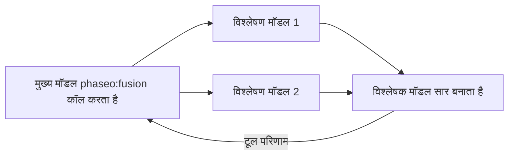

जब किसी जवाब को कई स्वतंत्र रायों से फ़ायदा हो, जैसे कोई योजना का फ़ैसला, शोध का सार या डिज़ाइन समीक्षा, तो `phaseo:fusion` जोड़ें। जब मुख्य मॉडल इसे कॉल करता है, तो Phaseo सवाल हर विश्लेषण मॉडल को समानांतर में भेजता है, एक विश्लेषक मॉडल से उनके निष्कर्ष मिलाने को कहता है, और वह सार लौटाता है। इससे लेटेंसी बढ़ती है, इसलिए जब एक समीक्षा काफ़ी हो तो एक [Advisor](./advisor) इस्तेमाल करें।



```json
{
  "tools": [
    {
      "type": "phaseo:fusion",
      "parameters": {
        "analysis_models": ["anthropic/claude-opus-5", "openai/gpt-5"],
        "model": "google/gemini-pro-latest",
        "instructions": "Reconcile disagreements and return concise synthesis guidance.",
        "max_uses": 1,
        "max_completion_tokens": 1400
      }
    }
  ]
}
```

Playground में सर्वर-टूल मेन्यू यही चीज़ें सेट करता है: विश्लेषण मॉडल, एक वैकल्पिक जज (विश्लेषक) मॉडल, और कॉल सीमा।

## पैरामीटर

| पैरामीटर | प्रकार | डिफ़ॉल्ट | विवरण |
| --- | --- | --- | --- |
| `analysis_models` | string[] | ज़रूरी | कम से कम 2 मॉडल। इससे कम होने पर अनुरोध अस्वीकार होता है। |
| `model` | string | अनुरोध का मॉडल | सार लिखने वाला विश्लेषक मॉडल। |
| `instructions` | string | कोई नहीं | विश्लेषण और विश्लेषक, दोनों कॉल के लिए निर्देश। |
| `max_uses` | integer | `1` | हर अनुरोध में Fusion कॉल, अधिकतम `4`। |
| `max_completion_tokens` | integer | `1400` | हर विश्लेषण और सार के आउटपुट टोकन, अधिकतम `32000`। |

## मॉडल क्या भेजता है

एक `prompt`: वह सवाल जिस पर कई नज़रिए चाहिए।

## टूल क्या लौटाता है

```json
{
  "status": "ok",
  "analyses": 2,
  "analysis": "Both reviewers flag the cutover order..."
}
```

`analyses` उन विश्लेषण मॉडल की गिनती है जिन्होंने जवाब दिया। अगर कुछ विफल होते हैं, तो सार बाकी मॉडल से बनता है। त्रुटि परिणाम हैं `fusion_invalid_request` (कोई प्रॉम्प्ट नहीं), `fusion_max_uses_exceeded`, `fusion_panel_failed` (हर विश्लेषण मॉडल विफल हुआ) और `fusion_request_failed` (विश्लेषक विफल हुआ)।

## उपयोग और कीमत

हर कॉल `usage.server_tool_use.fusion_requests` में 1 जोड़ती है और `server_tool_fusion_requests` से बिल हो सकती है। हर विश्लेषण और विश्लेषक कॉल का शुल्क उसके मॉडल की दरों पर, अनुरोध के बिल में अलग पंक्ति के रूप में लगता है; उसके टोकन कॉल करने वाले मॉडल के टोकन में नहीं जोड़े जाते। सशुल्क मॉडलों के लिए क्रेडिट चाहिए, भले ही कॉल करने वाला मॉडल मुफ़्त हो।
