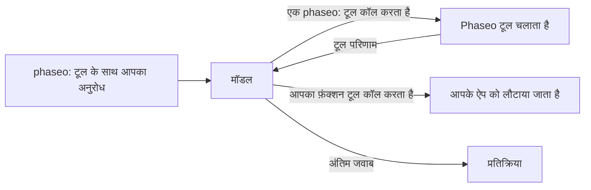

`tools` में एक `phaseo:` टूल जोड़ें, और जब मॉडल उसे कॉल करता है तो Phaseo उसे आपके लिए चलाता है: मॉडल मौजूदा समय, वेब खोज या किसी दूसरे मॉडल की राय माँगता है, Phaseo कॉल चलाता है, परिणाम वापस देता है, और मॉडल अपना जवाब पूरा करता है। आपको कोई टूल एक्ज़ीक्यूटर नहीं लिखना पड़ता।



<Note>
सर्वर टूल बीटा में हैं। प्रदाता सपोर्ट बदलने के साथ अनुरोध के आकार और परिणाम पेलोड बदल सकते हैं।
</Note>

## उपलब्ध टूल

| टूल | प्रकार | किसके लिए इस्तेमाल करें | एंडपॉइंट |
| --- | --- | --- | --- |
| [दिनांक-समय](./datetime) | `phaseo:datetime` | अधिकतम 5 टाइमज़ोन में मौजूदा दिनांक और समय | तीनों |
| [वेब खोज](./web-search) | `phaseo:web_search` | मौजूदा या स्रोत-सहित जानकारी के लिए वेब खोजना | तीनों |
| [Web Fetch](./web-fetch) | `phaseo:web_fetch` | किसी ख़ास URL का टेक्स्ट पढ़ना | तीनों |
| [Advisor](./advisor) | `phaseo:advisor` | किसी दूसरे मॉडल से समीक्षा या योजना माँगना | तीनों |
| [Subagent](./subagent) | `phaseo:subagent` | एक स्व-निहित टास्क किसी वर्कर मॉडल को सौंपना | तीनों |
| [Fusion](./fusion) | `phaseo:fusion` | कई मॉडल का विश्लेषण, फिर एक सार पाना | तीनों |
| [मॉडल खोज](./search-models) | `phaseo:search_models` | लाइव Phaseo कैटलॉग में मॉडल ढूँढना | तीनों |
| [इमेज जनरेशन](./image-generation) | `phaseo:image_generation` | जवाब देते समय इमेज बनाना | तीनों |
| [Apply Patch](./apply-patch) | `phaseo:apply_patch` | मान्य किए गए फ़ाइल पैच लौटाना | सिर्फ़ `/v1/responses` |

"तीनों" का मतलब है `/v1/chat/completions`, `/v1/responses` और `/v1/messages`।

## अनुरोध भेजें

```bash
curl https://api.phaseo.app/v1/chat/completions \
  -H "Authorization: Bearer $PHASEO_API_KEY" \
  -H "Content-Type: application/json" \
  -d '{
    "model": "openai/gpt-6-astra",
    "messages": [
      { "role": "user", "content": "What are the latest AI policy updates this week?" }
    ],
    "tools": [
      { "type": "phaseo:web_search" },
      { "type": "phaseo:datetime", "parameters": { "timezones": ["Europe/London", "UTC"] } }
    ]
  }'
```

हर टूल एक वैकल्पिक `parameters` ऑब्जेक्ट लेता है, जिसका विवरण उसके पेज पर है। `stream: true` भी काम करता है: Phaseo टूल वाले टर्न ख़ुद चलाता है और अंतिम जवाब आपको स्ट्रीम करता है।

## सर्वर टूल को अपने फ़ंक्शन के साथ मिलाएँ

Phaseo सिर्फ़ `phaseo:` टूल चलाता है। उसी अनुरोध में एक सामान्य `function` टूल हमेशा की तरह आपके ऐप को लौटाया जाता है, और आप उसका परिणाम अगले अनुरोध में वापस भेजते हैं, जैसा [टूल कॉलिंग](../tool-calling) में है।

```json
{
  "model": "openai/gpt-6-astra",
  "messages": [
    { "role": "user", "content": "Find recent funding news and save the best item." }
  ],
  "tools": [
    { "type": "phaseo:web_search", "parameters": { "max_results": 3 } },
    {
      "type": "function",
      "function": {
        "name": "save_research_item",
        "description": "Save a selected research item",
        "parameters": {
          "type": "object",
          "properties": {
            "title": { "type": "string" },
            "url": { "type": "string" }
          },
          "required": ["title", "url"]
        }
      }
    }
  ]
}
```

## टूल लूप की सीमाएँ

| सीमा | मान | सीमा पार होने पर |
| --- | --- | --- |
| हर अनुरोध में सर्वर टूल कॉल | अनुरोध में `max_tool_calls`, डिफ़ॉल्ट `30`, अधिकतम `100` | `400 gateway_server_tool_limit` |
| फ़ॉलो-अप टर्न | `8` | `502 gateway_server_tool_error` |
| एक टूल को कॉल | उस टूल का `max_uses` | टूल मॉडल को एक त्रुटि परिणाम लौटाता है, और मॉडल उसके बिना आगे बढ़ सकता है |

## उपयोग और कीमत

हर सर्वर टूल `usage.server_tool_use` में एक काउंटर जोड़ता है, और किसी मॉडल का प्राइस कार्ड उससे मेल खाने वाले मीटर का बिल बना सकता है। दूसरे मॉडल (Advisor, Subagent, Fusion, इमेज जनरेशन) द्वारा इस्तेमाल किए गए टोकन अनुरोध के उपयोग में जोड़े जाते हैं और उस मॉडल की दरों पर गिने जाते हैं।

```json
{
  "usage": {
    "input_tokens": 105,
    "output_tokens": 250,
    "server_tool_use": {
      "datetime_requests": 1,
      "web_search_requests": 2,
      "web_search_results": 8
    }
  }
}
```

| टूल | उपयोग काउंटर | कीमत मीटर |
| --- | --- | --- |
| दिनांक-समय | `datetime_requests` | कोई नहीं |
| वेब खोज | `web_search_requests`, `web_search_results`, `web_search_extra_results` | `server_tool_web_search_requests`, `server_tool_web_search_extra_results` |
| Web Fetch | `web_fetch_requests` | `server_tool_web_fetch_requests` |
| Advisor | `advisor_requests` | `server_tool_advisor_requests` |
| Subagent | `subagent_requests` | `server_tool_subagent_requests` |
| Fusion | `fusion_requests` | `server_tool_fusion_requests` |
| मॉडल खोज | `search_models_requests` | `server_tool_search_models_requests` |
| इमेज जनरेशन | `image_generation_requests` | `server_tool_image_generation_requests` |
| Apply Patch | `apply_patch_requests` | `server_tool_apply_patch_requests` |

जब वेब खोज या Web Fetch प्रदाता के अपने टूल (`engine: "native"`) के रूप में चलता है, तो उसका बिल इसकी जगह `native_web_search_requests` या `native_web_fetch_requests` के साथ बनता है।
