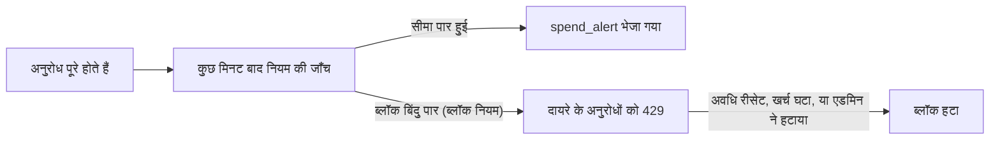

जब आपके वर्कस्पेस का खर्च किसी सीमा को पार करे, तब अलर्ट पाने के लिए खर्च नियम बनाएँ, और चाहें तो खर्च के रियायती मार्जिन से आगे जाने पर अनुरोध ब्लॉक भी करें। **सेटिंग्स → सूचनाएँ → खर्च अलर्ट** खोलें और **अलर्ट जोड़ें** चुनें। हर प्लान में एक वर्कस्पेस में ज़्यादा से ज़्यादा 50 नियम हो सकते हैं; 51वाँ नियम `409 spend_rule_limit_reached` के साथ विफल होता है।

<Note>खर्च अलर्ट, ब्लॉक करना और खर्च रिपोर्ट धीरे-धीरे शुरू किए जा रहे हैं। इन्हें चालू किए जाने तक नियम और सेटिंग सहेजे जाते हैं, लेकिन कुछ भी जाँचा, ब्लॉक या भेजा नहीं जाता, और नए नियम `action: "block"` का इस्तेमाल नहीं कर सकते।</Note>



एक नियम में ये हिस्से होते हैं:

| हिस्सा | फ़ील्ड | मान |
| --- | --- | --- |
| मीट्रिक | `metric` | `spend`, `budget_percent`, `forecast`, `spike`, `balance`। [अलर्ट के प्रकार](#alert-types-and-bases) देखें। |
| दायरा | `scope_type`, `scope_id` | किसका खर्च गिना जाता है: वर्कस्पेस, एक API कुंजी, सदस्य, विभाग, मॉडल या प्रदाता |
| अवधि | `period` | कैलेंडर का `day`, `week` या `month`, या `window_hours` पर `rolling` |
| सीमाएँ | `threshold_amount` या `threshold_percents` | वह डॉलर राशि या प्रतिशत जिन पर अलर्ट भेजा जाता है |
| कार्रवाई | `action` | `notify`, या सीमा पार करने वाले अनुरोधों को अस्वीकार भी करने के लिए `block` |

Phaseo दर्ज उपयोग के आधार पर नियमों की जाँच करता है, अनुरोध पूरे होने के कुछ मिनट बाद। जिन वर्कस्पेस में नियम हैं, उनकी हर घंटे भी जाँच होती है, और बैलेंस नियमों की हर 15 मिनट में। खर्च में वीडियो, बैच, संगीत और रियलटाइम जॉब भी शामिल हैं।

एडिटर सहेजे गए नियम का मौजूदा मान दिखाता है और टेस्ट अलर्ट भेज सकता है। API कुंजी के पेज और बजट पेज पर शॉर्टकट हैं, जो कुंजी की सीमा या बजट को आधार बनाकर एडिटर खोलते हैं। सदस्य नियम देख सकते हैं; मालिक और एडमिन उन्हें बनाते, बदलते, टेस्ट करते और मिटाते हैं।

<span id="alert-types-and-bases"></span>
## अलर्ट के प्रकार और आधार

| मीट्रिक | अलर्ट कब भेजता है | अवधियाँ |
| --- | --- | --- |
| `spend` | अवधि का खर्च `threshold_amount` तक पहुँचे | कोई भी |
| `budget_percent` | खर्च किसी आधार के प्रतिशत तक पहुँचे, 50, 80 और 100 जैसी ज़्यादा से ज़्यादा पाँच सीमाओं तक | कोई भी |
| `forecast` | अवधि के अंत तक का अनुमानित खर्च किसी राशि या आधार के प्रतिशत तक पहुँचे | दिन, सप्ताह, महीना |
| `spike` | पिछले कुछ घंटों का खर्च सामान्य खर्च से कई गुना हो | रोलिंग |
| `balance` | उपलब्ध बैलेंस किसी राशि तक गिर जाए, या कुछ तय दिनों से कम चले | रोलिंग, केवल वर्कस्पेस दायरा |

प्रतिशत एक आधार (`base_kind`) के मुकाबले मापे जाते हैं:

- `amount`: नियम पर तय की गई डॉलर राशि, जो केवल अलर्ट के लिए इस्तेमाल होती है।
- `workspace_budget`: मेल खाने वाले अंतराल का वर्कस्पेस बजट (`base_ref`: दिन की अवधि के लिए `daily`, सप्ताह के लिए `weekly`, महीने के लिए `monthly`)। आजीवन बजट आधार नहीं हो सकता।
- `key_limit`: मेल खाने वाली विंडो के लिए नियम की API कुंजी की खर्च सीमा। इसके लिए कुंजी दायरा ज़रूरी है।
- `previous_period`: पिछली अवधि में इसी समय तक का खर्च, जैसे "कल इस समय तक"। रोलिंग नियमों में यह पिछली विंडो है; पूर्वानुमान में पूरी पिछली अवधि।

जिस नियम का आधार मौजूद नहीं है, जैसे मिटाया गया बजट या बिना खर्च सीमा वाली कुंजी, वह आधार फिर से मौजूद होने तक कुछ नहीं भेजता। गार्डरेल में खर्च सीमाएँ नहीं होतीं और वे आधार नहीं हो सकते।

## चुनें कि किसका खर्च गिना जाए

| दायरा | `scope_id` | क्या गिना जाता है |
| --- | --- | --- |
| `workspace` | कोई नहीं | वर्कस्पेस का पूरा खर्च |
| `key` | API कुंजी की ID | उस कुंजी से किए गए अनुरोध |
| `member` | सदस्य की यूज़र ID | सदस्य की बनाई कुंजियों से किए गए अनुरोध, और सदस्य के अपने OAuth अनुरोध |
| `department` | विभाग की ID | विभाग के लोगों का किया हुआ सब कुछ (नीचे देखें) |
| `model` | मॉडल ID, जैसे `openai/gpt-6-astra` | उस मॉडल से पूरे हुए अनुरोध |
| `provider` | प्रदाता ID | उस प्रदाता से पूरे हुए अनुरोध |

विभाग का खर्च हर अनुरोध के हिसाब से तय होता है:

1. किसी विभाग को सौंपी गई कुंजी केवल उसी विभाग में गिनी जाती है।
2. नहीं तो कुंजी बनाने वाला तय करता है: उसके विभाग, या OAuth अनुरोधों के लिए साइन-इन किए यूज़र के विभाग।
3. कई विभागों में शामिल व्यक्ति डिफ़ॉल्ट रूप से **सभी** विभागों में गिना जाता है। केवल मुख्य विभाग में गिनने के लिए **वर्कस्पेस खर्च सेटिंग** में **उनके सभी विभाग** की जगह **केवल मुख्य विभाग** चुनें (API: `spend.department_attribution: "primary"`)। अगर कोई विभाग मुख्य के रूप में चिह्नित नहीं है, तो हाथ से जोड़ा गया विभाग पहले आता है, फिर सबसे पुराना।

हर बार नियम की जाँच होने पर विभाग की सदस्यता पढ़ी जाती है, इसलिए किसी को दूसरे विभाग में भेजने पर मौजूदा अवधि का उसका खर्च भी उसके साथ चला जाता है। क्योंकि एक व्यक्ति कई विभागों में गिना जा सकता है, इसलिए विभागों का कुल जोड़ वर्कस्पेस के कुल से ज़्यादा हो सकता है। सितंबर 2026 से पहले का उपयोग सदस्यों या विभागों को नहीं सौंपा जाता।

## अवधियाँ और टाइम ज़ोन

दिन, सप्ताह और महीना कैलेंडर अवधियाँ हैं। सप्ताह सोमवार से रविवार तक चलता है। हर नियम अपना IANA `time_zone` सेट कर सकता है, जैसे `Europe/London` या `America/New_York`; नहीं तो वह वर्कस्पेस का बिलिंग टाइम ज़ोन इस्तेमाल करता है, जो डिफ़ॉल्ट रूप से UTC है। बिलिंग टाइम ज़ोन **वर्कस्पेस खर्च सेटिंग** में या [सूचना सेटिंग API](../api-reference/endpoint/notifications-settings-update.mdx) में `spend.billing_time_zone` से बदलें। डेलाइट सेविंग टाइम के बदलाव संभाले जाते हैं, और ज़ोन के नाम में छोटे-बड़े अक्षरों का फ़र्क पड़ता है।

`rolling` अवधि पिछले `window_hours` (1 से 720) को कवर करती है और लगातार आगे बढ़ती है। उछाल नियम इसे उछाल विंडो की तरह इस्तेमाल करते हैं, और बैलेंस नियम उस समय की तरह जिस पर वे खर्च का औसत निकालते हैं।

<Note>[कुंजी सीमाएँ](../api-reference/limits.mdx#key-limits-and-budgets) और [वर्कस्पेस बजट](../api-reference/endpoint/budgets-list.mdx) हमेशा UTC सीमाओं पर रीसेट होते हैं। किसी दूसरे टाइम ज़ोन में `workspace_budget` या `key_limit` आधार वाला नियम अपने स्थानीय दिन, सप्ताह या महीने की तुलना उस सीमा से करता है, इसलिए उसका खर्च उस सीमा की गिनती से अलग हो सकता है।</Note>

## सीमाएँ और दोहराए जाने वाले अलर्ट

अपनी मीट्रिक के हिसाब से, किसी नियम में एक से पाँच प्रतिशत सीमाएँ (1 से 1000) या एक डॉलर सीमा होती है।

- कैलेंडर अवधियों में, हर सीमा प्रति अवधि ज़्यादा से ज़्यादा एक अलर्ट भेजती है। जब खर्च एक साथ कई सीमाएँ पार करता है, तो एक अलर्ट सबसे ऊँची सीमा का नाम लेता है और बाकी की सूची देता है।
- रोलिंग, उछाल और बैलेंस नियम इसके बजाय `cooldown_minutes` (5 से 43,200, डिफ़ॉल्ट 360) इस्तेमाल करते हैं। कूलडाउन के दौरान सिर्फ़ ऊँची सीमा अलर्ट भेजती है; उसके बाद, अगर खर्च अब भी ऊपर है तो नियम फिर से अलर्ट भेजता है।
- इस अवधि में पहले भेजी जा चुकी सीमाएँ नियम संपादित करने पर दोबारा नहीं भेजी जातीं।

**टेस्ट भेजें** वह अलर्ट, जो नियम अभी भेजता, `[TEST]` के निशान के साथ नियम के गंतव्यों पर पहुँचाता है। कुछ भी दर्ज नहीं होता, और एक वर्कस्पेस एक मिनट में पाँच टेस्ट भेज सकता है। हर नियम का **इतिहास** उसके भेजे गए अलर्ट और ब्लॉक की सूची देता है।

<span id="block-requests"></span>
## अनुरोध ब्लॉक करें

`action: "block"` वाला `spend` या `budget_percent` नियम अपनी सीमाओं पर चेतावनी देता है और खर्च के ब्लॉक बिंदु तक पहुँचते ही ब्लॉक करता है: आधार का `block_at_percent` (100 से 1000, डिफ़ॉल्ट 110, और कम से कम सबसे ऊँची सीमा जितना), या `spend` नियम के लिए `block_at_amount` (कम से कम `threshold_amount` जितना)। `previous_period` आधार वाले नियम ब्लॉक नहीं कर सकते। आखिरी अलर्ट और ब्लॉक बिंदु के बीच की जगह रियायती मार्जिन है: अनुरोध रुकने से पहले आपकी टीम को चेतावनी मिल जाती है।

<Warning>ब्लॉक करना पूरी कोशिश के आधार पर होता है। यह दर्ज उपयोग का इस्तेमाल करता है, इसलिए ब्लॉक खर्च के ब्लॉक बिंदु पार करने के कुछ मिनट बाद शुरू होता है, और उस दौरान खर्च उससे आगे जा सकता है। हर अनुरोध पर जाँची जाने वाली पक्की सीमा के लिए, कुंजी सीमाएँ या वर्कस्पेस बजट इस्तेमाल करें।</Warning>

| | खर्च नियम ब्लॉक | कुंजी सीमा | वर्कस्पेस बजट |
| --- | --- | --- | --- |
| जाँच | हर कुछ मिनट में, दर्ज उपयोग से | हर अनुरोध पर | हर अनुरोध पर |
| दायरा | वर्कस्पेस, कुंजी, सदस्य, विभाग, मॉडल या प्रदाता | एक कुंजी | वर्कस्पेस |
| अवधियाँ | दिन, सप्ताह, महीना या रोलिंग, किसी भी टाइम ज़ोन में | UTC दिन, सप्ताह या महीना | UTC दिन, सप्ताह या महीना, या आजीवन |
| मुफ़्त मॉडल | ब्लॉक नहीं होते, जब तक `block_free_models` true न हो | गिने जाते हैं | गिने जाते हैं |
| पहले चेतावनी | हाँ, नियम की सीमाओं पर | नहीं | नहीं |
| हटाना | मालिक या एडमिन द्वारा, अवधि के बाकी समय के लिए | सीमा बढ़ाएँ | बजट बढ़ाएँ |

ब्लॉक सक्रिय रहने तक, उसके दायरे के अनुरोधों को `spend_rule_blocked` एरर कोड के साथ `429` मिलता है। बॉडी में `reason: "spend_rule_block"`, `rule_id`, `rule_name`, `block_id`, `limit_scope`, `limit_value` (USD) और `reset_at` होते हैं। `Retry-After` अवधि रीसेट होने तक के सेकंड देता है। रोलिंग नियम का कोई रीसेट समय नहीं होता: उसका ब्लॉक तब तक रहता है जब तक विंडो का खर्च ब्लॉक बिंदु से नीचे न आ जाए, और प्रतिक्रिया में `Retry-After` नहीं होता। प्रदाता ब्लॉक उस प्रदाता के रूट हटा देता है, और अनुरोध तभी अस्वीकार होता है जब कोई दूसरा रूट न बचे। रियलटाइम सत्र अभी ब्लॉक नहीं होते।

जब खर्च नियम की आखिरी सीमा पार कर चुका हो पर ब्लॉक बिंदु से नीचे हो, तब दायरे के अनुरोधों की प्रतिक्रियाओं में `x-phaseo-spend-warning` हेडर होता है, जिसमें ज़्यादा से ज़्यादा तीन नियम होते हैं, जैसे `rule_id=…; scope=workspace; resets_at=2026-11-01T00:00:00.000Z`। क्लाइंट ब्लॉक शुरू होने से पहले इसे लॉग कर सकते हैं या धीमे हो सकते हैं।

ब्लॉक अपने आप हट जाता है जब अवधि रीसेट होती है, जब रोलिंग नियम का खर्च उसके ब्लॉक बिंदु से नीचे आता है, या जब नियम बंद किया जाता है, मिटाया जाता है या बदला जाता है। मालिक और एडमिन इसे **खर्च अलर्ट → सक्रिय ब्लॉक** में या [`POST /v1/spend-blocks/{id}/lift`](../api-reference/endpoint/spend-blocks-lift.mdx) से हटा सकते हैं। हटाया गया ब्लॉक उसी अवधि में फिर शुरू नहीं होता (रोलिंग नियमों के लिए, एक विंडो तक)। खर्च ब्लॉक की सूचनाएँ ब्लॉक शुरू होने और हटने पर भेजी जाती हैं।

## अपना बैलेंस और रनवे देखें

`balance` नियम वर्कस्पेस के उपलब्ध बैलेंस पर नज़र रखता है: उसका क्रेडिट बैलेंस, चल रहे अनुरोधों के लिए रोकी गई राशि घटाकर। यह वर्कस्पेस दायरा और रोलिंग अवधि इस्तेमाल करता है, और इनमें से कोई भी शर्त पूरी होने पर अलर्ट भेजता है:

- `threshold_amount`: उपलब्ध बैलेंस इस राशि के बराबर या उससे कम है;
- `runway_days` (1 से 365): पिछले `window_hours` के औसत दैनिक खर्च पर, बैलेंस इतने दिनों से कम चलेगा। हाल में कोई खर्च न हो, तो रनवे अलर्ट नहीं भेजा जाता।

बैलेंस नियम हर गिरावट पर एक बार अलर्ट भेजता है। वह दोबारा तभी अलर्ट भेजता है जब बैलेंस ठीक होकर फिर गिरे, और अपने कूलडाउन से ज़्यादा बार नहीं। जब ऑटो टॉप-अप चालू हो और काम कर रहा हो, तब कोई अलर्ट नहीं भेजा जाता।

**सेटिंग्स → क्रेडिट** में कम बैलेंस वाला ईमेल सरल डिफ़ॉल्ट के रूप में बना रहता है। यह हर बार बैलेंस के अपनी सीमा से नीचे जाने पर एक बार भेजा जाता है, ज़्यादा से ज़्यादा हर छह घंटे में, और तब नहीं जब ऑटो टॉप-अप काम कर रहा हो। रनवे अलर्ट, दूसरे गंतव्यों या अलग सीमा के लिए बैलेंस नियम इस्तेमाल करें।

## अवधि के अंत तक के खर्च का पूर्वानुमान लगाएँ

`forecast` नियम मौजूदा दिन, सप्ताह या महीने के अंत तक के खर्च का सीधी रेखा में अनुमान लगाता है: अब तक का खर्च, बीती हुई अवधि के हिस्से से भाग देकर। यह तब तक इंतज़ार करता है जब तक दिन के 3 घंटे, सप्ताह के 24 घंटे या महीने के 72 घंटे न बीत जाएँ, और कम से कम $0.01 खर्च न हो जाए, ताकि शांत शुरुआत से अलर्ट न भेजा जाए। अलर्ट बताता है कि मौजूदा रफ़्तार से सीमा कब पहुँचेगी।

डॉलर `threshold_amount` सेट करें, या प्रतिशत के साथ कोई आधार। `previous_period` आधार के साथ, अनुमान की तुलना पूरी पिछली अवधि से की जाती है। हर सीमा प्रति अवधि एक बार अलर्ट भेजती है।

## अचानक उछाल पकड़ें

`spike` नियम पिछले `window_hours` (1 से 56) के खर्च की तुलना उस समय के सामान्य खर्च से करता है:

- 24 घंटे से छोटी विंडो के लिए, सामान्य खर्च पिछले सात दिनों में से हर दिन के उन्हीं घंटों का माध्यिका (median) है। लंबी विंडो के लिए, यह पिछले सात दिनों में उतनी ही लंबाई की पहले की विंडो का माध्यिका है।
- यह तब अलर्ट भेजता है जब खर्च सामान्य का कम से कम `spike_multiplier` गुना हो (1 से ज़्यादा और 100 तक, डिफ़ॉल्ट 3) और कम से कम `spike_floor` (डिफ़ॉल्ट $5) हो।
- इसके लिए उन पहले की विंडो में से कम से कम तीन में वर्कस्पेस का खर्च होना चाहिए। तब तक एडिटर दिखाता है कि यह अभी सीख रहा है। जब सामान्य खर्च शून्य हो, तो सिर्फ़ न्यूनतम सीमा लागू होती है।
- यह कूलडाउन (डिफ़ॉल्ट 6 घंटे) इस्तेमाल करता है और कभी ब्लॉक नहीं करता।

तुलना ठीक 24 घंटे के कदमों में होती है, इसलिए डेलाइट सेविंग बदलाव के बाद यह स्थानीय घड़ी पर एक घंटे पहले या बाद से तुलना करती है। नया उपयोग आने पर उछाल नियमों की जाँच होती है।

## खर्च रिपोर्ट

मालिकों को डिफ़ॉल्ट रूप से साप्ताहिक खर्च रिपोर्ट मिलती है, और एडमिन इसे चुन सकते हैं। दैनिक और मासिक रिपोर्ट भी उपलब्ध हैं। सेटिंग और सामग्री [वर्कस्पेस सूचना गाइड](./workspace-notifications.mdx#spend-reports) में बताई गई हैं। साथ ही:

- रिपोर्ट अपनी अवधि के बाद के पहले दिन बिलिंग टाइम ज़ोन में 09:00 से 21:00 के बीच भेजी जाती है। अगर उस दिन नहीं भेजी जा सकती, तो देर से भेजने के बजाय छोड़ दी जाती है।
- रिपोर्ट में पूर्वानुमान मौजूदा बिलिंग महीने का होता है।
- सदस्य और विभाग के कुल में एसिंक जॉब शामिल हैं और वे ऊपर के विभाग नियम का पालन करते हैं, इसलिए वे कुल से थोड़ा अलग हो सकते हैं।
- हर व्यक्ति किसी वर्कस्पेस की रिपोर्ट की अपनी कॉपी से सदस्यता खत्म करता है। जो सदस्य मालिक या एडमिन नहीं हैं, उन्हें यह कभी नहीं मिलती।

## चुनें कि अलर्ट कहाँ जाएँ

खर्च नियम तीन तरह की सूचनाएँ भेजते हैं। हर एक कहाँ जाए, यह **सेटिंग्स → सूचनाएँ** में चुनें:

| रूट | प्रकार | कब भेजी जाती है |
| --- | --- | --- |
| खर्च अलर्ट | `spend_alert` | किसी नियम की सीमा पार हो |
| खर्च ब्लॉक | `spend_blocked` | ब्लॉक शुरू हो या हटे (`payload.state` `started` या `lifted` है) |
| खर्च रिपोर्ट | `spend_report` | खर्च रिपोर्ट का समय हो |

किसी नियम के अपने गंतव्य हो सकते हैं। वे उस नियम के लिए खर्च अलर्ट और खर्च ब्लॉक रूट की जगह लेते हैं; अगर वे सभी रुके हुए हैं, तो नियम के अलर्ट उनकी जगह रूट पर नहीं भेजे जाते। अलर्ट और ब्लॉक मालिकों और एडमिन के लिए, और कुंजी बनाने वाले या उस सदस्य के लिए जिसके बारे में नियम है, मोबाइल ऐप तक भी पहुँचते हैं।

कस्टम वेबहुक को अलर्ट JSON के रूप में मिलता है, जिसमें `title`, `message`, `rule_id`, `rule_name`, `metric`, `scope`, `period`, `value_nanos` और, मीट्रिक के हिसाब से, `base_nanos`, `forecast`, `spike` या बैलेंस फ़ील्ड होते हैं। हर डिलीवरी को उसके सिग्नेचर से सत्यापित करें; [वेबहुक सिग्नेचर सत्यापित करें](./workspace-notifications.mdx#verify-webhook-signatures) देखें।

## API से नियम प्रबंधित करें

[खर्च नियम API](../api-reference/endpoint/spend-rules-list.mdx) `spend_rules:read`, `spend_rules:write` या `spend_rules:delete` वाली प्रबंधन कुंजी इस्तेमाल करता है। राशियाँ डॉलर में (`threshold_amount_usd`) या ठीक-ठीक नैनोडॉलर में (`threshold_amount_nanos`) भेजी जा सकती हैं, और प्रतिक्रियाओं में दोनों होते हैं।

```bash
curl https://api.phaseo.app/v1/spend-rules \
  -H "Authorization: Bearer $PHASEO_MANAGEMENT_KEY" \
  -H "Content-Type: application/json" \
  -d '{
    "name": "Monthly budget",
    "metric": "budget_percent",
    "period": "month",
    "base_kind": "workspace_budget",
    "base_ref": "monthly",
    "threshold_percents": [50, 80, 100],
    "action": "block",
    "block_at_percent": 110
  }'
```

मौजूदा मान और अगली सीमा देखने के लिए [`GET /v1/spend-rules/{id}/preview`](../api-reference/endpoint/spend-rules-preview.mdx) इस्तेमाल करें, और टेस्ट भेजने के लिए [`POST /v1/spend-rules/{id}/test`](../api-reference/endpoint/spend-rules-test.mdx)। [`GET /v1/spend-blocks`](../api-reference/endpoint/spend-blocks-list.mdx) सक्रिय ब्लॉक की सूची देता है। बिलिंग टाइम ज़ोन, विभाग एट्रिब्यूशन और रिपोर्ट सेटिंग [सूचना सेटिंग](../api-reference/endpoint/notifications-settings-update.mdx) के `spend` ऑब्जेक्ट में हैं।

## Terraform से नियम प्रबंधित करें

[Phaseo Terraform प्रदाता](https://github.com/phaseoteam/terraform-provider-phaseo) (`phaseoteam/phaseo`) में `phaseo_spend_rule` और `phaseo_workspace_budget` रिसोर्स, और `phaseo_spend_rules`, `phaseo_spend_blocks` और `phaseo_workspace_budgets` डेटा सोर्स हैं।

```hcl
resource "phaseo_workspace_budget" "monthly" {
  interval = "monthly"
  limit    = 500
}

resource "phaseo_spend_rule" "monthly_budget" {
  name               = "Monthly budget"
  metric             = "budget_percent"
  period             = "month"
  base_kind          = "workspace_budget"
  base_ref           = "monthly"
  threshold_percents = [50, 80, 100]
  action             = "block"
  block_at_percent   = 110

  depends_on = [phaseo_workspace_budget.monthly]
}

resource "phaseo_spend_rule" "spike" {
  name             = "Spend spike"
  metric           = "spike"
  period           = "rolling"
  window_hours     = 3
  spike_multiplier = 4
}
```

किसी मौजूदा नियम या बजट को उसकी ID से इंपोर्ट करें:

```bash
terraform import phaseo_spend_rule.monthly_budget 11111111-1111-4111-8111-111111111111
```

<Visibility for="agents">
एजेंट के लिए खर्च नियम के नियम, इस पेज का सार:

- खर्च नियम के ब्लॉक पूरी कोशिश के आधार पर होते हैं और सीमा के कुछ मिनट बाद शुरू होते हैं; पक्की सीमा के लिए कुंजी सीमाएँ या वर्कस्पेस बजट इस्तेमाल करें।
- ब्लॉक किया गया अनुरोध `spend_rule_blocked`, `rule_id`, `block_id` और `reset_at` के साथ `429` लौटाता है। `Retry-After` का इंतज़ार करें; इसके बिना ब्लॉक तब तक रहता है जब तक रोलिंग विंडो का खर्च न घटे, या कोई मालिक या एडमिन `POST /v1/spend-blocks/{id}/lift` से उसे न हटा दे। लूप में दोबारा कोशिश न करें।
- प्रतिक्रिया पर `x-phaseo-spend-warning` का मतलब है कि कोई ब्लॉक करने वाला नियम अपनी आखिरी अलर्ट सीमा पार कर चुका है; ब्लॉक हो सकता है।
- मुफ़्त मॉडल ब्लॉक नहीं होते, जब तक नियम `block_free_models` सेट न करे।
- कैलेंडर अवधियाँ नियम का टाइम ज़ोन इस्तेमाल करती हैं (डिफ़ॉल्ट: वर्कस्पेस का बिलिंग टाइम ज़ोन, जिसका डिफ़ॉल्ट UTC है); कुंजी सीमाएँ और वर्कस्पेस बजट UTC इस्तेमाल करते हैं।
</Visibility>
