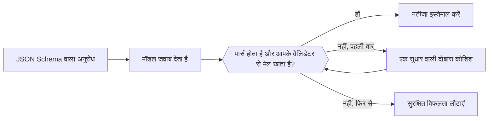

अनुरोध के साथ एक JSON Schema भेजें, और मॉडल खुले टेक्स्ट के बजाय उसी आकार में JSON लौटाता है। इस्तेमाल करने से पहले आपका कोड फिर भी उसे पार्स और सत्यापित करता है।



## फ़ॉर्मेट चुनें

| `type` | आपको क्या मिलता है |
| --- | --- |
| `json_schema` | ऐसा JSON जो आपके भेजे गए schema का पालन करता है। डिफ़ॉल्ट रूप से इसे इस्तेमाल करें। |
| `json_object` | कोई भी मान्य JSON ऑब्जेक्ट, बिना किसी तय आकार के। |
| `text` | सादा टेक्स्ट (डिफ़ॉल्ट)। |

फ़ॉर्मेट कहाँ जाता है, यह एंडपॉइंट पर निर्भर करता है:

| एंडपॉइंट | फ़ील्ड |
| --- | --- |
| `/v1/chat/completions` | `response_format` |
| `/v1/responses` | `text.format` |
| `/v1/messages` | समर्थित नहीं। प्रॉम्प्ट में JSON माँगें और उसे उसी तरह सत्यापित करें। |

## schema भेजें

<CodeGroup>
```bash Chat Completions
curl https://api.phaseo.app/v1/chat/completions \
  -H "Authorization: Bearer $PHASEO_API_KEY" \
  -H "Content-Type: application/json" \
  -d '{
    "model": "openai/gpt-6-astra",
    "messages": [
      { "role": "user", "content": "Return the city and weather for London." }
    ],
    "response_format": {
      "type": "json_schema",
      "json_schema": {
        "name": "weather",
        "strict": true,
        "schema": {
          "type": "object",
          "properties": {
            "city": { "type": "string" },
            "weather": { "type": "string" }
          },
          "required": ["city", "weather"],
          "additionalProperties": false
        }
      }
    }
  }'
```

```bash Responses
curl https://api.phaseo.app/v1/responses \
  -H "Authorization: Bearer $PHASEO_API_KEY" \
  -H "Content-Type: application/json" \
  -d '{
    "model": "openai/gpt-6-astra",
    "input": "Return the city and weather for London.",
    "text": {
      "format": {
        "type": "json_schema",
        "name": "weather",
        "strict": true,
        "schema": {
          "type": "object",
          "properties": {
            "city": { "type": "string" },
            "weather": { "type": "string" }
          },
          "required": ["city", "weather"],
          "additionalProperties": false
        }
      }
    }
  }'
```
</CodeGroup>

JSON मैसेज की सामग्री में एक स्ट्रिंग के रूप में वापस आता है:

```json
{
  "choices": [
    {
      "finish_reason": "stop",
      "message": {
        "role": "assistant",
        "content": "{\"city\":\"London\",\"weather\":\"Cloudy\"}"
      }
    }
  ]
}
```

## schema डिज़ाइन करें

एक छोटे ऑब्जेक्ट से शुरू करें। हर फ़ील्ड को `required` में लिखें, जानी-पहचानी श्रेणियों के लिए `enum` इस्तेमाल करें, और जब अतिरिक्त कुंजियाँ अस्वीकार करनी हों तो `additionalProperties: false` सेट करें। schema का वर्ज़न अपने सर्वर-साइड वैलिडेटर के साथ रखें, ताकि दोनों कभी अलग न हों।

<span id="validate-the-result"></span>
## नतीजा सत्यापित करें

पार्स करने से पहले इनकार, गायब सामग्री, या कटे हुए जवाब (`stop` के अलावा कोई `finish_reason`) की जाँच करें। फिर पार्स किए गए ऑब्जेक्ट को सत्यापित करें। यह Zod वैलिडेटर ऊपर के schema से मेल खाता है:

```typescript
import { z } from "zod";

const Weather = z.object({
  city: z.string(),
  weather: z.string(),
}).strict();

function parseWeather(content: string) {
  return Weather.parse(JSON.parse(content));
}
```

अगर सत्यापन विफल होता है, तो प्रॉम्प्ट में एरर के साथ एक बार दोबारा कोशिश करें, फिर सुरक्षित विफलता लौटाएँ। हर दोबारा कोशिश का शुल्क लगता है। मान्य JSON फिर भी इस बात का सबूत नहीं है कि मान सही हैं या कोई कार्रवाई अधिकृत है।

सत्यापन की विफलताओं पर हर मॉडल और schema वर्ज़न के हिसाब से नज़र रखें, और इनमें से कोई भी बदलने पर अपने मूल्यांकन केस फिर से चलाएँ। खराब JSON को अपने आप ठीक करने के लिए, [response healing](../cookbook/response-healing-for-structured-json.mdx) देखें।
