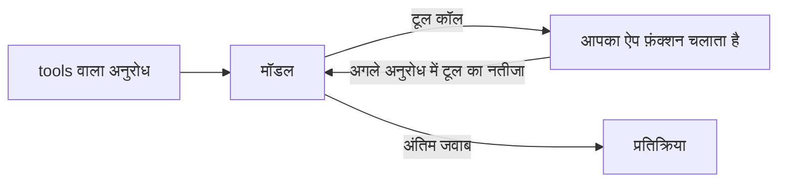

अपने फ़ंक्शन `tools` में बताएँ, और मॉडल अंदाज़ा लगाने के बजाय उनमें से किसी एक को कॉल करके जवाब देता है, जैसे डेटाबेस में कुछ ढूँढना या मौसम जाँचना। आपका ऐप फ़ंक्शन चलाता है और नतीजा वापस भेजता है; फिर मॉडल अंतिम जवाब लिखता है।



टूल कॉलिंग तीनों टेक्स्ट एंडपॉइंट पर काम करती है, हर एक अपने फ़ॉर्मेट में:

| एंडपॉइंट | मॉडल की कॉल | आपका नतीजा |
| --- | --- | --- |
| `/v1/chat/completions` | assistant मैसेज पर `tool_calls`, `finish_reason: "tool_calls"` | एक `role: "tool"` मैसेज |
| `/v1/responses` | एक `function_call` आउटपुट आइटम | एक `function_call_output` इनपुट आइटम |
| `/v1/messages` | एक `tool_use` कंटेंट ब्लॉक | एक `tool_result` कंटेंट ब्लॉक |

## tools के साथ अनुरोध भेजें

```bash
curl https://api.phaseo.app/v1/chat/completions \
  -H "Authorization: Bearer $PHASEO_API_KEY" \
  -H "Content-Type: application/json" \
  -d '{
    "model": "openai/gpt-6-astra",
    "messages": [
      { "role": "user", "content": "What is the weather in London?" }
    ],
    "tools": [
      {
        "type": "function",
        "function": {
          "name": "get_weather",
          "description": "Get current weather by city",
          "parameters": {
            "type": "object",
            "properties": {
              "city": { "type": "string" }
            },
            "required": ["city"]
          }
        }
      }
    ],
    "tool_choice": {
      "type": "function",
      "function": { "name": "get_weather" }
    }
  }'
```

यहाँ `tool_choice` कॉल को ज़बरदस्ती करवाता है। मॉडल को खुद तय करने देने के लिए इसे हटा दें, या `"auto"` सेट करें।

मॉडल टेक्स्ट के बजाय एक कॉल के साथ जवाब देता है:

```json
{
  "id": "chatcmpl_...",
  "object": "chat.completion",
  "choices": [
    {
      "index": 0,
      "finish_reason": "tool_calls",
      "message": {
        "role": "assistant",
        "content": null,
        "tool_calls": [
          {
            "id": "call_123",
            "type": "function",
            "function": {
              "name": "get_weather",
              "arguments": "{\"city\":\"London\"}"
            }
          }
        ]
      }
    }
  ]
}
```

कुछ भी चलाने से पहले `arguments` पार्स करें और जाँचें; [टूल कॉलिंग की सुरक्षा](./tool-calling-safety) देखें। फिर अगले अनुरोध में assistant मैसेज और अपना नतीजा वापस भेजें। [टूल कॉलिंग पैटर्न](./tool-calling-patterns) Chat Completions और Responses के लिए वह अगला अनुरोध दिखाता है।

## टूल Phaseo को चलाने दें

जिन टूल का type `phaseo:` से शुरू होता है, वे Phaseo की ओर चलते हैं: मॉडल उन्हें कॉल करता है, Phaseo उन्हें चलाकर लूप जारी रखता है, और आपको बिना कोई एक्ज़िक्यूटर लिखे अंतिम जवाब मिलता है। आप इन्हें एक ही अनुरोध में अपने फ़ंक्शन के साथ मिला सकते हैं।

| टूल | Type |
| --- | --- |
| [दिनांक-समय](./server-tools/datetime) | `phaseo:datetime` |
| [वेब खोज](./server-tools/web-search) | `phaseo:web_search` |
| [Web Fetch](./server-tools/web-fetch) | `phaseo:web_fetch` |
| [Advisor](./server-tools/advisor) | `phaseo:advisor` |
| [Subagent](./server-tools/subagent) | `phaseo:subagent` |
| [Fusion](./server-tools/fusion) | `phaseo:fusion` |
| [मॉडल खोज](./server-tools/search-models) | `phaseo:search_models` |
| [इमेज जनरेशन](./server-tools/image-generation) | `phaseo:image_generation` |
| [पैच लागू करें](./server-tools/apply-patch) | `phaseo:apply_patch` (केवल Responses) |

```json
{
  "tools": [
    { "type": "phaseo:datetime", "parameters": { "timezones": ["Europe/London", "UTC"] } }
  ],
  "tool_choice": "auto"
}
```

सीमाओं, उपयोग काउंटर और कीमतों के लिए [सर्वर टूल](./server-tools) देखें।

## टूल कॉल स्ट्रीम करें

टूल-कॉलिंग अनुरोध `stream: true` स्वीकार करते हैं। फ़ंक्शन-कॉल के आर्ग्युमेंट टुकड़ों में आते हैं; कॉल पार्स करने से पहले उन सबको इकट्ठा करें। जब कोई सर्वर टूल चलता है, तो Phaseo वह टूल टर्न पूरा करता है, टूल चलाता है, मॉडल को आगे बढ़ाता है, और बाकी जवाब आपको स्ट्रीम करता है, इसलिए आपका क्लाइंट फिर भी एक ही स्ट्रीम पढ़ता है। [स्ट्रीमिंग](./streaming) देखें।

जिन जवाबों को फ़ंक्शन कॉल करने के बजाय किसी schema से मेल खाना हो, उनके लिए [संरचित आउटपुट](./structured-outputs) इस्तेमाल करें।
