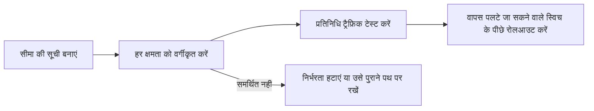

आपका मौजूदा गेटवे इंटीग्रेशन जो भी क्षमता उपयोग करता है, उसे ढूंढें, फिर ट्रैफ़िक बदलने से पहले आखिरी कॉलम में लिखा काम करें। आखिरी समीक्षा 4 नवंबर, 2026 को हुई।

माइग्रेशन इसी क्रम में करें। इससे वे व्यवहार पकड़ में आते हैं जो तब भी बदल सकते हैं जब दोनों प्लेटफ़ॉर्म एक ही OpenAI-संगत अनुरोध स्वीकार करते हों।

## इंटीग्रेशन सीमा की सूची बनाएं

हर वह जगह दर्ज करें जहां मौजूदा गेटवे दिखता है, ताकि माइग्रेशन के बाद कोई दूसरा, छिपा हुआ कॉन्फ़िगरेशन पथ न बचे:

- बेस URL और API कुंजी के एनवायरनमेंट वेरिएबल;
- SDK इनिशियलाइज़ेशन और कस्टम हेडर;
- मॉडल ID और फ़ॉलबैक मॉडल;
- प्रदाता क्रम, अनुमति सूचियां और गोपनीयता आवश्यकताएं;
- स्ट्रीमिंग, टूल कॉलिंग और संरचित आउटपुट का कोड;
- बैच जॉब, फ़ाइलें, वेबहुक और async स्थिति पोलिंग;
- अनुरोध एट्रिब्यूशन और उपयोगकर्ता या सत्र मेटाडेटा।

## अनुरोध

| क्षमता | Phaseo पर | कटओवर से पहले |
| --- | --- | --- |
| प्रमाणीकरण | `Authorization: Bearer $PHASEO_API_KEY` | बेस URL और कुंजी बदलें, फिर एक प्रमाणित अनुरोध चलाएं। |
| Chat Completions | `/v1/chat/completions` | सामान्य, स्ट्रीमिंग, टूल कॉलिंग और संरचित आउटपुट वाले अनुरोध टेस्ट करें। अज्ञात शीर्ष-स्तरीय फ़ील्ड `400` लौटाते हैं। |
| Responses | `/v1/responses`, संग्रहीत स्थिति के बिना | इनपुट फ़ॉर्मेट, स्ट्रीमिंग इवेंट, टूल और पार्सिंग टेस्ट करें। `previous_response_id` और `conversation` `400` लौटाते हैं; पूरा इतिहास भेजें। |
| Anthropic Messages | रूट होस्ट `https://api.phaseo.app` पर `/v1/messages` | कुंजी को bearer टोकन के रूप में भेजें, और हर `anthropic-beta` हेडर की समीक्षा करें; Phaseo उन्हें आगे नहीं भेजता। |
| मॉडल ID | `<org>/<model>` | हर प्रोडक्शन ID को `GET /v1/models?format=openai` में जांचें। यह न मानें कि उपनाम मेल खाते हैं। |
| एम्बेडिंग, इमेज, ऑडियो, मॉडरेशन | मॉडल और प्रदाता के अनुसार समर्थित | पुष्टि करें कि मॉडल उस ऑपरेशन को सपोर्ट करता है। |

## रूटिंग और नीति

| क्षमता | Phaseo पर | कटओवर से पहले |
| --- | --- | --- |
| मॉडल फ़ॉलबैक | `models` ऐरे, 1 से 25 एंट्री | फ़ॉलबैक `429`, `500`, `502`, `503` और `504` पर चलते हैं, अनुरोध त्रुटियों पर कभी नहीं। |
| प्रदाता क्रम | `provider.order` | सिर्फ़ वही क्रम दोबारा बनाएं जिसकी वर्कलोड को अब भी ज़रूरत है। |
| प्रदाता अनुमति और अनदेखी सूचियां | `provider.only`, `provider.ignore` | प्रदाता ID जांचें, और यह कि कम से कम एक रूट बचता है। |
| मूल्य, लेटेंसी या थ्रूपुट के अनुसार क्रम | `provider.sort` | टेस्ट के बाद, अनुरोध विवरण में चुना गया प्रदाता जांचें। |
| शून्य डेटा प्रतिधारण | `provider.require_zero_data_retention` (उपनाम `provider.zdr`) | लागू करने से पहले पुष्टि करें कि मॉडल का कोई मेल खाता प्रदाता है। |
| क्षेत्रीय निष्पादन और डेटा रेज़िडेंसी | `provider.required_execution_region`, `provider.required_data_region`, वर्कस्पेस गोपनीयता डिफ़ॉल्ट | सफल रूट और कोई-मेल-खाता-प्रदाता-नहीं त्रुटि, दोनों टेस्ट करें। |
| साझा प्रॉम्प्ट और डिफ़ॉल्ट | [प्रीसेट](../guides/presets) | साझा कॉन्फ़िगरेशन को हर कॉलर में कॉपी करने के बजाय प्रीसेट में ले जाएं। |

## संचालन

| क्षमता | Phaseo पर | कटओवर से पहले |
| --- | --- | --- |
| ऐप एट्रिब्यूशन | `X-App-Id`, `X-App-Name`, `HTTP-Referer`, `X-Title`, `X-App-Categories` | वे हेडर रखें जो कॉल करने वाले ऐप्लिकेशन का वर्णन करते हैं; माइग्रेशन के दौरान उन्हें हटाने से लागत और उपयोग की तुलना कठिन होती है। डैशबोर्ड में ऐप समूहन जांचें। श्रेणी मानों के लिए [ऐप एट्रिब्यूशन](../guides/app-attribution) देखें। |
| लागत लेबल | `X-Phaseo-Metadata` लेबल | कस्टम प्रॉपर्टी या टैग को लेबल से मैप करें। |
| अनुरोध विवरण | अनुरोध लॉग और `GET /v1/generations?id=<request_id>` | प्रतिनिधि प्रॉम्प्ट के लिए प्रदाता, लेटेंसी, टोकन उपयोग और मूल्य की तुलना करें। |
| रीप्ले | `replay_supported` के `true` होने पर `replay_request` | पुष्टि करें कि विफल अनुरोध का एंडपॉइंट और पेलोड वापस पाया जा सकता है। |
| बैच और async जॉब | बैच, फ़ाइल, वीडियो, वेबहुक और WebSocket API | स्थिति बदलाव, अंतिम बिलिंग, रद्दीकरण और परिणाम प्राप्ति जांचें। `/v1/files` सिर्फ़ बैच इनपुट रखता है। |
| दर सीमाएं | प्रति-उपयोगकर्ता प्रति-मिनट-अनुरोध भत्ता, नए वर्कस्पेस के लिए 10 से शुरू | जो प्रॉक्सी पूरी टीम का ट्रैफ़िक एक ही कुंजी मालिक से भेजता है, वह इस सीमा तक पहुंच सकता है। देखें [सीमाएं](../api-reference/limits)। |
| क्रमिक रोलआउट | क्लाइंट या इन्फ्रास्ट्रक्चर स्तर पर ट्रैफ़िक विभाजन | कटओवर स्थिर होने तक रोलबैक को बेस URL और कुंजी बदलने तक रखें। |

## उपलब्ध नहीं

इनका Phaseo में कोई समकक्ष नहीं है। इन्हें ऐप में या पुराने प्लेटफ़ॉर्म पर रखें:

- **प्रतिक्रिया कैशिंग।** Phaseo प्रतिक्रियाएं कैश नहीं करता। [प्रॉम्प्ट कैशिंग](../guides/prompt-caching) फिर भी इनपुट लागत घटाती है।
- **संग्रहीत प्रतिक्रियाएं और बातचीत।** कोई `GET` या `DELETE /v1/responses/{id}` नहीं है।
- **टोकन गिनती** (`/v1/messages/count_tokens`)।
- **OpenAI Assistants, Threads, वेक्टर स्टोर, फ़ाइन-ट्यूनिंग, और पुराना `/v1/completions`।**

## हर क्षमता को वर्गीकृत करें

ऊपर की तालिकाओं और आपके [स्रोत प्लेटफ़ॉर्म](./index#platform-migrations) की गाइड की मदद से, हर प्रोडक्शन व्यवहार को एक स्थिति दें:

| स्थिति | अर्थ |
| --- | --- |
| अपरिवर्तित | वही अनुरोध फ़ील्ड और प्रतिक्रिया व्यवहार सत्यापित हो चुका है। |
| मैप किया गया | Phaseo किसी दूसरे फ़ील्ड या सेटिंग से वही परिणाम देता है। |
| अनुकूलित | एक संगतता परत अनुरोध या प्रतिक्रिया का अनुवाद करती है। |
| समर्थित नहीं | निर्भरता हटाएं या उस वर्कलोड को उसके मौजूदा पथ पर रखें। |
| सत्यापित नहीं | सपोर्ट हो सकता है, लेकिन अभी प्रोडक्शन जैसा कोई प्रमाण नहीं है। |

## अपने ट्रैफ़िक पर सत्यापित करें

API संगतता से ये चीज़ें एक जैसी नहीं हो जातीं:

- स्वचालित प्रदाता चयन और फ़ॉलबैक क्रम;
- प्रॉम्प्ट-कैश एफ़िनिटी और कैश मूल्य;
- प्रदाता-विशिष्ट अनुरोध फ़ील्ड और सिर्फ़-प्रतिक्रिया मेटाडेटा;
- दर सीमाएं और पुनः प्रयास का समय;
- डेटा प्रतिधारण, रेज़िडेंसी और ट्रेनिंग नीतियां;
- सटीक मॉडल उपलब्धता और मूल्य।

संवेदनशील प्रोडक्शन डेटा कॉपी किए बिना, वास्तविक वर्कलोड पैटर्न से एक छोटा टेस्ट सेट बनाएं, और चलाएं:

1. उपयोग में आने वाले हर एंडपॉइंट के लिए एक सामान्य अनुरोध;
2. प्रोडक्शन वाले ही क्लाइंट पथ से स्ट्रीमिंग;
3. वास्तविक स्कीमा के साथ टूल कॉल और संरचित आउटपुट;
4. हर प्रदाता या गोपनीयता शर्त;
5. अमान्य कुंजी, अमान्य मॉडल, दर सीमा और अनुपलब्ध-प्रदाता विफलताएं;
6. सफलता, विफलता और रद्दीकरण तक बैच या async जॉब।

आउटपुट गुणवत्ता, लेटेंसी, टोकन उपयोग, चुने गए प्रदाता और अंतिम लागत की तुलना करें। हर अनुरोध ID दर्ज करें, ताकि आप उसे अनुरोध लॉग में या `GET /v1/generations?id=<request_id>` से जांच सकें।

## वापस पलटे जा सकने वाले स्विच के साथ रोलआउट करें

डेवलपमेंट और आंतरिक ट्रैफ़िक से शुरू करें। टेस्ट सेट पास होने के बाद ही प्रोडक्शन का छोटा हिस्सा बदलें, और नतीजे स्थिर होने तक रोलबैक को बेस URL और कुंजी तक सीमित रखें। कटओवर को प्रॉम्प्ट, मॉडल या रूटिंग बदलावों के साथ न मिलाएं; वे बदलाव गेटवे सीमा सत्यापित होने के बाद करें।
