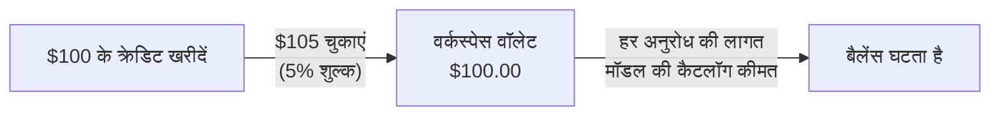

एक बार क्रेडिट खरीदें और उन्हें हर मॉडल की कैटलॉग कीमत पर अनुरोधों में खर्च करें। प्रबंधित अनुरोधों पर Phaseo का एकमात्र शुल्क हर क्रेडिट खरीद का 5% है, न्यूनतम $1; अनुरोधों पर कोई मार्कअप नहीं होता।

## टॉप-अप की लागत

शुल्क खरीदे गए क्रेडिट के 5% और $1 में से जो ज़्यादा हो, वह होता है। यह आपकी चुकाई जाने वाली राशि में जोड़ा जाता है।

| आप जितने क्रेडिट खरीदते हैं | शुल्क | आप चुकाते हैं |
| ---: | ---: | ---: |
| $5.00 | $1.00 (न्यूनतम) | $6.00 |
| $20.00 | $1.00 | $21.00 |
| $100.00 | $5.00 | $105.00 |
| $1,000.00 | $50.00 | $1,050.00 |

उल्टी तरफ़ से देखें, तो $100.00 के चार्ज से $95.24 के क्रेडिट और $4.76 का शुल्क बनता है। डैशबोर्ड टॉप-अप $5 से शुरू होते हैं।

क्रेडिट **सेटिंग्स -> बिलिंग -> बिलिंग और क्रेडिट** में खरीदें, या टर्मिनल से `phaseo credits add --amount <usd>` के साथ (देखें [क्विकस्टार्ट](../quickstart#add-credits-for-paid-models))। वही पेज आपका बैलेंस, मौजूदा शुल्क और हाल का खर्च दिखाता है; **सेटिंग्स -> बिलिंग -> लेनदेन** हर खरीद की सूची देता है।

## किसमें क्रेडिट उपयोग नहीं होते

| उपयोग | Phaseo शुल्क |
| --- | --- |
| मुफ़्त मॉडल (`phaseo/free` और $0 कीमत वाले मॉडल) | कोई नहीं। मुफ़्त-मॉडल अनुरोधों का एक दैनिक भत्ता है; देखें [प्लान](../exploring/subscription-plans)। |
| अपनी कुंजी लाएं (BYOK) | कोई टॉप-अप नहीं। हर UTC महीने में प्रति वर्कस्पेस पहले 250,000 पूरे हुए BYOK अनुरोधों पर कोई सेवा शुल्क नहीं, उसके बाद प्रदाता-समकक्ष लागत का 2.5%। मॉडल उपयोग का बिल आपका प्रदाता बनाता है। देखें [BYOK से जुड़ी बातें](../guides/routing-and-fallbacks#byok-considerations)। |

## Enterprise

Self Serve Enterprise SSO, SCIM, डायरेक्टरी प्रबंधन, विभागों और प्राथमिकता ईमेल सपोर्ट के लिए एक अलग मासिक सदस्यता है। यह 100 वर्कस्पेस सदस्यों तक के लिए $29/महीने से शुरू होती है और 1,000 सदस्यों पर $79/महीने है। इसमें क्रेडिट शामिल नहीं हैं और यह 5% शुल्क (न्यूनतम $1) नहीं बदलती। [प्लान](../exploring/subscription-plans#enterprise-member-pricing) में पूरी सदस्य कीमत और सदस्यों की गिनती का तरीका है।

इनवॉइसिंग, खरीद प्रक्रिया या कस्टम व्यावसायिक शर्तों के लिए [सहायता केंद्र](https://phaseo.app/help) से संपर्क करें। सामान्य Gateway उपयोग के लिए Enterprise की ज़रूरत नहीं है।
