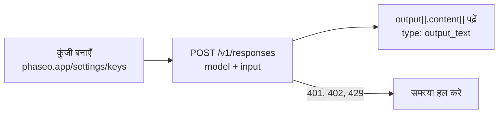

API कुंजी बनाएँ, `POST /v1/responses` पर एक अनुरोध भेजें, और जवाब `output_text` से पढ़ें।



<Prompt description="**कोडिंग एजेंट इस्तेमाल कर रहे हैं?** शुरू करने से पहले यह प्रॉम्प्ट पेस्ट करें।" icon="bot" actions={["copy", "cursor"]}>
{`You are integrating this project with Phaseo Gateway.

Before editing anything:
- Install the Phaseo skills: npx skills add https://phaseo.app/docs
- Read https://phaseo.app/docs/skill.md and the API reference for the endpoint you will use. If your tools support MCP, search the docs at https://phaseo.app/docs/mcp.
- Inspect the existing provider configuration and identify the smallest safe change.

Rules:
- Call https://api.phaseo.app/v1 with a server-side PHASEO_API_KEY. Never print or commit credentials.
- Keep the current provider and model behaviour unless I ask for a migration. Check model IDs with GET /v1/models instead of guessing them.
- Explain the files you would change and the verification commands first.
- Do not deploy, rotate keys, send external messages, or make unrelated edits without my approval.`}
</Prompt>

<Visibility for="agents">
एजेंटों के लिए क्विकस्टार्ट चेकलिस्ट:

- व्यक्ति से डैशबोर्ड में **सेटिंग्स -> API कुंजियाँ** के तहत कुंजी बनाने को कहें, या प्रबंधन कुंजी के साथ `POST /v1/keys` से बनाएँ; CLI साइन-इन कुंजियाँ नहीं बना सकता। कभी कुंजी जनरेट या अनुमान न करें। इसे सिर्फ़ सर्वर-साइड कोड से `Authorization: Bearer phaseo_v1_sk_<kid>_<secret>` के रूप में भेजें।
- पेड मॉडल के लिए एक बार `phaseo login --scopes billing:write` चलाएँ, फिर `phaseo credits add --amount <usd> --json` टॉप-अप शुरू करता है। सेव किए गए कार्ड के साथ, वर्कस्पेस का मालिक या एडमिन ईमेल से आए लिंक से इसकी पुष्टि करता है। सेव किया गया कार्ड न होने पर प्रतिक्रिया में `next_action: "open_checkout_url"` और एक चेकआउट लिंक होता है, जिसे मालिक या एडमिन भुगतान के लिए खोलता है; इसके बाद कार्ड आगे के टॉप-अप के लिए सेव हो जाता है। क्रेडिट या CLI से होने वाले दूसरे कामों के लिए उपयोगकर्ता को डैशबोर्ड पर न भेजें; देखें https://phaseo.app/docs/hi/v1/developers/manage-from-an-agent.md।
- पहला अनुरोध `POST https://api.phaseo.app/v1/responses` से करें, और `model` व `input` भेजें। उदाहरण `openai/gpt-6-astra` का उपयोग करते हैं, जो एक पेड मॉडल है और जिसके लिए क्रेडिट चाहिए। `phaseo/free` कोई उपलब्ध मुफ़्त मॉडल चुनता है और वॉलेट बैलेंस के बिना काम करता है।
- जवाब `output[].content[]` से पढ़ें, जहाँ `type` का मान `output_text` है।
- अनुरोध विफल हो, तो JSON `error` कोड के आधार पर आगे बढ़ें, जैसा https://phaseo.app/docs/hi/v1/api-reference/errors.md में बताया गया है।
</Visibility>

## 1. API कुंजी बनाएँ

[डैशबोर्ड](https://phaseo.app/settings/keys) में **सेटिंग्स -> API कुंजियाँ** के तहत कुंजी बनाएँ, फिर उसे एक्सपोर्ट करें:

```bash
export PHASEO_API_KEY="phaseo_v1_sk_..."
```

कुंजी सिर्फ़ एक बार दिखती है। हर अनुरोध इसे bearer टोकन के रूप में भेजता है:

```http
Authorization: Bearer phaseo_v1_sk_<kid>_<secret>
```

<Danger>
अपनी API कुंजी को पासवर्ड की तरह रखें। इसे सर्वर-साइड कोड में रखें, और कभी ब्राउज़र या मोबाइल ऐप में न भेजें।
</Danger>

<span id="add-credits-for-paid-models"></span>
### पेड मॉडल के लिए क्रेडिट जोड़ें

`phaseo/free` क्रेडिट के बिना काम करता है। `openai/gpt-6-astra` जैसे पेड मॉडल के लिए वॉलेट बैलेंस चाहिए:

```bash
phaseo login --scopes billing:write   # once; credit top-ups need this scope
phaseo credits add --amount 20
```

सेव किए गए कार्ड के साथ, वर्कस्पेस का मालिक या एडमिन ईमेल से आए लिंक से शुल्क की पुष्टि करता है। सेव किया गया कार्ड न होने पर कमांड एक चेकआउट लिंक लौटाता है, जिसे मालिक या एडमिन भुगतान के लिए खोलता है, और कार्ड आगे के टॉप-अप के लिए सेव हो जाता है।

## 2. टेक्स्ट अनुरोध भेजें

नए टेक्स्ट काम के लिए `POST /v1/responses` सुझाया गया एंडपॉइंट है। उदाहरण `openai/gpt-6-astra` का उपयोग करते हैं, जो एक पेड मॉडल है। क्रेडिट के बिना टेस्ट करने के लिए इसे `phaseo/free` से बदलें, जो कोई उपलब्ध मुफ़्त मॉडल चुनता है; देखें [मुफ़्त राउटर पर लॉन्च करें](./cookbook/free-router-first-deploy)।

cURL और `fetch` के लिए कुछ भी इंस्टॉल नहीं करना पड़ता। SDK के लिए पहले उसे इंस्टॉल करें:

<CodeGroup>
```bash npm
npm install @phaseo/sdk
```

```bash pnpm
pnpm add @phaseo/sdk
```

```bash pip
pip install phaseo
```
</CodeGroup>

रनटाइम ज़रूरतों और दूसरे SDK के लिए [TypeScript और Python इंस्टॉलेशन पेज](./sdk-reference/client/installation) देखें।

<CodeGroup>
```bash cURL
curl https://api.phaseo.app/v1/responses \
  -H "Authorization: Bearer $PHASEO_API_KEY" \
  -H "Content-Type: application/json" \
  -d '{
    "model": "openai/gpt-6-astra",
    "input": "Reply with: quickstart works"
  }'
```

```javascript JavaScript
const response = await fetch("https://api.phaseo.app/v1/responses", {
  method: "POST",
  headers: {
    Authorization: `Bearer ${process.env.PHASEO_API_KEY}`,
    "Content-Type": "application/json",
  },
  body: JSON.stringify({
    model: "openai/gpt-6-astra",
    input: "Reply with: quickstart works",
  }),
});

const data = await response.json();
const assistantText = data.output
  ?.find((item) => item.type === "message")
  ?.content?.find((part) => part.type === "output_text")
  ?.text;

console.log(assistantText);
```

```typescript TypeScript SDK
import Phaseo, { outputText } from "@phaseo/sdk";

const client = new Phaseo(); // reads PHASEO_API_KEY

const response = await client.generateResponse({
  model: "openai/gpt-6-astra",
  input: "Reply with: quickstart works",
});

console.log(outputText(response));
```

```python Python SDK
from phaseo import Phaseo

client = Phaseo()  # reads PHASEO_API_KEY

response = client.responses.create(
    {
        "model": "openai/gpt-6-astra",
        "input": "Reply with: quickstart works",
    }
)

print(response.output_text)
```

```go Go SDK
package main

import (
  "context"
  "fmt"

  phaseo "github.com/phaseoteam/Phaseo/packages/sdk/sdk-go/v3"
)

func main() {
  client := phaseo.MustNewFromEnv() // reads PHASEO_API_KEY

  response, err := client.GenerateResponse(context.Background(), phaseo.ResponsesRequest{
    Model: "openai/gpt-6-astra",
    Input: "Reply with: quickstart works",
  })
  if err != nil {
    panic(err)
  }

  fmt.Println(response)
}
```

```csharp C# SDK
using PhaseoSdk;
using System.Collections.Generic;

var client = new Phaseo(); // reads PHASEO_API_KEY

var response = await client.GenerateResponse(new Dictionary<string, object>
{
    ["model"] = "openai/gpt-6-astra",
    ["input"] = "Reply with: quickstart works",
});

Console.WriteLine(response);
```

```php PHP SDK
<?php
require 'vendor/autoload.php';

use Phaseo\Sdk\Phaseo;

$client = new Phaseo(getenv('PHASEO_API_KEY'));

$response = $client->generateResponse([
    'model' => 'openai/gpt-6-astra',
    'input' => 'Reply with: quickstart works',
]);

print_r($response);
```

```ruby Ruby SDK
require 'phaseo_sdk'

client = PhaseoSdk::Phaseo.new # reads PHASEO_API_KEY

response = client.generate_response(
  model: 'openai/gpt-6-astra',
  input: 'Reply with: quickstart works',
)

puts response
```

```java Java SDK
// Build from source: https://phaseo.app/docs/v1/sdk-reference/client/installation
import app.phaseo.sdk.Phaseo;
import java.util.Map;

public class Main {
    public static void main(String[] args) throws Exception {
        var client = new Phaseo(System.getenv("PHASEO_API_KEY"));
        var response = client.createResponse(Map.of(
            "model", "openai/gpt-6-astra",
            "input", "Reply with: quickstart works"
        ));
        for (var item : response.path("output")) {
            for (var part : item.path("content")) {
                if ("output_text".equals(part.path("type").asText())) {
                    System.out.println(part.path("text").asText());
                }
            }
        }
    }
}
```

```rust Rust SDK
use phaseo::Phaseo;
use serde_json::{json, Value};

fn main() -> Result<(), Box<dyn std::error::Error>> {
    let client = Phaseo::from_env()?;
    let response = client.responses(&json!({
        "model": "openai/gpt-6-astra",
        "input": "Reply with: quickstart works"
    }))?;

    let assistant_text = response.body
        .get("output")
        .and_then(Value::as_array)
        .into_iter()
        .flatten()
        .filter(|item| item.get("type").and_then(Value::as_str) == Some("message"))
        .flat_map(|item| {
            item.get("content")
                .and_then(Value::as_array)
                .into_iter()
                .flatten()
        })
        .find_map(|part| {
            (part.get("type").and_then(Value::as_str) == Some("output_text"))
                .then(|| part.get("text").and_then(Value::as_str))
                .flatten()
        })
        .unwrap_or("");

    println!("{assistant_text}");
    Ok(())
}
```

```typescript Vercel AI SDK
import { phaseo } from "@phaseo/ai-sdk-provider";
import { generateText } from "ai";

const result = await generateText({
  model: phaseo("openai/gpt-6-astra"),
  prompt: "Reply with: quickstart works",
});

console.log(result.text);
```
</CodeGroup>

## 3. जवाब पढ़ें

```json
{
  "id": "G-...",
  "nativeResponseId": "resp_...",
  "object": "response",
  "created_at": 1730000000,
  "status": "completed",
  "completed_at": 1730000001,
  "model": "openai/gpt-6-astra",
  "output": [
    {
      "type": "message",
      "id": "msg_...",
      "status": "completed",
      "role": "assistant",
      "content": [{ "type": "output_text", "text": "quickstart works", "annotations": [] }]
    }
  ],
  "usage": {
    "input_tokens": 9,
    "output_tokens": 3,
    "total_tokens": 12
  },
  "error": null,
  "incomplete_details": null
}
```

| फ़ील्ड | इसमें क्या है |
| --- | --- |
| `type: "output_text"` वाला `output[].content[]` | जवाब का टेक्स्ट। TypeScript का `outputText()` हेल्पर और Python का `response.output_text` इसे आपके लिए पढ़ते हैं; Vercel AI SDK इसे `result.text` के रूप में लौटाता है। |
| `id` | Phaseo अनुरोध ID। अनुरोध **सेटिंग्स -> उपयोग -> लॉग -> अनुरोध** के तहत दिखता है। |
| `nativeResponseId` | उसी प्रतिक्रिया के लिए प्रदाता की ID। |
| `usage` | अनुरोध के लिए बिल किए गए इनपुट, आउटपुट और कुल टोकन। |

### जवाब स्ट्रीम करें

जवाब बनते ही उसे प्रिंट करने के लिए स्ट्रीम करें। हर `response.output_text.delta` इवेंट के `text` में सिर्फ़ नया टेक्स्ट होता है, इसलिए यह लूप जवाब एक ही बार प्रिंट करता है। `response.output_text.done` जैसे समापन इवेंट वह टेक्स्ट दोहराते हैं जो पहले ही स्ट्रीम हो चुका है। पूरी इवेंट सूची के लिए [स्ट्रीमिंग](./guides/streaming) देखें।

<CodeGroup>
```typescript TypeScript SDK
import Phaseo from "@phaseo/sdk";

const client = new Phaseo(); // reads PHASEO_API_KEY

for await (const chunk of client.streamResponses({
  model: "openai/gpt-6-astra",
  input: "Reply with: quickstart works",
})) {
  if (chunk.type === "response.output_text.delta") process.stdout.write(chunk.text);
}
```

```python Python SDK
from phaseo import Phaseo

client = Phaseo()  # reads PHASEO_API_KEY

for chunk in client.stream_responses(
    {
        "model": "openai/gpt-6-astra",
        "input": "Reply with: quickstart works",
    }
):
    if chunk.get("type") == "response.output_text.delta":
        print(chunk["text"], end="", flush=True)
print()
```
</CodeGroup>

## 4. पहले अनुरोध की समस्या हल करें

| स्टेटस | क्या जाँचें |
| --- | --- |
| `401` | API कुंजी और `Authorization: Bearer` हेडर। |
| `400` | अनुरोध का बॉडी और मॉडल ID। मान्य ID की सूची `GET /v1/models` से लें। |
| `402` | आपका क्रेडिट बैलेंस। क्रेडिट जोड़ें या `phaseo/free` पर जाएँ। |
| `429` या `5xx` | एक्सपोनेंशियल बैकऑफ़ के साथ दोबारा कोशिश करें। |

[त्रुटि संदर्भ](./api-reference/errors) में हर त्रुटि कोड और उसके लिए क्या करना है, दिया गया है।

## टेक्स्ट के बजाय टाइप किए गए जवाब पाएँ

जब कोड को गद्य के बजाय कोई मान चाहिए, तो सवाल `POST /v1/decisions` (बीटा) पर भेजें। हर जवाब टाइप किए गए रूप में, संभावनाओं के साथ, सवालों के ही क्रम में लौटता है। सवालों के टाइप हैं `predicate` (हाँ/नहीं), `choice` (आपके विकल्पों में से एक) और `score` (आपके पैमाने पर एक स्तर)।

<CodeGroup>
```bash cURL
curl https://api.phaseo.app/v1/decisions \
  -H "Authorization: Bearer $PHASEO_API_KEY" \
  -H "Content-Type: application/json" \
  -d '{
    "model": "openai/gpt-6-luna",
    "input": "I was charged twice and need a refund. I cannot log in to pay my team.",
    "questions": [
      {
        "type": "choice",
        "name": "department",
        "instructions": "Which team should handle this request?",
        "choices": [
          { "value": "billing", "description": "Payments, invoices, refunds and duplicate charges" },
          { "value": "support", "description": "Product usage and troubleshooting" }
        ]
      },
      {
        "type": "predicate",
        "name": "is_urgent",
        "instructions": "Is the customer blocked from using the product?"
      }
    ]
  }'
```

```typescript TypeScript SDK
import Phaseo from "@phaseo/sdk";

const client = new Phaseo(); // reads PHASEO_API_KEY

const decision = await client.decisions.create({
  model: "openai/gpt-6-luna",
  input: "I was charged twice and need a refund. I cannot log in to pay my team.",
  questions: [
    {
      type: "choice",
      name: "department",
      instructions: "Which team should handle this request?",
      choices: [
        { value: "billing", description: "Payments, invoices, refunds and duplicate charges" },
        { value: "support", description: "Product usage and troubleshooting" },
      ],
    },
    {
      type: "predicate",
      name: "is_urgent",
      instructions: "Is the customer blocked from using the product?",
    },
  ],
});

console.log(decision.answers);
```

```python Python SDK
from phaseo import Phaseo

client = Phaseo()  # reads PHASEO_API_KEY

decision = client.decisions.create(
    {
        "model": "openai/gpt-6-luna",
        "input": "I was charged twice and need a refund. I cannot log in to pay my team.",
        "questions": [
            {
                "type": "choice",
                "name": "department",
                "instructions": "Which team should handle this request?",
                "choices": [
                    {"value": "billing", "description": "Payments, invoices, refunds and duplicate charges"},
                    {"value": "support", "description": "Product usage and troubleshooting"},
                ],
            },
            {
                "type": "predicate",
                "name": "is_urgent",
                "instructions": "Is the customer blocked from using the product?",
            },
        ],
    }
)

print(decision["answers"])
```
</CodeGroup>

प्रतिक्रिया (मान उदाहरण के लिए हैं):

```json
{
  "model": "openai/gpt-6-luna",
  "answers": [
    {
      "type": "choice",
      "name": "department",
      "choice": "billing",
      "confidence": 0.89,
      "probabilities": [
        { "value": "billing", "probability": 0.91 },
        { "value": "support", "probability": 0.09 }
      ]
    },
    { "type": "predicate", "name": "is_urgent", "probability": 0.84 }
  ],
  "usage": { "input_tokens": 42, "output_tokens": 18, "total_tokens": 60 }
}
```

`answers[0].choice` या `answers[1].probability` पढ़ें, और अपनी सीमा तय करने के लिए `confidence` या `probabilities` का उपयोग करें। [Decisions संदर्भ](./api-reference/endpoint/decisions) में हर decision मॉडल, उसकी सीमाएँ और कीमतें, इमेज इनपुट, और नामित सवाल मैप (`noul`, `criteria`) वाला पुराना `state` फ़ॉर्मैट दिया गया है, जो अब भी काम करता है और कुछ मॉडल के लिए ज़रूरी है।

## वीडियो बनाएँ

वीडियो जनरेशन असिंक्रोनस है: एक जॉब बनाएँ, उसे पोल करें, फिर फ़ाइल डाउनलोड करें।

```bash
# 1. जॉब बनाएँ
curl https://api.phaseo.app/v1/videos \
  -H "Authorization: Bearer $PHASEO_API_KEY" \
  -H "Content-Type: application/json" \
  -d '{
    "model": "google/veo-3.1-fast",
    "prompt": "A cinematic sunrise over a mountain lake"
  }'

# 2. स्टेटस completed होने तक पोल करें
curl https://api.phaseo.app/v1/videos/VIDEO_ID \
  -H "Authorization: Bearer $PHASEO_API_KEY"

# 3. वीडियो डाउनलोड करें
curl https://api.phaseo.app/v1/videos/VIDEO_ID/content \
  -H "Authorization: Bearer $PHASEO_API_KEY" \
  -o video.mp4
```

पोलिंग के बजाय वेबहुक पाने के लिए [असिंक्रोनस जॉब और वेबहुक](./guides/async-video-and-batch) देखें।

## आगे बनाते रहें

<Columns cols={2}>
	<Card title="Gateway के साथ इंटीग्रेशन" icon="plug" href="./developers/integrating-with-the-gateway">
		एंडपॉइंट चुनें और प्रोडक्शन इंटीग्रेशन सेट करें।
	</Card>
	<Card title="API संदर्भ" icon="book" href="./api-reference/introduction">
		हर एंडपॉइंट के हर अनुरोध और प्रतिक्रिया फ़ील्ड।
	</Card>
	<Card title="उदाहरण" icon="code" href="./guides/examples">
		आम वर्कफ़्लो के लिए शुरुआती ऐप्लिकेशन।
	</Card>
	<Card title="सहायता" icon="message-circle" href="https://phaseo.app/help">
		डिबगिंग, रूटिंग और मॉडल के व्यवहार में मदद पाएँ।
	</Card>
</Columns>
