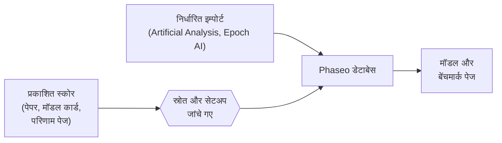

Phaseo दूसरों द्वारा मापे गए बेंचमार्क स्कोर प्रकाशित करता है, हर एक के साथ उसके स्रोत का लिंक। यह खुद बेंचमार्क नहीं चलाता और न ही उन्हें एक स्कोर में मिलाता है।

## स्कोर कहां से आते हैं

| स्रोत | कैसे आता है |
| --- | --- |
| मॉडल डेवलपर के पेपर, मॉडल कार्ड और घोषणाएं | मेंटेनर जोड़ते हैं, **स्व-रिपोर्टेड** के रूप में चिह्नित |
| बेंचमार्क आयोजकों के परिणाम पेज | मेंटेनर जोड़ते हैं |
| Artificial Analysis और Epoch AI इंडेक्स | निर्धारित इम्पोर्ट, हर घंटे जांचे जाते हैं |
| समुदाय की रिपोर्ट | GitHub issue, मेंटेनर के प्रमाण जांचने के बाद प्रकाशित |

हर स्कोर को प्रकाशित होने से पहले एक सार्वजनिक स्रोत या दोहराया जा सकने वाला मूल्यांकन लॉग चाहिए।

## सामान्यीकरण का मतलब

Phaseo हर बेंचमार्क को उसके अपने पैमाने पर रखता है। यह स्कोर को नहीं, स्कोर के आसपास के रिकॉर्ड को सामान्यीकृत करता है:

1. हर परिणाम को एक बेंचमार्क ID से मैप किया जाता है, ताकि अलग-अलग नामों वाला एक ही बेंचमार्क एक साथ समूहित हो।
2. जब सेटअप अलग हो, जैसे few-shot संख्या, हार्नेस या रीज़निंग effort, तो उसे डिफ़ॉल्ट में मिलाने के बजाय एक वेरिएंट के रूप में रखा जाता है।
3. हर बेंचमार्क की एक क्रम दिशा होती है। जिन बेंचमार्क में कम बेहतर है, जैसे त्रुटि दर, उनमें सबसे कम स्कोर पहले आता है।
4. स्रोत लिंक और स्व-रिपोर्टेड फ़्लैग स्कोर के साथ रहते हैं।

स्व-रिपोर्टेड फ़्लैग एक खुलासा है, अस्वीकृति नहीं। पर्याप्त कॉन्टेक्स्ट के बिना कोई स्कोर स्रोत नोट्स के साथ संग्रहीत हो सकता है; उसे पूरी तरह सत्यापित लीडरबोर्ड पंक्ति के बराबर न मानें।

## किसी विसंगति की रिपोर्ट करें

1. [बेंचमार्क स्कोर सबमिट करें](./submitting-scores.mdx) में बताए गए प्रमाण के साथ एक issue खोलें।
2. issue में समीक्षा के सवालों के जवाब दें। मेंटेनर सत्यापित सुधार डेटाबेस एडिटर के ज़रिए प्रकाशित करते हैं।
3. बड़े रिसर्च सबमिशन के लिए [Discord](https://discord.gg/aQyywCvgZ5) में समन्वय करें।

सार्वजनिक [बेंचमार्क सामान्यीकरण](https://phaseo.app/how-phaseo-normalises-ai-benchmarks) पेज कैटलॉग पढ़ने वालों के लिए यही नियम बताता है।
