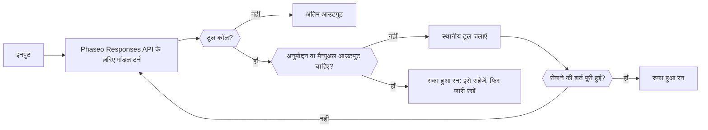

जब एक अनुरोध काफ़ी न हो, तब Phaseo Agent SDK का उपयोग करें: SDK आपके प्रोसेस में एक सीमित लूप चलाता है, जो हर टर्न को Responses API पर भेजता है, मॉडल जिन टूल को कॉल करता है उन्हें चलाता है, और जब किसी टूल को अनुमोदन चाहिए तो किसी व्यक्ति के लिए रुक जाता है। रन स्टेट आपके पास रहती है; Phaseo एजेंट के लिए कुछ भी होस्ट नहीं करता।

## अपना पैकेज चुनें

| भाषा | पैकेज | संस्करण | यह कौन-सा कोर क्लाइंट इंस्टॉल करता है |
| --- | --- | --- | --- |
| TypeScript | [`@phaseo/agent-sdk`](https://www.npmjs.com/package/@phaseo/agent-sdk) | 0.3.0 | `@phaseo/sdk` |
| Python | [`phaseo-agent-sdk`](https://pypi.org/project/phaseo-agent-sdk/) (मॉड्यूल `phaseo_agent`) | 0.3.0 | `phaseo` 3.x |
| Go | [`github.com/phaseoteam/Phaseo/packages/sdk/agent-sdk-go`](https://pkg.go.dev/github.com/phaseoteam/Phaseo/packages/sdk/agent-sdk-go) | v0.3.0 | `sdk-go/v3` |
| C# | [`Phaseo.AgentSdk`](https://www.nuget.org/packages/Phaseo.AgentSdk) | 0.3.0 | `Phaseo.Sdk` |
| PHP | [`phaseo/agent-sdk`](https://packagist.org/packages/phaseo/agent-sdk) | v0.3.0 | `phaseo/sdk` `^3.0.0` |
| Ruby | [`phaseo_agent_sdk`](https://rubygems.org/gems/phaseo_agent_sdk) | 0.3.0 | `phaseo_sdk` `>= 3.0.0, < 4.0.0` |
| Java | `app.phaseo:phaseo-agent-sdk` (Maven Central) | 0.3.0 | `app.phaseo:phaseo-sdk` 3.0.0 |
| Rust | [`phaseo-agent`](https://crates.io/crates/phaseo-agent) | 0.2.0 | `phaseo` 0.2 |

TypeScript संदर्भ डिज़ाइन है। C++ के लिए कोई Agent SDK नहीं है। [इंस्टॉलेशन](./installation) में इंस्टॉल कमांड और रनटाइम आवश्यकताएँ हैं, और [उपयोग](./usage) में पहला एजेंट बनाया जाता है।

<Prompt description="किसी कोडिंग एजेंट से अपनी भाषा में Phaseo Agent SDK के साथ पहला एजेंट बनवाएँ।" icon="bot" actions={["copy", "cursor"]}>
{`Build a small agent in this project with the Phaseo Agent SDK.

1. Install the Phaseo skills: npx skills add https://phaseo.app/docs
   For TypeScript, follow the phaseo-agent-sdk-typescript skill.
2. Read the Agent SDK pages at https://phaseo.app/docs/v1/sdk-reference/agent/overview, pick this project's language tab, and use only the APIs it documents.
3. Define one agent with at most two local tools that fit [AGENT TASK]. Keep the loop bounded with a step limit, and require approval for any tool that changes data.
4. Use a server-side PHASEO_API_KEY and check the model ID with GET /v1/models before using it.
5. Stream the agent's steps to the console so a run can be inspected.
6. Run the agent once, then report what you verified and what you could not verify.`}
</Prompt>

## तुलना करें कि हर रनटाइम क्या समर्थन करता है

हर SDK स्थानीय टूल चलाता है, अनुमोदन या मैन्युअल आउटपुट के लिए सटीक टूल-कॉल ID पर रुकता है, और serializable रन स्टेट लौटाता है जिसे आपका ऐप्लिकेशन सहेजता है। बाकी चीज़ें भाषा के अनुसार अलग हैं:

| क्षमता | TypeScript | Python | Go | C# | PHP | Ruby | Java | Rust |
| --- | --- | --- | --- | --- | --- | --- | --- | --- |
| डिफ़ॉल्ट स्टेप सीमा | 12 | 12 | 8 | 12 | 12 | 12 | 12 | 8 |
| स्टेप सीमा पूरी होने पर | `Max steps exceeded` फेंकता है | `RuntimeError` raise करता है | त्रुटि लौटाता है | `InvalidOperationException` फेंकता है | फेंकता है | raise करता है | फेंकता है | `stopped` रन लौटाता है (`max_steps:N`) |
| मॉडल स्ट्रीमिंग | Async iterable | Iterator (बैकग्राउंड थ्रेड) | Channel | Async enumerable | Iterable; सिर्फ़ तब चलता है जब आप iterate करते हैं (Fiber) | Enumerator (वर्कर थ्रेड) | रन के बाद सूचियाँ; लाइव `onEvent` के ज़रिए | अभी नहीं |
| टूल प्रगति इवेंट | Async generator | `emit_progress` या generator | `EmitProgress` | `EmitProgress` | `emitProgress` | `emit_progress` | `emitProgress` | अभी नहीं |
| समवर्ती टूल | हाँ | हाँ (थ्रेड) | हाँ | हाँ | नहीं | हाँ (थ्रेड) | हाँ (थ्रेड पूल) | नहीं |
| टूल timeout | `context.signal` को abort करता है | रन विफल करता है; थ्रेड चलता रहता है | कॉल विफल करता है; goroutine चलता रहता है | `CancellationToken` रद्द करता है | टूल के लौटने के बाद जाँचा जाता है | कॉल को बाधित करता है | थ्रेड को बाधित करता है | कोई नहीं |
| रनटाइम schema validation | हाँ | हाँ | हाँ | हाँ | हाँ | हाँ | हाँ | नहीं; JSON Schema सिर्फ़ मॉडल को भेजा जाता है |
| डिफ़ॉल्ट रूप से टूल त्रुटि | रन विफल करती है | रन विफल करती है | रन विफल करती है | रन विफल करती है | रन विफल करती है | रन विफल करती है | रन विफल करती है | मॉडल को लौटाई जाती है |
| कॉल ID से अनुमोदन और अस्वीकृति | हाँ | हाँ | हाँ | हाँ | हाँ | हाँ | हाँ | सिर्फ़ अनुमोदन |
| इंटरैक्टिव (human-in-the-loop) टूल | हाँ | हाँ | हाँ | हाँ | हाँ | हाँ | हाँ | सिर्फ़ एजेंट-स्तर का `human_review` |
| रोकने की शर्तें | जोड़ी जा सकती हैं | जोड़ी जा सकती हैं; सिर्फ़ बिना टूल कॉल वाले स्टेप पर जाँची जाती हैं | जोड़ी जा सकती हैं | जोड़ी जा सकती हैं | जोड़ी जा सकती हैं | जोड़ी जा सकती हैं | जोड़ी जा सकती हैं | स्टेप सीमा |
| गतिशील टर्न | हाँ | मॉडल, निर्देश और sampling; टूल `next_turn_params` के ज़रिए | हाँ | हाँ | हाँ | हाँ | हाँ | प्रति-रन मॉडल, स्टेप सीमा और संदर्भ |
| टाइप किए गए टाइमलाइन आइटम | `AgentItem` union | Dicts | `Details` map | `Details` dictionary | Arrays | Hashes | `details()` map | नहीं; `messages` और `steps` पढ़ें |
| उपयोग और लागत | हाँ | हाँ | हाँ | हाँ | हाँ | हाँ | हाँ | टोकन, और लागत तब जब प्रतिक्रिया में `meta.cost` या `cost` हो |
| रद्द करना | `cancel()` | `cancel()` | Context | `CancellationToken` | `cancel()` | `cancel` | `cancel()` | अभी नहीं |
| Devtools कैप्चर | हाँ | हाँ | हाँ | हाँ | हाँ | हाँ | हाँ | अभी नहीं |

Rust (`phaseo-agent` 0.2) synchronous है: इसमें स्ट्रीमिंग, async execution, समवर्ती टूल, रनटाइम schema validation या Devtools कैप्चर नहीं है। जब किसी रन को अनुरोध handler को ब्लॉक नहीं करना चाहिए, तो इसे वर्कर थ्रेड पर चलाएँ। PHP टूल एक-एक करके चलाता है, और इसकी स्ट्रीम सिर्फ़ तब आगे बढ़ती है जब आपका कोड iterate करता है।

## Agent SDK, क्लाइंट या raw API में से चुनें

| उपयोग | चुनें | इसके ज़िम्मे क्या है |
| --- | --- | --- |
| एक API अनुरोध या पूरे endpoint की कवरेज | [क्लाइंट SDK](../client/overview) | जनरेट किए गए API टाइप और ट्रांसपोर्ट |
| टूल का उपयोग करने वाला, कई स्टेप वाला ऐप्लिकेशन लॉजिक | Agent SDK | स्थानीय लूप, टूल, चेकपॉइंट, समीक्षा, इवेंट और Devtools |
| कस्टम ट्रांसपोर्ट या कोई असमर्थित भाषा | Raw API | HTTP अनुरोध और प्रतिक्रिया को संभालना |

हर Agent SDK का gateway क्लाइंट मॉडल टर्न उस भाषा के क्लाइंट SDK के ज़रिए भेजता है। ज़्यादातर अतिरिक्त Responses API फ़ील्ड के लिए `requestOptions` map (या उस भाषा का समकक्ष) स्वीकार करते हैं; एजेंट फिर भी `model`, `input`, `instructions` और अपने function टूल ख़ुद सेट करता है। Rust 0.2 adapter सिर्फ़ normalized एजेंट फ़ील्ड भेजता है और इसमें अतिरिक्त विकल्पों के लिए कोई hook नहीं है।

## किसी रेसिपी से शुरू करें

| रेसिपी | भाषा |
| --- | --- |
| [टिकाऊ एजेंट लूप बनाएँ](../../cookbook/agent-sdk-durable-loop) | TypeScript |
| [संरचित आउटपुट और वेब सर्च के साथ रिसर्च करें](../../cookbook/agent-sdk-research-brief) | TypeScript |
| [प्रीसेट और गार्डरेल-अवेयर विफलताओं के साथ सपोर्ट ट्राइएज](../../cookbook/agent-sdk-support-triage) | TypeScript |
| [रनटाइम टूल के साथ कोडिंग-समीक्षा एजेंट चलाएँ](../../cookbook/agent-sdk-coding-review) | TypeScript |
| [स्थानीय एजेंट टूल को समवर्ती रूप से चलाएँ](../../cookbook/agent-sdk-parallel-tools) | TypeScript |
| [संरचित JSON निकालें](../../cookbook/agent-sdk-python-structured-extraction) | Python |
| [ऑप्स रनबुक एजेंट बनाएँ](../../cookbook/agent-sdk-go-ops-runbook) | Go |
| [टिकट ट्राइएज करें](../../cookbook/agent-sdk-csharp-ticket-triage) | C# |
| [CMS सामग्री की समीक्षा करें](../../cookbook/agent-sdk-php-content-review) | PHP |
| [आंतरिक नोट्स का सारांश बनाएँ](../../cookbook/agent-sdk-ruby-rag-notes) | Ruby |

TypeScript रेसिपी इन पेजों पर दिए गए APIs के साथ किसी भी भाषा में पोर्ट की जा सकती हैं।
