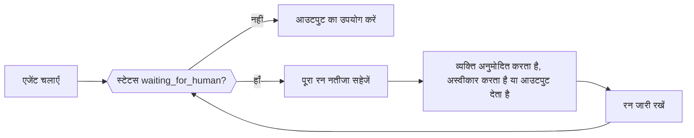

जब किसी एजेंट को किसी व्यक्ति, किसी बाहरी जॉब, या आपके ऐप्लिकेशन द्वारा चलाए जाने वाले किसी टूल की ज़रूरत होती है, तो रन सामान्य रूप से (त्रुटि के रूप में नहीं) `waiting_for_human` स्टेटस और जारी रखने के लिए ज़रूरी हर चीज़ के साथ लौटता है। पूरा नतीजा सहेजें, अपने ऐप्लिकेशन में फ़ैसला इकट्ठा करें, फिर सहेजा हुआ नतीजा और फ़ैसला एजेंट के continue method को दें।



<Note>
Phaseo Agent SDK रन संग्रहीत नहीं करता। जब फिर से शुरू की जा सकने वाली स्टेट को किसी अनुरोध या प्रोसेस के restart के बाद भी बचे रहना हो, तो उसे अपने ऐप्लिकेशन में सहेजें।
</Note>

| भाषा | जारी रखें | स्ट्रीमिंग के साथ जारी रखें | नोट्स |
| --- | --- | --- | --- |
| TypeScript | `agent.continueRun()` | `agent.continueStream()` | |
| Python | `agent.continue_run()` | `agent.continue_stream()` | |
| Go | `agent.Continue(ctx, ContinueOptions)` | `agent.ContinueStream` | |
| C# | `agent.ContinueRun(ContinueOptions)` | `agent.ContinueStream` | |
| PHP | `$agent->continueRun()` | `$agent->continueStream()` | `continueRunById()` पहले रन को state accessor से लोड करता है |
| Ruby | `agent.continue_run` | `agent.continue_stream` | |
| Java | `agent.continueRun(ContinueOptions)` | `agent.continueStream` | `ContinueOptions` एक positional record है |
| Rust | `agent.continue_run(&mut client, options)` | कोई नहीं | `continue_with_events` एक इवेंट callback जोड़ता है; रन synchronous होते हैं |

## टूल कॉल को अनुमोदित या अस्वीकार करें

अनुमोदन से नियंत्रित, मैन्युअल और human-in-the-loop टूल चलने से पहले रन को रोक देते हैं। हर लंबित कॉल में मॉडल की `call` (उसके `id` के साथ) और एक `kind` होता है: `approval`, `manual` या `hitl`। हर कॉल का जवाब उसके सटीक कॉल ID से दें, टूल के नाम से नहीं, ताकि एक ही टूल की दो कॉल अलग-अलग रहें।

अनुमोदित कॉल अपना टूल चलाती है। अस्वीकृत कॉल मॉडल को टूल नतीजे के रूप में `{"error": "<reason>"}` भेजती है, जिसका डिफ़ॉल्ट कारण `Tool call rejected` है।

<CodeGroup>

```typescript TypeScript
const resumed = await agent.continueRun({
  run: paused,
  client,
  approvals: [{ toolCallId: "call_deploy_42" }],
  rejections: [
    { toolCallId: "call_delete_17", reason: "Not authorized" },
  ],
});
```

```python Python
from phaseo_agent import AgentToolDecision

pending = paused.run.pause.pending_tool_calls

continued = agent.continue_run(
    run=paused,
    client=client,
    approvals=[AgentToolDecision(pending[0].call.id)],
    rejections=[AgentToolDecision(pending[1].call.id, "Not authorized")],
)
```

```go Go
var approvals, rejections []phaseoagent.ToolDecision
for _, pending := range result.Run.Pause.PendingToolCalls {
  if pending.Kind != "approval" {
    continue
  }
  if userApproved(pending.Call) {
    approvals = append(approvals, phaseoagent.ToolDecision{ToolCallID: pending.Call.ID})
  } else {
    rejections = append(rejections, phaseoagent.ToolDecision{ToolCallID: pending.Call.ID, Reason: "Not now"})
  }
}

result, err = agent.Continue(ctx, phaseoagent.ContinueOptions{
  Run: result, Client: client, Approvals: approvals, Rejections: rejections,
})
```

```csharp C#
var pending = result.Run.Pause!.PendingToolCalls!.Where(item => item.Kind == "approval");

result = await agent.ContinueRun(new ContinueOptions
{
    Run = result,
    Client = client,
    Approvals = pending.Where(item => UserApproved(item.Call)).Select(item => new ToolDecision(item.Call.Id)).ToList(),
    Rejections = pending.Where(item => !UserApproved(item.Call)).Select(item => new ToolDecision(item.Call.Id, "Not now")).ToList(),
});
```

```php PHP
use Phaseo\AgentSdk\ToolDecision;

$approvals = $rejections = [];
foreach ($result->run->pause->pendingToolCalls as $pending) {
    if ($pending->kind !== "approval") continue;
    if (userApproved($pending->call)) {
        $approvals[] = new ToolDecision($pending->call->id);
    } else {
        $rejections[] = new ToolDecision($pending->call->id, "Not now");
    }
}

$result = $agent->continueRun(run: $result, client: $client, approvals: $approvals, rejections: $rejections);
```

```ruby Ruby
pending = result.run.pause.pending_tool_calls.select { |item| item.kind == "approval" }
approved, declined = pending.partition { |item| user_approved?(item.call) }

result = agent.continue_run(
  run: result,
  client: client,
  approvals: approved.map { |item| PhaseoAgentSdk::ToolDecision.new(tool_call_id: item.call.id) },
  rejections: declined.map { |item| PhaseoAgentSdk::ToolDecision.new(tool_call_id: item.call.id, reason: "Not now") }
)
```

```java Java
var pending = result.run().pause().pendingToolCalls();
var approvals = pending.stream().filter(item -> item.kind().equals("approval") && userApproved(item.call()))
    .map(item -> new AgentSdk.ToolDecision(item.call().id())).toList();
var rejections = pending.stream().filter(item -> item.kind().equals("approval") && !userApproved(item.call()))
    .map(item -> new AgentSdk.ToolDecision(item.call().id(), "Not now")).toList();

result = agent.continueRun(new AgentSdk.ContinueOptions(
    result, client, null, null, null, null, null, null, null, null, null,
    approvals, rejections, List.of()));
```

```rust Rust
use phaseo_agent::{ContinueOptions, ToolDecision};

let approvals = paused.run.pause.as_ref().unwrap()
    .pending_tool_calls
    .iter()
    .map(|pending| ToolDecision {
        tool_call_id: pending.call.id.clone(),
        reason: Some("Approved by the release operator".to_string()),
    })
    .collect();

let mut options = ContinueOptions::new(paused);
options.approvals = approvals;

let completed = agent.continue_run(&mut client, options)?;
```

</CodeGroup>

लंबित कॉल कहाँ होती हैं, और कोई फ़ैसला न होने पर क्या होता है:

| भाषा | लंबित कॉल | फ़ैसला न होने पर |
| --- | --- | --- |
| TypeScript | `run.pause.pendingToolCalls` | `Missing approval decision for tool call <id>` फेंकता है |
| Python | `run.pause.pending_tool_calls` | `ValueError` raise करता है |
| Go | `Run.Pause.PendingToolCalls` | `missing approval decision for tool call <id>` लौटाता है |
| C# | `Run.Pause.PendingToolCalls` | `Missing approval decision for tool call <id>` फेंकता है |
| PHP | `$result->run->pause->pendingToolCalls` | `Missing approval decision for tool call <id>` फेंकता है |
| Ruby | `result.run.pause.pending_tool_calls` | `Missing approval decision for tool call <id>` raise करता है |
| Java | `run().pause().pendingToolCalls()` | `Missing approval decision for tool call <id>` फेंकता है |
| Rust | `run.pause.pending_tool_calls` (एक `Option`) | एक `AgentError` लौटाता है |

Pause का भी अपना `kind` होता है। Go और C# हर टूल pause के लिए इसे `tool_approval` सेट करते हैं। PHP, Ruby और Java तब `tool_approval` सेट करते हैं जब किसी लंबित कॉल को अनुमोदन चाहिए, वरना पहली कॉल का kind। Rust अनुमोदन कॉल के लिए `tool_approval`, तब `external_output` जब हर लंबित कॉल को बाहरी नतीजा चाहिए, और दोनों के मिश्रण के लिए `tool_input` का उपयोग करता है।

<Warning>
Rust `0.2` में कोई rejection टाइप और कोई `rejections` फ़ील्ड नहीं है। अनुमोदित न की गई कॉल को रुका रहने दें, या जारी रखने से पहले अपने ऐप्लिकेशन की अस्वीकृति नीति लागू करें।
</Warning>

हर टूल के बजाय हर टूल कॉल के लिए अनुमोदन ज़रूरी करने के लिए, एजेंट definition पर `requireApproval` सेट करें (Python और Ruby में `require_approval`, Go और C# में `RequireApproval`)। TypeScript में यह एक function `requireApproval(call, context)` है। Rust सिर्फ़ प्रति-टूल अनुमोदन का समर्थन करता है, `Tool::require_approval()` के साथ। [टूल](./tools) दिखाता है कि हर तरह का टूल कैसे परिभाषित किया जाता है।

## मैन्युअल और human-in-the-loop टूल के लिए नतीजे दें

`manual` और `hitl` कॉल के लिए, आपके ऐप्लिकेशन ने जो नतीजा बनाया उसे कॉल ID के साथ दें। Rust में, ये `Tool::external(...)` से बनाए गए टूल हैं।

<CodeGroup>

```typescript TypeScript
await agent.continueRun({
  run: paused,
  client,
  toolOutputs: [{ toolCallId: callId, output: { status: "shipped" } }],
});
```

```python Python
from phaseo_agent import AgentToolOutput

agent.continue_run(
    run=paused,
    client=client,
    tool_outputs=[AgentToolOutput(call_id, {"status": "shipped"})],
)
```

```go Go
ToolOutputs: []phaseoagent.ToolOutput{{ToolCallID: callID, Output: map[string]any{"status": "shipped"}}},
```

```csharp C#
ToolOutputs = new[] { new ToolOutput(callId, new { status = "shipped" }) },
```

```php PHP
use Phaseo\AgentSdk\ToolOutput;

toolOutputs: [new ToolOutput($callId, ["status" => "shipped"])],
```

```ruby Ruby
tool_outputs: [PhaseoAgentSdk::ToolOutput.new(tool_call_id: call_id, output: { status: "shipped" })]
```

```java Java
// ContinueOptions का toolOutputs argument
List.of(new AgentSdk.ToolOutput(callId, Map.of("status", "shipped")))
```

```rust Rust
use phaseo_agent::{ContinueOptions, ToolOutput};
use serde_json::json;

let mut options = ContinueOptions::new(paused);
options.tool_outputs = vec![ToolOutput {
    tool_call_id: call_id,
    output: json!({ "status": "shipped" }),
}];

let completed = agent.continue_run(&mut client, options)?;
```

</CodeGroup>

कोई आउटपुट न होने पर continuation `Missing output for tool call <id>` के साथ विफल होता है (Go में lowercase `missing`, Python में `ValueError`, Rust में `AgentError`)। मानवीय इनपुट मैसेज टूल आउटपुट की जगह नहीं ले सकता।

## मानवीय समीक्षा के लिए रोकें

रन आगे बढ़ने से पहले हर मॉडल प्रतिक्रिया जाँचने के लिए एजेंट definition पर एक मानवीय समीक्षा callback सेट करें। रोकने के लिए `reason` (और वैकल्पिक रूप से `payload`) के साथ एक समीक्षा अनुरोध लौटाएँ, या आगे बढ़ने के लिए कुछ न लौटाएँ। Pause का `kind` `human_review` होता है। Callback को रन ID, स्टेप इंडेक्स, मैसेज, मॉडल प्रतिक्रिया और पार्स किया गया आउटपुट मिलता है (Rust: रन और एजेंट ID, स्टेप इंडेक्स, मैसेज, प्रतिक्रिया और ऐप्लिकेशन संदर्भ)।

<CodeGroup>

```typescript TypeScript
const agent = createAgent({
  id: "support-agent",
  humanReview: ({ response }) =>
    response.message.content.includes("needs approval")
      ? {
          reason: "approval_required",
          payload: { draft: response.message.content },
        }
      : null,
});
```

```python Python
from phaseo_agent import AgentHumanReviewRequest

def review(context):
    if "needs approval" in context.response.message.content:
        return AgentHumanReviewRequest("approval_required", {"draft": context.response.message.content})
    return None

agent = create_agent({"id": "support-agent", "human_review": review})
```

```go Go
HumanReview: func(review phaseoagent.HumanReviewContext) *phaseoagent.HumanReviewRequest {
  if strings.Contains(review.Response.Message.Content, "refund") {
    return &phaseoagent.HumanReviewRequest{Reason: "Refunds need sign-off"}
  }
  return nil
},
```

```csharp C#
HumanReview = review => Task.FromResult<HumanReviewRequest?>(
    review.Response.Message.Content.Contains("refund")
        ? new HumanReviewRequest("Refunds need sign-off")
        : null),
```

```php PHP
use Phaseo\AgentSdk\HumanReviewRequest;

humanReview: fn ($review) => str_contains($review->response->message->content, "refund")
    ? new HumanReviewRequest("Refunds need sign-off")
    : null,
```

```ruby Ruby
human_review: ->(review) {
  if review.response.message.content.include?("refund")
    PhaseoAgentSdk::HumanReviewRequest.new(reason: "Refunds need sign-off")
  end
}
```

```java Java
AgentSdk.HumanReview review = context ->
    context.response().message().content().contains("refund")
        ? new AgentSdk.HumanReviewRequest("Refunds need sign-off", null)
        : null;
```

```rust Rust
use phaseo_agent::{AgentDefinition, HumanReviewRequest};
use serde_json::json;

let definition = AgentDefinition::new("review-agent", "openai/gpt-6-astra")
    .human_review(|context| {
        if context.response.message.content.contains("needs approval") {
            Some(HumanReviewRequest {
                reason: "Review the proposed action".to_string(),
                payload: json!({ "draft": context.response.message.content }),
            })
        } else {
            None
        }
    });
```

</CodeGroup>

मानवीय इनपुट के साथ जारी रखें, जो बातचीत में उपयोगकर्ता मैसेज के रूप में जोड़ा जाता है:

<CodeGroup>

```typescript TypeScript
const continued = await agent.continueRun({
  run: pausedResult,
  client,
  humanInput: "Approved. Continue and return the final answer.",
});
```

```python Python
continued = agent.continue_run(
    run=paused,
    client=client,
    human_input="Approved. Continue and return the final answer.",
)
```

```go Go
result, err = agent.Continue(ctx, phaseoagent.ContinueOptions{
  Run:        result,
  Client:     client,
  HumanInput: "Approved. Refund up to $50.",
})
```

```csharp C#
result = await agent.ContinueRun(new ContinueOptions
{
    Run = result,
    Client = client,
    HumanInput = "Approved. Refund up to $50.",
});
```

```php PHP
$result = $agent->continueRun(
    run: $result,
    client: $client,
    humanInput: "Approved. Refund up to $50."
);
```

```ruby Ruby
result = agent.continue_run(
  run: result,
  client: client,
  human_input: "Approved. Refund up to $50."
)
```

```java Java
result = agent.continueRun(new AgentSdk.ContinueOptions(
    result, client, null, null, null, null,
    "Approved. Refund up to $50.",          // humanInput
    null, null, null, null));
```

```rust Rust
use phaseo_agent::ContinueOptions;

let mut options = ContinueOptions::new(paused);
options.human_input = Some("Approved. Continue and return the final result.".to_string());

let completed = agent.continue_run(&mut client, options)?;
```

</CodeGroup>

समीक्षा के लिए रुके रन को मानवीय इनपुट के बिना जारी रखने पर `Run <id> is waiting for human input` के साथ विफलता होती है (Go: `run <id> is waiting for human input`; Java: `Run is waiting for human input`)। Rust में ख़ाली न होने वाला `human_input` ज़रूरी है। TypeScript संरचित `humanMessages` भी स्वीकार करता है।

## अनुरोधों के बीच रन स्टेट सहेजें

रन नतीजा सादा डेटा है: इसे अपने डेटाबेस, object store या जॉब रिकॉर्ड में संग्रहीत करें, और ऐप्लिकेशन `context` को serializable रखें। किसी रन को सिर्फ़ उसी ID वाला एजेंट जारी रख सकता है। [टिकाऊ एजेंट लूप कुकबुक](../../cookbook/agent-sdk-durable-loop) सहेजने और फिर से शुरू करने का पूरा फ़्लो दिखाती है।

SDK से रन सहेजवाने और लोड करवाने के लिए, `load(runId)` और `save(result)` वाला एक state accessor दें। तब SDK हर रन और continuation के बाद सहेजता है, और आप रिकॉर्ड को हर लेयर से गुज़ारने के बजाय रन ID से जारी रख सकते हैं।

| भाषा | State accessor | ID से जारी रखें |
| --- | --- | --- |
| TypeScript | async `load(runId)` और `save(result)` वाला `state` | `continueRun({ runId, state, client })` |
| Python | `AgentStateAccessor` लागू करने वाला `state` | `continue_run(run_id=..., state=..., client=...)` |
| Go | `RunOptions` और `ContinueOptions` पर `StateAccessor` लागू करने वाला `State` | `ContinueOptions{RunID: id, State: store}` |
| C# | `RunOptions` और `ContinueOptions` पर `IStateAccessor` लागू करने वाला `State` | `new ContinueOptions { RunId = id, State = store, Client = client }` |
| PHP | `StateAccessor` लागू करने वाला `state` | `continueRunById($runId, $state, $client, approvals: ..., rejections: ..., toolOutputs: ...)`; न मिलने पर `Run <id> not found` फेंकता है |
| Ruby | `state:`, `load(run_id)` और `save(result)` वाला कोई भी object | `continue_run(run_id: id, state: store, client: client)` |
| Java | `StateAccessor`, `RunOptions` का आख़िरी argument | 16-argument `ContinueOptions`, जिसमें `runId` और `state` आख़िर में हों और `run` null हो। यह रन लोड करता है लेकिन जारी रखे गए नतीजे को नहीं सहेजता, इसलिए उसे ख़ुद सहेजें। |
| Rust | कोई नहीं | `RunResult` को Serde से serialize करें और `ContinueOptions::new` को दें |

<CodeGroup>

```go Go
type StateAccessor interface {
  Load(ctx context.Context, runID string) (*phaseoagent.RunResult, error)
  Save(ctx context.Context, result phaseoagent.RunResult) error
}
```

```csharp C#
public interface IStateAccessor
{
    Task<RunResult?> Load(string runId, CancellationToken cancellationToken = default);
    Task Save(RunResult result, CancellationToken cancellationToken = default);
}
```

```rust Rust
use phaseo_agent::RunResult;

// रुका हुआ रन सहेजें
std::fs::write("paused-run.json", serde_json::to_string_pretty(&paused)?)?;

// बाद में इसे वापस लाएँ
let paused: RunResult = serde_json::from_str(&std::fs::read_to_string("paused-run.json")?)?;
```

</CodeGroup>

Rust में, जारी रखने से पहले वही एजेंट definition और टूल फिर से बनाएँ: closures और `AgentDefinition` serialize किए गए रन का हिस्सा नहीं हैं। प्रभावी मॉडल और स्टेप सीमा `RunRecord` में संग्रहीत होते हैं, इसलिए प्रति-रन overrides continuation के बाद भी सक्रिय रहते हैं।

आप जो भी संग्रहीत करें, सहेजे गए रन का एन्क्रिप्शन और रिटेंशन, अनुमोदन और मानवीय इनपुट के लिए authorization, और फिर से शुरू करने के बाद दोबारा चलने वाले साइड इफ़ेक्ट के आसपास idempotency आपके ऐप्लिकेशन के ज़िम्मे है।
