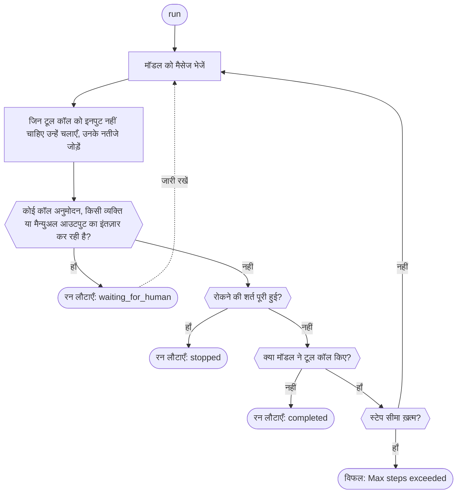

एक टूल परिभाषित करें, एक एजेंट बनाएँ, और उसे gateway क्लाइंट के साथ चलाएँ। मॉडल आपके टूल को कॉल करता है, SDK उसे चलाकर नतीजा वापस भेजता है, और रन तब लौटता है जब मॉडल कोई टूल कॉल किए बिना जवाब देता है, किसी व्यक्ति के लिए रुकता है, या कोई [रोकने की शर्त](./stop-conditions) मेल खाती है। अगर रन पहले अपनी स्टेप सीमा तक पहुँच जाता है, तो SDK एरर थ्रो करता है; सिर्फ़ Rust रन को `stopped` स्टेटस के साथ लौटाता है। Phaseo एजेंट को होस्ट नहीं करता और न ही उसके रन संग्रहीत करता है; यह आपका ऐप्लिकेशन करता है।

## पहला एजेंट बनाएँ

<CodeGroup>

```typescript TypeScript
import {
  createAgent,
  createGatewayAgentClient,
  defineTool,
} from "@phaseo/agent-sdk";

const lookupDocs = defineTool({
  id: "lookup-docs",
  description: "Look up an internal docs page by slug.",
  parameters: {
    type: "object",
    properties: {
      slug: { type: "string" },
    },
    required: ["slug"],
    additionalProperties: false,
  },
  async execute(input: { slug: string }) {
    return {
      slug: input.slug,
      url: `https://phaseo.app/docs/v1/${input.slug}`,
    };
  },
});

const agent = createAgent({
  id: "support-docs-agent",
  model: "openai/gpt-6-astra",
  instructions: "Use tools when helpful and finish with a concise answer.",
  tools: [lookupDocs],
});

const result = await agent.run({
  input: "Find the docs page for presets and explain when to use them.",
  client: createGatewayAgentClient({
    clientOptions: {
      apiKey: process.env.PHASEO_API_KEY!,
    },
  }),
});

console.log(result.output);
```

```python Python
import os
from phaseo_agent import AgentTool, create_agent, create_gateway_agent_client, define_tool

lookup_docs = define_tool(AgentTool(
    id="lookup-docs",
    description="Look up an internal docs page by slug.",
    parameters={
        "type": "object",
        "properties": {"slug": {"type": "string"}},
        "required": ["slug"],
        "additionalProperties": False,
    },
    execute=lambda tool_input, runtime: {
        "slug": tool_input["slug"],
        "url": f"https://phaseo.app/docs/v1/{tool_input['slug']}",
    },
))

agent = create_agent({
    "id": "support-docs-agent",
    "model": "openai/gpt-6-astra",
    "instructions": "Use tools when helpful and finish with a concise answer.",
    "tools": [lookup_docs],
})

result = agent.run(
    input="Find the docs page for presets and explain when to use them.",
    client=create_gateway_agent_client(client_options={"api_key": os.environ["PHASEO_API_KEY"]}),
)

print(result.output)
```

```go Go
package main

import (
  "context"
  "fmt"

  phaseoagent "github.com/phaseoteam/Phaseo/packages/sdk/agent-sdk-go"
)

func main() {
  client, err := phaseoagent.CreateGatewayAgentClient(phaseoagent.GatewayAgentClientOptions{})
  if err != nil {
    panic(err) // PHASEO_API_KEY ज़रूरी है
  }

  lookup := phaseoagent.DefineTool(phaseoagent.Tool{
    ID:          "lookup_docs",
    Description: "Look up a Phaseo documentation topic",
    Parameters: map[string]any{
      "type":       "object",
      "properties": map[string]any{"topic": map[string]any{"type": "string"}},
      "required":   []string{"topic"},
    },
    Execute: func(input any, runtime phaseoagent.RuntimeContext) (any, error) {
      args, _ := input.(map[string]any)
      return map[string]any{"topic": args["topic"], "found": true}, nil
    },
  })

  agent := phaseoagent.CreateAgent(phaseoagent.AgentDefinition{
    ID:           "docs-agent",
    Model:        "openai/gpt-6-astra",
    Instructions: "Use tools when helpful and finish with a concise answer.",
    Tools:        []phaseoagent.Tool{lookup},
    MaxSteps:     6,
  })

  result, err := agent.Run(context.Background(), phaseoagent.RunOptions{
    Input:  "Explain when to use routing presets.",
    Client: client,
  })
  if err != nil {
    panic(err)
  }

  fmt.Println(result.Output)
  fmt.Println(result.Run.Status, result.Usage.TotalTokens)
}
```

```csharp C#
using System.Text.Json;
using PhaseoAgentSdk;

var lookup = AgentSdk.DefineTool(new Tool(
    "lookup_docs",
    async (input, runtime) =>
    {
        var topic = ((JsonElement)input!).GetProperty("topic").GetString();
        return new { topic, found = true };
    },
    "Look up a Phaseo documentation topic",
    new Dictionary<string, object?>
    {
        ["type"] = "object",
        ["properties"] = new Dictionary<string, object?> { ["topic"] = new { type = "string" } },
        ["required"] = new[] { "topic" },
    }));

var agent = AgentSdk.CreateAgent(new AgentDefinition
{
    Id = "docs-agent",
    Model = "openai/gpt-6-astra",
    Instructions = "Use tools when helpful and finish with a concise answer.",
    Tools = new[] { lookup },
    MaxSteps = 6,
});

var result = await agent.Run(new RunOptions
{
    Input = "Explain when to use routing presets.",
    Client = AgentSdk.CreateGatewayAgentClient(), // PHASEO_API_KEY न होने पर exception फेंकता है
});

Console.WriteLine(result.Output);
Console.WriteLine($"{result.Run.Status} {result.Usage.TotalTokens}");
```

```php PHP
<?php
require "vendor/autoload.php";

use Phaseo\AgentSdk\AgentDefinition;
use Phaseo\AgentSdk\AgentSdk;
use Phaseo\AgentSdk\Tool;

$lookup = AgentSdk::defineTool(new Tool(
    id: "lookup_docs",
    execute: fn (array $input, $runtime) => ["topic" => $input["topic"], "found" => true],
    description: "Look up a Phaseo documentation topic",
    parameters: [
        "type" => "object",
        "properties" => ["topic" => ["type" => "string"]],
        "required" => ["topic"],
    ],
));

$agent = AgentSdk::createAgent(new AgentDefinition(
    id: "docs-agent",
    model: "openai/gpt-6-astra",
    instructions: "Use tools when helpful and finish with a concise answer.",
    tools: [$lookup],
    maxSteps: 6,
));

$result = $agent->run(
    input: "Explain when to use routing presets.",
    client: AgentSdk::createGatewayAgentClient() // PHASEO_API_KEY न होने पर exception फेंकता है
);

echo $result->output . PHP_EOL;
echo $result->run->status . " " . $result->usage["total_tokens"] . PHP_EOL;
```

```ruby Ruby
require "phaseo_agent_sdk"

lookup = PhaseoAgentSdk.define_tool(
  PhaseoAgentSdk::Tool.new(
    id: "lookup_docs",
    description: "Look up a Phaseo documentation topic",
    parameters: {
      type: "object",
      properties: { topic: { type: "string" } },
      required: ["topic"]
    },
    execute: ->(input, runtime) { { topic: input["topic"], found: true } }
  )
)

agent = PhaseoAgentSdk.create_agent(
  id: "docs-agent",
  model: "openai/gpt-6-astra",
  instructions: "Use tools when helpful and finish with a concise answer.",
  tools: [lookup],
  max_steps: 6
)

result = agent.run(
  input: "Explain when to use routing presets.",
  client: PhaseoAgentSdk.create_gateway_agent_client # PHASEO_API_KEY न होने पर raise करता है
)

puts result.output
puts "#{result.run.status} #{result.usage[:total_tokens]}"
```

```java Java
import app.phaseo.agent.AgentSdk;
import java.time.Duration;
import java.util.List;
import java.util.Map;

var lookup = AgentSdk.defineTool(new AgentSdk.Tool(
    "lookup_docs",
    (input, context) -> Map.of("topic", ((Map<?, ?>) input).get("topic"), "found", true),
    "Look up a Phaseo documentation topic",
    Map.of(
        "type", "object",
        "properties", Map.of("topic", Map.of("type", "string")),
        "required", List.of("topic")),
    Duration.ofSeconds(10)
));

var agent = AgentSdk.createAgent(new AgentSdk.AgentDefinition(
    "docs-agent",                       // id
    "openai/gpt-6-astra",               // model
    null,                               // preset
    "Use tools when helpful and finish with a concise answer.", // instructions
    List.of(lookup),                    // tools
    6,                                  // maxSteps
    null, null, null, null              // parseOutput, humanReview, modelRetry, toolExecution
));

var result = agent.run(new AgentSdk.RunOptions(
    "Explain when to use routing presets.",  // input
    AgentSdk.createGatewayAgentClient(),     // PHASEO_API_KEY न होने पर exception फेंकता है
    null, null, null, null, null, null, null, null
));

System.out.println(result.output());
System.out.println(result.run().status() + " " + result.usage().totalTokens());
```

```rust Rust
use phaseo_agent::{
    create_agent, create_gateway_agent_client, define_tool, AgentDefinition,
    RunOptions, Tool,
};
use serde_json::json;

fn main() -> Result<(), Box<dyn std::error::Error>> {
    let lookup = define_tool(Tool::new(
        "lookup_docs",
        "Look up a Phaseo documentation topic",
        json!({
            "type": "object",
            "properties": {
                "topic": { "type": "string" }
            },
            "required": ["topic"]
        }),
        |input, context| {
            Ok(json!({
                "topic": input["topic"],
                "run_id": context.run_id,
                "found": true
            }))
        },
    ));

    let agent = create_agent(
        AgentDefinition::new("docs-agent", "openai/gpt-6-astra")
            .instructions("Use lookup_docs when helpful. Answer concisely.")
            .max_steps(6)
            .tool(lookup),
    );

    let mut client = create_gateway_agent_client("openai/gpt-6-astra")?;
    let result = agent.run(
        &mut client,
        RunOptions::new("Explain when to use routing presets."),
    )?;

    println!("{}", result.output);
    println!("steps: {}", result.run.step_count);
    println!("tokens: {}", result.usage.total_tokens);
    Ok(())
}
```

</CodeGroup>

टूल का ID वह function नाम है जो मॉडल देखता है, और उसके पैरामीटर वह JSON Schema हैं जिसे मॉडल भरता है। Arguments आपके कोड तक हर भाषा के अपने आकार में पहुँचते हैं:

| भाषा | टूल को क्या मिलता है | नोट्स |
| --- | --- | --- |
| TypeScript | टाइप किया गया object | `execute(input, context)` |
| Python | `dict` | `execute(tool_input, runtime)` |
| Go | `any` (decode किया गया JSON, आमतौर पर `map[string]any`) | `Execute(input, runtime) (any, error)` |
| C# | `JsonElement` | `Execute(input, runtime)`, await किया जाता है |
| PHP | Associative array | `execute(array $input, $runtime)` |
| Ruby | String keys वाला Hash | टूल `PhaseoAgentSdk::Tool.new` से बनाएँ; `define_tool` वही लौटाता है जो आप उसे देते हैं, इसलिए सादा Hash काम नहीं करेगा |
| Java | `Map` | Records positional हैं; जो कुछ आप सेट नहीं करते उसके लिए `null` दें |
| Rust | `serde_json::Value` | Closure स्थानीय रूप से चलता है; `RuntimeContext` में रन ID, एजेंट ID, स्टेप इंडेक्स, ऐप्लिकेशन संदर्भ और टूल कॉल होते हैं |

अगर एजेंट, रन और क्लाइंट कोई मॉडल या प्रीसेट सेट नहीं करते, तो gateway क्लाइंट `phaseo/free` भेजता है। Rust का `create_gateway_agent_client` मॉडल को argument के रूप में लेता है।

## रन कैसे काम करता है



हर स्टेप का चेकपॉइंट लौटाए गए रन नतीजे में बनता है। अनुरोधों या restarts के पार फिर से शुरू करने के लिए, वह नतीजा अपने स्टोर में सहेजें और उसे continue method को दें, या एजेंट को एक state accessor दें; [स्टेट और अनुमोदन](./state-and-approval) देखें। स्टेप सीमा और उसके ख़त्म होने पर क्या होता है, यह भाषा के अनुसार अलग है:

<Tabs>
<Tab title="TypeScript">

हर `run()` या `continueRun()` कॉल अधिकतम 12 स्टेप लेती है, जब तक आप `maxSteps` सेट न करें; उसके बाद यह `Max steps exceeded` फेंकती है। रन को साफ़ तरीके से ख़त्म करने के लिए [रोकने की शर्तों](./stop-conditions) का उपयोग करें।

</Tab>
<Tab title="Python">

रन अधिकतम 12 स्टेप लेता है, जब तक आप `max_steps` सेट न करें; उसके बाद यह `RuntimeError` raise करता है। रोकने की शर्तें सिर्फ़ उस स्टेप पर जाँची जाती हैं जिसमें मॉडल कोई टूल कॉल नहीं करता, इसलिए क्रम डायग्राम से अलग है: टूल लूप तब तक चलता है जब तक वह रुक न जाए, जवाब न दे दे, या `max_steps` ख़त्म न कर दे।

</Tab>
<Tab title="Go">

जिस रन को `MaxSteps` (डिफ़ॉल्ट 8) से ज़्यादा मॉडल टर्न चाहिए, वह `Max steps exceeded (N)` के साथ विफल होता है।

</Tab>
<Tab title="C#">

जिस रन को `MaxSteps` (डिफ़ॉल्ट 12) से ज़्यादा मॉडल टर्न चाहिए, वह `InvalidOperationException("Max steps exceeded (N)")` फेंकता है।

</Tab>
<Tab title="PHP">

जिस रन को `maxSteps` (डिफ़ॉल्ट 12) से ज़्यादा मॉडल टर्न चाहिए, वह `Max steps exceeded (N)` फेंकता है।

</Tab>
<Tab title="Ruby">

जिस रन को `max_steps` (डिफ़ॉल्ट 12) से ज़्यादा मॉडल टर्न चाहिए, वह `Max steps exceeded (N)` raise करता है।

</Tab>
<Tab title="Java">

जिस रन को `maxSteps` (डिफ़ॉल्ट 12) से ज़्यादा मॉडल टर्न चाहिए, वह `Max steps exceeded (N)` फेंकता है।

</Tab>
<Tab title="Rust">

रन अधिकतम 8 मॉडल टर्न लेता है, जब तक आप `.max_steps(n)` कॉल न करें या `RunOptions.max_steps` सेट न करें। सीमा तक पहुँचना विफलता नहीं है: रन `run.status` `stopped` और `run.stop_reason` `max_steps:<limit>` के साथ लौटता है। रन synchronous होते हैं और स्थानीय टूल एक-एक करके चलते हैं, इसलिए जब किसी रन को अनुरोध handler को ब्लॉक नहीं करना चाहिए, तो वर्कर थ्रेड या task boundary का उपयोग करें।

</Tab>
</Tabs>

## रन नतीजा पढ़ें

हर रन वही हिस्से लौटाता है। फ़ील्ड के नाम हर भाषा की casing का पालन करते हैं (`output`, `Output`, `output()`):

| हिस्सा | सामग्री |
| --- | --- |
| `run` | स्टेटस, IDs, प्रभावी मॉडल, स्टेप सीमा, संदर्भ, pause स्टेट और रोकने का कारण |
| `steps` | हर मॉडल टर्न के लिए एक रिकॉर्ड: अनुरोध ID, प्रदाता, मॉडल, समाप्ति का कारण, चेतावनियाँ, टूल कॉल और उपयोग |
| `messages` | टूल नतीजों सहित पूरी बातचीत |
| `output` | अंतिम आउटपुट |
| `usage` | इनपुट, आउटपुट, cached और कुल टोकन, और लागत |

Rust का `usage.cost` सिर्फ़ प्रतिक्रिया पर संख्यात्मक `meta.cost` या `cost` से आता है; यह `cost_nanos` या `cost_cents` को map नहीं करता। Rust में ख़र्च की रिपोर्टिंग के लिए Gateway प्रतिक्रिया या generation रिकॉर्ड का उपयोग करें।

## सही सुविधा खोजें

| इसके लिए… | पेज |
| --- | --- |
| मॉडल को स्थानीय, मैन्युअल या प्रगति बताने वाले टूल दें | [टूल](./tools) |
| अनुमोदन या किसी व्यक्ति के लिए रोकें, फिर फिर से शुरू करें | [स्टेट और अनुमोदन](./state-and-approval) |
| टेक्स्ट और टूल गतिविधि होते ही दिखाएँ | [स्ट्रीमिंग](./streaming) |
| मैसेज, reasoning और टूल कॉल की टाइमलाइन रेंडर करें | [आइटम](./items) |
| स्टेप, टोकन, लागत या समय सीमित करें | [रोकने की शर्तें](./stop-conditions) |
| टर्न के बीच मॉडल या टूल बदलें | [गतिशील टर्न](./dynamic-turns) |
| टाइप किया गया आउटपुट पाएँ, मॉडल कॉल दोबारा आज़माएँ, प्रीसेट का उपयोग करें | [आउटपुट और retries](./run-controls) |
| हर स्टेप को लॉग या ऑडिट करें | [लाइफ़साइकल हुक](./lifecycle-hooks) |
| किसी रन का उपयोग, लागत और अनुरोध IDs रिकॉर्ड करें | [ऑब्ज़र्वेबिलिटी](./observability) |
| Gateway, schema और स्टेप-सीमा त्रुटियाँ संभालें | [इवेंट और त्रुटियाँ](./events-and-errors) |
| रन को स्थानीय रूप से जाँचें | [DevTools](./devtools) |

हर export [API संदर्भ](./api-reference) में सूचीबद्ध है, और पूरे एजेंट [उदाहरण](./examples) में हैं।
