import { ChangelogFilters } from "/snippets/changelog-filters.jsx";

<ChangelogFilters labels={{"product":"製品","api":"API と SDK","models":"モデル"}} clearLabel="クリア" />

<Update label="2026年3月31日">

モデル

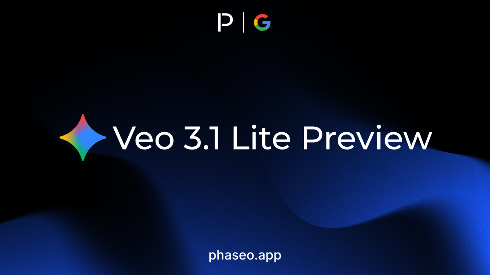

- [Google: Veo 3.1 Lite Preview](https://phaseo.app/models/google/veo-3.1-lite-preview)

</Update>

<Update label="2026年3月23日">

製品

- チャットルームで、テキストモデルに加えて音声、モデレーション、埋め込みのモデルを実行できるようになりました ([#201](https://github.com/phaseoteam/Phaseo/pull/201), [#157](https://github.com/phaseoteam/Phaseo/pull/157))。
- 実験的なプロジェクトのための新しい場である Foundry が、1 つのプロンプトを複数のモデルに送り、回答を 1 つにまとめる LLM Council とともに公開されました ([#201](https://github.com/phaseoteam/Phaseo/pull/201))。

API と SDK

- TypeScript と Python の SDK に加えて、Go、C#、Java、PHP、Ruby の SDK が利用可能になりました。いずれもバージョン `1.1.0` です ([#203](https://github.com/phaseoteam/Phaseo/pull/203), [#201](https://github.com/phaseoteam/Phaseo/pull/201))。
- SDK `1.1.0` は、リクエストで非推奨または提供終了のモデルを指定すると警告を出し、モデルの型とルートのパスが API と一致するようになりました ([#201](https://github.com/phaseoteam/Phaseo/pull/201), [#203](https://github.com/phaseoteam/Phaseo/pull/203))。

モデル

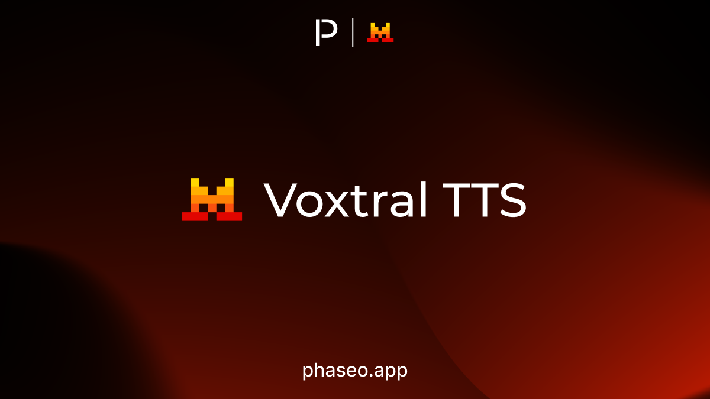

- [Mistral: Voxtral TTS](https://phaseo.app/models/mistral/voxtral-tts)

</Update>

<Update label="2026年3月22日">

製品

- 新しい **Redeem** ページ（**Settings -> Credits** からリンク）で、プロモーションコードをクレジットに引き換えられます。請求書払いのチームは引き換えできません ([#188](https://github.com/phaseoteam/Phaseo/pull/188))。
- アカウント設定の任意のステップでエラーが起きても、サインアップが失敗しなくなりました ([#187](https://github.com/phaseoteam/Phaseo/pull/187))。

</Update>

<Update label="2026年3月19日">

モデル

- [Xiaomi: MiMo V2 Omni](https://phaseo.app/models/xiaomi/mimo-v2-omni)
- [Xiaomi: MiMo V2 Pro](https://phaseo.app/models/xiaomi/mimo-v2-pro)
- [Xiaomi: MiMo V2 TTS](https://phaseo.app/models/xiaomi/mimo-v2-tts)

</Update>

<Update label="2026年3月18日">

製品

- Chat では、アシスタントの各メッセージの上にモデル ID ではなくモデル名が表示され、その名前からモデルのページに移動できます ([#179](https://github.com/phaseoteam/Phaseo/pull/179))。
- スマートフォンでは、ヘッダーのメニューが 1 つにまとまり、ナビゲーション、設定・クレジット・キーなどのアカウントリンク、ライト・ダーク・システムのテーマ切り替えが入りました ([#180](https://github.com/phaseoteam/Phaseo/pull/180), [#183](https://github.com/phaseoteam/Phaseo/pull/183), [#181](https://github.com/phaseoteam/Phaseo/pull/181))。

モデル

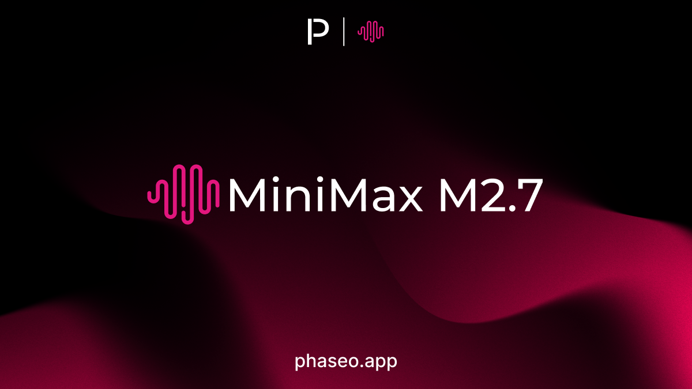

- [MiniMax: MiniMax M2.7](https://phaseo.app/models/minimax/minimax-m2.7)
- [Xiaomi: MiMo V2 Omni](https://phaseo.app/models/xiaomi/mimo-v2-omni)
- [Xiaomi: MiMo V2 Pro](https://phaseo.app/models/xiaomi/mimo-v2-pro)
- [Xiaomi: MiMo V2 TTS](https://phaseo.app/models/xiaomi/mimo-v2-tts)

</Update>

<Update label="2026年3月17日">

モデル

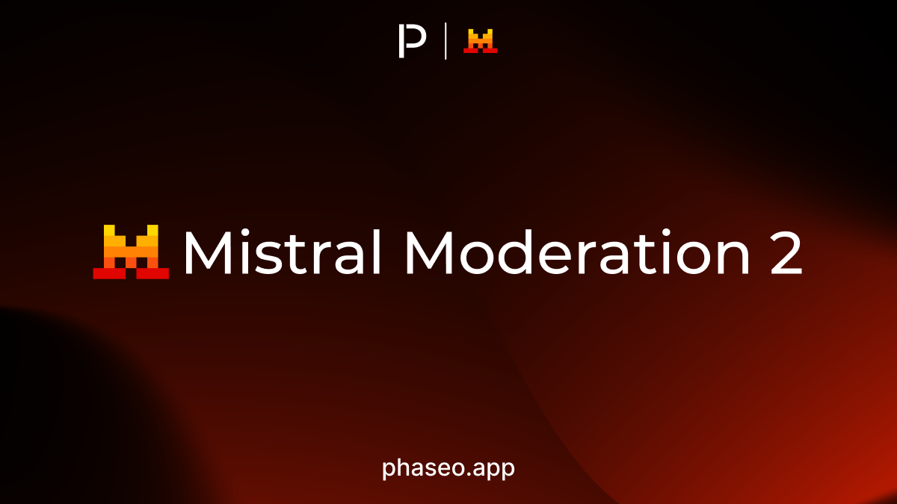

- [Mistral: Mistral Moderation 2](https://phaseo.app/models/mistral/mistral-moderation-2)
- [OpenAI: GPT 5.4 Mini](https://phaseo.app/models/openai/gpt-5.4-mini)
- [OpenAI: GPT 5.4 Nano](https://phaseo.app/models/openai/gpt-5.4-nano)

</Update>

<Update label="2026年3月16日">

製品

- モデルページのゲートウェイのクイックスタートには、選択したエンドポイントと有効なプロバイダーが受け付けるモデル ID だけが表示されます ([#157](https://github.com/phaseoteam/Phaseo/pull/157))。

モデル

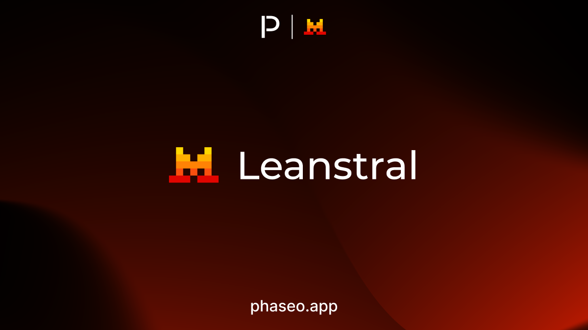

- [Mistral: Leanstral](https://phaseo.app/models/mistral/leanstral)
- [Mistral: Mistral Small 4](https://phaseo.app/models/mistral/mistral-small-4)

</Update>

<Update label="2026年3月15日">

モデル

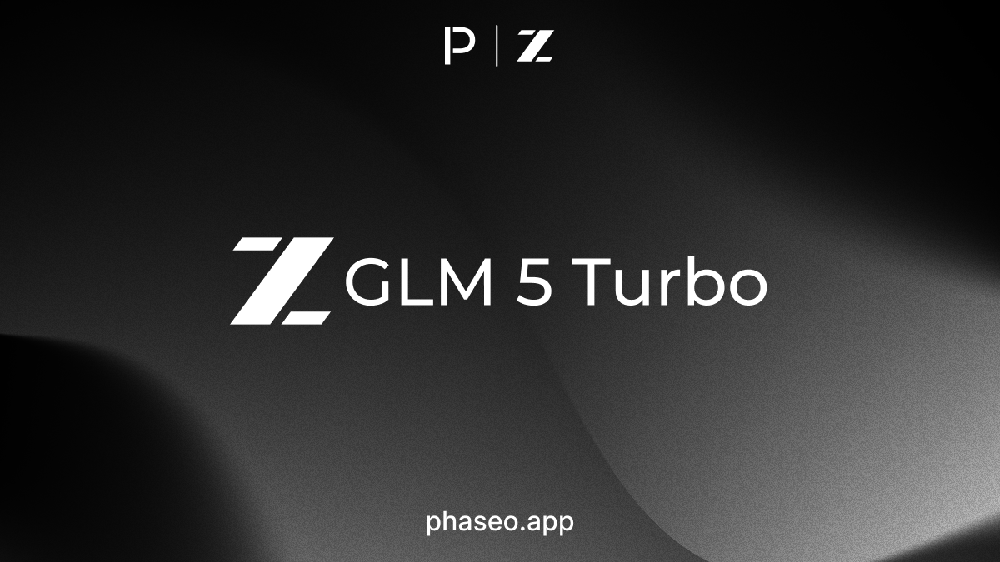

- [z.AI: GLM 5 Turbo](https://phaseo.app/models/z-ai/glm-5-turbo)

</Update>

<Update label="2026年3月12日">

モデル

- [Nvidia: Nemotron 3 Super](https://phaseo.app/models/nvidia/nemotron-3-super-120b-a12b)

</Update>

<Update label="2026年3月11日">

製品

- **Settings -> Provisioning Keys** は **Settings -> Management API Keys** になり、以前のアドレスは新しいページにリダイレクトされます ([#153](https://github.com/phaseoteam/Phaseo/pull/153))。
- ヘッダーの検索でモデル名の一致が優先されるようになり、`Grok 4.20` と検索すると Grok 4.20 が先頭に表示されます ([#156](https://github.com/phaseoteam/Phaseo/pull/156))。
- 新しいガイド [SpaceXAI Grok 4.20](../model-migrations/xai-grok-4-20.mdx) では、Grok 4.20 を導入する際の推論とマルチエージェントのエフォート設定を説明しています ([#155](https://github.com/phaseoteam/Phaseo/pull/155))。

API と SDK

- **破壊的変更:** `/v1/provisioning/keys` のエイリアスは削除されました。代わりに `/v1/management/keys` を呼び出してください。詳しくは[管理 API キー](../developers/management-api-keys.mdx)をご覧ください ([#153](https://github.com/phaseoteam/Phaseo/pull/153))。

モデル

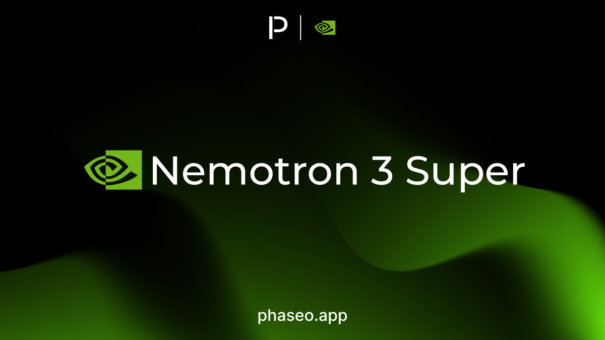

- [Nvidia: Nemotron 3 Super](https://phaseo.app/models/nvidia/nemotron-3-super-120b-a12b)

</Update>

<Update label="2026年3月10日">

モデル

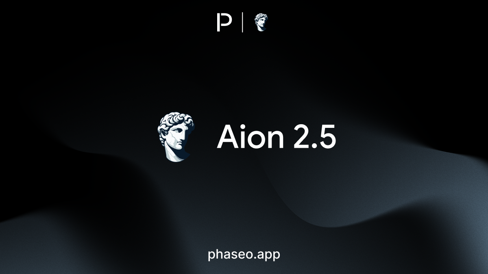

- [Aion Labs: Aion 2.5](https://phaseo.app/models/aion-labs/aion-2.5)
- [Google: Gemini Embedding 2 Preview](https://phaseo.app/models/google/gemini-embedding-2-preview)
- Alibaba Cloud がゲートウェイのリクエストを処理するプロバイダーに加わりました。

</Update>

<Update label="2026年3月6日">

製品

- モデルの料金表では、プロバイダーが無効にした batch などの機能を非表示にせず、**Not Active** と表示します ([#141](https://github.com/phaseoteam/Phaseo/pull/141))。

API と SDK

- リクエストで `service_tier` に `standard` または `priority` を再び指定できるようになりました。詳しくは[サービス階層](../guides/service-tiers.mdx)をご覧ください ([#141](https://github.com/phaseoteam/Phaseo/pull/141))。
- エイリアス `openai/gpt-latest` が `openai/gpt-5.4` を指すようになりました ([#140](https://github.com/phaseoteam/Phaseo/pull/140))。

</Update>

<Update label="2026年3月5日">

モデル

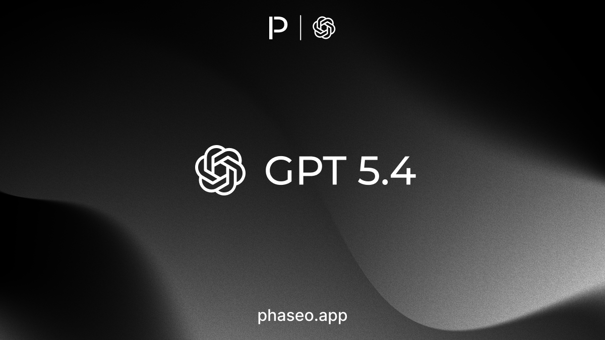

- [OpenAI: GPT 5.4](https://phaseo.app/models/openai/gpt-5.4)
- [OpenAI: GPT 5.4 Pro](https://phaseo.app/models/openai/gpt-5.4-pro)

</Update>

<Update label="2026年3月3日">

API と SDK

- エイリアス `openai/gpt-chat-latest` が `openai/gpt-5.3-chat` を指すようになりました ([#138](https://github.com/phaseoteam/Phaseo/pull/138))。

モデル

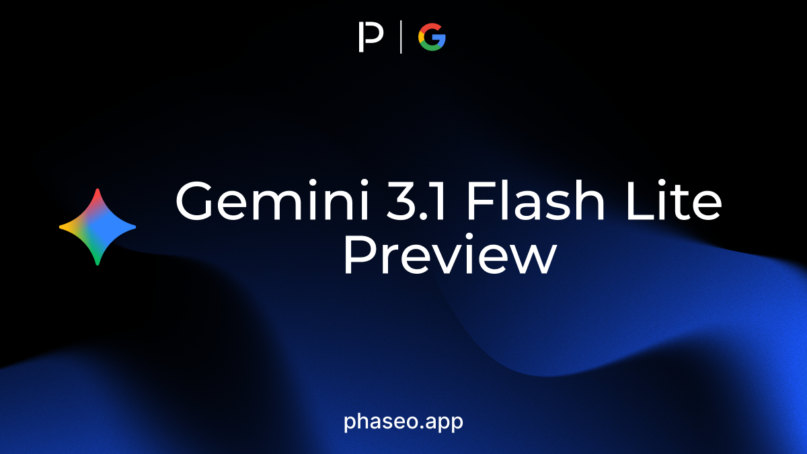

- [Google: Gemini 3.1 Flash Lite Preview](https://phaseo.app/models/google/gemini-3.1-flash-lite-preview)
- [OpenAI: GPT 5.3 Chat](https://phaseo.app/models/openai/gpt-5.3-chat)

</Update>

<Update label="2026年3月2日">

API と SDK

- Responses API は、アシスタントメッセージの `phase`（`commentary` または `final_answer`）を受け付けて返すため、複数ターンのリクエストでそのまま送り返せます。詳しくは[応答を作成](../api-reference/endpoint/responses.mdx)をご覧ください ([#130](https://github.com/phaseoteam/Phaseo/pull/130))。
- OpenAI モデルへの Responses リクエストで、`type: "compaction"` と任意の `compact_threshold` を指定した `provider_options.openai.context_management` を使えます。詳しくは[パラメーター](../api-reference/parameters.mdx)をご覧ください ([#130](https://github.com/phaseoteam/Phaseo/pull/130))。
- `safety_identifier` を省略した OpenAI へのリクエストでは、`user` または `user_id`、どちらもなければリクエスト ID から値を設定して送信します ([#130](https://github.com/phaseoteam/Phaseo/pull/130))。

モデル

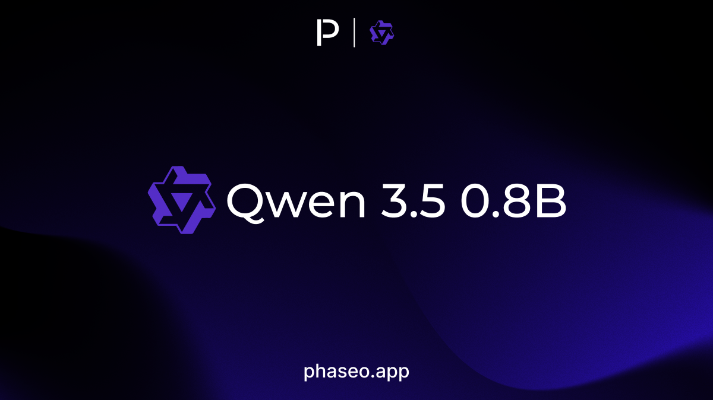

- [Qwen: Qwen 3.5 0.8B](https://phaseo.app/models/qwen/qwen3.5-0.8b)
- [Qwen: Qwen 3.5 2B](https://phaseo.app/models/qwen/qwen3.5-2b)
- [Qwen: Qwen 3.5 4B](https://phaseo.app/models/qwen/qwen3.5-4b)
- [Qwen: Qwen 3.5 9B](https://phaseo.app/models/qwen/qwen3.5-9b)

</Update>
