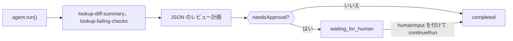

ローカルツールでプルリクエストを調べ、厳密な JSON のレビュー計画を返し、計画が承認を必要とする場合は人の判断を待って一時停止する TypeScript エージェントを作成します。完成すると、検証済みの `CodeReviewPlan` を出力し、誰かが承認するまで `waiting_for_human` で停止するスクリプトが 1 つできます。

ツールは固定のサンプルデータを返すため、このスクリプトは例示用です。実際にはコードホスティングサービスや CI への呼び出しに置き換えてください。パッケージ化した版は `packages/sdk/agent-sdk-ts/examples/coding-review-agent.ts` にあります。



## 作成する

<Steps>
<Step title="インストールする">

```bash
npm install @phaseo/agent-sdk zod
export PHASEO_API_KEY="phaseo_v1_sk_..."
```

</Step>
<Step title="エージェントを書く">

```ts review-agent.ts
import { z } from "zod";
import { createAgent, createGatewayAgentClient, defineTool } from "@phaseo/agent-sdk";

const CodeReviewPlan = z
  .object({
    risk: z.enum(["low", "medium", "high"]),
    summary: z.string().min(1),
    recommendedActions: z.array(z.string()).min(1),
    needsApproval: z.boolean(),
  })
  .strict();
type CodeReviewPlan = z.infer<typeof CodeReviewPlan>;

const PullRequestInput = z.object({ pullRequestId: z.string().regex(/^pr_\d+$/) }).strict();
const pullRequestParameters = {
  type: "object",
  properties: { pullRequestId: { type: "string", pattern: "^pr_\\d+$" } },
  required: ["pullRequestId"],
  additionalProperties: false,
};

// 読み取り専用で決定的なツール：worker が実行を再開しても安全に再実行できます。
const lookupDiffSummary = defineTool({
  id: "lookup-diff-summary",
  description: "Return a short summary of the changed files in one pull request.",
  parameters: pullRequestParameters,
  inputSchema: PullRequestInput,
  async execute({ pullRequestId }) {
    return {
      pullRequestId,
      files: ["apps/api/src/pipeline/before/index.ts"],
      summary: "Changes touch request validation.",
    };
  },
});

const lookupFailingChecks = defineTool({
  id: "lookup-failing-checks",
  description: "Return the failing CI checks for one pull request.",
  parameters: pullRequestParameters,
  inputSchema: PullRequestInput,
  async execute({ pullRequestId }) {
    return { pullRequestId, failingChecks: ["web-typecheck"] };
  },
});

const codingReviewAgent = createAgent<string, CodeReviewPlan>({
  id: "coding-review-agent",
  model: "openai/gpt-6-astra",
  instructions:
    "Use the available tools to inspect the coding task, then return a strict JSON review plan.",
  tools: [lookupDiffSummary, lookupFailingChecks],
  maxSteps: 6,
  parseOutput: (text) => JSON.parse(text),
  outputSchema: CodeReviewPlan,
  humanReview: ({ parsedOutput }) =>
    parsedOutput?.needsApproval
      ? { reason: "coding_review_approval_required", payload: parsedOutput }
      : null,
});

// Gateway にこの JSON の形をそのまま要求し、ほぼ正しい JSON を修復します。
const client = createGatewayAgentClient({
  clientOptions: { apiKey: process.env.PHASEO_API_KEY! },
  responseFormat: {
    type: "json_schema",
    name: "code_review_plan",
    schema: {
      type: "object",
      properties: {
        risk: { type: "string", enum: ["low", "medium", "high"] },
        summary: { type: "string" },
        recommendedActions: { type: "array", items: { type: "string" }, minItems: 1 },
        needsApproval: { type: "boolean" },
      },
      required: ["risk", "summary", "recommendedActions", "needsApproval"],
      additionalProperties: false,
    },
  },
  plugins: [{ id: "response-healing", mode: "strict" }],
});

const result = await codingReviewAgent.run({
  input: "Review pull request pr_482 and produce a remediation plan.",
  client,
  onEvent(event) {
    console.log(event.type, event.runId);
  },
});

if (result.run.status === "waiting_for_human") {
  console.log("Needs approval:", result.run.pause?.payload);

  // 実際のアプリでは `result` を保存し、レビュー担当者が承認したら続行します。
  if (process.env.APPROVE === "yes") {
    const continued = await codingReviewAgent.continueRun({
      run: result,
      client,
      humanInput: "Approved. Finalize the plan.",
    });
    console.log(continued.output);
  }
} else {
  console.log(result.output);
}
```

`responseFormat` によって Gateway はこのスキーマでリクエストし、`outputSchema` はパースした結果をプロセス内で再度確認します。strict モードの[レスポンス修復](./response-healing-for-structured-json)は、すでに有効な JSON の包みを外すだけです。

</Step>
<Step title="実行する">

```bash
npx tsx review-agent.ts
APPROVE=yes npx tsx review-agent.ts
```

</Step>
</Steps>

## 動作を確認する

- イベントログに、両方のツールの `tool.started` と `tool.completed` が表示され、ツールのステップの後に `checkpoint.saved` が表示されます。
- `needsApproval: true` の計画では、最初の実行が `waiting_for_human` で終わり、計画は `result.run.pause.payload` に入ります。`APPROVE=yes` を付けると `completed` まで続行します。
- **設定 → 利用状況 → ログ** では、各モデルターンにツール呼び出しが表示され、リクエストのプラグイン記録で修復が実行されたかどうかがわかります。
- スキーマに違反する計画は、不正なデータを返す代わりに `AgentSchemaValidationError` で実行を失敗させます。

## 実際のリポジトリで安全に使う

レビュー用のツールは読み取り専用にしてください。コメント、プッシュ、マージを行うツールを追加する場合は、そのツールに `requireApproval: true` を設定して実行前に一時停止させ、`continueRun({ run, client, approvals: [toolCallId] })` で承認します。diff の内容は信頼できない入力として扱ってください。コードコメントにモデルを狙った指示が含まれている場合があります。レビューの待機中に再起動しても状態を保てるように、[永続化可能なループ](./agent-sdk-durable-loop)のように `state` アクセサーで実行を保存してください。承認と却下については[状態と承認](../sdk-reference/agent/state-and-approval)で説明しています。
