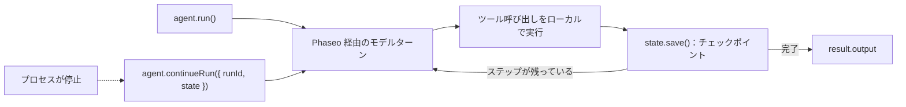

TypeScript Agent SDK でツールを使うエージェントを実行し、各ステップの後に状態を保存します。こうすると、クラッシュや再起動をしたプロセスが止まったところから再開できます。完成すると、検索ツールでドキュメントに関する質問に答え、各実行を `.agent-runs/<run id>.json` に書き込み、ID を渡すとその実行を再開するスクリプトが 1 つできます。

このスクリプトは例示用で、ファイルストアは 1 台のマシン向けです。本番環境では同じ `load`/`save` の組を残し、保存先をデータベースにしてください。Phaseo は Agent SDK の実行を保存しません。



## 作成する

<Steps>
<Step title="インストールする">

<CodeGroup>
```bash npm
npm install @phaseo/agent-sdk zod
```

```bash pnpm
pnpm add @phaseo/agent-sdk zod
```

```bash yarn
yarn add @phaseo/agent-sdk zod
```

```bash bun
bun add @phaseo/agent-sdk zod
```
</CodeGroup>

`@phaseo/agent-sdk` をインストールすると `@phaseo/sdk` も一緒にインストールされます。キーを設定します。

```bash
export PHASEO_API_KEY="phaseo_v1_sk_..."
```

</Step>
<Step title="エージェントを書く">

```ts agent.ts
import { mkdir, readFile, writeFile } from "node:fs/promises";
import { z } from "zod";
import {
  createAgent,
  createGatewayAgentClient,
  defineTool,
  type AgentStateAccessor,
} from "@phaseo/agent-sdk";

const DOC_SLUGS = ["guides/presets", "guides/routing-and-fallbacks", "guides/streaming"] as const;

// モデルに見えるのは `parameters` だけです。`inputSchema` は execute の実行前にそれ以外の入力を拒否します。
const lookupDocs = defineTool({
  id: "lookup-docs",
  description: "Return the URL of one Phaseo docs page by slug.",
  parameters: {
    type: "object",
    properties: { slug: { type: "string", enum: [...DOC_SLUGS] } },
    required: ["slug"],
    additionalProperties: false,
  },
  inputSchema: z.object({ slug: z.enum(DOC_SLUGS) }).strict(),
  async execute({ slug }) {
    return { slug, url: `https://phaseo.app/docs/v1/${slug}` };
  },
});

const agent = createAgent<string, string>({
  id: "support-docs-agent",
  model: "openai/gpt-6-astra",
  instructions: "Use tools when helpful and finish with a concise answer that includes the docs URL.",
  tools: [lookupDocs],
  maxSteps: 6,
});

// 各ステップの後に実行全体を保存します。この 2 つの関数をデータベース用に置き換えてください。
const RUNS_DIR = ".agent-runs";
const state: AgentStateAccessor<string, unknown, string> = {
  async load(runId) {
    try {
      return JSON.parse(await readFile(`${RUNS_DIR}/${runId}.json`, "utf8"));
    } catch {
      return null;
    }
  },
  async save(result) {
    await mkdir(RUNS_DIR, { recursive: true });
    await writeFile(`${RUNS_DIR}/${result.run.id}.json`, JSON.stringify(result));
  },
};

const client = createGatewayAgentClient({
  clientOptions: { apiKey: process.env.PHASEO_API_KEY! },
});

const onEvent = (event: { type: string; runId: string }) => {
  if (event.type === "checkpoint.saved") console.log("checkpoint", event.runId);
};

const resumeId = process.argv[2];
let result;

if (resumeId) {
  const saved = await state.load(resumeId);
  if (!saved) throw new Error(`No saved run ${resumeId}`);
  result = saved.run.status === "completed"
    ? saved
    : await agent.continueRun({ run: saved, client, state, onEvent });
} else {
  result = await agent.run({
    input: "Find the docs page for presets and explain when to use them.",
    client,
    state,
    onEvent,
  });
}

console.log(result.run.id, result.run.status);
console.log(result.output);
```

</Step>
<Step title="実行する">

```bash
npx tsx agent.ts
```

再開を試すには、最初の `checkpoint` の行が出た後に `Ctrl+C` でスクリプトを止め、出力された実行 ID（UUID）を渡します。

```bash
npx tsx agent.ts 3f6c1d2e-...
```

</Step>
</Steps>

## 動作を確認する

- スクリプトはステップごとに `checkpoint` を 1 回出力し、続いて実行 ID、`completed`、`phaseo.app/docs` の URL を含む回答を出力します。
- `.agent-runs/<run id>.json` には、実行 ID、ステータス、メッセージ履歴、各ステップのツール呼び出しと結果、最終出力が入ります。
- 中断した実行の後で再開コマンドを実行すると、新しい実行を始めるのではなく、同じ実行 ID の実行が完了します。
- 各モデルターンは **設定 → 利用状況 → ログ** に表示されます。照合できるように、各リクエスト ID の隣に実行 ID をログに記録してください。

## 保存される状態の中身

保存される各結果は `AgentRunResult` 全体です。`run`（ID、ステータス、メッセージ、使用量、一時停止の情報）、Gateway のリクエスト ID とツール呼び出しを持つ `steps`、実行完了後の `output` が含まれます。`continueRun()` はこれをそのまま受け取るか、`runId` と `state` を受け取って自分で `load()` を呼び出します。

プロセスが止まったときに実行中だったツール呼び出しは、すでに効果を及ぼしている場合があるため、ツールは冪等にしてください。SDK は、結果を得られなかった呼び出しの履歴を修復してから続行します。一時停止と承認については[状態と承認](../sdk-reference/agent/state-and-approval)で説明しています。

## 慎重に拡張する

ワークフローごとにエージェントを 1 つにし、ツールの一覧は短く保ち、実行ごとに実行 ID とリクエスト ID を含むログ行を 1 行残してください。承認のための一時停止や、ツールを共有する複数のエージェントが必要になったら、この Gateway クライアントと状態の組を残したまま、その周りに組み立ててください。[コードレビューエージェント](./agent-sdk-coding-review)は承認のための一時停止を追加し、[並列ツール](./agent-sdk-parallel-tools)はツールを並行して実行します。リクエストの既定値を共有するには、固定のモデルの代わりに[プリセット](../guides/presets)を呼び出してください。
