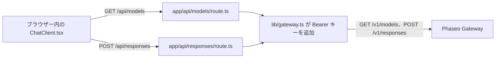

ブラウザーのコードが自分のサーバールートとだけ通信し、Phaseo の API キーがブラウザーに届かない小さな Next.js チャットアプリを実行します。完成すると、`GET /v1/models` から取得したモデル選択欄と、`POST /v1/responses` からの回答を持つローカルのチャットページができます。

このサンプルは例示用です。ルートにはサインインもレート制限もないため、ルートにアクセスできる人は誰でもあなたのキーを使って支出できます。先に[デプロイする前に](#before-you-deploy-it)のチェックを追加してください。

コーディングエージェントに同じアプリを一から作らせるには、次のプロンプトを貼り付けます。

<Prompt
  description="Phaseo Gateway 上に **Next.js のウェブチャットアプリ** を作成します。"
  icon="message-square"
  actions={["copy", "cursor"]}
>
{`You are building a small production-style chat app with Phaseo Gateway.

Create a Next.js app with:
- a chat UI
- a model picker backed by GET https://api.phaseo.app/v1/models
- a server-side route that calls POST https://api.phaseo.app/v1/responses
- server-side API key handling using PHASEO_API_KEY (Authorization: Bearer)
- loading, success, and error states

Keep the app intentionally small and easy to inspect.

Implementation requirements:
- Use one local API route for model discovery.
- Use one local API route for responses generation.
- Keep secrets server-side only.
- Send the whole conversation in input on every turn. The gateway rejects previous_response_id.
- Only accept model IDs from an allowlist on the server, and cap the input length.
- Show the request/response flow clearly in code.
- Add a short README with setup and run steps.

Verification:
- Run the app if possible.
- Verify two successful chat turns in a row.
- Report the exact files changed, what you verified, and any remaining assumptions.`}
</Prompt>

## サンプルの構成



サンプルは [examples/web-chat-nextjs](https://github.com/phaseoteam/Phaseo/tree/main/examples/web-chat-nextjs) にあります。

| ファイル | 役割 |
| --- | --- |
| `app/components/ChatClient.tsx` | 入力、読み込み中とエラーの状態、表示されるメッセージ、モデル選択欄 |
| `app/api/models/route.ts` | `GET /v1/models` から取得したモデル ID を返します |
| `app/api/responses/route.ts` | `model` と `input` が空でない文字列であることを確認し（`400 missing_model`、`400 missing_input`）、`POST /v1/responses` を呼び出します |
| `lib/gateway.ts` | URL とヘッダーを組み立てます：`Authorization: Bearer $PHASEO_API_KEY`、`x-title`、設定されている場合は `http-referer` |

## 実行する

Node.js と Phaseo の API キーが必要です。

<Steps>
<Step title="インストールする">

```bash
cd examples/web-chat-nextjs
npm install
```

サンプルには `package-lock.json` が含まれているため、`npm` はテスト済みのバージョンをインストールします。

</Step>
<Step title=".env.local を作成する">

サンプルには `.env.example` がありません。`.env.local` を自分で作成します。

```bash .env.local
PHASEO_API_KEY=phaseo_v1_sk_...
# 省略可能。デフォルトは https://api.phaseo.app で、/v1 は自動で追加されます。
NEXT_PUBLIC_GATEWAY_URL=https://api.phaseo.app
# 省略可能なアプリのアトリビューションヘッダー。
GATEWAY_APP_TITLE=My chat app
GATEWAY_HTTP_REFERER=https://myapp.example
```

ここでは `NEXT_PUBLIC_GATEWAY_URL` はサーバー側でしか読み取られませんが、`NEXT_PUBLIC_` という接頭辞が付いた変数はブラウザーのコードに公開されるため、キーは絶対に入れないでください。省略可能な 2 つのヘッダーについては[アプリのアトリビューション](../guides/app-attribution)で説明しています。

</Step>
<Step title="2 回目のチャットターンを修正する">

`ChatClient.tsx` は、前の回答の `id` を `previous_response_id` として送信します。Gateway はレスポンスを保存しないため、このフィールドを `400 validation_error`（キーワード `unsupported_param`）で拒否し、2 通目のメッセージは失敗します。`app/api/responses/route.ts` で、`previous_response_id` をペイロードにコピーするブロックを削除します。

```ts app/api/responses/route.ts
  // 次の行を削除します：
  if (typeof body.previous_response_id === 'string' && body.previous_response_id.trim()) {
    payload.previous_response_id = body.previous_response_id.trim();
  }
```

これで各ターンは単独で回答されます。コンテキストを保つには、それまでのターンをメッセージの配列として `input` で送信してください。

</Step>
<Step title="開発サーバーを起動する">

```bash
npm run dev
```

`http://localhost:3000` を開きます。

</Step>
</Steps>

## 動作を確認する

- モデル選択欄にモデル ID が入ります。
- 続けて送った 2 通のメッセージの両方に回答が返ります。
- ブラウザーのネットワークパネルで、リクエストの送信先は `/api/models` と `/api/responses` だけで、`PHASEO_API_KEY` を含むリクエストはありません。
- 不正なモデル ID を指定すると、空の回答ではなく Gateway のエラーメッセージが表示されます。
- リクエストは、設定したアプリのタイトルとともに **設定 → 利用状況 → ログ** に表示されます。

<span id="before-you-deploy-it"></span>
## デプロイする前に

- **ルートを認証する。** `/api/responses` と `/api/models` でサインイン済みのユーザーを必須にするか、[OAuth ワークベンチ](./build-an-oauth-nextjs-workbench)を使って各ユーザーが自分のクレジットを使うようにしてください。
- **モデルを許可リストで制限する。** ルートはブラウザーから届いた任意の `model` 文字列を転送します。サーバー側で固定のリストと照合してください。
- **入力とリクエスト頻度に上限を設ける。** 入力の長さとユーザーごとのリクエスト数を制限し、[キーに支出上限](../api-reference/limits#key-limits-and-budgets)を設定してください。
- **必要ならストリーミングする。** `stream: true` を設定してイベントを転送します。Responses のストリームを終了させるイベントは[ストリーミング](../guides/streaming)で説明しています。

UI ではなくバックエンドのスクリプトが必要な場合は、[Node REST スモークアプリ](./build-a-node-rest-smoke-app)または [Python Gateway CLI](./build-a-python-gateway-cli) から始めてください。
